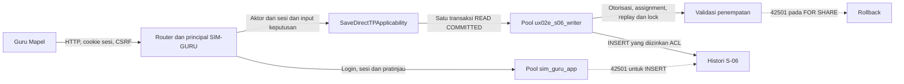

# UX-02E-03A-4 — Keamanan lock TP dan kesiapan harness integrasi SIM-GURU

Inventaris pada 26 November 2026 mencakup 163 tes bertag `integration`, termasuk smoke ACL yang juga memakai tag `ux02e_min_read_acl`. Paket `internal/auth` dan `internal/database` ikut kelompok aplikasi untuk regresi Go. Keduanya tidak memiliki tes bertag `integration`. Pengujian privat E2E sebelumnya merupakan kelompok terpisah.

## Target dan operasi harness

| Kelompok | Database pada cluster UX-02E | Login → role efektif | Operasi |
|---|---|---|---|
| Migration | `sim_guru_ux02e_migrations_test`, OID 16388 | `ux02e_ddl_owner` → owner | Paket `migrations` untuk pemeriksaan skema, idempotensi Goose, dan probe DDL/rollback yang sudah ada. |
| Aplikasi | `sim_guru_ux02e_suite_test`, OID 16389 | `sim_guru_app` → runtime | Paket database, auth, master, academic, web dan testutil. Service/HTTP memakai runtime. |
| Fixture suite | Database suite yang sama | `ux02e_fixture` → `ux02e_ddl_owner` pada startup tiap koneksi | Seed, cleanup yang sah, dan pemeriksaan fixture. |
| Metadata | Kedua target di atas | `ux02e_bootstrap` | SELECT identitas cluster, katalog dan logika preflight. |
| RD-02 opt-in | `sim_guru_rd02_s06_20261123_test`, OID 84604 | `sim_guru_app` → runtime | Tes baca lintas guru yang sudah ada. Dijalankan terpisah dengan `SIM_GURU_RUN_RD02_CONTEXT_SECURITY_TEST=1` dan konfigurasi eksplisitnya. SKIP pada suite UX-02E. |

`make integration-preflight` memverifikasi tiga koneksi test-only. `make integration` memakai preflight yang sama, lalu menjalankan paket migration dan kelompok aplikasi secara serial dengan `-p 1 -parallel 1 -count=1 -race -timeout 30m -tags=integration`. Kegagalan salah satu kelompok membuat target gagal. Eksekusi penuh UX-02E-03B masih HOLD. Flag `-preflight-suite` pada runner memeriksa koneksi runtime dan fixture tanpa membuka database migration.

Konfigurasi ditunjuk dengan `SIM_GURU_INTEGRATION_CONFIG`. Gunakan JSON 0600 milik operator, di path absolut di luar repository. Isi `system_identifier` sebagai string, `data_directory` dan `socket` sebagai path absolut privat 0700, `port` sebagai angka, serta objek `migrations` dan `suite` berisi `name` dan `oid` yang telah diverifikasi. Socket Unix harus privat, pengaturan listener TCP kosong, dan nama target harus sesuai kelompok. Wrapper memeriksa data directory, socket, sysid, OID, database owner, role login/efektif, membership owner dan ledger baca-saja terhadap versi source. `DATABASE_URL`, `TEST_DATABASE_*`, `TEST_FIXTURE_*`, `PG*` dan opt-in RD-02 yang terisi ditolak untuk jalur UX-02E. Pemanggil lama `testutil.Database` masih menerima argumen path. Implementasinya mengambil konfigurasi hanya dari wrapper.

Kedua database UX-02E sudah memiliki versi 66 dan ledger sesuai source tanpa 00065. Verifikasi baca-saja tidak menginisialisasi ledger. Saat paket migration kelak dijalankan dengan baseline ini, jalur upgrade 00035 khusus skema kosong di tes lama akan dilewati. Bukti bootstrap dan migration dari database kosong tetap tercatat pada UX-02E-02A. Pengulangan jalur kosong memerlukan target dan otorisasi tersendiri.

## ACL dan pekerjaan sebelum full integration

Daftar ini memetakan kebutuhan dari source dan bukti eksekusi yang tersedia untuk review. Inventaris belum menjadi manifest GRANT.

| Area | Kebutuhan runtime atau batas fixture | Bukti dan pekerjaan tersisa |
|---|---|---|
| Beranda Guru Mapel | `staff_members(user_id,active)` untuk kelayakan presensi. `teacher_attendance_events(teacher_id,on_date,action)` untuk status masuk/pulang. | Smoke ACL minimum PASS melalui handler in-process dengan akun Guru Mapel sintetis. Untuk cabang semester aktif, source membaca `weekly_timetable_revisions(id,semester_id,status,effective_from,revision_no)` dan, bila ada jadwal terbit, `weekly_timetable_entries(weekday,assignment_id,class_id,teacher_id,revision_id)`. Katalog 03A-2 menunjukkan runtime saat itu belum punya SELECT pada `weekly_timetable_revisions.id` dan `weekly_timetable_entries.teacher_id`. Cabang ini BLOCKED sebelum GET pada 03A-2 dan PASS pada 03A-3 setelah dua GRANT kolom jadwal yang diotorisasi. Tag smoke khusus diperlukan karena tes sengaja memeriksa ketiadaan ACL tulis Master. |
| Sesi dan akun HTTP | Runtime untuk autentikasi dan perubahan akun yang diuji. Tentukan hak baca/tulis `users`, `user_roles`, akses sesi sesuai kolom, INSERT `access_audit` dan hak sequence yang digunakan. Fixture owner untuk akun fallback, penautan guru dan tanggal kedaluwarsa buatan. | `TestAccountsHTTPIntegration` sebelumnya menjalankan Goose dari runtime. Pemanggilan tersebut sudah dipisah. Kredensial dan grant login yang disetujui pada E2E belum diterapkan ke suite. Tes penuh akun NOT RUN. |
| Master, impor dan kalender | ACL service untuk UPDATE/INSERT data master dan tabel histori yang benar-benar ditulis. Contoh `TestStaffMasterIntegration` membutuhkan pembacaan Master dan penulisan `staff_members` serta `staff_member_history`. `TestAdminDashboardStatsIntegration` juga membaca `outstanding_student_school_exits`. | Seed akun tes Staff dipindah ke fixture owner. Impor master dan HTTP ASC masih memiliki seed runtime. Kebutuhan ACL service dipetakan per aksi setelah seed dipisah. |
| Penilaian, TP langsung, ASTS/ASAS dan Final | Runtime perlu akses sesuai query service resmi, termasuk baca pembentuk fingerprint historis, tabel skor/audit yang diubah, dan lock kolom yang sudah dibuktikan di E2E. Pertahankan larangan menulis `direct_tp_guard` langsung dan EXECUTE helper guard. | RD-02 pernah gagal pada `TestSemesterFinalBatchAtomicReplayAndConcurrencyIntegration` ketika seed `school_years` ditolak 42501. E2E pernah gagal 42501 pada baca sumber historis Final. Grant E2E terdahulu berlaku hanya pada E2E. Pisahkan seed dan verifikasi query runtime tiap skenario sebelum meminta grant. |
| Presensi, jurnal, penempatan dan transisi | Runtime tetap menjalankan transaksi service dan percobaan constraint yang diuji. DDL injeksi kegagalan yang sudah ada, perubahan tanggal fixture dan cleanup harus terisolasi. Jangan menjalankan service sebagai owner. | Ada tes yang membuat/menghapus fungsi atau trigger, dan tes yang menyentuh kalender aktif. `TestTeacherAttendanceReportsIntegration` juga punya kegagalan historis ketika role Guru Mapel dicabut. Kasus tersebut perlu diuji ulang terpisah dari ACL. Batas 30 menit per paket mempertahankan allowance setelah timeout historis 10 menit. |
| Tes penjagaan privilege | Runtime untuk membuktikan penolakan SQL, DDL, atau role. Gunakan fixture hanya untuk prasyarat yang terpisah dari assertion. | `TestDirectTPRuntimeCannotDisableGuardIntegration` tetap memiliki assertion 42501. Tes tersebut **NOT RUN** pada 03A. Pemeriksaan katalog dan rekonsiliasi trigger dijalankan baca-saja. |

Pemindaian 03A menemukan 143 tes yang mencapai SQL tulis atau DDL. Triase 03A-2 membedakan setup, penulisan bisnis dan assertion. Kedua inventaris memakai definisi dan keanggotaan berbeda. Pekerjaan sebelum full integration:

1. Pisahkan seed/cleanup per paket dari service dan assertion. Awali dengan akademik/Final, akun, master dan impor. Tempatkan fault-injection DDL yang sudah ada di target terisolasi dengan rencana rollback. Periksa urutan serta cleanup tes kalender aktif.
2. Siapkan manifest akses minimum berdasarkan operasi runtime yang tersisa. Review akses urutan, tabel histori, row lock dan RLS/role secara terpisah bila relevan. Lanjutkan smoke terfokus per paket setelah manifest disetujui.
3. Setelah clearance, jalankan full integration satu runner pada cluster terisolasi. Catat SKIP, kegagalan privilege/produk dan perubahan fingerprint secara terpisah. Bila gagal, simpan log serta manifest dan hentikan runner. Pemulihan atau pembersihan target tetap memerlukan otorisasi.

## Rekap triase 163 tes

| Kode | Kategori operasi | Tes | Role dan batas |
|---|---|---:|---|
| F | FIXTURE_SETUP | 154 | Fixture owner, terbatas pada data pendukung sintetis. |
| C | FIXTURE_CLEANUP | 49 | Fixture owner dengan filter ID run sendiri dan aturan append-only. Rollback transaksi dicatat pada skenario terkait. |
| B | BUSINESS_WRITE | 128 | Runtime `sim_guru_app` untuk jalur aplikasi yang diuji, termasuk mutasi sesi/audit bila login resmi dipakai. |
| N | PRIVILEGE_NEGATIVE | 2 | Runtime dengan ekspektasi SQLSTATE 42501. |
| M | MIGRATION_DDL | 13 | Satu tes migration di OID 16388 dan 12 tes dengan DDL injeksi kegagalan yang perlu rencana isolasi tersendiri. |
| X | DIRECT_SQL_ASSERTION | 26 | Pertahankan assertion langsung dan periksa penyebab penolakannya. ACL dapat menolak sebelum constraint dievaluasi. |
| R | READ_ONLY | 159 | Operasi baca pada service, assertion, atau preflight. Tes dapat sekaligus memasukkan fixture, menulis data bisnis atau memuat DDL. |

Kategori dapat bertumpang-tindih. Empat tes murni berjalan in-process tanpa SQL. Metode service yang hanya menyiapkan konteks dicatat sebagai setup. GET terautentikasi dapat memperbarui `sessions.last_seen_at` walau handler fitur hanya membaca. INSERT Final sintetis menjadi setup jika yang diuji adalah penggunaan Final oleh handler. SQL yang sengaja menguji FK, snapshot, constraint, atau append-only tetap dikelompokkan sebagai assertion.

**Kesiapan.** 143 tes masih memerlukan pemisahan seed atau cleanup. Sebelas tes lain yang memiliki fixture sudah memakai koneksi fixture terpisah. 152 tes perlu verifikasi ACL runtime per operasi, termasuk 128 yang menguji mutasi service/HTTP. Ada 14 tes yang membutuhkan penyesuaian harness tambahan. Dua belas memakai fault injection DDL. Dua lainnya, CP10-20 dan CP10-21, menggabungkan seed dan assertion dalam transaksi yang sama. CP10-21 juga mengunci versi migration pada 60 di `TestHistoricalAssessmentLinkGuardIntegration`, sehingga akan gagal sebelum assertion pada suite versi 66. Ubah syarat versi hanya setelah memastikan constraint yang diuji tetap berlaku. Dua tes mempertahankan ekspektasi penolakan ACL. Satu tes hanya boleh berjalan pada database migration. Status **Review ACL R** menandai kebutuhan verifikasi akses dan tidak mengusulkan GRANT untuk SQL fixture atau cleanup.

**Siap pada cakupan yang tercatat (8 tes).** `TestTPAchievementExactPrecision`, `TestValidateDatabaseTarget`, `TestDatabaseUsesPreMigratedRuntime`, `TestConnectionEnvironmentIsolation`, `TestPinnedTargetIdentity`, `TestConfigPathIsolation`, `TestDirectTPMutationUsesReadCommittedIntegration`, dan `TestTeacherHomeReadACLIntegration` dengan manifest baca minimum dan tag `ux02e_min_read_acl`. Cakupan Beranda mencakup semester belum aktif pada 03A serta jadwal terbit pada 03A-3. Pada 03A-2 hanya subtes ACL negatifnya yang diulang. Tes RD-02 punya target/opt-in tersendiri. Tes yang memeriksa penolakan ALTER Final tetap tercatat dan tidak dijalankan dalam pilot.

## Pilot dan ACL yang tertahan

| Kasus | Hasil dan cakupan |
|---|---|
| `TestDirectTPMutationUsesReadCommittedIntegration` | **PASS dengan race.** Koneksi fixture membuat satu akun Guru Mapel dan membersihkannya berdasarkan ID/username. `sim_guru_app` membuka transaksi service dengan default sesi REPEATABLE READ. `SHOW transaction_isolation` mengonfirmasi READ COMMITTED, lalu transaksi di-rollback. |
| `TestDirectTPGradebookConcurrentReadWriteIntegration` | **BLOCKED sebelum seed.** `SaveDirectTPScores` membaca provenance TP untuk keberlakuan, lalu melakukan `SELECT id FROM app.student_placements … FOR SHARE`. `EXPLAIN` sebagai runtime mendapat 42501 pada kedua pemeriksaan. Tes tulis belum dijalankan. Seed roster, kalender dan TP pada tes ini juga perlu dipisah. |
| `TestTeacherHomeReadACLIntegration/privilege-negative` | **PASS dengan race.** `sim_guru_app` ditolak 42501 ketika memilih `id` dari dua tabel di luar cakupan grant kolom. Katalog menegaskan tidak ada hak tulis atau hak administratif. Subtes negatif tidak menjalankan seed Beranda. |

ACL minimum kandidat untuk simpan TP pada **suite OID 16389** adalah SELECT kolom `learning_objective_id, assessment_date` pada `app.historical_learning_objective_insertions` dan UPDATE kolom `id` pada `app.student_placements`. PostgreSQL memerlukan hak UPDATE pada setidaknya satu kolom tabel untuk `FOR SHARE`. Jalur simpan tidak menjalankan UPDATE penempatan. Kedua usulan menunggu review. Kebutuhan runtime lain pada skenario tulis tetap perlu direkonsiliasi.

## Baseline Beranda Guru Mapel dengan semester aktif pada 03A-2

Audit mengikuti `home → PersonalAttendanceEligibility → TeacherDashboard → dashboardReader → authorize`. Transaksi kedua service READ ONLY dan REPEATABLE READ. Login resmi membutuhkan akses sesi dan audit secara terpisah.

| Urutan | Query dan kolom | ACL aktual suite |
|---|---|---|
| Kelayakan presensi | EXISTS `users(id,active)`, `user_roles(user_id,role_code)`, `teachers(user_id,active)` dan `staff_members(user_id,active)`. | Ada. |
| Otorisasi dan identitas | EXISTS akun/role aktif, SELECT `teachers(id,user_id,active)`. | Ada. |
| Tanggal dan semester | Waktu WIB, SELECT `semesters(id,school_year_id,active)` dan `school_years(id,active)`. | Ada. |
| Revisi terbit | SELECT `weekly_timetable_revisions(id,semester_id,status,effective_from,revision_no)` dan uji tanggal `semester_calendars(semester_id,starts_on,ends_on)`. | Lima kolom revisi belum tersedia. Kalender tersedia. `EXPLAIN` sebagai runtime ditolak 42501. |
| Pertemuan | COUNT per hari/minggu pada `weekly_timetable_entries(weekday,assignment_id,class_id,teacher_id,revision_id)` dan JOIN penugasan. | Lima kolom entri belum tersedia. Penugasan tersedia. `EXPLAIN` sebagai runtime ditolak 42501. |
| Jumlah kelas aktif | COUNT DISTINCT kelas dari `teaching_assignments(id,semester_id,class_id,teacher_id,effective_from,effective_until)` dengan `semesters(id,school_year_id)` dan `classes(id,school_year_id)`. | Ada. |
| Presensi pribadi | EXISTS `teacher_attendance_events(teacher_id,on_date,action)` untuk check-in/out. | Ada lewat grant 03A. |

**BLOCKED sebelum GET.** Suite belum mempunyai semester aktif. Pada 03A-2 ACL kandidat terbatas pada SELECT lima kolom revisi dan lima kolom entri. Saat itu tidak ada seed jadwal atau GRANT tambahan. Hasil eksekusi 03A-3 tercatat di bawah.

## Review 15 file lokal UX-02E-03A

| File | Fungsi perubahan | Risiko atau batas |
|---|---|---|
| [Makefile](../Makefile) | Memanggil runner dengan preflight wajib. Dry-run memverifikasi kedua target. | Eksekusi suite tetap HOLD. |
| [README.md](../README.md) | Menunjuk panduan konfigurasi privat dan gate integrasi. | Tester lama perlu beralih dari DSN langsung. |
| [HANDOVER.md](HANDOVER.md) | Mempertahankan histori dan merekam status serta bukti. | Log lengkap tersimpan privat. |
| [INTEGRATION_READINESS.md](INTEGRATION_READINESS.md) | Matriks 163 kasus dan klasifikasi per operasi. | Verifikasi runtime cabang yang belum diuji tetap diperlukan. |
| [direct_tp_read_perf_integration_test.go](../internal/academic/direct_tp_read_perf_integration_test.go) | Tracer memakai runtime terverifikasi dan setup memakai fixture. | Performa dan ACL rekap belum diuji ulang. |
| [staff_integration_test.go](../internal/master/staff_integration_test.go) | Seed akun dipindah ke fixture, Master tetap runtime. | Hak tulis Master/histori memerlukan review ACL. |
| [database.go](../internal/testutil/database.go) | Memisahkan runtime/fixture dan menghapus fallback `.env`. RD-02 tetap gated opt-in/nama/OID. | Harness privat yang memakai env lama perlu diselaraskan sebelum diulang. |
| [auth_integration_test.go](../internal/web/auth_integration_test.go) | Goose dikeluarkan dari tes HTTP. Seed fallback dan waktu sesi buatan menulis lewat fixture. | Login dan perubahan akun tetap membutuhkan ACL runtime. |
| [semester_recommendations.html](../internal/web/templates/semester_recommendations.html) | Satu guard render memeriksa ketersediaan hasil. | Regresi biasa/HTMX mencakup status 403/422/500 dan HTML tanpa detail internal. |
| [integration_test.go](../migrations/integration_test.go) | Membuka target migration terpisah sebagai owner. | Subkasus 00035 membutuhkan target kosong. Probe dan migration NOT RUN. |
| `main.go` (perubahan lokal) | Memisahkan kelompok database, serial, race, timeout, `internal/testutil`, dan meneruskan kegagalan. Flag `-preflight-suite` memilih preflight suite saja. | Eksekusi kedua kelompok penuh belum dilakukan. |
| `target.go` (perubahan lokal) | Memverifikasi config privat, sysid, OID, socket, role dan ledger. Pembanding ledger dipisah untuk tes baca-saja. | Provisioning dan pemulihan tetap eksplisit. |
| `target_test.go` (perubahan lokal) | Tes var lingkungan, path, identitas dan mismatch role/ledger. | Subtes role/ledger nyata membutuhkan suite yang valid. |
| `dashboard_acl_integration_test.go` (perubahan lokal) | Subtes negatif runtime dapat dipilih tanpa seed. Manifest baca minimum punya tag tersendiri. | Jadwal terbit PASS pada 03A-3 dengan fixture sementara dan ACL kolom. |
| [semester_recommendation_render_test.go](../internal/web/semester_recommendation_render_test.go) | Sepuluh pemeriksaan status, banner, opsi berizin dan redaksi error biasa/HTMX. | Tes renderer tidak memakai PostgreSQL. |

File tambahan 03A-2 adalah [direct_tp_gradebook_integration_test.go](../internal/academic/direct_tp_gradebook_integration_test.go). Perubahannya terbatas pada fixture akun tes isolasi transaksi. Service produksi, SQL migration, rumus dan Final tetap sama. Pemindaian diff tidak menemukan secret atau fallback koneksi ke database proyek.

## UX-02E-03A-3 — Hasil pilot dan keputusan berikutnya

### Beranda semester aktif dan jadwal terbit

Source `TeacherDashboard` sesuai baseline. Di suite OID `16389` pada cluster `7712449350873102267`, owner DDL menerapkan tepat dua GRANT SELECT kolom setelah preflight socket privat, ledger dan role lulus.

| Tabel | Kolom yang diberi SELECT kepada `sim_guru_app` |
|---|---|
| `app.weekly_timetable_revisions` | `id, semester_id, status, effective_from, revision_no` |
| `app.weekly_timetable_entries` | `weekday, revision_id, teacher_id, assignment_id, class_id` |

Fixture owner membuat semester aktif, kalender, dua Guru Mapel dengan penugasan berbeda, satu revisi terbit, periode dan entri jadwal. **PASS** melalui GET handler in-process dengan principal per guru dan service pada runtime. Guru A melihat **2 hari ini / 3 per minggu**, guru B **1 hari ini / 1 per minggu**, masing-masing satu kelas aktif dan HTTP 200. Tidak ada pencampuran agregat antar guru. Batas cakupannya adalah filter aplikasi per guru. Hak SELECT kolom pada level database berlaku pada tabel suite. Pilot menggunakan principal in-process dan tidak mencakup login resmi atau alur publikasi jadwal.

Pada masing-masing tabel, SELECT kolom di luar grant serta INSERT, UPDATE, DELETE dengan nol baris target semuanya ditolak dengan 42501. Katalog juga menegaskan ketiadaan SELECT tabel penuh atau privilege tulis. Prioritas sebelumnya, dua GRANT Beranda 03A pada `staff_members` dan `teacher_attendance_events`, tetap identik. Fixture jadwal dibersihkan dengan ID run. Manifest seusai pilot sama dengan manifest segera setelah GRANT.

### Penempatan TP dan kewenangan row lock

| Pemeriksaan | Bukti |
|---|---|
| Simpan nilai langsung | `SaveDirectTPScores` membaca keberlakuan melalui `readDirectTPApplicability`. Query provenance memakai `historical_learning_objective_insertions.learning_objective_id` dan `assessment_date`. Setelah keberlakuan disahkan, `SELECT id … FOR SHARE` mengunci baris penempatan. SELECT biasa atas `id` berhasil direncanakan dengan runtime. Menambahkan row lock menghasilkan 42501. Owner dapat merencanakannya. Kedua pembacaan provenance masih belum diberi SELECT pada suite. |
| Penetapan keberlakuan | `SaveDirectTPApplicability` memadankan TP, semester, kelas, roster, tanggal dan penempatan, lalu memakai `FOR SHARE OF p` sebelum memeriksa Final dan menyimpan event. SQL SELECT memerlukan privilege UPDATE sedikitnya satu kolom setiap tabel yang dikenai row lock, termasuk bila tidak ada UPDATE pada alur aplikasi. [PostgreSQL SELECT](https://www.postgresql.org/docs/18/sql-select.html) |
| Bukti E2E sebelumnya | Manifest 02B memberikan SELECT tabel provenance dan UPDATE `student_placements.id` pada E2E saja. Hasil E2E memakai kombinasi tersebut. Pilot ini hanya membaca artefak 02B dan tidak mengulangnya. |
| Hak efektif suite | Runtime dapat SELECT penempatan dan tidak memiliki INSERT/UPDATE/DELETE. Semua delapan kolom penempatan menolak UPDATE, termasuk `id`, siswa, tahun, kelas dan tanggal mulai. Tidak ada hak tulis runtime pada tabel perpindahan, keluar, masuk kembali atau histori penempatan. |
| Constraint dan trigger | Owner `ux02e_ddl_owner`. `id` adalah PK identity GENERATED ALWAYS. Katalog menunjukkan nol trigger noninternal dan nol kebijakan RLS pada `student_placements`. Dua belas FK masuk dari nilai, bukti, perpindahan, absensi dan transisi memakai ON UPDATE NO ACTION. FK tersebut menjaga referensi yang terdaftar pada data, tetapi tidak menjadikan PK immutable untuk seluruh baris. [PostgreSQL FK](https://www.postgresql.org/docs/18/ddl-constraints.html) |

**Risiko UPDATE(id).** Privilege tersebut memberi kewenangan atas kolom identitas untuk baris tabel yang dapat diakses runtime, sehingga operasi SQL langsung dapat melewati validasi dan audit service. Identity GENERATED ALWAYS membatasi nilai eksplisit tetapi PostgreSQL masih mendukung regenerasi identity ketika memakai nilai default saat UPDATE. FK masuk akan menolak perubahan yang memutus referensi terdaftar, sedangkan identitas pada baris tanpa referensi belum memiliki pengaman yang menolaknya. Referensi di luar FK, termasuk identitas yang disimpan sebagai bukti, perlu dipertimbangkan. Grant kolom `id` sendiri tidak memberikan hak mengubah siswa, kelas, tahun, tanggal mulai atau menulis tabel gerakan. Analisis ini berasal dari katalog dan aturan DB, tanpa mencoba mutasi ID atau menambah privilege. [PostgreSQL UPDATE](https://www.postgresql.org/docs/18/sql-update.html)

| Alternatif | Trade-off dan pengaruh pada Final |
|---|---|
| Menyalin UPDATE(id) E2E | Mempertahankan perilaku lock saat ini, tetapi memberi hak perubahan identitas pada tabel penempatan. Tidak direkomendasikan pada suite tanpa proteksi DB dan pembuktian isolasi tersendiri. |
| Mengganti dengan FOR KEY SHARE | Tetap memerlukan UPDATE. Mode lebih lemah dapat membiarkan perubahan tanggal/atribut nonkey bersamaan, sehingga tidak setara untuk validasi keberlakuan. [PostgreSQL row locks](https://www.postgresql.org/docs/18/explicit-locking.html) |
| Operasi DB khusus untuk lock dan validasi | Kandidat review. Pertahankan `FOR SHARE` dalam transaksi yang sama tanpa memberi UPDATE tabel ke runtime. Batasi konteks dan hak EXECUTE, pisahkan owner, gunakan search path aman, serta tolak cakupan bebas. Role DB runtime dipakai bersama sehingga actor dari request tidak cukup sebagai kontrol akses database. Uji batas penyalahgunaan lock dan otorisasi bersama service. [PostgreSQL SECURITY DEFINER](https://www.postgresql.org/docs/18/sql-createfunction.html) |
| Menyelaraskan protokol fakta dan operasi penilaian | Relevan jika perubahan hak tidak dapat diselesaikan dengan operasi terbatas. Advisory lock yang kini diambil oleh service hanya mengurutkan penulis yang ikut protokol. Row lock penempatan tidak mencakup perubahan pada setiap tabel fakta terkait. Perlu pembuktian terpisah lintas penulis sebelum lock dipindah atau dihapus. |

**Keputusan diminta.** Pertahankan **BLOCKED** untuk pilot tulis TP. Nilai dua kolom SELECT provenance secara terpisah dari desain lock. Minta review atas operasi lock/validasi terbatas sebelum menyiapkan perubahan aditif. Pertahankan urutan lock terhadap `auth.MutationLock` serta guard `direct_tp_guard` untuk nilai/Final. Uji dua koneksi dengan tanggal/kelas berubah, perpindahan, snapshot basi, Final dan nilai berlomba, rollback, timeout/deadlock, dan retry aman. Guard Final tetap melindungi konteks–siswa dari nilai baru setelah Final. Ia tidak menggantikan validasi fakta penempatan. Tidak ada perubahan service atau akses TP pada 03A-3.

### Guard CP10-21 pada migration 60

[`TestHistoricalAssessmentLinkGuardIntegration`](../internal/academic/historical_assessment_link_guard_integration_test.go#L18) berhenti jika ledger tidak tepat 60. Riwayat menunjukkan pin diperkenalkan pada 58 di `64b4600` saat kegiatan historis ditambahkan, dinaikkan ke 59 pada `89031d7`, lalu ke 60 pada `c2e598d` saat validasi bukti nilai historis ditambahkan. Perubahan angka mengikuti baseline pengujian historis CP10-22/23. Tidak ditemukan persyaratan versi tepat 60 pada kontrak bisnis. Meski bernama CP10-21, tes juga menjalankan assertion CP10-22 untuk audit dan himpunan TP lengkap, write immutability, duplikasi submission, dan identitas sumber di transaksi rollback.

Migration 61 menambah kode TP dan guard per konteks–siswa untuk nilai langsung dan Final. 62 mengubah batas batch no-op. 63 mengisi kode TP existing. 64 menambah FK konteks Final untuk baris baru. 66 menambah audit keberlakuan. Pada katalog 66, trigger relasi Sumatif pasca-Final, audit append-only, dan pemeriksaan audit aktivitas tertunda tetap aktif. Kontrak Revisi 3 mempertahankan histori dan Final dengan satu sumber NH aktif. Ini mendukung pengujian retensi pada 66, dengan dampak trigger baru, FK dan ACL dinilai tersendiri. Assertion perilaku lama belum dieksekusi pada 66. [Kontrak Revisi 3](contracts/KONTRAK_BISNIS_FASE_10_SIM_GURU_REVISI_3_FINAL.md)

**Usulan B.** Arsipkan skenario pin 60 sebagai uji kontrak historis dengan target sintetis terpisah dan otorisasi baru saat diperlukan. Bentuk tes perilaku pada source terkini yang memeriksa prerequisite schema dan guard, menyiapkan fixture Final sesuai FK baru, serta mempertahankan assertion Formatif, Sumatif, audit append-only, dan replay yang relevan. Pisahkan penolakan privilege runtime dari constraint agar 42501 tidak dianggap bukti trigger. Tes historis saat ini belum diubah. Tidak ada downgrade, perubahan ledger, atau database versi 60 baru.

### Tes terpilih dan kesiapan

Delapan entry matriks dijalankan dengan filter nama eksplisit dan race detector, termasuk subtes baru jadwal terbit di entri Beranda. Semua koneksi suite melewati preflight sysid, nama, OID, Unix socket, role, dan versi 66. Seed/cleanup memakai fixture owner. Service/HTTP memakai `sim_guru_app`. Tes murni tidak membuka koneksi.

| Tes | Peran, hasil, serta cleanup |
|---|---|
| `TestTeacherHomeReadACLIntegration` | **PASS** untuk `published-timetable` dan `privilege-negative`. Role fixture membuat dan membersihkan jadwal, runtime melakukan GET/cek ACL. Delapan penolakan jadwal dan dua penolakan baseline Beranda memakai 42501. Subtes lama `dashboard` tidak dipanggil ulang. |
| `TestDirectTPMutationUsesReadCommittedIntegration` | **PASS** untuk fixture akun dan transaksi runtime READ COMMITTED. Transaksi runtime rollback dan akun dibersihkan. |
| `TestTPAchievementExactPrecision` | **PASS** in-process tanpa fixture. |
| `TestValidateDatabaseTarget` | **PASS** in-process untuk nama/OID. |
| `TestDatabaseUsesPreMigratedRuntime` | **PASS** untuk pemeriksaan katalog/ACL runtime. Tanpa perubahan data. |
| `TestConnectionEnvironmentIsolation` | **PASS** in-process untuk penolakan environment warisan. |
| `TestPinnedTargetIdentity` | **PASS** untuk identitas serta role/ledger berbeda melalui pemeriksaan baca-saja pada runtime suite. |
| `TestConfigPathIsolation` | **PASS** in-process untuk path dan mode file privat. |

Delapan tes tetap **siap dalam cakupan tercatat**, kini termasuk jadwal terbit pada entri Beranda. **155 entri lainnya belum siap untuk eksekusi full suite.** Angka ini termasuk tes yang perlu perubahan, bukti ACL, target lain, opt-in atau clearance. Status itu tidak menandakan bahwa semuanya pernah gagal. Pilot tulis TP dan guard CP10-21 tetap **BLOCKED**. Pengujian migration, seluruh paket integration, E2E, dan penulisan bisnis TP **NOT RUN**. Ledger/Final identik untuk seluruh tes terpilih. Statistik cleanup dalam matriks kini 49 tes karena subtes jadwal memiliki cleanup terverifikasi.

## UX-02E-03A-7G R1 — Integrasi database terisolasi dan perbaikan privasi terverifikasi (28 November 2026)

**Keputusan.** Blocker grant dari 7G diselesaikan dalam cakupan R1. Migration lokal 00067 diuji di database integrasi khusus dan jalur HTTP resmi lulus dengan role runtime/writer yang sesuai. Empat pasangan konkuren lintas penulis masih menunggu dependency. **GO untuk review supervisor. HOLD untuk commit, publikasi, dan penerapan ke database proyek.**

### Source dan kontrak digest

| Source R1 | Perubahan |
|---|---|
| `migrations/00067_academic_writers.sql` | Entry point penempatan, kalender dan typed score, guard S-06/skor/legacy, ACL, histori append-only dan digest v2. Inilah SQL lengkap yang diterapkan. 00066 tidak berubah dan 00065 tetap HOLD. G diperoleh sebelum pembacaan ulang. Penempatan mengunci P dengan urutan ID. Guard skor/S-06 mengambil P sebelum pemeriksaan dan mempertahankan F existing untuk skor/Final. Perubahan fakta yang relevan terhadap Sumatif lama, provenance, S-06, skor atau Final tetap ditahan. |
| `internal/academic/academic_writers.go`, `attendance_foundation.go`, `placement_date_batch.go`, dan `store.go` | Admin memulai preview melalui runtime terotorisasi. Penempatan tunggal menyandingkan versi yang dikirim Admin dengan preview internal v2. Konfirmasi tunggal dan batch memakai writer yang hanya dapat mengeksekusi mutasi ber-digest. Kalender tetap untuk role aplikasi Kurikulum. Audit tanggal pada penempatan awal tetap satu transaksi dengan INSERT penempatan dan mencatat fakta dari baris baru. |
| `internal/academic/direct_tp_scores.go` dan `direct_tp_applicability.go` | Penempatan aktif dan provenance diperiksa pada transaksi writer dengan guard. Nilai teks divalidasi sebelum coercion ke tipe penyimpanan. Idempotensi dan audit existing dipertahankan. |
| `cmd/server/academic_writers.go` dan `main.go` | Pool terpisah untuk kalender, penempatan, skor, dan S-06. Startup memvalidasi endpoint, target database, OID, dan identitas setiap koneksi fisik. Konfigurasi runtime tidak diterima sebagai konfigurasi writer. Login, sesi, Final dan Rekomendasi memakai runtime existing. Source Go/UI 7F tidak ditulis ulang. |

Preview `academic_write.preview_placement_batch` hanya memproyeksikan ID penempatan, tahun, versi tanggal, nama siswa/kelas, tanggal mulai dan hasil validasi beserta digest. Helper privat memakai daftar kolom eksplisit. State mempertahankan identitas internal, nama/status/versi siswa, kelas, tanggal/version placement, serta kalender dan event efektif yang mengikat keputusan. Tanggal lahir, NISN dan nomor telepon tidak dibaca oleh helper fingerprint. Tidak ada JSON state mentah pada hasil fungsi, token, tabel baru, atau audit. Metadata histori existing tidak ditulis ulang.

Digest v2 dikonstruksi di PostgreSQL dalam UTF-8 dengan input terurut menurut ID, konteks, mode tunggal/batch, aktor, tanggal dan alasan. Helper menggunakan HMAC-SHA256 melalui `pgcrypto` pada schema privat dan kunci acak dalam tabel owner-only. Writer penempatan tidak menerima hasil digest baru, tidak memiliki EXECUTE fungsi preview/internal, dan tidak dapat membaca kunci. Fungsi mutasi memeriksa digest sebelum lock baris, mengambil lock dengan urutan ID, lalu membaca ulang digest dan fakta sebelum mutasi serta audit. Digest salah, hilang atau berubah menghasilkan konflik generik. Aktor diverifikasi dari sesi HTTP dan role aplikasi. Argumen aktor ke fungsi SQL bukan bukti identitas manusia.

Format payload v2 sengaja berbeda dari serialisasi `json.Marshal` milik v1. Tidak ada klaim kesamaan byte. Token v1 yang bertanda tangan sah masih ditolak dengan HTTP 409 pada jalur v2. Fixture lama membuktikan perilaku yang tetap: perubahan nama termasuk Unicode/nama sama, tanggal, kalender, perubahan NULL menjadi array event yang berisi, urutan ID kanonis, dan rollback. Kunci digest tetap di luar output uji serta source.

### Manifest ACL dan provisioning

| Role | Cakupan teruji |
|---|---|
| DDL owner `ux02e_ddl_owner` | Pemilik schema, fungsi dan tabel terlindungi di OID 33684. Hanya untuk migrasi serta fixture. Fungsi dengan SECURITY DEFINER memakai `search_path=pg_catalog,pg_temp` dan referensi objek berkualifikasi. Helper privat tidak dapat dieksekusi role online. |
| `sim_guru_app` | Preview penempatan dengan kontrak proyeksi terbatas dan fungsi audit penempatan awal terikat INSERT/fakta. Runtime tidak dapat menulis kalender, mengubah tanggal placement, INSERT S-06 dari grant 00066, atau INSERT tiga tabel skor/audit. Baseline hak baca untuk rute resmi, termasuk query snapshot Final, serta sesi/audit login dipasang **terpisah** pada fixture baru. Manifest fixture tidak dipromosikan sebagai GRANT proyek. |
| `ux02e_placement_writer` | USAGE schema fungsi dan EXECUTE mutasi penempatan. Tidak memiliki EXECUTE preview atau helper state/digest, maupun SELECT kunci atau tabel siswa. |
| `ux02e_calendar_writer` | USAGE schema fungsi dan EXECUTE mutasi kalender/pengecualian. Tidak memiliki EXECUTE preview atau helper privat. |
| `ux02e_s06_writer` | SELECT kolom rujukan untuk service dan INSERT kolom keputusan yang diperiksa trigger. Tidak memiliki akses helper penempatan atau INSERT skor/Final. |
| `ux02e_tp_score_writer` | SELECT kolom rujukan, INSERT submission terjaga, sequence submission, dan EXECUTE entry point teks nilai awal/koreksi. INSERT nilai yang melewati validasi presisi ditolak. Tidak memiliki akses fungsi placement atau S-06 write. |

Provisioning cluster-wide terpisah dari file migration. Empat role existing digunakan di cluster eksperimen tanpa pembuatan role/membership/password baru. HBA peer sementara hanya membuka akses database integrasi khusus. Deployment selanjutnya memerlukan persetujuan manifest, owner terpisah, validasi ACL efektif, login per writer dan konfigurasi privat `ACADEMIC_CALENDAR_DATABASE_URL`, `ACADEMIC_PLACEMENT_DATABASE_URL`, `ACADEMIC_SCORE_DATABASE_URL`, dan `ACADEMIC_S06_DATABASE_URL`. Tinjau ketersediaan `pgcrypto` serta schema extension sebelum cutover. Tahan penulisan, drain pool lama, verifikasi backup/restore dan jalankan prosedur pemulihan yang disetujui bila rollout gagal. Migration Down menolak rollback destruktif. Pemulihan tidak mengembalikan grant tulis lama yang membuka jalur tak terjaga.

### Bukti eksekusi dan batas

| Pemeriksaan | Hasil |
|---|---|
| Migration resmi | **PASS** Goose 66 → 67. Database khusus `sim_guru_ux02e_7g_integration_test`, OID 33684, cluster `7712449350873102267`, port 55477 melalui socket privat. 66 entri positif tanpa 00065. Manifest 112 tabel sebelum dan tepat sesudah migration identik. |
| Login, S-06 dan skor | **PASS** HTTP resmi in-process dengan sesi/CSRF asli untuk Admin, Kurikulum dan Guru Mapel. S-06 dan replay 303, satu histori. Skor awal 0,00, koreksi 82,50, sel kosong, replay dan audit lulus. 82.505 ditolak HTTP 422 dan parser SQL writer 22023. Nilai awal 0,00 tetap tersimpan dan hanya ada dua audit submission skor. |
| Kalender dan penempatan | **PASS** Kalender Kurikulum dan penempatan Admin 303. Guru ditolak 403, Admin tanpa role Kurikulum juga 403 pada kalender. Versi basi, digest v1, perubahan nama/tanggal, replay batch 409. Urutan ID tidak mengubah digest. Kasus yang mengetes siswa kedua terlindungi Final menghasilkan 409 dengan nol penulisan tanggal dan audit tersisa pada kedua siswa. Probe kalender/peristiwa relevan memberi 40001 dengan fixture rollback. |
| Final dan Rekomendasi | **PASS** GET resmi 200 tanpa Perlu Ditinjau untuk kenaikan versi saja. Bukti akademik sintetis yang diubah untuk skenario uji menghasilkan Perlu Ditinjau. Bukti kalender hilang menghasilkan ReviewUncertain dan form mutasi disembunyikan. POST paksa revision dan retain 422. Snapshot/hash tidak berubah. |
| Privilege dan wiring | **PASS** Runtime dan role writer diperiksa terhadap helper privat. Percobaan as writer/runtime menghasilkan 42501 untuk preview privasi, helper state, kunci, DML S-06, UPDATE placement/kalender dan INSERT skor langsung. Pemisahan empat pool lulus pada pemanggil startup dan DSN runtime sebagai writer ditolak. |
| Regresi | **PASS** Sumatif 16/16, provenance 8/8, semantik Final 14/14, fingerprint dan S-06/presisi dengan race. Untuk D03/D04, harness menegaskan UPDATE histori ditolak 55000, lalu menambahkan event audit sintetis untuk membandingkan metadata dengan rollback. Ekspektasi akademik tidak berubah. Go unit, Rekomendasi P2 dengan race, 17 JavaScript, vet, `make check`, build Go/frontend dan diff check lulus. |
| Konkurensi tambahan | **NOT RUN — dependency.** Belum ada jalur tulis resmi ber-ACL di fixture ini untuk Sumatif lama, koreksi/remedial kegiatan, provenance atau Final baru. Empat pasangan menunggu dependency. Tidak ada grant tambahan agar pasangan tersebut berjalan. Full integration dan CP10-21 tetap HOLD. |

Tiga Final sintetis yang ada saat mulai HTTP, termasuk satu fixture untuk kegagalan batch, beserta versi, snapshot dan hash identik setelah tes. Dua di antaranya sudah ada sebelum migration. Perubahan yang disengaja sesudah migration mencakup fixture tambahan, tiga sesi/login audit, empat audit kalender/penempatan, satu S-06, nilai awal dan koreksi, serta dua submission. Status kalender/bobot fixture berbeda karena skenario yang tercatat. Seluruh perbedaan manifest dibatasi pada tabel tersebut dan baris guard terkait. Empat writer **NOLOGIN**, nol sesi, HBA/peer dikembalikan byte-identik, dan cluster dihentikan. Seluruh file data proyek yang dibandingkan identik dengan baseline arsip 7F. Pada database UX-02E lama, perbedaan fisik yang teramati terbatas pada cache serta katalog/statistik PostgreSQL. WAL yang masih tersedia merujuk hanya ke relasi sistem 1259, 2619 dan 2696 untuk OID 16390 dan 29327, konsisten dengan pemeliharaan statistik latar belakang. Segmen awal sudah didaur ulang, sehingga bukti WAL tidak mencakup interval lengkap. Harness dan migrator tidak membuka koneksi ke database lama atau proyek.

Bukti privat ada di `/home/fasih/.local/share/sim-guru/ux02e03a7gr1.ljjscW/SHA256SUMS` dengan SHA-256 `a87fa3ca4b6f2a9c965e36cbda62641ada26bcc0f6edd3a00f626e9d3e3e73c8`. Branch `review/fase10-checkpoints`, HEAD dan PR `602ce385d53d64b89da416a88c97cdd8dac5133a`. PR #1 OPEN / DRAFT / UNMERGED. Tidak ada stage, commit, push, merge atau deployment.

### Gate publikasi R1

**HOLD sebelum staging, commit dan push (28 November 2026).** Review preflight menemukan dua grant SELECT gabungan yang melampaui kebutuhan `ux02e_s06_writer`.

| Grant 00067 | Bukti kebutuhan role |
|---|---|
| `app.direct_tp_applicability_history` memberikan `applicable`, `effective_date` dan `placement_id` pada kedua writer. | Jalur S-06 membaca identitas dan hash untuk replay serta versi beserta kolom konteks. Tiga kolom tambahan dibaca resolver skor, sedangkan guard INSERT S-06 membacanya dalam konteks owner bila diperlukan. Hak INSERT S-06 pada kolom itu tetap diperlukan. |
| `app.student_class_moves.from_class_id` diberikan pada kedua writer. | Query simpan S-06 memakai `student_placement_class_at`, yang membaca `to_class_id`, tanggal, ID dan placement. Filter `from_class_id` berada pada resolver skor. |

Review berikutnya perlu memisahkan grant SELECT kedua writer, mempertahankan hak tulis yang sudah disetujui, lalu mengulang tes S-06, skor, dan penolakan privilege terfokus. Tidak ada perubahan SQL/Go pada preflight publikasi ini. [ACL migration](../migrations/00067_academic_writers.sql#L747) · [Jalur simpan dan resolver](../internal/academic/direct_tp_applicability.go#L100) · [Fungsi kelas efektif](../migrations/00018_attendance_foundation.sql#L28)

Diff check tracked/untracked, pemindaian rahasia dan artefak pada 34 file lokal, tes Go terfokus dengan race, dan build lulus. Checksum 00067 identik dengan artefak yang diuji pada R1. Indeks privat R1 lulus verifikasi. Startup cluster dan matriks integrasi tidak diulang. Empat pasangan konkurensi tetap NOT RUN. HEAD dan branch remote masih `602ce385d53d64b89da416a88c97cdd8dac5133a`, index kosong, dan PR #1 OPEN / DRAFT / UNMERGED.

### Verifikasi perbaikan ACL R1

Supervisor mengizinkan pemisahan dua grant. `SaveDirectTPApplicability` membaca konteks dan versi serta identitas submission dan hash untuk replay. `student_placement_class_at` membaca `placement_id`, `to_class_id`, `effective_date` dan `id`. Resolver skor juga membaca tiga kolom keputusan S-06 dan kelas asal. Trigger S-06 tetap membaca fakta sebagai owner saat memeriksa INSERT. Hak INSERT S-06 dan semua hak score writer tetap sama.

| SELECT | Sebelum | Sesudah |
|---|---|---|
| `direct_tp_applicability_history(applicable,effective_date,placement_id)` | S-06 dan skor | Skor |
| `student_class_moves(from_class_id)` | S-06 dan skor | Skor |
| Kedua tabel, SELECT tingkat tabel atau dari PUBLIC | Tidak ada | Tidak ada |

| Pemeriksaan | Hasil |
|---|---|
| Migration revisi | **PASS**. Goose menambahkan satu entri setelah ledger 66 baru pada `sim_guru_ux02e_7g_acl_test` OID 38082, cluster `7712449350873102267` melalui socket privat port 55477. Ledger 67, 00065 tidak ada, 00066 utuh. SHA-256 SQL teruji `50cb5d0300adafae81eab9d4a486d0a73d6c5f34b8909e844cd159e141256010`. |
| S-06 | **PASS** dengan race, autentikasi dan CSRF resmi in-process. Simpan dan replay 303 menghasilkan satu histori. Versi usang 409, konteks asing 403, dan penempatan tidak cocok `23514` tanpa audit tersisa. |
| Skor langsung | **PASS** dengan race. Nilai awal 0,00 dan koreksi 82,50 masing-masing 303. Replay tidak menambah submission, nilai awal utuh, dan sel kosong tidak menghasilkan baris. 82.505 ditolak 422 melalui HTTP dan `22023` dalam transaksi SQL. Setelah sel pertama tersimpan sementara, sel kedua yang tidak sah membatalkan batch (`25P02`). Tidak ada nilai maupun submission parsial. |
| Hak efektif | **PASS**. `has_table_privilege`, `has_column_privilege` dan SELECT nyata mengonfirmasi matriks. S-06 ditolak `42501` ketika membaca kolom khusus skor atau menjalankan SET ROLE ke score writer/owner. Role runtime tidak mendapat membership atau hak INSERT baru, dan hak INSERT tabel S-06 pada versi 66 dicabut oleh 67. SQL langsung pada tabel skor ditolak. Katalog tidak menemukan view yang dapat dibaca kedua writer. Hanya dua entry point tulis skor yang dapat dieksekusi sebagai SECURITY DEFINER oleh score writer. Helper penempatan, proyeksi privat dan kunci tetap terlindungi. ACL EXECUTE role kalender/penempatan identik dengan hasil R1 sebelumnya. |
| Preservasi | **PASS**. Fingerprint 112 tabel identik sebelum dan sesudah migrasi. Dua Final sintetis beserta snapshot/hash, histori S-06 lama, nilai awal lama, dan submission terkait identik setelah tes. Tiga sesi dan tiga audit login bertambah. Penulisan akademik yang dilakukan hanya satu keputusan S-06, satu nilai awal, satu koreksi, dua submission, dan dua baris guard. |
| Isolasi dan penutupan | Keempat writer **NOLOGIN**, nol sesi, HBA/peer pulih dan cluster berhenti. Konten 14.984 file fisik cluster proyek yang diperiksa identik. Pada lima database scratch lama, hanya cache `pg_internal.init` yang berubah. Tidak ada koneksi pengujian ke database proyek atau database scratch lama. |
| Quality gate | Go terfokus, race, `make check`, `make build` dan diff check **PASS**. Matriks 7D, 7E dan browser 7F tetap mengacu pada bukti terdahulu. Empat pasangan konkurensi **NOT RUN** karena dependency, full integration dan CP10-21 tetap HOLD. |

Indeks bukti privat berada di `/home/fasih/.local/share/sim-guru/ux02e03a7g-acl.eUiNOA/SHA256SUMS` dengan SHA-256 `0e44d75eea7ceda5a6ff469e420b1da7aa8acefd4e6710f22ac61740d36b851e`. Publikasi bersyarat mencakup source 7F–7G R1 beserta dokumentasi. Pekerjaan harness kesiapan suite sebelumnya tetap lokal.

## UX-02E-03A-7G — Database integration BLOCKED / awaiting supervisor review (28 November 2026)

**Keputusan.** Gate minimum privilege 7G gagal sebelum pembuatan migration 00067. Draf 7F membatasi koneksi writer pada kebutuhan operasinya. Entry point prototype 7B untuk pratinjau batch penempatan, yang masih dipakai oleh guard 7E, memberikan pembacaan efektif yang lebih luas. Temuan ini berasal dari definisi SQL, pemanggil Go dan ACL yang sudah tercatat. Tidak ada akses data pribadi untuk membuktikannya.

| Bukti | Dampak |
|---|---|
| Prototype 7B `placement_state` baris 140–160 menyusun `state text` dari JSON baris penuh placement, siswa, kelas, perpindahan, keluar, kembali dan kalender. | Kolom `birth_date`, `nisn` dan `phone` pada row siswa ikut keluar. Proyeksi tampilan pratinjau sudah mempunyai nama siswa/kelas, tanggal dan versi terpisah. |
| Prototype 7B `read_placement` baris 162–168 berjalan sebagai `SECURITY DEFINER` dan mengembalikan `SELECT st.*`. Pemilik DDL memiliki akses tabel. | Pembatasan SELECT langsung pada role writer tidak membatasi kolom dalam hasil fungsi. |
| Prototype 7B baris 251–253 memberikan EXECUTE kepada `ux02e_placement_writer`. Katalog 7E mencatat grant efektif yang sama dan ACL tabel tidak memberi role itu SELECT langsung ke `app.students`. | Penggabungan body dan grant menjadi perluasan baca saat dipromosikan. Klasifikasi ini khusus kontrak SQL prototipe dan kandidat integrasi, tanpa klaim pernah terjadi paparan data sekolah. |
| Go prototype memakai `state` untuk membentuk digest dan mengirimnya kembali ke writer. SQL 7E pada baris 87–93 membandingkan `st.state` dengan state kandidat setelah lock. Handler mengirim digest yang ditandatangani, bukan row mentah, ke browser. | Mencabut EXECUTE tanpa pengganti membuat preview batch gagal. Menghilangkan kolom dari state pembanding tanpa validasi ulang dapat mengubah deteksi fingerprint basi. |

**Diff kandidat yang ditahan.** Potongan di bawah mengidentifikasi bagian grant yang tidak boleh dipromosikan dengan bentuk hasil fungsi saat ini. Ini bukan diff migration yang diterapkan.

```diff
-GRANT EXECUTE ON FUNCTION ux02e_fact_write.read_placement(bigint,bigint,bigint,bigint,date),
- ux02e_fact_write.set_placement_dates(bigint,bigint,bigint,bigint[],bigint[],text[],date,text),
+GRANT EXECUTE ON FUNCTION ux02e_fact_write.set_placement_dates(bigint,bigint,bigint,bigint[],bigint[],text[],date,text),
  ux02e_fact_write.read_placement_history(bigint,bigint) TO ux02e_placement_writer;
```

**Perubahan minimum untuk review.** Pertahankan seluruh input fingerprint di helper owner-only. Kembalikan proyeksi eksplisit yang diperlukan pratinjau dan digest state, tanpa `state text` mentah. Validasi ulang digest yang terikat pada aktor, konteks, urutan ID dan versi di bawah lock saat konfirmasi. Jika representasi token berubah, gunakan versi token yang membedakannya dan tolak konfirmasi lama dengan 409 agar Admin memuat ulang. Sebelum membuka EXECUTE, buktikan bentuk output minimum pada role writer, stabilitas kontrol fingerprint 7E, penolakan fingerprint basi, serta rollback batch. Tindakan kalender tetap memerlukan Kurikulum dan tanggal penempatan tetap memerlukan Admin sesuai otorisasi existing. Tidak perlu menambah akses tabel atau memperluas cakupan modul. [Skema siswa](../migrations/00003_master_data.sql#L2) · [Fingerprint Go](../internal/academic/placement_date_batch.go#L42) · [Token handler](../internal/web/placement_date_batch.go#L31)

**Status eksekusi.** Hanya HANDOVER dan dokumen ini berubah. Migration 00067, database integrasi baru, provisioning, perubahan ACL dan porting Go 7G dihentikan sebelum eksekusi. Migration 00066 tetap identik dan 00065 tetap HOLD. Migration, E2E HTTP, privilege dan empat pasangan konkurensi 7G **NOT RUN**. Full integration dan CP10-21 tetap HOLD. Bukti 7F tetap sah dalam cakupannya. Indeks SHA-256 privat 6F, 7B, 7E dan 7F berhasil diverifikasi ulang.

**Preservasi dan status akhir.** Cluster UX-02E sysid `7712449350873102267` terverifikasi berhenti dari `pg_controldata`. Socket 55477 tidak aktif, HBA dan peer sama dengan artefak 7F. Bukti penutupan terakhir 7F mencatat kedua writer NOLOGIN dan nol sesi pada ledger 66, boundary OID 29327. 7G tidak membuka koneksi atau mengambil manifest baru. Tidak ada data, Final, snapshot, audit atau role yang ditulis pada 7G. HEAD `602ce385d53d64b89da416a88c97cdd8dac5133a` pada `review/fase10-checkpoints` dan [PR #1](https://github.com/fasih-kode/sim_guru/pull/1) OPEN / DRAFT / UNMERGED. Perubahan lokal sebelumnya dipertahankan. **HOLD** untuk menjalankan migration dan memublikasikan 7G.

## UX-02E-03A-7F — Application fixes implemented / awaiting supervisor integration review (27 November 2026)

Perbaikan lokal tersedia pada `review/fase10-checkpoints`, HEAD `602ce385d53d64b89da416a88c97cdd8dac5133a`. Pembanding semantik serta perbaikan tampilan Final dan Rekomendasi sudah masuk source aplikasi. Pengamanan SQL kalender/penempatan tetap di prototipe 7E. Draf di bawah belum menjadi migration executable dan memerlukan persetujuan integrasi terpisah.

### Perubahan aplikasi

- `internal/academic/semester_final_review.go` membandingkan proyeksi bukti sesuai bentuk snapshot. Konteks semester, kelas, mapel dan siswa diperiksa. Kalender wajib mempunyai identitas, rentang tanggal dan hari sekolah yang dapat dibaca. Nomor versi kalender tetap ada di snapshot dan token, tetapi tidak membentuk penanda Perlu Ditinjau. Perubahan rentang yang relevan pada konteks Final menimbulkan penanda. Bentuk kalender hilang/rusak atau perubahan hari sekolah yang relevansinya belum terbukti menghasilkan `ReviewUncertain`. Bentuk lama juga dapat menyertakan daftar S-06 transisi. Kegiatan dan skor lama hanya masuk cabang perbandingan bukti historis. Bentuk langsung memakai bukti TP dan hasil kanonis existing tanpa perhitungan ulang NH lama.
- `semester_finalization.go` dan `semester_final_revision.go` memakai pembanding yang sama untuk pratinjau, daftar rekomendasi dan pemeriksaan dalam transaksi peninjauan. Query perbandingan tidak membaca hash tersimpan sebagai proksi perubahan akademik. Serialisasi snapshot, hash saat diterbitkan, fingerprint konfirmasi, formula dan operasi penyimpanan existing dipertahankan. Ringkasan versi tetap tersedia jika rincian bobot snapshot lama tidak terbaca; ketiadaan rincian tidak ditampilkan sebagai bobot 0%.
- `internal/web/semester_finalization.go` melewati pembuatan UUID form saat `ReviewUncertain`. Dua template memberi penjelasan di bagian yang relevan, mempertahankan informasi baca-saja sesuai izin, dan menyembunyikan form koreksi/konfirmasi/retensi bila bukti belum cukup. Penanda Perlu Ditinjau tetap mengarah ke alur peninjauan resmi melalui Final Milik Saya. Ketika kedua flag false, peringatan tidak ditampilkan. Pemeriksaan role, kepemilikan, CSRF, versi, dan token tetap berlaku; service menolak revisi maupun retensi yang belum terjadi saat bukti tidak bisa dipastikan. Replay identik untuk transaksi yang sudah tercatat tetap mengikuti kontrak idempotensi existing. [Pembanding](../internal/academic/semester_final_review.go) · [Layanan peninjauan](../internal/academic/semester_final_revision.go) · [Pola peringatan TailAdmin](https://demo.tailadmin.com/alerts)

### Bukti regresi dan batas integrasi

| Pemeriksaan | Hasil aktual |
|---|---|
| Guard Sumatif dan provenance 7E | **PASS 16/16 dan 8/8** dengan race. Fungsi SQL 7E dan fixture yang sama, dengan rollback. |
| Semantik Final 7E | **PASS 14/14** dengan race. Overlay hanya memasukkan harness dan dependensi prototipe existing; pembanding dan pemanggil Final berasal dari source lokal 7F. D12/D14 tetap `ReviewUncertain`. Bentuk transisi yang mempunyai kunci daftar S-06 juga lolos kontrol terpisah. |
| Mutasi Final saat bukti kalender hilang | **PASS di service.** Uji PostgreSQL memakai fixture sintetis DDL owner dalam transaksi luar yang di-rollback. `ReviewSemesterFinal` asli dijalankan dengan Guru Mapel pemilik, versi dan token sah, serta UUID berbeda untuk `revision` dan `retain`. Keduanya mencapai guard bukti dan menghasilkan `ValidationError` yang dipetakan ke 422. Versi, snapshot, hash dan audit retensi tetap identik. Tes ini membuktikan guard service dan preservasi tanpa memberi hak runtime tambahan. |
| Rute resmi Final/Rekomendasi | **BLOCKED oleh ACL fixture.** Probe baca-saja sebagai `sim_guru_app` kembali mendapat 42501 pada bobot semester, kegiatan, relasi kegiatan–TP dan skor ujian awal. Pada 7E, login resmi berhasil dan kedua GET terautentikasi menghasilkan 500 generik. Pada 7F, rute bisnis dan POST dengan role runtime tetap belum dapat diuji end-to-end dengan fixture ini. |
| Tampilan | **PASS sintetis.** Tes template dan Chrome headless memeriksa ketiga keadaan pada dua halaman di 1366 × 768 dan 390 × 844. Lebar dokumen masing-masing 1356 dan 390 CSS px. Penjelasan ketidakpastian terlihat dan tidak ada form mutasi historis pada keadaan tersebut. Riwayat masih dapat dibuka. Bukti privat menyimpan screenshot dan pengukuran sintetis; halaman resmi terautentikasi belum diverifikasi pada 7F. |
| Quality gate | **PASS** unit Go, tes kalender/histori dan render termasuk Rekomendasi P2 dengan race, empat kontrol fingerprint, regresi S-06 dan presisi Opsi A dengan race, 17 JavaScript, vet, `make check`, build Go/frontend dan diff check tracked/untracked. Tes integrasi permanen yang diperluas dikompilasi. Pembuktian service pada PostgreSQL berjalan melalui harness privat di atas. |
| Preservasi dan shutdown | **PASS.** Target `sim_guru_ux02e_boundary_test` OID 29327, sysid `7712449350873102267`, ledger sama pada 66 tanpa 00065. Seluruh 112 tabel cocok sebelum/sesudah, termasuk tiga Final/snapshot/hash, audit, 20 keputusan S-06 dan sumber historis. ACL, fungsi prototipe dan definisi katalog cocok. Kedua writer tetap NOLOGIN, nol sesi, HBA/peer pulih dan cluster berhenti. 14.984 file cluster proyek identik. Database UX-02E lama hanya berbeda pada tiga cache relasi `pg_internal.init`; interval WAL tidak menunjukkan rujukan relasi ke ketiganya. |

Empat pasangan konkurensi 7E **DITUNDA** sampai jalur writer resmi tersedia: kalender dengan nilai Sumatif, penempatan dengan koreksi/remedial, administrasi dengan provenance, serta administrasi dengan Final. Full integration, CP10-21 historis, dan sepuluh skenario konkurensi penuh tetap **HOLD / NOT RUN**.

### Draf migrasi dan ACL untuk review integrasi berikutnya

**Prasyarat.** Tetapkan target database, role dan nama schema pada manifest terpisah. Ambil backup terverifikasi, fingerprint per tabel serta ACL efektif, daftar owner, membership/PUBLIC/default grant dan trigger. Rehearsal pada salinan terisolasi dengan ledger 66. Buktikan sumber yang sudah ada, termasuk relasi dan bukti CP10-18–21, tanpa backfill atau menyalin skor ke model NH aktif. Ukur efek konservatif yang tersisa, terutama rentang semester dengan data Final yang ternyata tidak terdampak dan perubahan tanggal remedial saja. Ketidakpastian penempatan atau arsip mengarahkan ke verifikasi manual sesuai jalur yang sudah disetujui. Tidak boleh menerbitkan koreksi historis otomatis.

| Lapisan | Rancangan objek dan ACL yang akan direview |
|---|---|
| Kalender dan tanggal mulai penempatan | Promosikan dua penulis terkontrol dan lima helper 7E ke schema terlindungi setelah penamaan disetujui. Penulis kalender memutasi `semester_calendars`; penulis penempatan hanya `student_placements.starts_on/date_version` untuk perubahan tanggal, dengan aturan versi dan batch NULL-only existing. Penulisan dan INSERT `attendance_foundation_history` dengan before/after/aktor/alasan atomik. Pertahankan pemeriksaan exception/hari sekolah existing. Bangun ulang relevansi konteks berdasarkan FK, kelas efektif dan bukti historis setelah lock. |
| Sumatif dan provenance | Helper privat DDL owner membaca `assessment_activities`, relasi TP, `assessment_activity_initial_scores`, koreksi/remedial, `historical_learning_objective_insertions`, bukti verifikasi, placement/event, kalender dan Final terkait. Gunakan tanggal kegiatan, tanggal yang dibekukan pada skor awal serta tanggal remedial; koreksi mengacu nilai awal. Guard pelanggaran/ketidakpastian mengembalikan keputusan deterministik sebelum UPDATE atau audit. Kalender berubah dan placement baru tidak boleh dianggap bukti bahwa siswa sudah menjadi anggota pada tanggal arsip. |
| Penulis aplikasi | Pisahkan koneksi kalender dan penempatan per aksi. Setiap writer hanya mempunyai USAGE schema entry point dan EXECUTE fungsi terotorisasi untuk pekerjaannya, beserta SELECT kolom yang terbukti diperlukan bila service masih membacanya langsung. Identitas aktor berasal dari sesi resmi Go, bukan request, GUC atau flag. Fungsi memvalidasi ulang role aktif, hubungan konteks, versi, tanggal dan bukti. Writer dan runtime tidak memiliki objek terlindungi, CREATE, hak mengubah trigger atau SET ROLE ke owner, writer lain atau peran yang mewarisi hak tersebut. Kredensial writer tetap merupakan batas kepercayaan service dan perlu disimpan/dirotasi terpisah. |
| Penutupan DML langsung | Setelah semua entry point dalam cakupan sudah menggunakan jalur terkontrol, cabut hak DML ekuivalen dari runtime umum dan writer nonpemilik, termasuk hak kolom, PUBLIC dan membership efektif. Jangan mencabut privilege jalur existing yang masih diperlukan sebelum penggantinya dibuktikan. Validasi caller, schema qualification, `SECURITY DEFINER` hanya pada entry point berhak, `search_path=pg_catalog, pg_temp`, ACL fungsi awal fail-closed. Helper lock/bukti/presisi owner-only. Periksa privilege operasi, fungsi, tabel, sequence dan pemilikan; hak PostgreSQL untuk row lock diperoleh melalui entry point yang sempit. Jangan menambah UPDATE pada fakta placement hanya agar role runtime bisa mengambil row lock. |
| Opsi A dan Final | Entry point skor menerima teks, memakai parser kanonis dan memvalidasi rentang 0–100 serta maksimal dua desimal sebelum konversi ke `numeric(5,2)` yang dapat membulatkan. Pertahankan koma/titik sesuai aturan Go, nilai nol dan validasi koreksi before/after. Hilangkan INSERT langsung ke nilai awal/koreksi setelah writer typed aktif; audit batch, UUID, FK dan trigger append-only tetap. Final, review dan retensi memakai guard existing dengan urutan yang sama. Dilarang mengubah versi, nilai, snapshot/hash dan retensi existing atau memalsukan audit. |
| S-06 migration 00066 | Pertahankan tabel `direct_tp_applicability_history`, UUID tanpa sequence, FK, unique versi/submission dan trigger append-only. Migration aditif kelak memasang kontrak INSERT dan batas writer terkontrol hanya sesudah resolver dan semua entry point dalam cakupan lulus rehearsal. Alihkan INSERT yang saat ini diberikan 00066 ke `sim_guru_app` secara terkoordinasi agar pembacaan dan simpan sah tetap bekerja. S-06 lama tidak dibuat ulang, dikonversi, atau disunting. |

**Urutan lock kandidat.** Pertahankan urutan yang dipakai 7E sebagai dasar, **G → P → F**. Ambil G pada awal transaksi READ COMMITTED sebelum membaca versi/fakta atau melakukan DML yang mengambil tuple lock. P adalah row lock penempatan bila diperlukan, menurut ID tetap untuk batch. F adalah guard nilai–Final existing per semester–kelas–mapel–siswa, diambil setelah P bagi jalur yang membutuhkan keduanya. Jika penulis kalender mengubah rentang, G mendahului lock kalender serta pembacaan ulang bukti. Penulis sah lain yang memengaruhi bukti harus memperoleh G sebelum lock berkaitan dan membaca ulang pada statement setelah memperoleh lock. Guard F tetap menjadi pengamanan atomik nilai–Final. Trigger row saja tidak menjamin G diambil sebelum PostgreSQL mengunci target UPDATE. Pada panggilan entry point, tegakkan READ COMMITTED dan jangan gunakan snapshot lebih lama sebagai dasar keputusan. Pertahankan rollback untuk 40001/40P01/55P03. Pemanggilan ulang hanya mengikuti identitas replay dan status transaksi yang dapat dipastikan. Validasi urutan aktual pada empat pasangan sebelum cutover, tanpa mengasumsikan semua service existing sudah mematuhinya. [PostgreSQL explicit locking](https://www.postgresql.org/docs/18/explicit-locking.html) · [Isolation](https://www.postgresql.org/docs/18/transaction-iso.html)

**Provisioning terpisah.** Operator cluster mengajukan manifest untuk penyediaan login/membership, CONNECT serta HBA yang membatasi tiap writer ke database dan sumber yang tepat. Role owner DDL tidak digunakan aplikasi. Koneksi writer dipisahkan dari koneksi runtime, diuji per koneksi fisik, dan konfigurasi rahasia tetap di luar source. Migration objek yang kelak disetujui memakai role DDL dan referensi role yang sudah tersedia, tidak membuat login/password atau menyunting HBA. Buktikan larangan koneksi ke target lain, silang writer, SET ROLE, DDL dan DML langsung. Belum ada provisioning pada 7F.

**Rollout dan pemulihan.** Setelah review, uji backup/restore dan pasang objek draft secara aditif di scratch. Verifikasi owner/ACL efektif, SQLSTATE, rollback dan audit. Jalankan empat eksperimen konkurensi serta alur resmi dalam scope dengan writer dan runtime asli. Rehearsal switch dan pemulihan saat upgrade serta saat klien lama masih mengirim permintaan. Cutover berikutnya perlu menghentikan penulis dalam cakupan, menguras pool dan menutup jalur lama pada saat mengaktifkan penulis baru, agar tidak ada jendela DML langsung. Bandingkan hash dan audit sebelum membuka tulis. Bila gagal, tahan tulis, verifikasi versi/commit dan pulihkan versi aplikasi/kontrak yang sudah dilatih di scratch. Pertahankan histori immutable; perbaikan aditif diutamakan dan restore perlu keputusan operator dengan titik pemulihan serta rekonsiliasi mutasi yang sudah sah. Jangan memulihkan grant lama yang membuka jalur bebas hanya untuk menghidupkan fitur. Nomor migration, entry point Sumatif/provenance dan manifest privilege aktual tetap memerlukan persetujuan. Migration 00066 tetap utuh, 00065 tetap HOLD dan 00067 belum dibuat. Batch Keluar/Kembali tetap HOLD.

Indeks bukti privat `/home/fasih/.local/share/sim-guru/ux02e03a7f.vlVmKE/SHA256SUMS` ber-SHA-256 `c9585f376bc6eac2f89884212d42a3fb4240eab56ac29237614e041d9ddb4745`. PR #1 OPEN / DRAFT / UNMERGED. Tidak ada commit atau push. Semua perubahan lokal yang mendahului 7F dipertahankan.

## UX-02E-03A-7E — Academic impact guard & review semantics PARTIAL (27 November 2026)

**Keputusan.** Prototipe memperbaiki 10 keputusan guard Sumatif dan tiga keputusan guard provenance yang meleset pada 7D. Pembanding test-only memperbaiki dua positif palsu dari kenaikan versi kalender serta satu kegagalan klasifikasi bukti wajib yang hilang. Seluruh 38 skenario B–D dijalankan ulang dengan ekspektasi akademik 7D. Empat pasangan konkurensi lintas penulis masih BLOCKED dan inspeksi rute Final/Rekomendasi dengan layanan nyata tertahan oleh ACL boundary. Implementasi permanen kalender/penempatan dan batch Keluar/Kembali **HOLD**.

### Lingkungan, akar masalah dan perubahan prototipe

Target aktual `sim_guru_ux02e_boundary_test` OID 29327, sysid `7712449350873102267`, PostgreSQL pada socket Unix privat port 55477 dengan TCP nonaktif. Owner `ux02e_ddl_owner`, ledger 66 dengan 65 migration positif dan 00065 absen. Baseline ACL, data, fungsi dan indeks bukti 7D diverifikasi sebelum perubahan. Fixture akademik memakai READ COMMITTED, kandidat diuji dalam savepoint dan transaksi induk di-rollback. Pengujian ACL/HTTP memakai role dan koneksi asli yang diperiksa identitasnya.

Guard 7D mengenali perlindungan Final, skor TP langsung dan keputusan S-06, tetapi melewatkan kegiatan Sumatif lama, relasi TP, tanggal snapshot nilai awal, tanggal remedial dan provenance TP tanpa S-06/skor. Karena itu 10 perubahan yang menyentuh Sumatif masuk jalur rutin, termasuk kegiatan tanpa skor. Tiga perubahan provenance lolos karena guard tidak membandingkan kelas efektif, ketercakupan tanggal arsip atau kecukupan verifikasi ketika tidak ada skor/ketetapan yang mengaktifkan pelindung lama.

Perubahan terbatas pada definisi `ux02e_fact_write.set_calendar` dan `set_placement_dates`. Keduanya tetap memakai lock transaksi G serta validasi role, versi dan audit existing. Penempatan tetap mengambil row lock dalam urutan ID existing. Lima helper owner-only menyediakan pencarian bukti, lingkup kelas, keanggotaan pada tanggal kandidat, dan dua pemeriksaan dampak. Helper berjalan sebagai invoker, dipanggil dari fungsi penulis definer, dengan referensi schema eksplisit dan `search_path=pg_catalog, pg_temp`. Tidak ada GRANT baru. Definisi lama untuk kedua fungsi disimpan privat bersama SQL pemasang dan versi baru. [Keamanan fungsi PostgreSQL](https://www.postgresql.org/docs/18/sql-createfunction.html#SQL-CREATEFUNCTION-SECURITY) · [Lock PostgreSQL](https://www.postgresql.org/docs/18/explicit-locking.html)

Kalender menilai perpindahan tanggal bukti ke dalam/luar jendela semester bagi placement terkait, termasuk skor yang mengikat placement tertentu. Penempatan membandingkan keanggotaan kelas pada tanggal bukti sebelum dan sesudah kandidat dengan riwayat pindah/keluar/kembali. Tanggal mulai NULL tetap belum diketahui. Tanggal nilai awal yang dibekukan dipertahankan, koreksi tetap mengikuti nilai awal, dan remedial memakai tanggalnya sendiri. Untuk provenance, kecocokan konteks, kelengkapan referensi, bagian dokumen dan status penelaahan dicocokkan dengan tanggal bukti tanpa mengotentikasi arsip manual secara otomatis. Dampak dan ketidakpastian yang relevan menolak jalur rutin dengan 23514. Validasi existing tetap dapat menolak tanggal yang bertentangan dengan event dengan 22023. Proteksi existing terhadap Final, skor langsung dan S-06 dipertahankan. Sumatif lama tetap bukti histori dan sumber NH aktif tetap nilai TP langsung.

### Matriks regresi Sumatif dan provenance

`23514` menahan perubahan rutin. `OK` berarti kandidat lolos dan perubahan diperiksa dalam transaksi yang kemudian dibatalkan. Kolom “Pulih” menunjuk jalur yang sebelumnya MISMATCH. Ekspektasi per kandidat sama dengan matriks 7D.

| ID | Bukti dan perubahan kandidat | Penempatan | Kalender | Pulih atau bertahan |
|---|---|---|---|---|
| B1 | Sumatif tanpa skor, tanggal mulai NULL; keanggotaan belum diketahui | 23514, verifikasi manual | 23514, verifikasi manual | Keduanya pulih |
| B2 | Nilai awal sah; anggota menjadi bukan anggota atau tanggal keluar semester | 23514 | 23514 | Keduanya pulih |
| B3 | Koreksi mengikuti nilai awal; bukti asal bergeser | 23514 | 23514 | Keduanya pulih |
| B4 | Remedial tertaut; perubahan menggeser bukti asal | 23514 | 23514 | Keduanya pulih |
| B5 | Kegiatan sebelum placement, tanpa skor | 23514; kandidat mengubah bukan anggota menjadi anggota | OK; kegiatan keluar rentang, siswa sudah tidak terkait | Penempatan pulih; kalender bertahan |
| B6 | Kegiatan di kelas tujuan setelah perpindahan efektif | OK; kelas efektif pada tanggal kegiatan tetap | 23514; kegiatan relevan keluar rentang | Kalender pulih; penempatan bertahan |
| B7 | Bukti terdapat di kelas/semester lain dan tidak terkait | OK | OK | Keduanya bertahan |
| B8 | Bukti Sumatif terkait Final lama | 23514 | 23514 | Keduanya bertahan; snapshot/hash identik |

**Sumatif 16/16.** Sepuluh mismatch diperbaiki, enam keputusan sebelumnya benar tetap benar, tanpa mismatch baru dalam fixture ini.

| ID | Bukti dan keputusan akademik | Hasil aktual | Pulih atau bertahan |
|---|---|---|---|
| C1 | Provenance dan S-06 Berlaku, sel kosong; keanggotaan hilang | 23514 | Bertahan |
| C2 | Provenance lengkap tanpa S-06/skor; keanggotaan hilang | 23514 | Pulih |
| C3 | Dokumen/penelaahan belum lengkap; kandidat mengubah keanggotaan | 23514; verifikasi manual | Pulih |
| C4 | Placement lebih baru dari bukti arsip; memundurkan tanggal belum membuktikan keadaan lama | 23514; verifikasi manual | Pulih |
| C5 | Kelas arsip bertentangan dengan pindah efektif | 22023; verifikasi manual diperlukan | Bertahan |
| C6 | Provenance terkait siswa yang sudah Final | 23514 | Bertahan; Final utuh |
| C7 | Tanggal mulai berubah, kelas efektif pada tanggal sumber tetap | OK; status Belum Pasti bertahan | Bertahan |
| C8 | Akhir semester berubah dan tetap mencakup tanggal provenance | OK | Bertahan |

**Provenance 8/8.** Tiga mismatch diperbaiki, lima keputusan sebelumnya benar tetap benar. Bukti tanggal dan autentisitas arsip yang kurang tetap memerlukan pemeriksaan manusia. 7E tidak mengganti aturan CP10-18–21 maupun K-1–K-4. Guard konservatif existing untuk perubahan rentang ketika ada Final, S-06 atau skor langsung tetap berlaku. Matriks ini belum mengukur selektivitasnya untuk seluruh konteks. Uji B4 mempertahankan bukti remedial dalam fixture; penggeseran tanggal remedial saja belum diuji terpisah.

### Pembanding semantik Final

Overlay Go test-only memisahkan `semesterFinalNeedsReview` dari serialisasi `semesterFinalInputSnapshot`, hash tersimpan dan token perubahan. Ia memeriksa konteks snapshot serta bentuk bukti yang diperlukan, memvalidasi kalender eksplisit, dan membandingkan proyeksi fakta dengan kesetaraan JSONB. Nomor `calendar.version` tidak ikut semantik. `starts_on` dan `ends_on` tetap ikut. Perbedaan `school_days` tanpa perubahan fakta yang terbukti ditangani konservatif sebagai tidak pasti; dependensi hari sekolah lintas format belum divalidasi. Bentuk lama membandingkan bukti kegiatan dari `semesterFinalEvidenceQuery`. Bentuk langsung membandingkan skor/ketetapan TP dan, bila formatnya menyimpan itu, hasil akademik kanonis yang relevan. Tambahan kegiatan lama saja tidak menandai Final langsung. Snapshot awal tetap menjadi sumber histori yang dibaca, tanpa penulisan ulang snapshot, hash, nilai atau versi Final. Perubahan rumus dan audit penulisan berada di luar patch. [Query dan penyimpanan existing](../internal/academic/semester_finalization.go#L62) · [Peninjauan Final](../internal/academic/semester_final_revision.go#L141)

| ID | Perubahan | Format lama | Format langsung | Hasil regresi |
|---|---|---|---|---|
| D01 | Awal semester relevan | Perlu Ditinjau | Perlu Ditinjau | Bertahan |
| D02 | Akhir semester relevan | Perlu Ditinjau | Perlu Ditinjau | Bertahan |
| D03 | Timestamp audit saja | Tanpa penanda | Tanpa penanda | Bertahan |
| D04 | Pencatat audit saja | Tanpa penanda | Tanpa penanda | Bertahan |
| D05 | Kalender semester lain | Tanpa penanda | Tanpa penanda | Bertahan |
| D06 | Kalender mengubah keberlakuan placement | Perlu Ditinjau | Perlu Ditinjau | Bertahan; resolver Berlaku → Belum Pasti |
| D07 | Rentang mengecualikan Sumatif lama | Perlu Ditinjau | Perlu Ditinjau | Bertahan; perbedaan rentang, tanpa klaim perubahan NH |
| D08 | Rentang mengecualikan provenance | Perlu Ditinjau | Perlu Ditinjau | Bertahan; perbedaan rentang |
| D09 | Kontrol kenaikan versi saja untuk format lama | Tanpa penanda | Tanpa penanda | Positif palsu diperbaiki |
| D10 | Kontrol kenaikan versi saja untuk format langsung | Tanpa penanda | Tanpa penanda | Positif palsu diperbaiki |
| D11 | Format fixture berbeda dengan fakta tetap | Tanpa penanda | Tanpa penanda | Bertahan |
| D12 | Bukti kalender snapshot lama hilang | ReviewUncertain | Tanpa penanda | Ambigu, tetap aman |
| D13 | Hanya kegiatan Sumatif lama bertambah | Perlu Ditinjau | Tanpa penanda | Bertahan |
| D14 | Snapshot langsung memiliki kunci TP, tetapi kalender hilang | Tanpa penanda | ReviewUncertain | Mismatch diperbaiki; fixture tetap ambigu secara akademik |

**Final 14/14 sesuai ekspektasi pengujian**, terdiri dari 12 keputusan pasti dan dua keadaan tidak pasti yang ditahan. Sepuluh MATCH dan satu penahanan aman 7D dipertahankan. Tiga mismatch diperbaiki, tanpa mismatch baru dalam matriks. D12/D14 merupakan fixture buatan, tanpa temuan kerusakan snapshot baseline. Batas pembuktian format mencakup bentuk historis yang dimodelkan dari query existing dan fixture yang dijalankan. Sebelum permanen, perlukan aturan kompatibilitas eksplisit untuk skema payload, bentuk bukti terperinci yang belum terwakili, dan perubahan tanggal/hari sekolah tanpa dampak akademik pada Final individual.

### Konkurensi, batas writer dan penanda UI

| Pasangan transaksi | Bukti aktual runtime | Status |
|---|---|---|
| Kalender ↔ nilai awal Sumatif lama | EXPLAIN INSERT `assessment_activity_initial_scores` ditolak 42501 dalam transaksi baca-saja | BLOCKED |
| Placement ↔ koreksi/remedial Sumatif | EXPLAIN INSERT `assessment_activity_score_corrections` dan `assessment_activity_score_remedials` ditolak 42501 | BLOCKED |
| Perubahan administratif ↔ provenance TP | EXPLAIN INSERT `historical_learning_objective_insertions` dan `learning_objectives` ditolak 42501 | BLOCKED |
| Perubahan administratif ↔ Final | EXPLAIN INSERT `semester_final_versions` ditolak 42501 | BLOCKED |

Empat pasangan belum dijalankan dengan dua transaksi bisnis independen. Jalur Go yang ditelusuri memperoleh G melalui `Store.begin`. Itu belum membuktikan seluruh penulis SQL tersebut diwajibkan mengikuti protokol yang sama. Pembuktian perlu writer sah di boundary dengan hak minimum tersendiri dan pengujian bahwa penulisan tersebut masuk protokol koordinasi sebelum mengambil sumber/row lock. DDL owner hanya digunakan sebagai pengelola fixture dan untuk rollback matriks akademik. Tidak ada pengganti role runtime untuk jalur bisnis, GRANT tambahan, atau klaim bebas deadlock. [Transaksi service Go](../internal/academic/store.go#L33)

Login Guru Mapel sintetis melalui form dan CSRF resmi menghasilkan 303. Harness in-process meneruskan sesi itu ke middleware akun/role dan merender kedua template existing dengan tiga hasil pembanding. Keenam respons 200 lulus, mencakup **Perlu Ditinjau**, pesan bukti belum dapat diverifikasi dan keadaan tanpa peringatan. Dua GET kontrol pada rute resmi Final/Rekomendasi dengan konteks sintetis terpilih menghasilkan 500 generik dengan SQLSTATE 42501 pada trace privat. Probe baca-saja juga membuktikan runtime kekurangan SELECT untuk tabel sumber, antara lain bobot semester, kegiatan, relasi kegiatan–TP dan nilai ujian awal. Tampilan melalui handler bisnis resmi masih **BLOCKED**. Tidak ada preview atau browser UAT. Template Final masih memperlihatkan form koreksi/retensi saat `HistoricalAccess` dan `ReviewUncertain` aktif bersamaan. Batas server menahan perubahan. Temuan tampilan perlu ditangani terpisah. [Template Final](../internal/web/templates/semester_finalization.html) · [Template Rekomendasi](../internal/web/templates/semester_recommendations.html)

### Fingerprint, verifikasi dan keputusan lanjut

- **PASS** empat kontrol fingerprint 7D tanpa perubahan algoritma. Koreksi nama, termasuk dua nama tampilan sama, dapat mengusangkan preview walau ID tetap; pengurutan kanonis ID tetap deterministik. Perubahan tanggal memengaruhi kelayakan. Bukti 55P03 dari 7D tetap berlaku, termasuk respons 500 generik dan pemulihan pool. Kandidat 503 hanya untuk timeout lock yang teridentifikasi dan rollback terkonfirmasi. Tidak ada retry otomatis atau perubahan handler.
- **PASS** regresi PostgreSQL terfokus dengan race untuk Sumatif, provenance, dua format Final, S-06, skor TP termasuk 0,00, koreksi 82,50 dan penolakan 82,505 dengan 22023, kalender, placement dan fingerprint. Login/render terfokus dan 26 probe ACL negatif dengan race lulus pada ekspektasi yang dijelaskan. Isolation level selain READ COMMITTED ditolak 25001 pada kontrol writer. Rekomendasi P2 dengan race, unit Go, 17 JavaScript, `go vet ./...`, `make check`, `make build`, `npm run build` dan whitespace tracked/untracked lulus. Run unit pertama dengan umask 077 gagal pada kontrol direktori permisif `internal/teacherphoto`; run penuh ulang dengan umask 022 lulus, file log tetap privat. Full integration, CP10-21 dan sepuluh skenario konkurensi penuh **HOLD / NOT RUN**.
- **PASS** preservasi. Tiga Final/snapshot/hash, 20 histori S-06, satu kegiatan Sumatif dan relasi, nilai/koreksi/remedial baseline yang berjumlah nol, serta tiga provenance tetap identik. Nilai lama, koreksi, remedial dan Final yang berisi nilai diuji pula pada fixture rollback. Semua baris baseline dalam 112 tabel cocok. Sebanyak 97 tabel identik seluruhnya dan 15 hanya bertambah masing-masing satu baris untuk konteks/akun sintetis 7E, termasuk satu sesi dan satu audit akses. Penambahan fixture tidak mencatat nilai, keputusan S-06, Final atau versi Final baru. Sequence boundary dapat maju dari transaksi yang dibatalkan. Ledger, ACL schema dan role existing diperiksa, tanpa perluasan. Dua definisi fungsi prototipe diganti, lima helper privat ditambahkan.
- **PASS** isolasi dan shutdown. Login kedua writer diaktifkan sementara hanya untuk probe. Kedua koneksi boundary berhasil, 12 percobaan ke enam database lain ditolak. Kedua writer kembali **NOLOGIN**, nol sesi, tanpa membership atau hak SET ROLE tambahan. HBA/peer dipulihkan byte-identik. Empat belas percobaan setelah pemulihan ditolak. Cluster berhenti dan socket hilang. Sebanyak 14.984 berkas cluster proyek identik. Dari 2.928 berkas tiga database UX-02E lama, hanya tiga `pg_internal.init` berubah karena restart. Pemindaian WAL interval tidak menemukan rujukan relasi pada ketiga OID lama.
- **HOLD** implementasi permanen kalender/penempatan dan batch Keluar/Kembali. Sebelum rollout, review evaluator Go/SQL dan resolver kandidat, buktikan koordinasi penulis sah untuk empat pasangan, serta batasi proyeksi semantik pada format yang diperiksa dan verifikasi efek perubahan rentang tanpa dampak. Review tampilan saat bukti tidak pasti dan jalur koreksi historis secara terpisah. Tidak ada source permanen atau migration yang dibuat pada 7E.
- Bukti privat 0700/0600 pada `/home/fasih/.local/share/sim-guru/ux02e03a7e.SHwUWE/SHA256SUMS` dengan SHA-256 `292fc360c2bba5be388398076d928c15aea6b0ed553a7ac1af2389701b77b277`. HEAD lokal dan PR `602ce385d53d64b89da416a88c97cdd8dac5133a` pada `review/fase10-checkpoints`. PR #1 OPEN / DRAFT / UNMERGED. Hanya HANDOVER dan INTEGRATION_READINESS berubah pada 7E. Seluruh perubahan lokal lain tetap utuh.

## UX-02E-03A-7D — Academic impact & review semantics BLOCKED (27 November 2026)

**Keputusan.** Pemeriksaan 7D selesai. Supervisor menutup 7C untuk cakupan hardening, isolasi role, konkurensi tambahan dan kontrak retroaktif. Pada 7D, guard existing mengizinkan beberapa perubahan administratif yang memengaruhi bukti Sumatif lama dan provenance TP. Pembanding Final menghasilkan Perlu Ditinjau pada perubahan nomor versi kalender saja. Ketiganya menjadi **BLOCKER**. Jalur snapshot langsung juga salah mengklasifikasikan satu bentuk bukti yang tidak lengkap. Migration permanen dan batch Keluar/Kembali **HOLD**. K-1–K-4 dan kontrak CP10-18–21 tetap menjadi acuan. Tidak ditemukan kebutuhan mengubah kebijakan tersebut. [Addendum bukti historis](contracts/ADDENDUM_CP10-19_BUKTI_HISTORIS_2026-11-21.md) · [Kontrak Revisi 3 FINAL](contracts/KONTRAK_BISNIS_FASE_10_SIM_GURU_REVISI_3_FINAL.md)

### Lingkungan dan makna hasil

Target `sim_guru_ux02e_boundary_test`, OID 29327, sysid `7712449350873102267`, Unix socket privat 55477 dan TCP nonaktif. Manifest, owner, ledger 66, definisi fungsi dan ACL cocok dengan 7C. Fixture akademik dibuat pada transaksi READ COMMITTED terisolasi oleh DDL owner. Hasil kandidat sebelum/sesudah dibandingkan dalam savepoint. Fungsi guard 7B dipanggil apa adanya dengan aktor fixture yang berwenang; 7B/7C dan probe 7D dengan login role nyata membuktikan ACL terpisah. Semua fixture B–D dan F termasuk dua Final sintetis intra-transaksi dibatalkan. Untuk uji HTTP, hanya fixture timeout, audit login dan satu tindakan kalender yang sah tersimpan sebagai tambahan terisolasi. Hasil **MATCH** berarti perilaku sesuai keputusan akademik, **MISMATCH** berarti tidak sesuai, dan **AMBIGUOUS** berarti pembanding perlu mempertahankan ketidakpastian. Tes karakterisasi Go dapat lulus karena mereproduksi mismatch yang diterangkan.

### Delapan kondisi Sumatif lama

Hubungan bukti ditelusuri dari `assessment_activities` dan `assessment_activity_objectives` ke nilai awal per siswa/TP/penempatan. `activity_date_snapshot` mengikat tanggal nilai awal; koreksi dan remedial mengacu pada ID nilai awal. Tanggal dan kelas efektif diperiksa melalui `student_placement_class_at`, dengan tanggal mulai NULL diperlakukan Belum Pasti. Kegiatan tanpa skor masih dapat memengaruhi keterkaitan siswa. Perubahan yang tidak menulis nilai tetap dapat mengubah penafsiran bukti. Pada setiap baris, kolom guard menampilkan hasil existing atas dua kandidat terpisah. Klasifikasi kalender hanya berlaku untuk lingkup fixture yang diuji. Penanda Final diukur terpisah pada matriks D. [Skema aktivitas](../migrations/00039_assessment_activities.sql) · [Nilai awal](../migrations/00040_assessment_initial_scores.sql) · [Koreksi](../migrations/00041_assessment_score_corrections.sql) · [Remedial](../migrations/00042_assessment_score_remedials.sql)

| ID dan kondisi awal | Resolver pada tanggal kegiatan untuk perubahan placement | Placement: ekspektasi, guard, hasil | Kalender: ekspektasi, guard, hasil |
|---|---|---|---|
| B1. Sumatif 10 Feb, tanpa skor, penempatan NULL | Belum Pasti → bukan anggota jika 15 Feb disahkan | PERLU VERIFIKASI MANUAL, OK, **MISMATCH** | Rentang baru berakhir 5 Feb. PERLU VERIFIKASI MANUAL, OK, **MISMATCH** |
| B2. Sumatif dengan nilai awal dan penempatan sah | Anggota → bukan anggota | ADA DAMPAK, OK, **MISMATCH** | Tanggal nilai awal keluar dari rentang. ADA DAMPAK, OK, **MISMATCH** |
| B3. Nilai awal dengan koreksi append-only | Anggota → bukan anggota | ADA DAMPAK, OK, **MISMATCH** | Rentang baru menggeser bukti asal koreksi. ADA DAMPAK, OK, **MISMATCH** |
| B4. Nilai awal dengan remedial tertaut | Anggota → bukan anggota | ADA DAMPAK, OK, **MISMATCH** | Rentang baru menggeser bukti kegiatan asal remedial. ADA DAMPAK, OK, **MISMATCH** |
| B5. Kegiatan 10 Jan sebelum placement 15 Jan, tanpa skor | Bukan anggota → anggota jika tanggal awal menjadi 1 Jan | ADA DAMPAK, OK, **MISMATCH** | Kandidat kalender mengeluarkan kegiatan yang sudah tidak relevan bagi siswa fixture. TIDAK ADA DAMPAK bagi siswa ini, OK, **MATCH** |
| B6. Sumatif di kelas tujuan setelah perpindahan efektif | Anggota → anggota saat tanggal awal tetap sebelum pindah | TIDAK ADA DAMPAK, OK, **MATCH** | Rentang baru mengeluarkan kegiatan yang diikuti di kelas tujuan. ADA DAMPAK, OK, **MISMATCH** |
| B7. Kegiatan pada kelas/semester lain, siswa tidak terkait | Bukan anggota → bukan anggota | TIDAK ADA DAMPAK, OK, **MATCH** | Rentang yang diubah bukan kalender kegiatan. TIDAK ADA DAMPAK, OK, **MATCH** |
| B8. Sumatif dan nilai masuk snapshot Final lama | Anggota → bukan anggota pada kandidat | ADA DAMPAK, 23514, **MATCH** | ADA DAMPAK, 23514, **MATCH**. Snapshot/hash fixture tetap identik. |

**Ringkasan B.** Delapan kondisi dengan 16 keputusan guard menghasilkan 10 MISMATCH dan 6 MATCH. Penolakan B8 berasal dari perlindungan Final yang sudah ada. Untuk B2–B4, audit bukti lama masih utuh. Yang lolos adalah perubahan fakta administratif yang akan menggeser dasar penafsirannya. Jalur rutin perlu menahan kasus relevan dan meminta pemeriksaan dampak. Tidak ada nilai yang ditranskripsi, dipindahkan atau dihitung ulang.

### Delapan kondisi provenance TP

Provenance dihubungkan ke TP melalui `learning_objective_id` dan konteks tanggal asesmen. Fixture lengkap memakai jenis dokumen dan struktur referensi resmi, dengan sumber dan penelaahan sintetis. Keaslian arsip tetap memerlukan verifikasi manual. Resolver Go menggunakan kelas efektif, tanggal mulai, event dan ketetapan S-06. Tabel memperlihatkan keanggotaan pada tanggal provenance sebagai pembanding, terpisah dari status S-06. Semua fixture tanpa skor TP.

| ID dan kondisi awal | Resolver Go, keanggotaan sebelum → pada kandidat | Ekspektasi, guard existing, hasil |
|---|---|---|
| C1. Provenance lengkap, S-06 Berlaku, skor kosong | Berlaku; anggota → bukan anggota | ADA DAMPAK, 23514, **MATCH** |
| C2. Provenance lengkap, tanpa S-06 dan skor | Berlaku pada penempatan normal; anggota → bukan anggota | ADA DAMPAK, OK, **MISMATCH** |
| C3. Dokumen/penelaahan belum lengkap | Belum Pasti; anggota → bukan anggota | PERLU VERIFIKASI MANUAL, OK, **MISMATCH** |
| C4. Penempatan bermula sesudah tanggal bukti | Belum Pasti; bukan anggota → anggota jika dimundurkan | PERLU VERIFIKASI MANUAL atas bukti bertanggal, OK, **MISMATCH** |
| C5. Perpindahan efektif bertentangan dengan kelas sumber | Belum Pasti; bukan anggota → bukan anggota pada kandidat | PERLU VERIFIKASI MANUAL. Guard menolak tanggal yang bertentangan dengan event, 22023, **MATCH** |
| C6. Provenance terkait siswa yang sudah Final | Berlaku; anggota → bukan anggota | ADA DAMPAK, 23514, **MATCH**. Final intra-transaksi dilindungi. |
| C7. Tanpa Final, awal penempatan bergeser tetapi tetap sebelum kejadian | Belum Pasti tanpa penetapan; anggota → anggota pada tanggal bukti | TIDAK ADA DAMPAK terhadap provenance teruji, OK, **MATCH**. Status Belum Pasti tidak gugur otomatis. |
| C8. Akhir kalender berubah dan tetap mencakup tanggal bukti | Berlaku; anggota → anggota | TIDAK ADA DAMPAK terhadap provenance teruji, OK, **MATCH** |

**Ringkasan C.** Lima MATCH dan tiga MISMATCH. Guard belum menilai provenance yang tidak diikat baris nilai atau keputusan S-06. Angka nol, nilai kosong, ketiadaan keputusan dan ketidakpastian sumber memiliki makna berbeda. Terapkan batas K-1–K-4 pada tanggal bukti, tanpa menyalin nilai, membuat relasi otomatis atau menulis ulang catatan guru.

### Perlu Ditinjau dan semantik kalender

`semesterFinalEvidenceQuery` mengambil seluruh baris kalender untuk semester Final. Kolom aktual tepat lima. Metadata waktu/pencatat disimpan pada tabel audit terpisah. `semesterFinalInputSnapshot` menghapus `activities` dari bukti snapshot langsung. `semesterFinalNeedsReview` memakai perbandingan field untuk bukti lama. Jika kunci skor langsung dan keberlakuan ada, ia memakai hash seluruh snapshot tanpa pemeriksaan lanjut atas kelengkapan bukti. [Query dan pembentuk snapshot](../internal/academic/semester_finalization.go#L66) · [Pembanding](../internal/academic/semester_finalization.go#L243)

| Field | Kelas | Alasan |
|---|---|---|
| `semester_id` | SEMANTIC | Mengikat konteks. Perubahan kalender semester lain tidak ikut. |
| `starts_on`, `ends_on` | SEMANTIC | Menentukan jendela relevansi bila sungguh memengaruhi penempatan, kegiatan, provenance, atau sumber terkait. |
| `version` | METADATA_ONLY | Penting untuk concurrency dan audit. Increment sendiri tidak mengubah bukti akademik. |
| `school_days` | UNCERTAIN | Berpengaruh pada modul hari sekolah. Relevansi ke bukti Final tertentu memerlukan jejak dependensi; jangan abaikan atau tandai perubahan akademik secara massal. |
| `attendance_foundation_history.created_at`, `actor_id` | METADATA_ONLY untuk isi bukti akademik | Bagian audit wajib, di luar bentuk kalender yang diambil query Final. Isolasi atribut ini menguji perbedaan audit dan kenaikan versi teknis. |

Tes memanggil pembentuk snapshot dan pembanding Go existing pada data PostgreSQL. Snapshot sintetis format lama memakai bukti kegiatan; snapshot langsung memakai pembentuk kanonis. Hipotesis diubah pada transaksi rollback. Keputusan guard untuk D tidak berlaku karena D mengisolasi comparator. Keputusan guard relevan dicatat pada B/C. Tidak ada pembacaan penanda di browser. Semua uji menghitung `NeedsReview` dan `ReviewUncertain` dari implementasi, mempertahankan nilai siswa sintetis sebagai kontrol. Perubahan keanggotaan D06 juga dihitung dengan resolver Go.

| ID dan varian | Ekspektasi lama/langsung | Aktual lama/langsung dan klasifikasi |
|---|---|---|
| D01 awal semester; D02 akhir semester | Ya / Ya untuk rentang relevan | Ya / Ya, masing-masing **MATCH** |
| D03 waktu audit saja; D04 pencatat audit saja | Tidak / Tidak | Tidak / Tidak, masing-masing **MATCH** |
| D05 kalender semester lain | Tidak / Tidak | Tidak / Tidak, **MATCH** |
| D06 kalender memengaruhi penempatan | Ya / Ya | Ya / Ya, **MATCH**. Go berubah Berlaku → Belum Pasti. |
| D07 kalender mengecualikan tanggal Sumatif; D08 mengecualikan tanggal provenance | Ya / Ya pada perubahan rentang relevan | Ya / Ya, masing-masing **MATCH**. Go tetap Berlaku pada fixture. Tes membuktikan penanda perubahan bukti/rentang, bukan perubahan NH atau penolakan arsip otomatis. |
| D09 versi kalender saja pada format lama; D10 kontrol yang sama untuk format langsung | Tidak / Tidak | Ya / Ya pada kedua kontrol, **MISMATCH**. Akar masalah sama di dua format. |
| D11 format lama dan langsung dengan fakta sama | Tidak / Tidak | Tidak / Tidak, **MATCH** |
| D12 bukti kalender hilang pada snapshot format lama | Tidak pasti / Tidak | `ReviewUncertain=true` untuk lama; langsung tidak ditinjau. **AMBIGUOUS**, respons aman. |
| D13 tambah bukti kegiatan lama saja tanpa mengubah nilai langsung | Ya / Tidak | Ya / Tidak, **MATCH**. Perbedaan kompatibilitas dipertahankan. |
| D14 bentuk langsung dengan dua kunci TP tetapi bukti kalender hilang | Tidak / Tidak pasti | Tidak / Perlu Ditinjau, dengan `ReviewUncertain=false` pada format langsung. **MISMATCH** pada fixture bentuk tidak lengkap, tanpa klaim ada snapshot baseline yang rusak. |

**Ringkasan D.** 14 kasus menghasilkan 10 MATCH, tiga MISMATCH dan satu AMBIGUOUS yang ditangani aman. Usulkan pemeriksaan bentuk bukti per versi sebelum pembandingan. Bandingkan proyeksi semantik yang diakui versi itu. Abaikan field versi teknis dalam perbandingan semantik, pertahankan audit dan render histori. Bentuk tak lengkap atau versi tak dikenal menghasilkan `ReviewUncertain`. Pertahankan bukti kegiatan lama pada format yang menggunakannya dan jangan memasukkannya kembali sebagai mesin NH untuk format langsung. Hash tersimpan tetap dipakai sebagai bukti integritas. Jangan tulis ulang snapshot/hash atau menerapkan algoritma baru pada snapshot lama tanpa aturan kompatibilitas yang diuji.

### Rancangan minimal guard kalender dan penempatan

1. Dalam fungsi penulis terkontrol yang existing, validasi setelah G. Ambil P bila perubahan menyentuh placement dan pertahankan urut lock yang telah diuji. Ambil fakta sebelum/target secara deterministik hanya dari siswa, semester, kelas, mapel/TP, event, tanggal kegiatan dan bukti terkait. Untuk kalender, bandingkan transisi masuk/keluar jendela pada sumber dalam konteks yang terdampak. Untuk placement, gunakan kalender dan riwayat efektif pada tanggal sumber. Cocokkan nilai awal, koreksi, remedial dan referensi snapshot Final lewat ID dan tanggal asli. Perbedaan antara sumber live dan tanggal nilai yang dibekukan memerlukan peninjauan.
2. Evaluator SQL perlu memberi alasan stabil untuk tiga kelas dampak. **TIDAK ADA DAMPAK** yang terbukti tetap boleh lewat jalur biasa dan diaudit. **PERLU VERIFIKASI MANUAL** menahan jalur rutin serta menjelaskan bukti yang belum cukup. **ADA DAMPAK** memerlukan pratinjau dan validasi ulang. Bila menyentuh Sumatif/provenance historis atau dasar Final, arahkan ke jalur koreksi khusus yang telah disetujui. Hindari larangan semester-wide hanya karena ada Final atau kegiatan. Batch tanggal awal tetap NULL-only.
3. Go memakai alasan tetap untuk pesan aman dan menyiapkan pratinjau/koreksi tanpa mutasi otomatis. Sebelum perubahan disimpan, SQL mengulang pemeriksaan dampak dari keadaan setelah lock. Tidak mengandalkan status UI, jumlah skor atau adanya keputusan S-06. Audit perubahan dan provenance tetap pada transaksi yang sama dan Final hanya bisa diperiksa melalui jalur Final berversi.
4. Perubahan ini memerlukan review patch Go/SQL test-only berikutnya. Dalam migration permanen, konkruensi dan biaya pembacaan kandidat perlu diuji. ACL, scope maintenance dan isolasi writer harus tetap terjaga. Jangan membuka batch Keluar/Kembali sebelum evaluator baru dan pembanding Final lulus matriks ini.

### Fingerprint dan pengenalan siswa

Nama tampilan terlihat pada dialog konfirmasi Admin bersama nama kelas. Nama bisa berubah meski dua ID internal tetap. Dua siswa juga bisa memiliki nama tampilan identik. Jadi perubahan nama dapat mengubah bukti yang dilihat pemeriksa, walau kelayakan akademik sama. Preview lama **tetap kedaluwarsa jika nama yang ditampilkan berubah**. Empat kontrol memakai `placementStartPreview` dan data PostgreSQL. Mereka mengukur digest, validitas dan identitas. Penolakan HTTP 409 untuk digest basi telah dibuktikan di 7B/7C. [Preview Go](../internal/academic/placement_date_batch.go#L42) · [Dialog Admin](../internal/web/templates/placement_date_batch.html)

| Kasus | Identitas stabil | Hasil aktual |
|---|---|---|
| F1. Ejaan satu nama dikoreksi | Ya | Digest berubah, preview masih valid. Konfirmasi lama harus dimuat ulang, **MATCH**. |
| F2. Nama berubah menjadi sama dengan siswa lain | Ya, dua ID tetap berbeda | Digest berubah dan tampilan menjadi ambigu. Tinjau ulang objek yang dimaksud sebelum konfirmasi, **MATCH**. |
| F3. Urutan dua ID dibalik | Ya, kanonisasi ID | Digest sama dan preview valid, **MATCH**. |
| F4. Tanggal mulai dan versi terisi setelah preview | Ya | Digest berubah dan preview baru membatalkan pengisian, **MATCH**. |

Usulan versi berikutnya memisahkan (1) identitas stabil dan versi konteks, (2) fakta akademik yang menentukan kelayakan, (3) proyeksi tampilan yang benar-benar dilihat Admin. Ketiganya diikat dengan versi skema token, aktor, scope, kedaluwarsa, alasan dan payload yang disetujui. Jika tampilan berubah, minta preview ulang sambil membedakan dari konflik akademik. Gunakan identitas pembeda yang sudah diizinkan ketika nama berulang. Jangan mengecilkan cakupan fakta sebelum dependensi 7C terbukti. Algoritma existing tetap utuh.

### Timeout, idempotensi dan respons HTTP

Login Kurikulum resmi menggunakan role fixture. Perlombaan lock diukur dengan dua PID dan `pg_blocking_pids`. 23514 dari guard dan 40001 dari expected version menjadi HTTP 409. 40P01 yang dibangkitkan terkendali di PostgreSQL juga 409; deadlock sungguhan tidak dibuat. Timeout G aktual 55P03 menjadi 500 generik. Tidak ada detail SQL pada respons. Setelah rollback, pool kembali dapat memakai backend fisik yang sama. Refresh eksplisit menampilkan keadaan belum berubah. Pengiriman manual berhasil 303, lalu pengulangan versi yang sama ditolak 409 dan hanya terdapat satu audit. Pool ditutup dan koneksi writer hilang. [SQLSTATE PostgreSQL](https://www.postgresql.org/docs/18/errcodes-appendix.html) · [Timeout PostgreSQL](https://www.postgresql.org/docs/18/runtime-config-client.html)

Usulan 503 terbatas pada kegagalan perolehan lock yang diidentifikasi dan sudah dipastikan rollback atau belum menulis. Tambahkan pesan aman untuk memuat ulang dan mencoba kembali secara eksplisit. Klasifikasikan sumber di batas Go saat memperoleh G/P. 55P03 juga dapat berarti lock tidak tersedia pada jalur lain; pertahankan pemetaan lama jika sumber belum diketahui. Jangan mencoba ulang otomatis saat status commit belum diketahui. Versi kalender mencegah duplikasi pada pengiriman lama, tetapi 409 versi tidak merupakan tanda terima yang membuktikan commit sebelumnya. Gunakan verifikasi keadaan/versi dan audit saat status ambigu. Kontrak idempotensi UUID S-06 dan batch skor tetap berlaku.

### Quality gate, integritas dan status

- **PASS** unit Go, Rekomendasi P2 dengan race, matriks akademik 8 + 8 + 14 + 4 dan regresi S-06/skor/presisi Opsi A/kalender/placement/bukti historis dengan race. Nilai 0.00 tetap asli, koreksi 82.50 sah, input SQL 82.505 ditolak 22023. HTTP timeout/versi dan 26 probe privilege negatif dengan race lulus menurut hasil ekspektasinya. 17 JavaScript, vet, `make check`, build Go/frontend dan diff check lulus. Percobaan awal harness diperbaiki setelah batas panjang nama fixture dan variabel Go yang tidak terpakai menghalangi tes. Log awal dan log ulang dipertahankan. Full integration, CP10-21 dan sepuluh skenario konkurensi penuh tetap HOLD/NOT RUN.
- **PASS** preservasi. Tiga Final/snapshot/hash, seluruh 20 histori S-06 baseline, Sumatif/nilai/koreksi/remedial dan provenance baseline, fungsi, role lama, ACL dan ledger 66 identik. Dari 112 tabel, 97 identik utuh dan 15 mengandung tambahan fixture timeout dengan baris lama identik. Rollback fixture akademik tidak menyimpan baris; sequence ID pada boundary dapat maju. Database proyek identik pada file yang dibandingkan. Ketiga database UX-02E lama hanya berubah pada `pg_internal.init`, tanpa WAL relasi di OID tersebut. 00065 tetap HOLD.
- **PASS** closure keamanan. Sebelum aktivasi uji, dua writer NOLOGIN, nol sesi dan koneksi luar boundary tertolak. Login sementara hanya saat tes HTTP/privilege. Keduanya kembali NOLOGIN, nol sesi. Di profil uji keduanya ditolak karena NOLOGIN. Setelah pemulihan HBA/peer byte-identik, ke-14 upaya koneksi terhadap tujuh database ditolak. Cluster dihentikan. Tidak ada role, privilege atau migrasi baru. [Aturan autentikasi PostgreSQL](https://www.postgresql.org/docs/18/auth-pg-hba-conf.html)
- Bukti privat berizin 0700/0600 terdapat pada `/home/fasih/.local/share/sim-guru/ux02e03a7d.FEaFtW/SHA256SUMS`, SHA-256 `eb5b6eb5feaf214545977a08b5485f2eeefff29f09e56c77e64429ef087982b3`. Hanya dua dokumen diperbarui. HEAD lokal/PR `602ce385d53d64b89da416a88c97cdd8dac5133a`, branch `review/fase10-checkpoints`, PR #1 OPEN / DRAFT / UNMERGED. Semua perubahan lokal lain dipertahankan.

## UX-02E-03A-7C — Writer hardening dan kontrak retroaktif terverifikasi untuk review (27 November 2026)

**Keputusan.** Security closure dan empat uji konkurensi tambahan **PASS**. Matriks retroaktif mengidentifikasi dua jalur yang masih mengizinkan operasi rutin tanpa memeriksa dampak terhadap bukti historis. Perubahan metadata kalender juga berpotensi menimbulkan Perlu Ditinjau dari perubahan hash saja. Ketiga temuan dibuktikan atau ditelusuri dengan batas yang dicatat di bawah. **HOLD** untuk migration permanen dan batch Keluar/Kembali. Uji ini mempertahankan hasil 7B dan tidak memperluas privilege maupun mengubah fungsi prototype.

### Batas login dan privilege akhir

Target dipastikan `sim_guru_ux02e_boundary_test` OID 29327, system identifier `7712449350873102267`, Unix socket privat 55477, TCP nonaktif, schema milik DDL owner, dan manifest 7B cocok. HBA baseline berisi empat aturan berurutan, yaitu peer bootstrap, peer DDL untuk tiga database lama, peer runtime/fixture untuk suite dan E2E, lalu `local all all reject`. Katalog menunjukkan `ux02e_calendar_writer` dan `ux02e_placement_writer` masih beratribut LOGIN saat startup. Kredensial keduanya ditolak HBA pada seluruh tujuh database, termasuk boundary. Keduanya kemudian ditetapkan **NOLOGIN**. Tidak ada membership masuk/keluar atau hak SET ROLE ke runtime, S-06, skor, atau owner.

CONNECT katalog pada `postgres`, `template0` dan `template1` berasal dari PUBLIC. Tiga database UX-02E lama tidak memberikan CONNECT. Boundary memberikan CONNECT eksplisit. Kedua role tidak menerima USAGE schema `app`, ownership, DML, atau EXECUTE baru. Profil uji dengan SCRAM khusus boundary dan HBA reject untuk semua database lain diperiksa terhadap profil teruji 7B. Dua belas penolakan di luar boundary terverifikasi saat role masih NOLOGIN. Setelah LOGIN sementara, kedua koneksi boundary berhasil dan dua belas penolakan di luar boundary terverifikasi lagi. `pg_hba_file_rules` tidak menunjukkan error.

Setelah tes, pool ditutup dan katalog menunjukkan nol sesi kedua writer. Keduanya kembali **NOLOGIN**. Dengan profil uji masih aktif, boundary menolak keduanya karena role tidak diizinkan login. Setelah HBA serta peer dipulihkan, empat belas percobaan terhadap tujuh database kembali ditolak oleh HBA. Atribut dan nol sesi diperiksa terpisah sebelum shutdown. NOLOGIN tidak dijadikan bukti putusnya sesi yang sudah ada. [Atribut role](https://www.postgresql.org/docs/18/role-attributes.html) · [Urutan evaluasi HBA](https://www.postgresql.org/docs/18/auth-pg-hba-conf.html)

### Kontrak koreksi retroaktif dan hasil probe

Tanggal efektif berasal dari fakta yang dapat ditelusuri. Waktu pencatatan adalah metadata audit. Nilai NULL tetap belum diketahui. `ApplyPlacementStartBatch` mengisi NULL saja, dengan token pratinjau dan pemeriksaan ulang digest/versi. `SavePlacementStart` dan `SaveSemesterCalendar` memeriksa role, versi dan alasan serta membuat before/after pada `attendance_foundation_history`. Bentuk sekarang belum menyimpan jejak bukti/pemeriksa terpisah, pratinjau dampak terhadap S-06/TP/Final, atau konfirmasi khusus atas dampak itu. Dalam boundary, writer tidak mempunyai hak UPDATE atau DELETE histori. Katalog tidak menemukan trigger append-only khusus di tabel histori kalender/penempatan. Histori S-06 dan Final memiliki pelindungnya sendiri. Jalur koreksi khusus harus menjaga append-only, mengikat bukti, tanggal efektif, aktor yang berwenang, waktu, alasan, dampak dan versi, lalu memvalidasi lagi pada konfirmasi. [Service kalender/tanggal](../internal/academic/attendance_foundation.go#L146) · [Batch placement](../internal/academic/placement_date_batch.go#L103) · [Histori 00018](../migrations/00018_attendance_foundation.sql) · [Kontrak Revisi 3 FINAL](contracts/KONTRAK_BISNIS_FASE_10_SIM_GURU_REVISI_3_FINAL.md)

Seluruh percobaan perubahan pada matriks berjalan dalam transaksi yang di-rollback. Untuk operasi yang diizinkan guard, histori before/after terlihat dalam transaksi. Total audit kembali sama setelah rollback. Tidak ada koreksi retroaktif yang dipublikasikan dan ketiga Final/snapshot/hash tetap identik.

| Fixture | Guard existing | Keputusan rutin, pratinjau dan audit | Dampak Final / Perlu Ditinjau |
|---|---|---|---|
| Penetapan pertama sebelum ada penilaian | OK | Rutin boleh jika tanggal dan konteks terverifikasi. Simpan tanggal efektif, aktor dan audit. Preview batch tetap berlaku. | Belum ada Final. |
| NULL setelah Sumatif lama tercatat | OK | **Gap.** Guard belum menilai relevansi kegiatan lama. Tahan jika keanggotaan/tanggal terkait kegiatan belum dapat dibuktikan. Pratinjau dampak mendahului jalur koreksi yang diperlukan. Tidak ada klaim siswa ini sudah memiliki skor pada fixture. | Jika ada Final yang terkait, gunakan jalur khusus. Ketidakpastian bukan Perlu Ditinjau otomatis dan tidak menghasilkan nilai nol. |
| Rentang kalender tanpa Final | OK | Rutin boleh untuk pengaturan pertama yang sah. Koreksi kalender existing memerlukan bukti, pemeriksa dan pratinjau dampak. Simpan versi serta histori. | Dampak pada kelayakan aktif perlu ditelusuri walau belum ada Final. |
| Rentang kalender pada semester dengan Final | 23514 | Tahan jalur rutin. Siapkan bukti dan pratinjau bagi koreksi khusus yang disetujui. | Perlu Ditinjau sesudah ada perubahan bukti yang relevan dan sah. Snapshot lama tetap. |
| Tanggal mematahkan S-06 Berlaku dan skor tersimpan | 23514 | Tahan. Kaitkan bukti tanggal, ketetapan S-06 dan nilai ke audit. | Jangan mengganti nilai/histori lama atau merombak Final. |
| Tanggal mematahkan S-06 Tidak Berlaku | 23514 | Tahan. Jika bukti keputusan lama gugur, hasil aktif harus diverifikasi dan dapat menjadi Belum Pasti. Jangan menebak keputusan sebaliknya. | Dampak kelengkapan NH dapat memerlukan tinjauan bila sudah Final. |
| Belum Pasti karena tanggal NULL | OK | Pengisian pertama boleh hanya setelah bukti diverifikasi. Selama bukti kurang, tahan skor dan Final yang memerlukan kepastian. | Pertahankan snapshot lama. Belum Pasti berbeda dari Tidak Berlaku. |
| Koreksi tanggal bisa mengubah bukti TP historis | OK | **Gap.** Pada fixture berprovenance tanpa S-06/skor, guard rutin menerima koreksi tanggal menjadi lebih awal. Belum ada pemeriksaan relevansi historis atau pratinjau. Tahan jalur rutin untuk kasus ini. | Pratinjau kebutuhan tinjauan memakai bukti historis nyata. Histori provenance tidak ditulis ulang. |
| Hari sekolah berubah dengan rentang sama pada semester Final | OK | Guard mengizinkan dan menaikkan versi. Pembaruan sebelum commit perlu membuktikan fakta yang diubah tidak relevan bagi penilaian historis. Audit perubahan tetap diperlukan. | `semesterFinalEvidenceQuery` mengambil seluruh JSON kalender. Perubahan versi/hari dapat membuat hash berbeda walau rentang tetap. Ini risiko Perlu Ditinjau palsu berdasarkan source dan kontrol versi. Penanda UI tidak diuji pada fixture Final sintetis. |
| Koreksi tanggal mengubah dasar Final siswa | 23514 | Tahan. Jalur khusus harus menampilkan bukti sebelum/sesudah, dampak, alasan, pemeriksa dan audit. | Versi Final lama tetap berlaku. Perlu Ditinjau mengikuti perubahan bukti yang sah. Penerbitan versi baru tetap eksplisit. |

Sebelum rollout, tentukan dampak berdasarkan fakta yang benar-benar dipakai masing-masing kalkulasi dan versi snapshot. Perbedaan metadata tampilan atau format saja tidak semestinya mengubah status. Jika bukti versi lama belum dapat dibandingkan, pertahankan status tinjauan tidak pasti. Pertahankan audit dan snapshot lama, serta gunakan definisi bukti berversi untuk perubahan ke depan. [Pembentuk bukti Final](../internal/academic/semester_finalization.go#L66) · [Pembanding versi](../internal/academic/semester_finalization.go#L243)

### Audit fingerprint

Preview Go mengurutkan ID, menolak duplikat, membangun snapshot atas setiap placement dan mengikat payload lewat SHA-256. Payload mencakup `YearID`, `ClassID`, `Date`, `Reason` dan ID. Handler menandatangani digest beserta aktor, konteks dan kedaluwarsa. Apply mengulang pembacaan setelah G dan SQL writer menguji snapshot/versi per baris sebelum UPDATE NULL. Klasifikasi berikut mencakup semua kolom aktual dari snapshot whole-row. **PRESENTATION_ONLY** mengacu pada predicate akademik yang diperiksa. Label yang terlihat ketika konfirmasi masih dapat penting bagi identifikasi Admin. **UNKNOWN** dipertahankan sampai dependensi lain teruji.

| Sumber | SECURITY_RELEVANT | PRESENTATION_ONLY | UNKNOWN |
|---|---|---|---|
| `p` placement | `id,school_year_id,student_id,class_id,actor_id,starts_on,date_version` | — | `created_at` untuk lineage. |
| `s` siswa | `id,active,version,nis,nisn` untuk status, identitas atau konsistensi sumber. | `name,gender,phone`. Nama terlihat pada konfirmasi. | `birth_date,created_at,updated_at`. |
| `c` kelas | `id,school_year_id,grade,version` | `name`, ditampilkan pada konfirmasi. | `created_at,updated_at`. |
| Perpindahan | `id,placement_id,from_class_id,to_class_id,effective_date,actor_id,reason` | — | `created_at`. |
| Keluar | `id,student_id,from_class_id,effective_date,actor_id,reason` | — | `destination_school,created_at`. |
| Kembali | `id,exit_id,placement_id,target_class_id,effective_date,created_placement,actor_id,reason` | — | `source_school,created_at`. |
| Kalender | `semester_id,starts_on,ends_on,version` | — | `school_days` tidak dipakai untuk batas tanggal penempatan. Ia dipakai di modul lain dan ada di snapshot Final. |
| Payload dan token | Daftar ID kanonis, tanggal, scope, alasan, versi, digest, aktor dan batas kedaluwarsa. | Urutan ID masukan. | — |

Audit pembacaan juga menemukan `semesters.number` sebagai batas pemilihan kalender semester pertama/kedua, serta tahun kelas asal pada peristiwa keluar, dibaca oleh predicate dan tidak diserialisasi sebagai kolom tersendiri. Jalur semester existing yang diperiksa tidak mengubah nomor semester setelah dibuat. Konfirmasi mengulang validasi, tetapi dependensi baca ini harus masuk inventaris bila proyeksi fingerprint kelak direvisi. Pertahankan seluruh fingerprint sekarang. Kandidat perubahan minimum adalah menghitung digest state dekat data dan mengirim hanya digest serta proyeksi tampilan yang dibutuhkan. Pertahankan semua fakta yang diikat, versi token dan uji kompatibilitasnya. Review terpisah dibutuhkan sebelum mengeluarkan kolom. [Fingerprint dan urutan](../internal/academic/placement_date_batch.go#L42) · [Token handler](../internal/web/placement_date_batch.go#L32)

| Variasi aktual | Digest dan konfirmasi | Klasifikasi |
|---|---|---|
| Koreksi ejaan nama siswa | Digest berubah. Preview baru tetap valid, Apply lama ErrConflict/409. | Konflik palsu terhadap kelayakan akademik pada fixture. Masih melindungi tampilan yang disetujui Admin. |
| Tanggal penempatan diisi dulu | Digest berubah. Preview baru menolak baris sudah terisi dan Apply lama 409. | Perlindungan NULL-only dan versi. |
| Status aktif berubah | Digest berubah. Apply lama 409. | Fakta relevan terhadap S-06 dan target konfirmasi. Status aktif tidak sendirian menentukan sahnya tanggal awal pada jalur existing. |
| Perpindahan ditambahkan | Digest berubah, 409. | Perlindungan konteks dan waktu efektif. |
| Keluar serta kembali ditambahkan | Masing-masing mengubah digest, termasuk token di antara exit dan return, lalu 409. | Perlindungan fakta efektif. |
| Kalender berubah | Digest berubah, 409. | Perlindungan batas waktu. |
| Versi penempatan berubah | Digest berubah, 409. | Perlindungan optimistic version. |
| ID dua siswa dibalik | Digest sama. Dua tanggal dan dua audit tersimpan. | Kanonisasi urutan valid. |
| Versi sel lain dalam batch berubah | 409, tidak ada perubahan sel pertama atau audit parsial. | Perlindungan atomisitas batch. |
| Tidak ada perubahan | Digest sama. Satu tanggal dan satu audit tersimpan. | Tidak ada konflik artifisial. |

Delapan kategori perubahan menyebabkan 409 pada pemetaan error service, dengan dua penolakan independen untuk kategori keluar/kembali. Skenario fingerprint memakai service Go dan database nyata. HTTP 409 untuk stale fingerprint sudah dibuktikan di 7B. Uji HTTP tambahan 7C di bawah memeriksa sanitasi SQLSTATE PostgreSQL melalui sesi resmi.

### Batas kepercayaan dan kontrol permanen

| Principal / kondisi | Kemampuan dan penolakan yang relevan | Atribusi, lock, Final, audit dan kontrol |
|---|---|---|
| Guru melalui HTTP resmi | Akses penilaian sesuai role dan assignment. Kalender/placement administratif ditolak. | Aktor dari sesi, bukan form. G bisa ditahan selama operasi aplikasi yang sah. Final tersimpan dan audit server tetap terlindungi. Lanjutkan CSRF, batas request dan review akses. |
| Kompromi SQL runtime umum | Dibatasi ACL lama, termasuk kemampuan tulis sesi yang memang diperlukan, dan jalur event 6D yang telah diberikan. Schema fungsi kalender/placement dan kedua writer terpisah. UPDATE ID Final hanya hak row lock existing dan trigger immutable berlaku. | Klaim aktor dalam SQL tidak setara sesi manusia. Jika integritas sesi terpengaruh, audit sesi perlu ditinjau. Role dapat menahan advisory lock PostgreSQL yang sudah tersedia. Tutup sumber kompromi, batasi socket dan sesi, dan pantau penahanan G. |
| Kredensial calendar writer bocor | Hanya empat fungsi kalender dalam sandbox, termasuk operasi baca yang disahkan. Tidak dapat menyimpan placement, S-06, skor atau Final langsung. | Identitas Kurikulum yang diterima fungsi bisa diklaim melalui parameter aktor. Database mencegah beberapa konflik fakta, tetapi atribusi audit kurang tepercaya. Pemegang login dapat menahan G. Nonaktifkan login, putuskan sesi secara terpisah, rotasi dan rekonsiliasi audit. |
| Kredensial placement writer bocor | Hanya tiga fungsi tanggal/histori. Pembacaan snapshot dapat memuat data sensitif karena menjaga fingerprint lama. Kalender, trigger, nilai dan Final langsung ditolak. | Aktor Admin dapat diklaim oleh pemegang kredensial. Lock dan penulisan yang lolos predicate tetap mungkin terjadi. Perlakukan audit sebagai catatan operasi dengan atribusi meragukan. Batasi proyeksi, isolasi kredensial, putus sesi dan rotasi bila insiden. |
| Proses Go dikompromikan | Akses dibatasi gabungan pool/rahasia yang dimiliki proses itu. ACL dan guard database tetap berlaku untuk identitas koneksi. | Proses dapat kehilangan jaminan principal sesi, menahan G atau menggunakan operasi yang diizinkan. Role online tidak diberi DDL atau kuasa mengubah Final langsung. Pisahkan pool/DSN, workload, cache rahasia, dan trust domain. |
| Owner DDL maintenance | Owner berwenang atas definisi, hak dan guard. Pemisahan role online tidak melindungi database terhadap owner yang tidak tepercaya. | Atribusi audit perlu bukti operator. Owner dapat memengaruhi lock dan meniadakan perlindungan Final bila menyalahgunakan kewenangan. Gunakan operasi offline, backup, manifest, kontrol akses tercatat dan rekonsiliasi penuh. |

Untuk permanen, pisahkan DSN/pool per operasi, tempatkan rahasia di penyimpanan server berizin ketat, gunakan kredensial independen yang dapat dirotasi, serta kaitkan log sanitasi dengan ID operasi, role dan identitas sesi. Jangan menaruh rahasia, bukti pribadi atau detail SQL di respons/log aplikasi. Pakai allowlist socket/jaringan, connection limit, `lock_timeout`, `statement_timeout`, batas idle dan umur transaksi, serta pengamatan server/pool. Pengaturan dari client sendiri tidak cukup untuk menahan pemegang kredensial yang tidak tepercaya. Tinjau dampak G pada banyak konteks sebelum mengubah developer pool atau memilih lock lebih sempit.

### Empat eksperimen tambahan dan HTTP

Seluruh eksperimen memakai dua koneksi PostgreSQL independen, role nyata, READ COMMITTED, jejak PID/lock, dan `pg_blocking_pids` sebagai barrier. Penunggu G belum menyentuh relasi fakta. Tidak ada deadlock yang diamati pada empat kasus ini.

| Kasus | Hasil aktual |
|---|---|
| 1. Operasi noninterferensi pada konteks yang sama | Ubah hari kalender tanpa mengubah rentang dan simpan tanggal pertama. Koneksi kedua menunggu G, lalu kedua transaksi commit. Masing-masing satu audit. |
| 2. Dua konteks berbeda | Ubah ujung kalender konteks A dan isi tanggal pada B. Terjadi antrean G walau konteks terpisah. Kedua transaksi commit dan masing-masing punya satu audit. Tidak ada penolakan akademik palsu. |
| 3. Rollback pemegang lock | Kalender menulis dalam transaksi lalu rollback. Placement yang sudah menunggu G melanjutkan dan commit. Audit kalender nol, audit placement satu. Tidak ada lock G atau transaksi aktif tersisa. |
| 4. Timeout nyata | Placement menahan G. POST kalender dengan `lock_timeout=650ms` menunggu secara teramati dan menerima 55P03. HTTP 500 generik. Rollback dan penutupan pool menghapus lock/koneksi terkait. Tidak ada perubahan tanggal, versi atau audit pada kedua sisi. |

HTTP memakai login Kurikulum resmi. 23514 dari guard bukti dan 40001 dari versi usang keduanya menjadi **409**. 40P01 yang dibangkitkan terkendali di PostgreSQL melalui overlay, tanpa membuat deadlock, juga menjadi **409**. Timeout 55P03 aktual menjadi **500** generik; detail SQL tidak muncul pada semua respons. Pembedaan timeout sementara dari kegagalan internal layak direview sebelum permanen. Bukti terfokus ini tidak mengukur kapasitas, latensi produksi, atau sepuluh skenario konkurensi penuh. [Kode SQLSTATE PostgreSQL](https://www.postgresql.org/docs/18/errcodes-appendix.html)

### Preservasi, regresi dan rekomendasi

- **PASS** unit Go, Rekomendasi P2 dengan race, ACL negatif 7B sebanyak 26, empat pasangan baru dengan race, sepuluh kategori fingerprint, sepuluh probe retroaktif, serta regresi kalender/tanggal, S-06, skor dan bukti historis. Replay S-06 menyimpan satu keputusan per siswa. Skor Belum Pasti dan Tidak Berlaku ditolak. Nilai awal 0.00 tetap asli setelah koreksi 82.50 melalui Opsi A; service menolak `82.500` dan `82.505`. Tiga status fixture historis 6F tetap sama. Definisi fungsi 6F dan 7B identik. 17 JavaScript, vet, `make check`, build dan diff check lulus. Full integration, CP10-21 dan sepuluh skenario penuh **HOLD / NOT RUN**.
- **PASS** manifest 112 tabel. 86 tabel identik, dan 26 tabel yang mendapat fixture baru seluruh baris baselinenya tetap identik. Tambahan sah meliputi 21 konteks, 23 siswa/placement, dua S-06, satu skor awal, satu koreksi, dua submission, 10 audit kalender/placement, satu sesi dan satu audit akses sintetis. Seluruh 18 histori S-06 baseline dan tiga Final/snapshot/hash identik. Ledger tetap 66 tanpa 00065. ACL, privilege role lama, fungsi dan hak CONNECT katalog tidak berubah. Perubahan katalog cluster yang bertahan adalah atribut NOLOGIN kedua writer. Database proyek byte-identik untuk file yang dibandingkan. Tiga database UX-02E lama hanya berbeda pada `pg_internal.init`, tanpa WAL relasi pada interval audit.
- **Sebelum migration permanen**, tambahkan kontrak pratinjau dampak dan bukti untuk koreksi sebelum memindahkan writer ke penggunaan operasional. Tahan perubahan terkait Sumatif lama atau provenance TP yang belum memiliki keputusan/skor apabila dampaknya belum dapat dinilai. Jaga audit before/after dan evaluasi bukti Final sesuai formatnya. Pertahankan fingerprint sekarang sampai dependensi dan data tampilan disetujui. Verifikasi batas pool dan penanganan error sementara. Batch **Keluar/Kembali HOLD**, karena dampak retroaktif dan keluasan lock perlu ditangani terlebih dahulu.
- Cluster berhenti, kedua writer **NOLOGIN**, nol sesi, HBA/peer baseline pulih byte-identik. Bukti privat berizin 0700/0600 di `/home/fasih/.local/share/sim-guru/ux02e03a7c.jM7Vbg/SHA256SUMS`, SHA-256 `90de64a42f04af7b1166d7b2e806ff1bada96f5a7ab2c51672cbfa1d9efc7243`. Pemindaian tidak menemukan password writer atau verifier dalam bukti atau password di diff. Hanya dua dokumen diubah. HEAD lokal/PR `602ce385d53d64b89da416a88c97cdd8dac5133a`, branch `review/fase10-checkpoints`, PR #1 OPEN / DRAFT / UNMERGED. Perubahan lokal lainnya dipertahankan.

## UX-02E-03A-7B — Calendar & Placement Writer Contract PROVEN pada prototipe (27 November 2026)

**Keputusan untuk review.** Writer kalender dan tanggal penempatan terpisah. Login resmi, perubahan kalender dan tanggal, penolakan versi/fingerprint usang, rollback audit, serta enam eksperimen dua koneksi lulus pada `sim_guru_ux02e_boundary_test` OID 29327, cluster `7712449350873102267`, socket privat 55477 tanpa listener TCP. Hanya pekerjaan prototipe yang disahkan. Matriks 7A untuk jalur existing dan pembatasan sebelum pembuatan role tetap tercatat di bawah.

### Login, isolasi dan hak efektif

Kedua identitas `ux02e_calendar_writer` dan `ux02e_placement_writer` memakai LOGIN, NOINHERIT, batas empat koneksi dan atribut nonadministratif. Tidak ada membership, ownership, CREATE/TEMP pada database atau CREATE/TRIGGER pada schema/tabel. Password SCRAM unik berada pada berkas privat 0600, direktori 0700, di luar repo dan indeks bukti. Konfigurasi memakai hostname pencocokan socket yang berbeda bagi libpq dan pgx. Percobaan harness pertama berhenti sebelum akses akademik karena entri pgpass pgx tidak cocok. Pengulangan memakai kredensial yang sama dengan pencocokan yang benar.

| Role | Koneksi efektif dan operasi online yang dibuktikan |
|---|---|
| Kalender | CONNECT pada boundary dan USAGE pada `ux02e_fact_write`. Empat EXECUTE persis untuk `read_calendar`, `read_calendar_history`, `set_calendar` dan `set_calendar_exception`. |
| Tanggal penempatan | CONNECT pada boundary dan USAGE pada schema yang sama. Tiga EXECUTE persis untuk `read_placement`, `read_placement_history` dan `set_placement_dates`. |
| Runtime umum, S-06 dan skor | Identitas dan ACL lama dipertahankan. Tanpa USAGE schema baru dan tanpa EXECUTE fungsi baru. Runtime tetap menjalankan login dan handler. Writer S-06/skor tetap memakai kontrak 6F. |
| Owner | Schema dan semua fungsi baru dimiliki `ux02e_ddl_owner`. Owner dipakai untuk DDL dan fixture, di luar koneksi bisnis. |

Kedua writer tidak berhak mengakses schema `app`. Schema `public` mewariskan USAGE dari PUBLIC, dengan nol tabel/fungsi terakses dalam audit schema tersebut. Aturan socket pertama mengizinkan SCRAM untuk pasangan dua role–boundary. Aturan berikutnya menolak dua role pada semua database, mendahului aturan yang berlaku bagi role lama. Di katalog, CONNECT ke `postgres`, `template0` dan `template1` tetap diwarisi dari PUBLIC. Percobaan login pada ketiganya serta database suite, E2E dan migration semuanya ditolak oleh HBA. Kedua login boundary lulus. `pg_hba_file_rules` mencatat nol error. Koneksi role lama lulus di boundary, dan kontrol identitas koneksi ke tiga database lama tetap berfungsi. Tidak ada perubahan ACL database lain. [Aturan HBA PostgreSQL 18](https://www.postgresql.org/docs/18/auth-pg-hba-conf.html)

### Kontrak operasi dan bukti batas privilege

SQL privat `prototype.sql` memuat fungsi final dan signature. DDL menerapkan pembuatan fungsi dan pencabutan EXECUTE dari PUBLIC dalam satu transaksi. Tujuh fungsi yang dapat diakses memakai `SECURITY DEFINER`, `search_path=pg_catalog,pg_temp`, nama objek berkualifikasi dan perintah SQL tetap. Enam helper internal tidak dapat diakses writer. Fungsi tulis menerima konteks, versi atau bukti fingerprint, dan payload khusus operasi. Auth Go memakai principal sesi resmi. Fungsi SQL memeriksa role akun aktif yang disebut dan menjaga invariant walaupun dipanggil langsung oleh writer. Hak koneksi writer sendiri tidak membuktikan identitas manusia yang memakainya. [Keamanan fungsi PostgreSQL 18](https://www.postgresql.org/docs/18/sql-createfunction.html#SQL-CREATEFUNCTION-SECURITY)

- **Kalender Kurikulum.** G diperoleh sebelum validasi dan akses fakta. Fungsi memeriksa versi, format tanggal, urutan semester satu tahun, pengecualian yang akan berada di luar rentang, daftar hari dan alasan. Simpan/rubah pengecualian menggunakan versi kalender yang sama. Histori before/after satu transaksi. Perubahan rentang ditahan jika tanggal S-06 yang terakhir keluar dari jendela atau semester sudah mempunyai nilai TP/Final yang perlu dievaluasi.
- **Tanggal penempatan Admin.** G → P (`FOR UPDATE`, ID menaik pada batch) → ulangi verifikasi konteks, versi, kalender, event dan fingerprint → simpan tanggal dan histori. Batch masih mengisi penempatan NULL saja dan membandingkan digest Go terhadap token pratinjau yang asli. DB memeriksa ulang keadaan per baris persis seperti yang dimasukkan ke digest. Koreksi tunggal memeriksa versi. Perubahan tanggal yang akan menggugurkan bukti S-06 atau menyentuh penempatan dengan skor/Final ditahan pada prototipe. Kriteria dampak yang lebih presisi untuk koreksi retroaktif tetap harus direview.
- **Bukti privilege.** 26 penolakan 42501 mencakup akses fungsi antar-writer, runtime/S-06/skor, UPDATE langsung, Final, trigger, CREATE/ALTER dan SET ROLE ke owner/runtime/writer lain. Empat validasi SQL tambahan menolak ketidaksesuaian role manusia, termasuk Guru Mapel pada kedua operasi. Uji isolasi non-READ COMMITTED ditolak 25001. Uji masukan hari, alasan kosong Unicode, dan tanggal di luar rentang ditolak 22023. Dua kontrol SQL sah mengobservasi data beserta audit pada transaksi yang sama lalu rollback.
- **Perubahan test-only.** Overlay memakai handler, router, formulir, sesi, CSRF, token fingerprint, dan pemeriksaan RBAC existing. Koneksi pembacaan kalender/histori terkait dipilih sesuai operasi. Writer memakai satu transaksi READ COMMITTED dari G sampai commit. Tidak ada session variable atau flag untuk melewati guard. Refinement setelah uji konkurensi memperketat validasi hari, whitespace dan tanggal. Regresi SQL dengan race lulus. Urutan lock dan pemeriksaan konkurensi tetap sama.

### HTTP, fingerprint dan rollback

HTTP in-process memakai login resmi tiga akun sintetis terpisah. Guru Mapel ditolak 403 pada kedua route administrasi. Admin ditolak 403 di kalender dan Kurikulum ditolak 403 pada tanggal penempatan.

| Jalur | Hasil aktual |
|---|---|
| Kalender | GET 200, simpan rentang 303, reload memperlihatkan 27 Juni. Versi usang 409 dan rentang salah 422. Pengecualian 303. Perubahan kalender yang kedua mengubah akhir menjadi 29 Juni dan membatalkan fingerprint penempatan sebelumnya. Jumlah tiga audit kalender pada konteks HTTP. |
| Penempatan tunggal | GET 200, koreksi tanggal 303, reload menampilkan 15 Januari, versi usang 409. Satu audit. Tanggal NULL sebelum operasi berstatus Belum Pasti. |
| Penempatan batch | Preview 200, perubahan kalender membuat token/digest lama 409 tanpa audit. SQL batch dua siswa dengan versi baris kedua usang mendapat 40001 dan transaksi tidak commit, termasuk perubahan serta audit baris pertama. Preview baru, konfirmasi 303 dan reload 200. Dua tanggal dan dua audit konsisten. |
| S-06/TP | Skor ditolak saat Belum Pasti. Setelah S-06 Berlaku yang sah, Go menyimpan nilai awal 0.00 dan koreksi 82.50. Tanggal dan audit tetap terkait transaksi yang benar. Skor kosong tidak ditambahkan lewat operasi tanggal. |

### Enam eksperimen konkurensi

Koneksi independen dicocokkan memakai PID backend dan pengamatan `pg_blocking_pids` serta `pg_locks`. Transaksi kedua menunggu G pada semua skenario. Tidak teramati lock relasi fakta kalender/penempatan pada penunggu. Pada penunggu S-06 atau skor, statement INSERT sudah mendapat RowExclusiveLock pada **tabel tujuan** sebelum trigger mengambil G. Writer fakta memperoleh G sebelum DML. P diambil sesudah G, lalu F pada jalur S-06/TP existing. Sesudah lead COMMIT, pengikut membaca fakta terkini, mendapat SQLSTATE 23514 dan di-rollback. Enam skenario tidak mengamati deadlock. Bukti ini mencakup urutan yang diuji. [Lock PostgreSQL](https://www.postgresql.org/docs/18/explicit-locking.html) · [Snapshot fungsi](https://www.postgresql.org/docs/18/xfunc-volatility.html)

| Kasus | Transaksi commit → transaksi ditolak 23514 | Resolver akhir | Baris/audit tersisa |
|---|---|---|---|
| 1 | Kalender berakhir 5 Februari → S-06 bertanggal 10 Februari | Belum Pasti | Kalender 1, S-06 0, skor/audit skor 0 |
| 2 | S-06 bertanggal 10 Februari → kalender yang memotong tanggal itu | Berlaku | S-06 1, kalender 0, skor/audit skor 0 |
| 3 | Penempatan mulai 15 Februari → S-06 bertanggal 10 Februari | Belum Pasti | Penempatan 1, S-06 0, skor/audit skor 0 |
| 4 | S-06 bertanggal 10 Februari → penempatan yang mulai setelahnya | Berlaku | S-06 1, penempatan 0, skor/audit skor 0 |
| 5 | Kalender mulai 25 Desember, lebih awal dari penempatan normal → nilai awal TP | Belum Pasti | Kalender 1, S-06 0, skor/audit skor 0 |
| 6 | Nilai awal 82.50 → perubahan tanggal penempatan yang menggeser bukti | Berlaku | Skor 1, submission 1, penempatan 0, S-06 0 |

Fingerprint tiga Final identik pada setiap kasus. Satu urutan untuk tiap pasangan kalender↔skor dan placement↔skor diuji, sesuai batas enam eksperimen. Regresi membaca kembali tiga keadaan historis 6F dengan resolver Go. Tanggal penempatan yang lebih baru dan perpindahan yang bertentangan tetap Belum Pasti. Bukti yang telah disahkan tetap Berlaku. Regresi presisi `82.500` dan `82.505` ditolak SQL 22023/Go 422 tanpa koreksi atau audit baru.

### Preservasi, kesiapan dan status

- **PASS** unit Go, Rekomendasi P2 dengan race, 17 JavaScript, HTTP/privilege/native validation dan enam eksperimen dengan race, regresi S-06/skor/presisi/historis, vet, `make check`, build Go/frontend, dan diff check. Full integration, sepuluh skenario konkurensi penuh, dan CP10-21 historis tetap **NOT RUN / HOLD**.
- **PASS** rekonsiliasi 112 tabel. 91 tabel identik dan pada 21 tabel yang mendapat fixture, seluruh baris baseline identik. Tiga Final beserta snapshot dan hash, 15 histori S-06 lama, nilai/audit lama, serta ledger 66 tetap identik. Tambahan sah meliputi tujuh konteks, sembilan siswa/penempatan, sembilan audit kalender/tanggal, tiga keputusan S-06, dua skor awal, satu koreksi, tiga submission serta tiga sesi/audit login. ACL/role legacy tetap sama. Katalog cluster berubah karena dua role baru. 00065 tetap HOLD.
- File `base/global` proyek cocok. Pada tiga database UX-02E lama, perubahan file yang ditemukan terbatas pada `pg_internal.init` dan tidak ada WAL relasi ketiga database itu pada interval pemeriksaan. Cluster dihentikan, HBA dan pemetaan peer dikembalikan byte-identik. Kedua role tetap tercatat dengan LOGIN. Konfigurasi normal setelah pemulihan menolak koneksinya. Profil socket uji terbatas disimpan agar proof bisa direproduksi.
- **Review sebelum permanen.** GO hanya untuk penerimaan hasil prototipe. Risiko tersisa meliputi atribusi aktor bila kredensial writer bocor, snapshot placement yang memuat data sumber untuk mempertahankan digest lama, waktu menahan G, dan batas konservatif untuk perubahan retroaktif. Review proyeksi fingerprint minimum dan perlindungan kredensial/pool sebelum rollout. Pisahkan akses DDL maintenance, uji dampak pada layanan Final, dan setujui kriteria koreksi retroaktif sebelum memperbolehkan perubahan yang menyentuh bukti tersimpan. Perluasan ke kelompok penulis berikutnya dan migrasi permanen tetap HOLD.
- Bukti privat 0700/0600 tersedia di `/home/fasih/.local/share/sim-guru/ux02e03a7b.Pbddfx/SHA256SUMS`, SHA-256 `8eb8b07b9fcb463786c2100711f950d79981081b0d83c85b9667600ffe478c11`. Isinya SQL dan overlay, katalog HBA/ACL, jejak dua koneksi, manifest serta log. Pemindaian memastikan dua password/verifier tidak tercantum dalam bukti. Hanya dua dokumen diperbarui, HEAD lokal/PR `602ce385d53d64b89da416a88c97cdd8dac5133a`, branch `review/fase10-checkpoints`, PR #1 OPEN / DRAFT / UNMERGED. Perubahan lokal lain dipertahankan.

## UX-02E-03A-7A — Calendar & Placement Write Contract BLOCKED (27 November 2026)

**Akar masalah.** Target `sim_guru_ux02e_boundary_test` OID 29327, system identifier `7712449350873102267`, socket privat 55477 tanpa TCP, schema `app` milik `ux02e_ddl_owner`, ledger tertinggi 66 dengan 65 versi positif dan 00065 absen. ACL, katalog terpilih, ledger dan sidik jari 112 tabel cocok dengan manifest akhir 6F. Target hanya mempunyai role online `sim_guru_app`, `ux02e_s06_writer` dan `ux02e_tp_score_writer`. Role pertama tidak dapat menyimpan kalender atau tanggal penempatan. Kedua writer lain terbatas pada operasi yang telah disetujui. `ux02e_fixture` bisa menjadi owner, dan `ux02e_bootstrap` adalah superuser. Keduanya dipakai di luar jalur bisnis. Penyediaan identitas writer baru adalah perubahan tingkat cluster. Izin 7A membatasi perubahan pada per database prototipe. Pemeriksaan berhenti sebelum memasang fungsi tulis, membuat role, mengubah ACL atau membuat fixture. [PostgreSQL CREATE ROLE](https://www.postgresql.org/docs/18/sql-createrole.html)

### Peta penulis, audit dan interaksi dengan S-06

`G` adalah advisory lock transaksi `auth.MutationLock` (742009). Service kalender dan tanggal memanggil `beginAny`, yang mengambil G sebelum otorisasi dan menggunakan isolasi default koneksi. `P` adalah row lock penempatan. `F` adalah guard skor–Final per konteks dan siswa. Writer S-06 prototipe memakai READ COMMITTED, G → P → F, dengan baca ulang setelah P. Jika dua service mulai bersamaan dan memakai G, yang belum memperoleh G menunggu. Jaminan itu bergantung pada pembatasan penulis serta snapshot setelah lock. [Transaksi akademik](../internal/academic/store.go#L33) · [PostgreSQL explicit locking](https://www.postgresql.org/docs/18/explicit-locking.html)

| Route / service | Operasi, kontrol dan audit | Perilaku saat S-06 berjalan dan hasil ACL |
|---|---|---|
| `/akademik/kalender-sekolah`, `SaveSemesterCalendar`, Kurikulum | G → baca kalender/pengecualian dan versi → uji kalender semester saudara/overlap → UPSERT rentang dan hari, naikkan versi → INSERT `attendance_foundation_history` dengan before/after/aktor/alasan. | Menunggu G bila S-06 lebih dulu. S-06 yang menunggu harus membaca versi baru setelah kalender commit. Runtime tidak memiliki SELECT pengecualian, DML kalender atau INSERT audit. SELECT pengecualian dan perencanaan UPSERT/audit mendapat 42501. |
| Route yang sama, `SaveSchoolDateException`, Kurikulum | G → versi kalender dan tanggal → UPSERT atau DELETE satu pengecualian → UPDATE versi kalender → histori atomik. | G menyelaraskan operasi dengan kalender dan fingerprint penempatan. Resolver TP membaca rentang, bukan label pengecualian. Perubahan versi tetap dapat membatalkan token batch. Runtime ditolak 42501 ketika membaca atau merencanakan INSERT pengecualian. Katalog juga menunjukkan UPDATE/DELETE tidak tersedia. |
| `/admin/placements/dates`, `SavePlacementStart`, Admin | G → `FOR UPDATE` P → cek `date_version`, kalender semester awal/akhir pada tahun yang sama serta move/exit/return → UPDATE `starts_on,date_version` → histori. | Menunggu G sebelum P. Runtime ditolak 42501 sejak `SELECT … FOR UPDATE` dan pada UPDATE tanggal. S-06 perlu mengulang penilaian terhadap tanggal setelah perubahan berhasil. |
| `/admin/placements/dates/bulk`, `PreviewPlacementStartBatch`, Admin | REPEATABLE READ READ ONLY, tanpa G. Urutkan ID. Hash batch dan keadaan placement, siswa, kelas, move/exit/return dan kalender tahun itu. Handler menandatangani token dengan aktor, konteks dan kedaluwarsa 10 menit. | Preview dapat membaca snapshot sebelum transaksi lain commit. Preview tidak mengunci hak simpan dan tidak menulis. Konfirmasi harus memvalidasi ulang fingerprint. |
| Route yang sama, `ApplyPlacementStartBatch`, Admin | G → ulangi preview dan cocokkan digest → UPDATE bersyarat untuk sel tanggal NULL dan versi cocok, urut ID → histori per baris → satu commit. Tidak ada `FOR UPDATE` terpisah pada batch existing. | Menunggu G sebelum menghitung ulang. S-06 tidak masuk langsung ke hash. Dependensi S-06/skor perlu diperiksa tersendiri setelah lock. UPDATE batch runtime mendapat 42501. Sidik jari lama, baris gagal, atau jumlah baris berbeda harus membatalkan seluruh batch. |
| Penempatan awal, transisi tahun, penerimaan kembali | `CreatePlacement` (Admin), jalur transisi (Kurikulum) dan `ReadmitStudent` (Admin) juga INSERT placement dan menetapkan tanggal melalui input, kalender atau tanggal kembali. Menggunakan G dan histori domain. | Runtime/dua writer tidak mempunyai INSERT placement pada boundary. Pertahankan sebagai dependensi untuk perluasan penulis berikutnya. Perpindahan kelas tetap menulis event `student_class_moves` melalui guard 6D, dengan regresi baca efektif sebelum/pada tanggal pindah yang lulus. |

Handler mengambil aktor dari sesi dan memakai route `require` untuk role yang tepat. Preview konfirmasi memeriksa aktor dan konteks token sebelum memanggil service. Otorisasi service tetap berlaku. DB fixture setup dan migration historis 00018 merupakan penulis administratif yang harus dipisahkan dari waktu pelayanan. Buka akses pemeliharaan hanya saat transaksi akademik terdampak dihentikan dan rekonsiliasi bisa dilakukan. [Route](../internal/web/web.go#L186) · [Handler kalender dan tanggal](../internal/web/attendance_foundation.go) · [Handler batch](../internal/web/placement_date_batch.go) · [Service batch](../internal/academic/placement_date_batch.go) · [Service kalender/tanggal](../internal/academic/attendance_foundation.go#L146)

### ACL aktual dan manifest yang diusulkan

| Role | Hak aktual pada boundary dan batas untuk prototipe lanjutan |
|---|---|
| `sim_guru_app` | SELECT tabel kalender dan placement. Tanpa SELECT pengecualian atau `attendance_foundation_history`. Tanpa DML pada keempat tabel itu. INSERT event perpindahan 6D tetap tersedia. SELECT S-06 serta skor/audit. Tanpa INSERT langsung S-06/TP. Pada Final hanya UPDATE kolom `id` untuk lock, dengan trigger immutable existing. Tanpa hak CREATE schema, TRIGGER, EXECUTE wrapper skor atau SET ROLE ke owner/writer. |
| `ux02e_s06_writer` | SELECT kolom konteks/tanggal yang diperlukan. INSERT kolom S-06, EXECUTE helper P. Tanpa DML kalender, placement atau Final dan tanpa EXECUTE fungsi skor. |
| `ux02e_tp_score_writer` | SELECT sumber yang diperlukan, INSERT submission terbatas, EXECUTE helper P dan dua fungsi tulis skor 6F. Tanpa INSERT/UPDATE skor/koreksi langsung, DML kalender/placement/Final, atau EXECUTE parser internal. Kedua writer tanpa CREATE schema, TRIGGER atau membership silang. |
| `ux02e_ddl_owner`, `ux02e_fixture`, `ux02e_bootstrap` | Owner memegang hak DDL dan DML objek. Fixture dapat `SET ROLE` ke owner. Bootstrap superuser hanya untuk identitas/katalog saat pemeriksaan ini. Ketiganya di luar runtime test bisnis. |
| Kandidat `ux02e_calendar_writer` | CONNECT hanya pada boundary melalui daftar HBA socket privat, USAGE schema `app`, EXECUTE hanya tiga operasi yang dibutuhkan: baca keadaan kalender untuk validasi, simpan kalender, simpan/reset pengecualian. Tidak menerima DML langsung pada `semester_calendars`, `school_date_exceptions`, `attendance_foundation_history` atau sequence audit. |
| Kandidat `ux02e_placement_date_writer` | CONNECT khusus boundary, USAGE `app`, EXECUTE hanya operasi baca snapshot fingerprint dan tulis tanggal tunggal/batch. Fungsi baca harus menghasilkan state kanonis yang dibutuhkan digest existing. Tidak menerima UPDATE/INSERT placement, INSERT histori atau USAGE sequence. |
| Baca data untuk handler | Audit bila perlu SELECT yang belum cukup untuk `school_date_exceptions(semester_id,on_date,school_day,label)` dan proyeksi histori `(id,entity_type,entity_id,actor_id,before_state,after_state,reason,created_at)` beserta nama pencatat yang sudah dibaca service. Panggil melalui proyeksi/fungsi terbatas per operasi jika perlu membatasi data yang dilihat runtime. Periksa ulang GET sebelum mengusulkan GRANT tambahan. |

Dua role kandidat memerlukan login terpisah tanpa membership, tanpa CREATEROLE/CREATEDB/BYPASSRLS atau pemilik objek. Fungsi tulis kandidat dimiliki DDL owner, memakai `SECURITY DEFINER` dengan `search_path` aman, parameter tetap, dan tanpa SQL dinamis. SELECT/INSERT/UPDATE kalender, DML pengecualian, UPDATE `starts_on,date_version` dengan versi, serta INSERT histori dan penggunaan identity terjadi di dalam fungsi. EXECUTE dicabut dari PUBLIC dan hanya diberikan ke role yang tepat. Tiap service mutasi memakai pool internal untuk operasi yang bersangkutan. Identitas pemeriksa/aktor berasal dari principal server. Role, penugasan dan batas operasi diperiksa ulang. Kredensial writer tidak berjalan melalui browser. Validasi hubungan aktor di DB tidak membuktikan siapa pemegang koneksi writer apabila kredensial itu dikompromikan.

### Rancangan koordinasi dan 6 skenario yang tertahan

Strategi B menggunakan fungsi penulis terkontrol yang mengambil G sebelum perintah menyentuh relasi kalender/placement. Validasi READ COMMITTED harus eksplisit dan menolak isolasi lain sampai ada pembuktian. Baca ulang fakta dalam perintah setelah G, lalu ambil P secara deterministik pada placement berdasarkan urutan ID, validasi ulang tanggal/fingerprint/versi sebelum DML, lalu commit audit bersama data. Kalender mengambil G sebelum membaca dan menulis versi/rentang kalender. Resolver S-06/skor tetap G → P → F. S-06/skor yang menunggu memakai fakta terbaru saat G/P tersedia. Jangan menambahkan trigger UPDATE yang baru memperoleh G setelah lock implisit. Tidak ada flag sesi untuk memercayai klaim guard. Hak DML langsung tetap tertutup. Pada eksperimen nanti, ukur lock relasi/row/advisory serta `pg_blocking_pids` sehingga urutannya teramati pada dua koneksi. Hasil baseline belum membuktikan bebas deadlock. [Lock PostgreSQL](https://www.postgresql.org/docs/18/explicit-locking.html) · [Snapshot fungsi PostgreSQL](https://www.postgresql.org/docs/18/xfunc-volatility.html)

Rancangan perubahan minimum berfokus pada pemilihan pool dan SQL dalam `attendance_foundation.go` dan `placement_date_batch.go`. Preview tetap read-only. Apply mengecek ulang digest asli pada koneksi writer yang sama dengan validasi dan mutasi. Versi, histori dan tanggal NULL mempertahankan arti existing. Kalender yang mengubah rentang dan koreksi tanggal yang berpotensi membuat bukti lama tidak sah perlu mendeteksi dampak sebelum commit. Usulan konservatif untuk uji adalah menahan perubahan sampai dampaknya dapat diverifikasi. Penanganan bisnis retroaktif di luar proof yang disetujui memerlukan keputusan terpisah. Final tersimpan tetap utuh.

| Eksperimen | Bukti yang dibutuhkan | Aktual |
|---|---|---|
| 1. Kalender → S-06 | Bukti S-06 masuk jendela lama tetapi di luar jendela baru. Kalender commit, S-06 yang menunggu G membaca ulang dan ditolak tanpa audit. | **BLOCKED**, writer kalender belum tersedia. |
| 2. S-06 → kalender | S-06 commit. Writer kalender yang menunggu membaca keputusan tersebut dan membuktikan penolakan perubahan yang membuat bukti tak sah, dengan audit kalender nol. | **BLOCKED**, writer kalender belum tersedia. |
| 3. Penempatan → S-06 | Tanggal baru melewati tanggal bukti. S-06 yang menunggu G/P membaca ulang dan tidak menyimpan keputusan. | **BLOCKED**, writer tanggal belum tersedia. |
| 4. S-06 → penempatan | S-06 commit, lalu penulis tanggal menilai dampak pada bukti. Versi/fingerprint basi serta batch gagal tidak meninggalkan perubahan parsial. | **BLOCKED**, writer tanggal belum tersedia. |
| 5. Kalender ↔ skor TP | Atur penunggu G secara eksplisit. Catat izin skor serta status setelah rentang berubah, atau penolakan perubahan yang menggugurkan bukti nilai. | **BLOCKED**, writer kalender belum tersedia. |
| 6. Penempatan ↔ skor TP | Atur penunggu G dan amati P. Verifikasi nilai awal, koreksi, audit batch, histori dan rollback ketika keberlakuan berubah. | **BLOCKED**, writer tanggal belum tersedia. |

Nol eksperimen mutasi 7A. Tidak ada SQLSTATE dari eksperimen konkurensi, urutan lock runtime baru, atau klaim commit terlacak. HTTP terautentikasi positif/negatif, fingerprint basi melalui handler, rollback batch dan perilaku efek retroaktif setelah perubahan **NOT RUN / BLOCKED**. Tes lanjutan harus memakai akun Admin, Kurikulum dan Guru Mapel yang sah, DDL owner khusus fixture, dan koneksi runtime/writer terpisah. Ambil manifest sebelum dan sesudah tiap skenario, termasuk Final/snapshot/hash, jumlah skor dan dampak pada resolver.

### Bukti manual, presisi dan preservasi

- **Kontrak bukti minimum.** Catat referensi sumber/arsip, tanggal yang dibuktikan, siswa/semester/kelas/TP, aktor dari sesi resmi, waktu pemeriksaan, hasil dan alasan, status bukti, serta relasi provenance atau histori. Histori 00066 sudah memiliki konteks, aktor, waktu pencatatan, tanggal, keputusan, versi dan alasan. Alasan dapat memuat referensi yang dapat ditelusuri untuk keputusan terverifikasi; `evidence_verified=true` hanya pernyataan. 00066 tidak menampung status tinjauan belum cukup/bertentangan atau relasi provenance eksplisit. Usulkan pencatatan append-only terpisah hanya jika kedua status tinjauan itu perlu dipersistenkan. Bukti yang kurang/bertentangan tetap Belum Pasti. Tidak ada UI baru atau perubahan skema yang diterapkan. [Histori S-06](../migrations/00066_direct_tp_applicability.sql)
- **Presisi dan histori PASS pada regresi baca.** Parser PostgreSQL 6F menerima teks `82,50` dan `0`, menolak `82.500` dengan 22023. ACL dan definisi fungsi cek historis 6F tetap. Bukti yang dipilih memperlihatkan tanggal provenance 2 Januari dan placement mulai 3 Januari, tanpa kelas efektif pada tanggal bukti dan kelas diketahui pada Februari. Probe move menunjukkan kelas lama sehari sebelum perpindahan dan kelas baru pada tanggal perpindahan. Tidak mengulang matriks tulis 3/3 atau 26/26. Tidak ada jalur dalam cakupan ACL online yang diamati dapat menulis nilai di luar Opsi A. Pemeriksaan jalur tabel nilai lain di luar scope.
- **Privilege negatif PASS.** 22 probe SELECT/EXECUTE atau `EXPLAIN` tanpa ANALYZE dalam transaksi read-only ditolak 42501 pada role aktual. Cakupan termasuk kalender, pengecualian, audit, lock/update tanggal, skor awal/koreksi dan update Final. TRIGGER, ownership, membership, CREATE dan EXECUTE diperiksa lewat katalog. Tidak ada DDL negatif yang dieksekusi.
- **Quality gate PASS.** Go unit, regresi Rekomendasi P2 dengan race, 17 JavaScript, `go vet ./...`, `make check`, build Go/frontend, dan diff check. Full integration, CP10-21, dan 6 eksperimen tulis 7A **NOT RUN**.
- **Integritas PASS.** Manifest 112 tabel, ledger, ACL/katalog yang diperiksa, 15 histori S-06 baseline dan seluruh tiga Final/snapshot/hash identik. File `base/global` database proyek identik. Di tiga database UX-02E sebelumnya hanya `pg_internal.init` berbeda; tidak ada WAL relasi ketiga OID tersebut pada interval pengujian. Cluster dihentikan dan HBA/identitas peer dikembalikan byte-identik. Bukti privat `/home/fasih/.local/share/sim-guru/ux02e03a7a.asANpg/SHA256SUMS` ber-SHA-256 `95ae6b73a64c3befe6efc37e0e0570b75dd256b2e4a91496c551edb13bf09597`.
- **Keputusan yang diperlukan.** Otorisasi eksplisit dua identitas login non-owner di cluster uji privat dengan manifest CONNECT/USAGE/EXECUTE di atas, tanpa perubahan hak di database lain. Setelah itu, buktikan batas kepercayaan, fingerprint, dua role HTTP dan enam transaksi sebelum menjadwalkan batch Keluar/Kembali. Perubahan bisnis retroaktif, perluasan hak runtime dan migration permanen tetap di luar izin. HEAD lokal/PR `602ce385d53d64b89da416a88c97cdd8dac5133a`; PR #1 OPEN/DRAFT/UNMERGED. Dua dokumen diperbarui dan perubahan lokal lain dipertahankan.

## UX-02E-03A-6F — Kebijakan bukti historis dan presisi terverifikasi pada prototipe (27 November 2026)

**Keputusan untuk review.** K-1 dan K-2 lulus pada cakupan prototipe. Variasi ambigu 6E tetap **Belum Pasti**. Pembacaan Go dan guard SQL bersepakat pada **3/3 variasi historis** dan **26/26 masukan skor menggunakan Opsi A**, dengan nol perbedaan keputusan yang teramati. Opsi B memberi tujuh perbedaan penerimaan representasi. Delapan kelompok penulis masih HOLD untuk implementasi. Prototipe memakai `sim_guru_ux02e_boundary_test`, OID 29327, system identifier `7712449350873102267`, Unix socket 55477 dan ledger 66 dengan 65 versi positif terpasang. 00065 tetap HOLD.

### Bukti historis dan hubungan dengan kontrak

| Acuan | Penerapan dalam pembuktian |
|---|---|
| CP10-19 K-1 | Provenance TP ID 2 untuk TP ID 9 menunjuk tanggal pelaksanaan 2020-01-02. Untuk kontrol positif, arsip sintetis pelengkap mencantumkan jurnal dan lembar penilaian, konteks dan tanggal. Referensi arsip, aktor, tanggal, penempatan, alasan, versi, waktu simpan dan hasil verifikasi dapat ditelusuri lewat histori S-06. Keaslian arsip manual berada pada pemeriksaan manusia. |
| CP10-19 K-2 | Arsip sintetis tidak membawa nilai untuk disalin. Nilai nol pada uji skor adalah input eksplisit yang terpisah. Lolosnya pemeriksaan bukti membuka kelayakan tulis pada kasus B setelah penetapan Berlaku. |
| CP10-19 K-3 | Relasi kegiatan historis, catatan guru asal dan provenance lama tetap utuh. Pembuktian memakai tiga penempatan sintetis tambahan dan satu event kelas sintetis untuk membandingkan fakta efektif. |
| CP10-19 K-4 dan R3 PN-05/S-06 | Kedua keputusan eksplisit memerlukan dasar pada tanggal arsip. Resolver Go memberi Belum Pasti dan guard normal menolak tulis jika tanggal awal atau kelas efektif pada tanggal itu tidak mendukung penetapan. Pemeriksaan berlaku pada baca keputusan lama dan pada penulisan baru. Tidak ada benturan kebijakan yang ditemukan. |

Rancangan prototipe mempertahankan `effective_date` S-06 sebagai tanggal keputusan yang divalidasi kalender dan riwayatnya. Untuk TP berprovenance, kelas efektif dan awal penempatan juga diperiksa tersendiri pada setiap tanggal `assessment_date` yang relevan, termasuk bila keputusan S-06 merujuk tanggal lain. Penempatan modern yang hanya sah pada tanggal keputusan tidak memenuhi pemeriksaan historis. Siswa normal dengan bukti lengkap tetap mengikuti resolver normal. Fakta penempatan yang belum dapat diverifikasi memerlukan peninjauan. [Addendum CP10-19](contracts/ADDENDUM_CP10-19_BUKTI_HISTORIS_2026-11-21.md) · [Kontrak Revisi 3 FINAL](contracts/KONTRAK_BISNIS_FASE_10_SIM_GURU_REVISI_3_FINAL.md)

| Variasi, provenance 2 | Awal penempatan dan kelas pada 2 Januari | Tanggal masukan S-06 | Baca dan izin skor Go / SQL | Uji kedua nilai S-06 Go / SQL | Histori commit |
|---|---|---|---|---|---:|
| A. Fixture ambigu 6E digunakan kembali | 3 Jan 2020, kelas tidak terbukti pada tanggal arsip | 10 Feb 2020 | **Belum Pasti**, 403 / 23514 | Keduanya 403 / 23514 | 0 |
| B. Bukti bertanggal dan penempatan cocok | 2 Jan 2020, kelas 3 sesuai provenance | 2 Jan 2020 | Belum Pasti → Tidak Berlaku → Berlaku. Skor 403 / 23514 hingga keputusan Berlaku, kemudian OK / OK | Kedua versi OK / OK. Replay Go mempertahankan dua versi | 2 |
| C. Gerakan efektif bertentangan | 1 Jan 2020, pindah ke kelas 4 efektif 2 Jan | 2 Jan 2020 | **Belum Pasti**, 403 / 23514 | Keduanya 403 / 23514 | 0 |

Respons Go 403/409/422 merupakan klasifikasi error service pada harness PostgreSQL, tanpa trafik browser. SQL menguji keputusan dan izin langsung dengan role terbatas. B menyimpan dua versi S-06 untuk menguji kedua keputusan dan pembaruan append-only. Alasan versi kedua menelusuri pemeriksaan ulang arsip sintetis. Pemeriksaan kelas historis memakai data relasional. Kolom `learning_evidence` dan `assessment_evidence` pada provenance 6E yang digunakan ulang berisi objek kosong, sehingga referensi dan narasi pembelajaran/penilaian berasal dari dokumen fixture privat dan verifikasi manual pada skenario uji. Guard belum membuktikan kecukupan isi arsip atau identitas manusia pemegang kredensial writer. Model bukti permanen perlu review sebelum perubahan skema.

### Presisi dan manifest penulis

`parseInitialScore` memangkas whitespace Unicode di tepian, menerima hanya digit ASCII dengan bagian bulat wajib dan paling banyak satu pemisah koma atau titik yang diikuti satu atau dua digit. Nol desimal tambahan seperti `82.500` ditolak. Leading zero diperbolehkan, tanda plus/minus, eksponen, ruang internal, pemisah campuran, pecahan tanpa bagian bulat, `NaN` dan `Infinity` ditolak. Nilai diolah sebagai sen bulat 0–10000. Sel kosong tidak menghasilkan nilai. Batch berisi sel kosong saja mendapat 422, sedangkan sel kosong pada batch campuran diabaikan dan nilai yang sudah ada tidak dapat dikosongkan lewat koreksi. [Parser Go](../internal/academic/assessment_activity_scores.go#L339) · [Service TP langsung](../internal/academic/direct_tp_scores.go#L90)

| Jalur | Perilaku dan hak prototipe |
|---|---|
| Nilai awal | `app.direct_tp_initial_scores.score` tetap `numeric(5,2)`. Fungsi `app.ux02e_write_initial_tp` menerima teks dan memvalidasinya sebelum konversi. |
| Koreksi | `app.direct_tp_score_corrections.before_score` dan `after_score` tetap `numeric(5,2)`. Fungsi `app.ux02e_write_tp_correction` memvalidasi keduanya. Trigger existing tetap memeriksa versi dan kecocokan nilai sebelum. Nilai awal append-only. |
| Service resmi | Overlay privat menjalankan `SaveDirectTPScores` dengan parser dan hash permintaan existing, lalu meneruskan teks asli untuk nilai baru setelah validasi. Untuk nilai sebelum koreksi, service meneruskan angka kanonis yang dibaca. Probe transport terpisah membuktikan teks dengan koma dan whitespace benar-benar sampai sebagai parameter, untuk nilai awal dan koreksi. |
| Runtime dan writer | `sim_guru_app` dan writer skor sama-sama ditolak untuk INSERT langsung pada kedua tabel nilai. Hanya `ux02e_tp_score_writer` mendapat EXECUTE pada dua fungsi tulis. Parser internal privat. Tidak ada overload numeric dan tidak ada perubahan tipe kolom, ownership awal, role, grant runtime umum, atau trigger Final. |
| Submission dan audit | `app.direct_tp_submissions` tetap memakai UUID, hash payload kanonis dan jumlah perubahan. FK, guard yang sudah ada dan constraint tertunda tetap bekerja dalam transaksi yang sama. Audit batch yang ada mengikat jumlah dan identitas batch. Audit detail sel dari 00065 tetap di luar cakupan. |

### Matriks presisi terfokus

`OK` mengobservasi nilai dan satu audit di dalam transaksi sebelum rollback. Angka audit nol pada penolakan berarti tidak ada audit tersisa. Ke-26 percobaan Go dan SQL meninggalkan nol nilai, koreksi dan submission baru setelah rollback. Fingerprint ketiga Final, termasuk snapshot dan hash tersimpan, identik pada setiap pemeriksaan. Opsi B diuji dengan ekspresi SQL baca-saja yang memakai `numeric` tanpa typmod, `BETWEEN 0 AND 100` dan `scale(x)<=2`. `22P02` berarti representasi ditolak oleh parser tipe PostgreSQL. Hasil tersebut menguji predikat tipe dan inputnya, tanpa ALTER tabel nilai atau pengujian migrasi Opsi B.

| Masukan | Kontrak | Go | SQL A | Nilai observasi Go / SQL A | Audit Go / SQL A | SQL B |
|---|---|---|---|---|---:|---|
| `0` | Terima | OK | OK | `0.00` / `0.00` | 1 / 1 | OK |
| `0.00` | Terima | OK | OK | `0.00` / `0.00` | 1 / 1 | OK |
| `82` | Terima | OK | OK | `82.00` / `82.00` | 1 / 1 | OK |
| `82.5` | Terima | OK | OK | `82.50` / `82.50` | 1 / 1 | OK |
| `82.50` | Terima | OK | OK | `82.50` / `82.50` | 1 / 1 | OK |
| `82.505` | Tolak | 422 | 22023 | — | 0 / 0 | Tolak |
| `0.001` | Tolak | 422 | 22023 | — | 0 / 0 | Tolak |
| `99.999` | Tolak | 422 | 22023 | — | 0 / 0 | Tolak |
| `100` | Terima | OK | OK | `100.00` / `100.00` | 1 / 1 | OK |
| `100.001` | Tolak | 422 | 22023 | — | 0 / 0 | Tolak |
| `101` | Tolak | 422 | 22023 | — | 0 / 0 | Tolak |
| `-0.01` | Tolak | 422 | 22023 | — | 0 / 0 | Tolak |
| `NaN` | Tolak | 422 | 22023 | — | 0 / 0 | Tolak |
| `Infinity` | Tolak | 422 | 22023 | — | 0 / 0 | Tolak |
| Kosong | Tanpa baris | 422 | 22023 | — | 0 / 0 | 22P02 |
| `82.500` | Tolak | 422 | 22023 | — | 0 / 0 | Tolak |
| `82,50` | Terima | OK | OK | `82.50` / `82.50` | 1 / 1 | 22P02 |
| `spasi TAB 82.50 NBSP` | Terima | OK | OK | `82.50` / `82.50` | 1 / 1 | 22P02 |
| `8.25e1` | Tolak | 422 | 22023 | — | 0 / 0 | OK |
| `.5` | Tolak | 422 | 22023 | — | 0 / 0 | OK |
| `82.` | Tolak | 422 | 22023 | — | 0 / 0 | OK |
| `+82` | Tolak | 422 | 22023 | — | 0 / 0 | OK |
| `-0` | Tolak | 422 | 22023 | — | 0 / 0 | OK |
| `8 2` | Tolak | 422 | 22023 | — | 0 / 0 | 22P02 |
| `82,5.0` | Tolak | 422 | 22023 | — | 0 / 0 | 22P02 |
| `８２` | Tolak | 422 | 22023 | — | 0 / 0 | 22P02 |

Kontrol tambahan **PASS** untuk lima koreksi SQL dengan bukti angka sebelum/sesudah terlalu presisi, `NaN` atau kosong (22023) dan dua koreksi Go dengan presisi salah atau kosong (422). Batch dua item dengan nilai 100 diikuti `82.505` dibatalkan seluruhnya. Kontrol commit Go menyimpan nilai awal `0.00` dan koreksi `0.00 → 82.50` versi 1. Replay identik menyisakan dua audit batch total, percobaan UUID sama dengan payload berbeda mendapat 409, dan sel kosong pada batch campuran tetap kosong.

Sebelas probe privilege negatif **PASS**. INSERT langsung pada skor dan koreksi oleh runtime atau writer mendapat 42501. Runtime juga ditolak untuk INSERT submission. Runtime dan writer S-06 ditolak saat memanggil fungsi skor. Writer skor tidak dapat mengeksekusi parser internal atau UPDATE nilai awal/Final. Panggilan fungsi tulis dengan argumen `numeric` tanpa konversi eksplisit ke teks ditolak 42883. Jika pemanggil mengubah angka sebelum membentuk teks yang dikirim, server hanya dapat memvalidasi teks yang diterima. Hasil uji mencakup batas antarmuka penerimaan, tanpa klaim tentang asal angka sebelum request.

### Pilihan desain permanen

| Aspek | A. Fungsi tulis teks tervalidasi | B. Numeric tanpa scale otomatis |
|---|---|---|
| Presisi dan bentuk | Paritas keputusan 26/26. Mencegah pembulatan sebelum pemeriksaan dengan teks yang sampai ke fungsi dan penutupan INSERT langsung. | Predikat menolak pecahan lebih dari dua digit dan nilai khusus. `scale` diperlukan agar `82.500` ditolak. Normalisasi tipe tetap menerima lima bentuk yang ditolak Go dan menolak dua bentuk yang diterima Go. |
| Query, NH dan snapshot | Tiga kolom mempertahankan tipe, bentuk baca, dasar agregasi dan skala penyajian lama. Rumus NH dan pembulatan rekomendasi tetap dari aplikasi. Tiga snapshot tersimpan terverifikasi identik. | Nilai yang sah tetap exact, tetapi skala hasil baca/serialisasi dapat berbeda. Membutuhkan review casting, rata-rata, pembulatan rekomendasi, JSON dan fingerprint Final baru. Snapshot historis tetap harus dipertahankan. |
| Privilege, biaya dan pemulihan | Owner DDL memiliki dua `SECURITY DEFINER` dengan `search_path=pg_catalog, pg_temp` dan nama objek berkualifikasi. EXECUTE hanya untuk writer. Satu validasi kecil per baris. Tidak ada benchmark produksi. Rollout perlu koordinasi pool, Go/ACL, dan rollback; jika migrasi gagal tahan penulisan, pulihkan jalur tervalidasi sebelum mengaktifkan kembali layanan. | Constraint lebih sederhana untuk nilai numerik yang sudah terbentuk. Paritas bentuk input memerlukan validasi teks tambahan. ALTER berpotensi memerlukan lock/rewrite, dan pembalikan harus membuktikan data aman sebelum kembali ke typmod lama. Performa dan rollback ALTER belum diuji. |

**Rekomendasi A.** Pertahankan tipe lama, antarmuka raw text berskala kecil, role writer terpisah dan uji diferensial terhadap parser Go. Pada implementasi permanen, pertimbangkan satu evaluator fakta historis terstruktur untuk resolver dan guard setelah koordinasi yang sama, lalu luluskan tes oracle independen. Preview manual perlu mengikat referensi, aktor dan waktu pemeriksaan ke sumber yang relevan sebelum policy bisa dipakai operasional. Tidak ada migration permanen atau perubahan source aplikasi yang ditetapkan oleh 6F. [Tipe numeric PostgreSQL 18](https://www.postgresql.org/docs/18/datatype-numeric.html) · [Keamanan fungsi PostgreSQL 18](https://www.postgresql.org/docs/18/sql-createfunction.html)

### Rencana delapan kelompok penulis, HOLD untuk implementasi

Nomor merujuk matriks 6E. Koordinasi rancangan mengikuti G → P bila membutuhkan penempatan → F bila menyentuh Final. Service mengotorisasi aktor. Fungsi/trigger writer membatasi SQL dan mengulangi validasi setelah lock. Owner DDL dipisahkan dari jalur online. Hindari akses tulis generik atau approval tambahan. Jika fakta sumber berpotensi mengubah bukti Final atau belum dapat direkonsiliasi, tahan perubahan yang berisiko untuk review. Snapshot yang telah tersimpan dipertahankan.

| Batch dan kelompok | Invariant, role, koordinasi | Negatif SQL, service dan konkurensi | Dampak Final dan syarat GO |
|---|---|---|---|
| 1. Kalender (#6), penempatan/tanggal/transisi (#1) | Tanggal efektif dan relasi siswa–kelas–tahun konsisten. Kurikulum untuk kalender/transisi dan Admin untuk penempatan awal atau koreksi yang sah. Scope kolom dan histori per fungsi. G sebelum membaca fakta, P untuk koreksi, urutan ID tetap dalam batch. | Tolak DML langsung runtime ke jalur yang dilindungi dan tanggal/konteks salah. Uji kalender, koreksi tunggal/massal dan transisi resmi. Benturkan masing-masing dengan skor/S-06 pada dua urutan. | Mencegah penggunaan bukti yang tanggalnya sudah tidak sah. GO setelah seluruh penulis kalender dan penempatan terinventaris, lock dibuktikan serta semantik retroaktif disetujui. HOLD untuk cakupan yang belum terbukti. |
| 2. Keluar (#3), kembali (#4) | Event wajib mengikuti urutan sah dan mengikat siswa, exit serta penempatan. Role sesuai kontrak per event dengan INSERT khusus. G lalu P, verifikasi event dan tujuan sebelum commit. | Tolak return tanpa exit, event kelas asing dan DML di luar fungsi. Uji keluar/kembali serta penempatan yang dibuat sebagai bagian transaksi. Benturkan skor, S-06 dan event pada tanggal yang sama. | Bukti keanggotaan efektif dan rekomendasi aktif dapat berubah. GO sesudah rekonsiliasi tanggal efektif dan rollback event lintas tabel. HOLD bila kasus retroaktif mengubah bukti historis. |
| 3. Assignment/otorisasi (#7), status siswa (#5) | Assignment yang dicabut atau pengguna nonaktif tidak memperoleh izin baru. Kurikulum dan Admin memakai penulis sesuai fungsi masing-masing. G sebelum assignment/identitas/status dibaca atau dikunci. Hak kolom sempit, histori append-only. | Tolak pengampu/aktor salah, operasi role silang dan UPDATE status di luar fungsi. Uji pencabutan, impor yang sah dan status kembali aktif. Benturkan perubahan dengan skor, S-06 dan Final. | Menjaga otorisasi dan bukti kepemilikan. GO setelah hak efektif, test peran gabungan dan duplikasi/replay lulus. HOLD jika identitas dan status masih dapat diubah melalui jalur runtime lain. |
| 4. TP/provenance (#8) | TP, kode stabil, sumber pembelajaran/penilaian dan tanggal historis terikat. Scope guru berpenugasan. G sebelum guard struktur, P/F ketika keputusan membutuhkan fakta siswa atau Final. Audit koreksi/provenance append-only. | Tolak sumber/konteks asing dan perubahan histori. Uji buat, salin, koreksi TP dan konfirmasi historis yang sah. Benturkan perubahan provenance dengan S-06, skor dan Final. | Tidak mengubah Final lama atau memasukkan nilai otomatis. GO setelah struktur bukti manual, relasi sumber, paritas evaluator dan rollback lulus review. CP10-21 tetap HOLD. |
| 5. Final/retention (#11) | Snapshot memakai fakta setelah koordinasi dan satu versi sah per tindakan. Role pemilik/kewenangan review tetap sesuai kontrak. G lalu lock assignment/versi dan F dengan urutan siswa deterministik. | Tolak INSERT Final langsung di luar penulis yang sah serta UPDATE/DELETE histori. Uji Final normal, pengecualian, massal, revisi dan retention melalui service. Benturkan batch dan perubahan bukti. Uji konflik, replay dan rollback. | Verifikasi Final terdahulu dan hash identik, versi baru benar, audit batch lengkap dan bebas duplikasi. GO menunggu seluruh fakta sumber serta empat service lulus. |

### Integritas dan quality gate

- **PASS** Go unit `go test -count=1 ./...`, Rekomendasi P2 dengan race, 17 tes JavaScript, diferensial historis dan presisi dengan race, probe transport dengan race, 11 tes privilege negatif, `go vet ./...`, `make check`, `make build`, `npm run build` dan diff check. Percobaan unit awal menjalankan umask 077 dan membuat tes penolak direktori permisif gagal karena fixture tes tercipta privat. Pengulangan dengan umask 022 lulus. Log tetap privat.
- **PASS** rekonsiliasi 112 tabel. Tiga Final total, termasuk dua Final baseline yang diminta, identik byte data, versi, snapshot dan hash. Seluruh 13 histori S-06 lama serta skor/koreksi/submission lama identik. Tambahan yang teridentifikasi hanya tiga siswa/penempatan, satu gerakan kelas, dua keputusan S-06, satu nilai awal, satu koreksi, dua submission dan dua baris guard. Tampilan dan tabel nilai proyek tidak berubah. Jurnal/provenance 6E lama tetap utuh.
- **PASS** preservasi lingkungan. Ledger tetap 66, 00065 absen, tidak ada perubahan ACL di luar prototipe. File `base/global` proyek byte-identik. Tiga database UX-02E lama hanya berbeda pada cache relasi `pg_internal.init`, tanpa WAL relasi untuk tiga OID itu pada interval pengujian, tanpa sesi pengujian dan tanpa perubahan file katalog atau data aplikasi yang terdeteksi. Cluster dihentikan dan konfigurasi peer dipulihkan byte-identik.
- **NOT RUN / HOLD** full integration, sepuluh skenario konkurensi penuh dan CP10-21 historis. Browser, performa produksi, migrasi Opsi B, dan pipeline permanen writer tidak diuji.
- Bukti privat berizin 0700/0600 terdapat pada `/home/fasih/.local/share/sim-guru/ux02e03a6f.x8gtTU/SHA256SUMS`, SHA-256 `ee636da7ddca0882690a151614949faffa6dc9ae3e43d0cee1129cdb3683dc83`. Indeks memuat SQL, overlay, matriks, log, manifest, perubahan ACL terbatas, dan definisi fungsi sebelum perubahan. Pemulihan eksperimen memerlukan review dan penghentian writer sebelum pengembalian definisi/ACL atau restore, agar jalur tanpa validasi tidak dibuka saat aktif.
- **Menunggu supervisor** menyetujui Opsi A dan batas kepercayaan writer, format referensi verifikasi manual, evaluator serta strategi rollout/rollback dan ruang lingkup batch pertama. Risiko atribusi pengguna pada kompromi kredensial writer tetap terbuka. Bukti 6F tidak mengotorisasi perubahan migration permanen, penambahan privilege runtime proyek atau perluasan penulis.

## UX-02E-03A-6E — Paritas diperiksa / implementasi HOLD (27 November 2026)

**Keputusan.** Dari 24 fixture diferensial, **23 MATCH** dan **1 CONTRACT AMBIGUOUS**. Tidak ada selisih keputusan izin tulis Go/SQL pada 24 fixture tersebut. Satu probe batas tipe tambahan menunjukkan **SQL MORE PERMISSIVE** untuk presisi input. Jumlah tersebut terpisah dari satu probe penempatan salah yang ditolak sesuai invariant. Perbaikan produksi dan implementasi delapan kelompok menunggu review. [Hasil per fixture, placement ID, keputusan, versi dan respons](</home/fasih/.local/share/sim-guru/ux02e03a6e.glybKU/parity-first.tsv>)

### Metode dan matriks aktual

Oracle mencantumkan keadaan baca, izin skor dan izin S-06 per fixture menurut BK-02, PN-01/02/05, PS-01, NL-01, dan AC-R3-09. Tes menjalankan resolver Go existing untuk membaca data. Untuk tulis Go memakai overlay writer 6D, dengan akhir transaksi khusus tes yang menjalankan constraint tertunda lalu rollback. Cabang SQL menjalankan guard tabel aktual dengan role writer dan transaksi terpisah. Probe SQL juga menjalankan constraint tertunda jika INSERT diterima, kemudian rollback. Tes tidak menyalin predikat resolver untuk menetapkan ekspektasi. Fixtures disimpan pada tahun sintetis terpisah. [Kontrak Revisi 3](contracts/KONTRAK_BISNIS_FASE_10_SIM_GURU_REVISI_3_FINAL.md#4-nilai-tp-dan-formatif) · [Resolver Go](../internal/academic/direct_tp_applicability.go#L148)

Tabel memakai **B** untuk Berlaku, **T** untuk Tidak Berlaku dan **?** untuk Belum Pasti. SQL guard mengembalikan izin atau penolakan tulis. Perbandingan keadaan tiga nilai hanya berlaku untuk resolver baca. Kode Go `403/409/422` adalah pemetaan error service dalam harness, tanpa request HTTP pada 6E. Kolom skor dan keputusan berformat **Go / SQL**. `OK` menunjukkan lolos validasi dan constraint dalam uji rollback, bukan commit aplikasi baru.

| # | Kondisi | Baca Go | S-06 tersimpan | Tulis skor | Tulis S-06 | Klasifikasi |
|---:|---|---|---|---|---|---|
| 1 | Aktif, penempatan normal | B | — | OK / OK | OK / OK | MATCH |
| 2 | Siswa nonaktif | ? | — | 403 / 23514 | 403 / 23514 | MATCH |
| 3 | Mulai terverifikasi sebelum semester | B | — | OK / OK | OK / OK | MATCH |
| 4 | Mulai belum diketahui | ? | — | 403 / 23514 | 403 / 23514 | MATCH |
| 5 | Masuk setelah awal semester, tanggal penetapan sah | ? | — | 403 / 23514 | OK / OK | MATCH |
| 6 | Pindah dalam semester, konteks tujuan | ? | — | 403 / 23514 | OK / OK | MATCH |
| 7 | Perpindahan efektif sebelum tanggal bukti S-06 | ? | v1 B, basi | 403 / 23514 | 403 / 23514 | MATCH |
| 8 | Keluar, tanggal bukti sesudah keluar | ? | — | 403 / 23514 | 403 / 23514 | MATCH |
| 9 | Masuk kembali, tanggal bukti sesudah kembali | ? | — | 403 / 23514 | OK / OK | MATCH |
| 10 | Kalender dipersingkat sesudah keputusan | ? | v1 B, basi | 403 / 23514 | 403 / 23514 | MATCH |
| 11 | Provenance historis dengan penempatan sah | B | — | OK / OK | OK / OK | MATCH |
| 12 | Penempatan belum berlaku pada tanggal provenance, tetapi sah pada tanggal penetapan baru | ? | — | 403 / 23514 | OK / OK | CONTRACT AMBIGUOUS |
| 13 | S-06 Berlaku yang sah | B | v1 B | OK / OK | OK / OK | MATCH |
| 14 | S-06 Tidak Berlaku yang sah | T | v1 T | 403 / 23514 | OK / OK | MATCH |
| 15 | Tanggal S-06 basi akibat perubahan awal penempatan | ? | v1 B, basi | 403 / 23514 | 403 / 23514 | MATCH |
| 16 | Versi terbaru mengganti keputusan lama | T | v1 B → v2 T | 403 / 23514 | OK / OK | MATCH |
| 17 | Penugasan guru telah berakhir | B | — | 403 / 23514 | 403 / 23514 | MATCH |
| 18 | Siswa Final | B | — | 409 / 23514 | 409 / 23514 | MATCH |
| 19 | Nilai awal nol, uji koreksi numerik | B | — | OK / OK | OK / OK | MATCH |
| 20 | Sel kosong, payload kosong | B | — | 422 / 23502 | OK / OK | MATCH |
| 21 | Tidak ada penempatan | ? | — | 403 / 22023 | 403 / 22023 | MATCH |
| 22 | Tanggal bukti tepat di akhir kalender | B | — | OK / OK | OK / OK | MATCH |
| 23 | Penugasan berakhir tepat hari ini | B | — | 403 / 23514 | 403 / 23514 | MATCH |
| 24 | Pindah tepat pada tanggal efektif bukti | ? | v1 B, basi | 403 / 23514 | 403 / 23514 | MATCH |

**Placement ID berbeda.** Fixture baca dengan dua placement ID untuk siswa–tahun yang sama tidak dapat dibentuk melalui schema yang sah karena unique siswa–tahun dan FK gabungan histori. Percobaan guard menggunakan placement siswa lain ditolak `23514` dan rollback. Ini PASS negatif tambahan. Tidak ada histori basi yang dibuat dengan melemahkan constraint.

**Provenance.** Pada #12, skor aman ditolak. Go dan SQL sama-sama menerima usulan S-06 yang memakai tanggal penempatan sah kemudian, walaupun tanggal arsip sebelumnya belum dapat dikaitkan ke siswa. Fixture ini juga memiliki awal penempatan sesudah awal kalender, sehingga dua fakta berkontribusi pada status Belum Pasti. PN-05 mensyaratkan pembelajaran/penilaian nyata dan tanggal yang dapat diverifikasi. Bukti teknis belum menentukan apakah bukti kemudian dapat menggantikan keterkaitan pada tanggal arsip atau membutuhkan dokumen tambahan. Supervisor/PO perlu menetapkan batasnya. Jalur service pada fixture normal juga bisa menerima S-06 jika dipanggil langsung. Form HTTP punya predicate `CanSetApplicability` tersendiri dan berada di luar pengujian 6E. [Tampilan Buku Nilai](../internal/academic/direct_tp_gradebook.go#L144)

**Presisi.** Probe baca-saja menunjukkan Go menolak input `82.505` sesuai NL-01, sedangkan PostgreSQL `numeric(5,2)` menghasilkan `82.51`. Klasifikasi batas representasi **SQL MORE PERMISSIVE**. Probe tidak menjalankan INSERT skor dengan angka itu. Guard saat ini menerima nilai setelah konversi tipe kolom, jadi desain permanen perlu memvalidasi presisi sebelum pembulatan hilang. Tetapkan cara menyimpan dan menguji presisi eksak untuk skor awal dan kedua sisi koreksi tanpa mengubah histori. Klasifikasi 24 fixture izin tulis tidak memasukkan probe ini. Tidak ada temuan GO MORE PERMISSIVE, GO MORE RESTRICTIVE, atau SQL MORE RESTRICTIVE dalam pembandingan tersebut. [Perilaku tipe numeric PostgreSQL](https://www.postgresql.org/docs/18/datatype-numeric.html)

### Snapshot, lock dan invariant

Pembacaan resolver tes memakai satu snapshot REPEATABLE READ READ ONLY per fixture. Tulis Go dan SQL memakai READ COMMITTED dan guard 6D. G diambil sebelum mutasi di jalur service dan pada BEFORE STATEMENT di SQL langsung. P mengunci penempatan. F menyelaraskan S-06/skor dengan Final pada konteks yang sama. Query guard terpisah sesudah lock melihat fakta yang sudah commit sebelum query dimulai. READ COMMITTED tidak mencegah penulis yang tidak ikut G/P/F memengaruhi pembacaan berikutnya atau fakta setelah validasi. [Snapshot READ COMMITTED](https://www.postgresql.org/docs/18/transaction-iso.html#XACT-READ-COMMITTED) · [Batas row lock dan advisory lock](https://www.postgresql.org/docs/18/explicit-locking.html)

| Kasus terkait | Fakta yang dibaca dan potensi perubahan antara validasi dan commit |
|---|---|
| 1–5, 15, 21 | Status siswa, placement ID, tanggal mulai dan kalender. Re-read membaca keadaan committed baru. P mencakup UPDATE baris penempatan yang dikunci. Status aktif, penempatan baru, kalender atau tahun lain membutuhkan koordinasi terpisah. |
| 6–9, 24 | Event kelas/keluar/kembali menentukan hasil kelas efektif. G prototipe mencakup perpindahan kelas. Event keluar/kembali belum dipagari. Probe 6D membuktikan dua urutan perpindahan/S-06. |
| 10, 22 | Rentang kalender dan tanggal efektif. Fixture membuktikan dampak kalender yang sudah tersimpan sebelum validasi. Kalender yang berubah setelah validasi masih dapat melewati P/F jika penulisnya tidak mengambil G. |
| 11–12 | Provenance `assessment_date` dan placement pada tanggal arsip. Perubahan sumber provenance oleh owner tidak tertahan P. Catatan arsip sah tetap append-only. Kebijakan kekuatan bukti kasus #12 belum diputuskan. |
| 13–16 | Riwayat S-06 terbaru dan fakta tanggal yang membuat keputusan valid atau basi. G dan guard versi mengoordinasikan INSERT keputusan. Penulis fakta eksternal dan pergantian tanggal WIB tetap perlu dipertimbangkan. |
| 17–18, 23 | Assignment/role aktif dan Final. F mengoordinasikan konflik skor–Final yang sama. Pemeriksaan assignment dilakukan sesudah G; perubahan assignment dari penulis di luar G belum terjamin. Batas hari lokal dapat bergeser walau tidak ada perubahan baris. |
| 19–20 | Nol, sel kosong dan kelengkapan audit. Constraint tertunda diperiksa pada probe dan seluruh penulisan kandidat dibatalkan. Commit dan replay nyata untuk nilai nol telah dibuktikan di 6D. |

Tidak ada pasangan mutasi baru pada 6E. Perilaku commit mendahului pembacaan diuji melalui fixture yang sudah tersimpan dan bukti dua koneksi 6B/6D. Kemungkinan perubahan setelah validasi dicatat berdasarkan jangkauan lock, bukan disimpulkan aman. Terbukti pula penolakan konteks/penugasan yang tidak berhak, status Belum Pasti berbeda dari Tidak Berlaku, nol berbeda dari kosong, Final lama terlindungi, dan tidak ada residu audit probe. Presisi input langsung, koordinasi delapan sumber lain, dan jaminan aktor manusia jika koneksi writer dikompromikan masih terbuka.

### Delapan kelompok penulis sesuai 6C

Nomor mengikuti matriks 6C. Pada OID 29327, jalur resmi tetap memakai `sim_guru_app` dan G, tetapi akun runtime belum memiliki DML administratif yang diperlukan untuk delapan kelompok berikut. Writer S-06/skor hanya mempunyai SELECT sesuai cakupan dan INSERT pada domain sendiri. Pemilik DDL memiliki DML yang melampaui kebutuhan online. Tabel berikut menilai hak efektif prototipe, bukan ACL DEV atau produksi.

| Kelompok | Tabel, operasi, service dan lock | ACL, guard, dampak langsung, kebutuhan dan status |
|---|---|---|
| 1. Penempatan/tanggal/transisi | INSERT penempatan dan histori/transisi, UPDATE `starts_on,date_version` via create, koreksi tunggal/massal dan transisi. G sebelum validasi, P untuk koreksi tunggal. | Runtime/dua writer tanpa DML. Owner dapat melewati G dan FK/unique hanya menjaga identitas. Tanggal dapat membuat S-06 basi, mengubah kelayakan skor dan bukti Final tanpa mengubah snapshot. **P1 BLOCKED** sampai hak minimum dan protokol penulis batch/transisi disepakati. |
| 3. Keluar | `ExitStudentSchool` INSERT `student_school_exits`, UPDATE versi siswa, satu transaksi G. | Runtime/dua writer tanpa DML. Owner dapat INSERT event tanpa G. FK/unique tidak melindungi status efektif lintas transaksi. S-06/TP bisa menjadi belum pasti atau tidak layak; Final tersimpan perlu rekonsiliasi. **P1 BLOCKED**, tetapkan koordinasi event dan rollback sejarah. |
| 4. Masuk kembali | `ReadmitStudent` INSERT return dan kemungkinan placement, UPDATE status/versi siswa di bawah G. | ACL sama. FK event mengikat exit. Owner bisa mengubah fakta registrasi/destinasi tanpa protokol bersama. Mengubah kelas berlaku, bukti S-06, skor dan kesiapan Final. **P1 BLOCKED**, gabungkan bukti dengan keluar dan penempatan. |
| 5. Status siswa | `master.Save`, impor dan readmit menulis `students.active`/versi/histori setelah G. | Tidak ada UPDATE runtime/writer. Owner langsung dapat melewati koordinasi. Aktivasi mengubah resolver dan izin skor/S-06 serta kesiapan Final. **P2 BLOCKED**, pisahkan scope kolom status dari master data umum. |
| 6. Kalender | `SaveSemesterCalendar`/pengecualian menulis rentang, versi, histori setelah G. | Runtime/dua writer tanpa DML; owner dapat mengubah jendela tanpa G/P/F. FK dan constraint tanggal tidak menjaga validasi lintas transaksi. Pengaruhnya banyak siswa/TP dan bisa membatalkan tanggal S-06 atau bukti Final aktif. **P1 BLOCKED**, uji sebelum kelompok event. |
| 7. Assignment/otorisasi | `AssignTeacher`, koreksi/salin assignment dan master akun/guru/mapel mengubah periode, aktor dan status dengan G, beberapa memakai row lock assignment. | Runtime/dua writer tanpa DML atas assignment/identitas. Owner punya DML penuh. FK/unique assignment terbuka tidak menahan pencabutan hak yang berjalan bersamaan. Memengaruhi izin S-06/skor/Final dan bukti kepemilikan. **P1 BLOCKED**, tetapkan batas assignment/status dan satu tanggal efektif konsisten. |
| 8. TP/provenance | Buat/salin/koreksi TP dan konfirmasi historis menulis `learning_objectives`, revisi dan provenance dengan G. | Runtime/dua writer tanpa DML. INSERT TP memiliki guard struktur/Final dan pengodean, provenance memakai stamp transaksi/append-only tanpa G sendiri. Owner write dapat mengubah penafsiran bukti untuk S-06/NH/Final aktif. **P2 BLOCKED**, selesaikan kasus provenance dan guard transaksi sumber sebelum membuka DML. |
| 11. Final/retention | Final normal, pengecualian, massal, dan review memakai G lalu lock assignment/versi dan F pada INSERT versi. Menulis versi, batch/items atau retention. | Runtime hanya memiliki UPDATE kolom ID yang dibatasi trigger append-only untuk row lock, tanpa INSERT Final pada prototipe. Dua writer tanpa DML. Owner INSERT mengikuti F, tanpa validasi perhitungan service. Existing snapshot tetap. **P1 BLOCKED**, gerbang khusus setelah fakta dan paritas stabil, dengan keempat service nyata. |

Urutan yang direkomendasikan: selesaikan presisi dan definisi bukti provenance terlebih dahulu. Verifikasi kalender dan penempatan sebagai dasar seluruh tanggal, lalu keluar/kembali sebagai satu paket peristiwa. Verifikasi assignment/otorisasi sebelum memperluas writer online, kemudian status siswa dan TP/provenance. Uji Final/retention setelah fakta sumber berada di bawah protokol yang sama agar rekomendasi dan snapshot punya bukti konsisten. Prioritas P1 menunjukkan risiko akademik, bukan urutan penerapan mandiri. Delapan kelompok ini tetap menunggu clearance.

### Kontrak bersama dan maintenance

Pertahankan role online non-owner, ACL per kolom atau jalur tulis terlindungi, dan operasi Go yang mengambil G sebelum row lock. Pada INSERT langsung, bedakan lock relasi implisit dari G, lalu P/lock row yang relevan dan F. Re-read fakta setelah lock, dengan tanggal efektif yang konsisten dalam satu transaksi. Hindari trigger UPDATE yang menunggu G setelah memperoleh row lock. SQL maupun aplikasi tidak memakai session variable sebagai bukti aktor. Fungsi definer hanya untuk role yang membutuhkan. Audit dan mutasi atomik, tanpa fallback privilege atau perubahan snapshot/riwayat existing.

Pola 6D dapat dipakai untuk proof kecil. Untuk permanen, hindari menyalin predikat yang sama ke setiap trigger. Evaluasikan satu evaluator baca dengan hasil terstruktur **status, placement, versi dan alasan**, dipanggil oleh Go dan guard dengan koordinasi yang sama. Pertahankan oracle kontrak yang independen untuk menguji evaluator. Otorisasi request tetap di Go dan invariant tulis ditegakkan database. Implementasi minimal berikutnya mencakup rencana presisi sebelum konversi tipe, keputusan provenance, tes paritas evaluator, dan ACL satu kelompok per checkpoint. Tidak ada objek baru, trigger atau GRANT yang diterapkan pada 6E.

Maintenance hanya oleh operator DDL yang ditunjuk untuk target dan perubahan yang disetujui. Untuk pekerjaan yang mengubah fakta akademik di luar protokol online, blokir penerimaan transaksi terkait dan drain pool runtime/writer sebelum membuka koneksi owner. Rekam target, ledger, ACL, manifest data, bukti Final/snapshot/hash dan backup privat. Catat transaksi, perubahan dan alasan. Verifikasi ulang setelah commit, termasuk perbandingan Final lama. Jika gagal sebelum commit, rollback. Jika kerusakan baru terdeteksi setelah commit, pertahankan bukti, tahan pembukaan layanan dan gunakan prosedur pemulihan yang disetujui dari backup terverifikasi. Writer tidak diberi flag bypass atau koneksi owner.

**Verifikasi dan preservasi.** Go unit, P2 Rekomendasi dengan race, 17 JavaScript, tes diferensial dengan race dan dua probe batas, lima tes ACL PostgreSQL baca-saja, vet, `make check`, build dan diff check **PASS** pada cakupan aktual. Ledger tetap 66 tanpa 00065. ACL/trigger/schema sama dengan 6D. Manifest 112 tabel merekonsiliasi hanya tambahan fixture 6E. Dua Final lama beserta snapshot/hash, lima histori S-06 dan skor/audit lama identik. Fixture sengaja menambah 24 siswa, 23 penempatan, delapan keputusan S-06, satu nilai nol dengan audit dan satu Final sintetis. Seluruh percobaan penulisan diferensial dibatalkan. Database proyek identik. Tiga database UX-02E lama hanya berbeda pada cache relasi, tanpa WAL relasi lama pada interval uji. Cluster `7712449350873102267` berhenti, akses peer dipulihkan dan bukti disimpan.

**Status.** **GO untuk review desain / HOLD untuk implementasi berikutnya.** CP10-21, full integration dan sepuluh skenario lengkap tidak dijalankan. Branch `review/fase10-checkpoints`, HEAD dan PR `602ce385d53d64b89da416a88c97cdd8dac5133a`. PR #1 OPEN / DRAFT / UNMERGED. Hanya dua dokumen diperbarui, dengan seluruh perubahan lokal sebelumnya dipertahankan.

## UX-02E-03A-6D — Kontrak tulis database PARTIAL / tiga kelompok terbukti pada prototipe (27 November 2026)

**Keputusan.** Delapan tes skor dan empat pasangan transaksi lulus pada tiga kelompok yang diizinkan. POST resmi menyimpan nilai melalui writer terpisah sampai commit. Status keseluruhan **PARTIAL** karena kesetaraan resolver Go/SQL untuk seluruh kondisi, penulis fakta di luar tiga kelompok, dan urutan lock saat pemeliharaan belum diverifikasi. Tidak ada perubahan kode produksi atau migration resmi. [SQL aktual dan ACL prototipe](</home/fasih/.local/share/sim-guru/ux02e03a6d.o4VA3M/prototype.sql>)

### Kontrak yang diuji

| Kelompok | Invariant dan mekanisme |
|---|---|
| Histori S-06 | Guard 6B tetap memeriksa konteks TP/siswa/penempatan, akun dan assignment, versi dan hash/UUID, serta Final. INSERT hanya melalui role S-06. Histori append-only. Trigger statement menambahkan pengambilan G sebelum row trigger existing, tanpa mengubah aturan S-06. |
| Skor TP, submission, koreksi | Runtime umum tidak dapat INSERT. Writer skor melewati G dan guard penugasan batch. Setelah P, guard memeriksa relasi TP dan penempatan, bukti eksplisit valid atau penempatan normal, serta kode TP. Ketidakberlakuan atau penempatan salah ditolak. Guard asli tetap mengelola F, Final, before/after koreksi dan hubungan satu transaksi. FK, unique UUID, nilai awal immutable serta constraint batch tertunda tetap berlaku. Nilai nol sah. Sel kosong tidak membuat baris nilai. |
| Pindah kelas | INSERT yang dipakai `MoveStudentClass` mengambil G sebelum validasi row. Guard row mengunci P dan memvalidasi aktor Kurikulum aktif, tahun/tingkat/kelas asal–tujuan, tanggal, status keluar/kembali, histori perpindahan serta transisi. Runtime hanya memperoleh INSERT enam kolom event yang dipakai service. Tidak ada UPDATE/DELETE event bagi role online. Perpindahan yang efektif pada tanggal lama dapat membuat keputusan sebelumnya perlu verifikasi tanpa mengubah histori tersebut. |

### Role, trigger dan urutan lock

| Role efektif | Privilege relevan akhir pada prototipe |
|---|---|
| `sim_guru_app` | SELECT existing untuk baca Buku Nilai/S-06, SELECT kolom minimum pada dua view penempatan/keluar dan referensi transisi, serta INSERT kolom eksplisit `student_class_moves`. INSERT tiga tabel skor dan UPDATE(id) nilai awal dicabut. Tetap tidak memiliki INSERT S-06, EXECUTE helper lock, UPDATE penempatan atau SET ROLE writer. |
| `ux02e_s06_writer` | INSERT kolom S-06 dan SELECT sesuai manifest 6B. EXECUTE helper P existing. Tanpa INSERT skor/koreksi/move, UPDATE penempatan, DDL atau membership role lain. |
| `ux02e_tp_score_writer` | Satu login nonprivileged baru di cluster terisolasi, hanya diizinkan konek ke target selama harness. CONNECT/USAGE, SELECT kolom rujukan, INSERT kolom batch/skor/koreksi, dan EXECUTE helper P untuk transaksi skor. Tidak punya INSERT S-06/move, UPDATE penempatan, hak owner, CREATE schema, perubahan trigger, atau membership silang. |
| DDL owner dan fixture | Owner DDL terpisah dan hanya dipakai untuk administrasi/fixture. Tidak dipakai oleh HTTP atau pasangan service. Role fixture existing dipertahankan. DML normal owner tetap memicu guard, tanpa flag bypass. |

G adalah transaction-level advisory lock `auth.MutationLock`. P adalah row lock penempatan dan F ialah guard skor–Final. Service mengambil G sebelum membaca fakta, lalu P pada sel/penempatan dan F dari trigger existing. Koreksi memakai row lock nilai awal sebelum F. Untuk SQL INSERT, `ux02e_g_before_insert` pada lima tabel koordinasi mewajibkan READ COMMITTED dan mengambil G sebelum row trigger. Probe SQL mengamati `RowExclusiveLock` pada tabel submission sudah diperoleh ketika backend menunggu G. Jadi batas urutannya adalah lock relasi tingkat INSERT → G → P/validasi row → F bila relevan, dengan G lebih dahulu pada transaksi resmi dari service. Row guard membaca keadaan baru setelah G/P. Fungsi guard tidak bisa dipanggil langsung oleh role online dan tidak memakai session variable. Lock relasi tingkat INSERT kompatibel dalam pasangan yang diuji. DDL atau lock relasi yang lebih kuat harus dipisahkan dari operasi online. [Trigger PostgreSQL](https://www.postgresql.org/docs/18/trigger-definition.html) · [Konflik lock PostgreSQL](https://www.postgresql.org/docs/18/explicit-locking.html)

Overlay privat memakai handler Buku Nilai, login dan CSRF resmi. POST meneruskan principal sesi ke pool skor dalam satu transaksi. Setelah helper P, service membaca ulang resolver dan memeriksa penempatan yang sama sebelum menulis. Jalur GET tetap memakai runtime umum. Pemisahan role membuat build resmi tanpa overlay kehilangan kemampuan simpan skor pada prototipe. Seed atau tes yang masih INSERT dengan runtime juga akan tertahan 42501. Service Final, rumus NH, halaman baca dan snapshot tidak diubah. Update produksi memerlukan wiring pool writer dan rollout ACL yang terkoordinasi.

### Delapan tes skor

| # | Kasus | Hasil |
|---|---|---|
| 1 | Runtime INSERT langsung | **PASS negatif**. INSERT initial, submission dan koreksi ditolak 42501. Runtime juga ditolak ketika mencoba SET ROLE writer atau EXECUTE helper. |
| 2 | Guru berwenang, TP berlaku | **PASS**. Login resmi 303, POST autentikasi/CSRF 303, GET PRG 200. Skor `0.00` dan audit satu sel tercatat dengan aktor sesi meskipun body berisi field aktor tambahan. Sel kosong tetap tidak memiliki baris. Kontrol koreksi service `0.00 → 82.50` menyimpan audit transaksi koreksi dan mempertahankan nilai awal. |
| 3 | S-06 Tidak Berlaku | **PASS negatif**. Guard skor menolak 23514 dan tidak ada batch/sel parsial. |
| 4 | Penempatan tidak cocok | **PASS negatif**. Guard menolak 23514 sebelum penulisan skor. |
| 5 | Siswa Final | **PASS negatif**. Trigger Final menolak 23514. Dua Final dan snapshot tetap identik. |
| 6 | Submission key dipakai ulang | **PASS**. Replay HTTP identik 303 tanpa duplikasi. Payload berbeda dengan UUID sama 409. |
| 7 | Rollback transaksi writer | **PASS**. Satu INSERT skor sah dalam batch yang mengharapkan dua ditolak saat COMMIT oleh constraint tertunda, SQLSTATE 23514. Batch dan skor sama-sama hilang. Kasus guard field salah juga tidak meninggalkan audit. |
| 8 | Teacher ID dan aktor tidak cocok | **PASS negatif**. Guard batch menolak 23514. Ini bukti hubungan penugasan, tanpa klaim autentikasi manusia oleh database. |

ACL tambahan membuktikan writer S-06 tidak dapat INSERT skor, writer skor tidak dapat INSERT S-06, UPDATE penempatan/Final atau mengubah trigger. Semuanya ditolak 42501.

### Empat eksperimen urutan transaksi

Koneksi aktual untuk service peristiwa adalah `sim_guru_app`, untuk S-06 `ux02e_s06_writer`, dan untuk skor `ux02e_tp_score_writer`. Harness menahan koneksi pemimpin tepat sebelum COMMIT dan memakai `pg_blocking_pids` serta `pg_locks` untuk membuktikan koneksi pengikut menunggu G. Tidak ada 40P01 atau timeout pada empat urutan ini.

| # | Hasil dan rekonsiliasi |
|---|---|
| 1. Perpindahan → S-06 | `MoveStudentClass` commit. S-06 yang menunggu membaca kelas efektif baru dan memberi `ErrForbidden` sebelum INSERT. Tidak ada histori dari transaksi yang ditolak. Resolver menampilkan Perlu verifikasi. |
| 2. S-06 → perpindahan | S-06 commit lebih dahulu dan perpindahan kemudian commit. Histori keputusan versi 1 tetap. Perpindahan berpengaruh pada tanggal bukti lama, sehingga resolver menampilkan Perlu verifikasi. Tidak ada perubahan snapshot Final. |
| 3. S-06 bersamaan dengan koreksi skor | S-06 Tidak Berlaku commit. Koreksi yang menunggu G memeriksa fakta baru dan memberi `ErrForbidden`. Original, koreksi sah sebelumnya, dan jumlah audit tetap. Resolver menampilkan TP tidak berlaku. |
| 4. INSERT SQL writer | Backend yang menggunakan pernyataan SQL terukur menunggu G pada trigger BEFORE STATEMENT walau sudah memegang lock relasi submission. Setelah S-06 Tidak Berlaku commit, guard row menolak skor 23514. Rollback menghapus batch yang sempat dibuat. |

Rekonsiliasi 112 tabel mengonfirmasi dua Final dan seluruh snapshot/hash identik. SHA-256 baris S-06 6B juga identik. Perubahan akademik terizin mencakup lima siswa/penempatan sintetis, dua perpindahan, empat keputusan S-06, satu nilai awal, satu koreksi dan dua audit submission. Fixture menambah satu akun/role Kurikulum non-login, satu sesi/audit login guru dan tiga baris konteks guard. Status aktif tahun fixture dikembalikan. Jumlah akhir 1 skor, 1 koreksi, 2 submission, 3 perpindahan, 5 histori S-06, 2 Final. Tidak ada transaksi online tersisa.

### Kelayakan, kebijakan maintenance dan backlog

1. **Batas konsisten terbukti pada tiga kelompok.** ACL memisahkan penulis S-06 dan skor. Guard database menolak SQL langsung yang tidak memenuhi fakta. Aktor manusia tetap ditentukan melalui sesi server. Pemegang credential writer dapat mengajukan identitas yang secara relasional sah. Isolasi sesi dan identitas independen tetap kebutuhan jika model ancaman mencakup kompromi proses atau credential.
2. **Koordinasi dan re-read teruji.** Empat urutan membuktikan penantian dan hasil akademik sesuai transaksi. Bukti belum mencakup operasi DDL, UPDATE lintas modul, atau seluruh variasi batch. Pemisahan role mempertahankan atomisitas karena satu transaksi writer memvalidasi, menulis dan mencatat audit bersama.
3. **Maintainability masih PARTIAL.** Predikat keberlakuan direplikasi dari resolver Go untuk guard SQL. Production perlu kontrak predikat yang dapat diuji bersama, tes paritas terhadap semua kasus S-06/ketidakpastian, profil kontensi G, manifest ACL per jalur dan pengujian rollback rollout.
4. **Pemeliharaan.** Owner tidak dipakai pada HTTP. Migrasi/operasi administratif dijalankan dengan role terpisah. Hentikan penerimaan transaksi akademik yang terkena dampak dan drain pool sebelum tugas pemeliharaan di luar protokol online. Simpan manifest, audit, backup yang sesuai dan verifikasi sebelum/sesudah, lalu buka operasi setelah rekonsiliasi. Tidak ada flag bypass untuk aplikasi atau penulis.
5. **Delapan kelompok backlog.** Tahap pertama buktikan penempatan/tanggal awal, keluar, kembali dan kalender pada urutan lock yang sama. Tahap kedua cakup status aktif siswa, assignment serta otorisasi yang relevan, dan TP/provenance. Tahap ketiga buktikan empat service Final/retention dengan F dan perhitungan aktif yang baru. Jangan memperluas hak sebelum manifest operasi disepakati. Sebelum migration permanen, tetapkan kontrak resolver tunggal, pembagian owner/runtime, prosedur pemulihan, fixture runtime lengkap, serta clearance pengujian konkurensi dan regresi kompatibilitas. Full integration tetap HOLD.

**Verifikasi dan preservasi.** Go unit, P2 Rekomendasi dengan race, 17 JavaScript, dua harness PostgreSQL/HTTP bereksekusi dengan race, vet, `make check`, build dan diff check **PASS**. Prototipe `sim_guru_ux02e_boundary_test` OID 29327, cluster sysid `7712449350873102267`, Unix socket privat tanpa TCP. Ledger tetap 66 tanpa 00065. Tidak ada koneksi ke database proyek atau tiga database UX-02E sebelumnya. File data proyek identik. Tiga direktori database UX-02E lama berbeda pada cache relasi. Suite lama juga mengalami perubahan fisik katalog statistik. WAL antara checkpoint berhenti sebelum/sesudah hanya mencatat relasi 1259 (`pg_class`), 2619 (`pg_statistic`) dan 2696 (indeks `pg_statistic`) dalam OID suite 16389, tanpa relasi aplikasi. Database lama tidak byte-identik pada file tersebut. Cluster berhenti dan konfigurasi peer kembali ke baseline. [Katalog statistik PostgreSQL](https://www.postgresql.org/docs/18/catalog-pg-statistic.html)

**Git.** Branch `review/fase10-checkpoints`, HEAD lokal dan PR `602ce385d53d64b89da416a88c97cdd8dac5133a`. Draft PR #1 OPEN / DRAFT / UNMERGED. Hanya dua dokumen diperbarui. SQL, test overlay dan bukti tersimpan privat. CP10-21 historis dan full integration **NOT RUN**.

## UX-02E-03A-6C — Koordinasi lintas penulis BLOCKED (27 November 2026)

**Keputusan.** Guard INSERT S-06 yang dibuktikan pada 6B tetap berlaku. Protokol itu belum mencakup semua penulis fakta. Pada prototipe 29327, kalender semester adalah contoh konkret: DDL owner dapat menulis rentang kalender, dan katalog tidak menunjukkan trigger koordinasi pada tabel tersebut. S-06 membaca kalender di bawah G, P dan F, tetapi P mengunci penempatan dan F mengunci konteks skor–Final. Keduanya tidak mengunci kalender. INSERT skor langsung oleh runtime juga memakai F tanpa G atau validasi keberlakuan dalam trigger skor. Temuan ini membuktikan ruang lingkup penguncian yang belum lengkap dari source dan katalog. Tidak ada histori tidak konsisten yang dibuat untuk mendemonstrasikannya. [Advisory lock dan row lock PostgreSQL](https://www.postgresql.org/docs/18/explicit-locking.html)

### Matriks penulis fakta

G adalah `auth.MutationLock`, P adalah row lock penempatan, dan F adalah guard skor–Final per semester–kelas–mapel–siswa. Role aplikasi pada tabel menetapkan siapa yang boleh memanggil service. Koneksi PostgreSQL resmi memakai `sim_guru_app` untuk service dasar dan `ux02e_s06_writer` hanya untuk simpan S-06 melalui overlay 6B. `ux02e_ddl_owner` memiliki DML administratif. Login fixture tidak mewarisi hak itu secara otomatis, tetapi dapat SET ROLE menjadi owner. Matriks menghitung **11 kelompok operasi mutasi**, dengan skor dan Final dipisahkan karena ACL dan guard berbeda. Klasifikasi mencakup semua jalur yang ditemukan pada target, termasuk SQL administratif. Cabang Go yang mengambil G tetap dapat terkoordinasi walau kelompoknya gagal memenuhi jaminan lintas penulis. Lingkungan lain di luar penilaian. [Koneksi Store](../cmd/server/main.go#L70) · [Transaksi aplikasi](../internal/academic/store.go#L33) · [Transaksi S-06/skor](../internal/academic/direct_tp_scores.go#L34)

| Kelompok fakta | Entry point, validasi dan tulis resmi | DML efektif dan guard pada 29327 | Pengaruh dan klasifikasi |
|---|---|---|---|
| 1. Penempatan dan tanggal mulai | Admin pada `CreatePlacement`, `SavePlacementStart`, `ApplyPlacementStartBatch`. Kurikulum pada `ExecuteStudentTransition`. G sebelum validasi tahun, versi, tanggal, atau digest; koreksi tunggal mengunci P, batch melakukan UPDATE kondisional. INSERT penempatan atau UPDATE `starts_on,date_version` bersamaan dengan histori. [Tanggal](../internal/academic/attendance_foundation.go#L284) · [Batch](../internal/academic/placement_date_batch.go#L110) · [Penempatan](../internal/academic/store.go#L565) · [Transisi](../internal/academic/transition.go#L103) | Runtime/writer tidak memiliki DML penempatan. Owner dapat menulis di luar G. FK 00006/00040 menjaga identitas/tahun dan UPDATE baris existing tetap berkonflik dengan P. | Menentukan awal keberlakuan. P mencakup baris yang dikunci, sementara penempatan baru dan transisi lintas tahun memerlukan pemeriksaan tersendiri. **UNCOORDINATED** untuk protokol semua penulis. |
| 2. Pindah kelas | Kurikulum pada `MoveStudentClass`. G → validasi asal, kelas tujuan, tanggal dan histori → INSERT `student_class_moves(placement_id,from_class_id,to_class_id,effective_date,...)`. [Service pindah kelas](../internal/academic/student_movement.go#L51) | Runtime/writer tanpa INSERT. Owner dapat menambah event tanpa G. FK dan unique penempatan–tanggal menjaga bentuk; tidak ada trigger yang mewajibkan G. | Mengubah kelas efektif tanpa UPDATE baris P. **UNCOORDINATED**. |
| 3. Keluar sekolah | Admin pada `ExitStudentSchool`. G → baca ulang versi/tanggal dan status keluar → INSERT `student_school_exits`, UPDATE versi siswa. [Service keluar](../internal/academic/student_movement.go#L93) | Runtime/writer tanpa INSERT event atau UPDATE siswa. Owner dapat menulis event tanpa G, dengan FK dan unique siswa–tanggal. | Mengubah keanggotaan efektif pada tanggal keluar. **UNCOORDINATED**. |
| 4. Masuk kembali | Admin pada `ReadmitStudent`. G → validasi exit terbuka dan tanggal/kelas tujuan → bila diperlukan INSERT penempatan, INSERT `student_school_returns`, UPDATE `students.active` dan versi. [Service masuk kembali](../internal/academic/student_readmission.go#L13) | Runtime/writer tanpa DML fakta ini. Owner dapat mencatat event di luar G. Constraint mengikat event ke exit dan membatasi pengulangan. | Mengubah kelas/status efektif, kadang pada penempatan lain. **UNCOORDINATED**. |
| 5. Status aktif siswa | Admin pada `master.Save`, impor resmi dan penerimaan kembali. G → RBAC dan versi/validasi → INSERT atau UPDATE `students.active`, histori master atau event. [Master](../internal/master/store.go#L152) · [Impor](../internal/master/import.go#L156) | Runtime/writer tanpa UPDATE. Owner dapat mengubah status tanpa G atau P. Tidak ada trigger penegak G pada `students`. | Status aktif menjadi syarat resolver dan guard. **UNCOORDINATED**. |
| 6. Kalender semester | Kurikulum pada `SaveSemesterCalendar`. G → validasi versi, rentang dan semester → UPSERT `semester_calendars.starts_on,ends_on,school_days,version`. `SaveSchoolDateException` juga memakai G dan mengubah pengecualian serta versi kalender. [Kalender](../internal/academic/attendance_foundation.go#L146) | Runtime/writer tanpa DML. Owner memiliki DML, dan `EXPLAIN` UPDATE owner berhasil tanpa menjalankannya. FK dan constraint kalender tidak mewajibkan G. | Mengubah batas tanggal dan evaluasi penempatan normal. **UNCOORDINATED**. |
| 7. Assignment dan fakta otorisasi | Kurikulum pada `AssignTeacher`, `CorrectTeachingAssignment`, `CopyTeachingAssignments`. G → konteks/interval → INSERT/UPDATE assignment dan histori; tutup/koreksi mengambil row lock assignment. Admin menulis `teachers.active,user_id` dan `users.active,user_roles`; Kurikulum menulis `subjects.active` melalui transaksi G. [Penugasan](../internal/academic/teaching.go#L74) · [Akun](../internal/auth/store.go#L180) · [Master](../internal/master/store.go#L152) | Runtime/writer tanpa DML atas fakta tersebut. Owner punya DML. FK dan unique assignment terbuka tidak mewajibkan G. | Memengaruhi hak guru saat keputusan. Tanggal lokal bisa mengubah hasil validasi walau tanpa penulisan baru. **UNCOORDINATED**. |
| 8. TP dan provenance historis | Guru Mapel pada buat/salin/koreksi TP dan `ConfirmHistoricalLearningObjective`. G sebelum pengampu, versi, sumber dan token; INSERT TP/provenance dengan `assessment_date`, atau UPDATE definisi dan tambah revisi. [TP](../internal/academic/learning_objectives.go#L106) · [Koreksi](../internal/academic/learning_objective_corrections.go#L276) · [Konfirmasi historis](../internal/academic/historical_tp_confirmation.go#L28) | Runtime/writer tanpa DML. INSERT TP memakai trigger struktur dengan G dan kode TP. Namun INSERT provenance memiliki stamp transaksi dan histori immutable, tanpa G mandiri. SQL owner tidak selalu melewati jalur INSERT TP yang berkoordinasi. | Provenance memengaruhi asumsi normal bila kelas efektif saat penilaian berbeda. **UNCOORDINATED** untuk seluruh rangkaian sumber. |
| 9. Histori S-06 | Guru Mapel sah melalui principal → writer overlay. G → pengampu/replay → P → baca ulang penempatan, kalender, provenance dan versi → INSERT. | Runtime tidak boleh INSERT/EXECUTE/SET writer. Writer INSERT 16 kolom. Trigger 6B mewajibkan G/P/F, memeriksa konteks, penugasan, versi/hash dan Final. FK, unique UUID dan append-only tetap aktif. Owner DML biasa juga melalui trigger. | Keputusan eksplisit mengubah TP yang berlaku, kelengkapan NH dan bukti rekomendasi. **DATABASE_ENFORCED** untuk koordinasi INSERT dan invariant yang tercakup guard. |
| 10. Nilai awal dan koreksi TP | Guru Mapel pada `SaveDirectTPScores`. G → izin/submission → resolver → P → cek Final, pemilik dan versi → INSERT skor/koreksi dan audit. [Service skor](../internal/academic/direct_tp_scores.go#L90) | Runtime punya INSERT audit/skor/koreksi. Trigger 00061 mengambil F dan memeriksa Final, versi koreksi, FK dan batch atomik. SQL langsung tidak diwajibkan mengambil G atau membaca resolver S-06. Writer tidak memiliki INSERT skor. | Menjadi bukti NH dan menentukan kepemilikan yang diperiksa S-06. **UNCOORDINATED** untuk validasi lintas fakta. |
| 11. Final dan retention | Guru Mapel sah pada Final normal/pengecualian/massal dan review. G → lock penugasan atau versi Final → validasi bukti/token → INSERT Final/audit atau retention. [Final](../internal/academic/semester_finalization.go#L371) · [Pengecualian](../internal/academic/semester_final_exception.go#L16) · [Massal](../internal/academic/semester_final_batch.go#L112) · [Review](../internal/academic/semester_final_revision.go#L141) | Runtime tanpa INSERT Final di prototipe, hanya UPDATE kolom ID yang tetap tertahan trigger immutable. Writer tanpa DML. Owner INSERT versi memakai F via trigger, tanpa kewajiban G atau evaluasi akademik service. FK konteks 00064 dan histori append-only tetap berlaku. | Mengunci S-06/skor pada konteks tersebut dan menjadi bukti historis. **UNCOORDINATED** untuk seluruh workflow Final. F terbukti pada urutan Final lebih dahulu di 6B. |

**Jumlah.** COORDINATED **0**, DATABASE_ENFORCED **1**, UNCOORDINATED **10**, UNKNOWN **0** dalam 11 kelompok yang diperiksa. Angka ini mengukur kewajiban semua penulis yang punya hak pada prototipe. Source Go pada semua grup mengambil G, tetapi hasil pemeriksaan ACL menunjukkan beberapa service tidak bisa menjalankan jalur tulis dengan runtime prototipe. Status deployment di luar 29327 belum diverifikasi.

### Invariant dan batas kepercayaan

| Invariant | Yang telah dibuktikan dan batasnya |
|---|---|
| S-06 sesuai konteks dan penugasan | Service menentukan aktor dari sesi resmi, memeriksa RBAC/pengampu, dan membaca ulang fakta setelah P. Guard 6B memeriksa relasi, status, tanggal efektif dan assignment yang disebut. Pembuktian HTTP/SQL sebelumnya lulus. PostgreSQL tidak membuktikan sendiri identitas manusia atau keaslian alasan pembelajaran. |
| Final lama terlindungi | Trigger append-only dan guard Final/score aktif. ACL writer menolak penulisan Final. Dua Final, snapshot dan hash 6B identik pada 6C. Commit Final sebelum S-06 dibuktikan di 6B untuk F pada kunci yang sama. |
| Commit fakta yang mendahului terlihat | Untuk tanggal penempatan yang berkonflik dengan P, kasus 6B membuktikan baca ulang READ COMMITTED menolak keadaan yang berubah. G menyediakan urutan bagi penulis yang ikut. Tidak ada jaminan umum bahwa commit dari kalender/event/assignment di luar G tercermin sebelum commit S-06. |
| Konflik dan replay atomik | Guard versi, unique UUID per aktor, rollback dan replay HTTP telah dibuktikan di 6B. Tidak ada bukti baru untuk atomisitas pasangan lintas service yang diblokir ACL. |
| Semua penulis yang berizin mengikuti koordinasi | **BLOCKED**. Owner dapat menulis fakta yang tidak dilindungi protokol, dan runtime memiliki jalur INSERT skor yang tidak mewajibkan G. Tidak ditemukan perubahan buruk pada histori yang disimpan saat pemeriksaan. |

`sim_guru_app` tidak dapat INSERT S-06, EXECUTE helper atau menjadi writer, tetapi masih mempunyai hak pencatatan sesi dan INSERT skor sesuai ACL. `ux02e_s06_writer` tidak dapat UPDATE penempatan, mengubah trigger/schema atau Final. Jika kredensial writer bocor, pemegangnya dapat meminta lock dan mengajukan keputusan atas identitas yang disebut melalui SQL. Guard hanya memeriksa fakta dan versi dari keputusan itu. Owner dan fixture setelah SET ROLE dapat melakukan tugas pemeliharaan. Bootstrap superuser dipakai hanya untuk identitas/katalog. Pembatasan akses owner selama operasi online tetap bagian dari desain yang perlu disetujui.

### Enam eksperimen dan bukti aktual

Enam pasangan transaksi akademik **tidak dijalankan pada 6C**. Lima jalur resmi terhenti pada hak efektif `sim_guru_app`. Percobaan keenam berhenti sebelum mutasi karena penulis administratif dan celah koordinasi sudah teridentifikasi. Tidak ada grant atau substitusi role owner untuk mengklaim keberhasilan service. Sebagai verifikasi defensif, 11 probe PostgreSQL `EXPLAIN` tanpa ANALYZE di transaksi baca-saja mendapat 42501. Dua pemeriksaan tambahan menolak EXECUTE helper dan SET ROLE writer dengan 42501. Perencanaan DML owner pada kalender berhasil, tanpa eksekusi UPDATE. Tidak ada transaksi akademik commit, timeout atau rollback mutasi dari probe ini. [PostgreSQL EXPLAIN](https://www.postgresql.org/docs/18/sql-explain.html)

| Skenario | Urutan yang akan diukur dan hasil 6C |
|---|---|
| 1. Tanggal penempatan | Penulis resmi memperoleh G, validasi dan UPDATE P, lalu commit. S-06 mulai setelah G/P tersedia dan membaca ulang. **BLOCKED** oleh UPDATE runtime 42501 saat planning. Bukti dua koneksi dari 6B menggunakan koreksi fixture owner, dengan HTTP 403 dan histori tetap. |
| 2. Pindah kelas | Penulis resmi G → INSERT event → commit. S-06 menunggu G, lalu memvalidasi kelas efektif. **BLOCKED** oleh INSERT runtime 42501 saat planning. |
| 3. Keluar/masuk kembali | G → simpan event dan status/penempatan atomik → commit. Resolver S-06 membaca ulang histori efektif. **BLOCKED** oleh INSERT 42501 pada kedua tabel event. |
| 4. Kalender | G → perubahan versi/rentang → commit. S-06 setelah penantian G memakai kalender terbaru. **BLOCKED** oleh UPDATE runtime 42501. Owner lolos perencanaan dan tidak menjalankan mutasi. |
| 5. Assignment | G → validasi dan row lock assignment → perubahan periode commit. S-06 menilai ulang assignment efektif setelah G. **BLOCKED** oleh UPDATE runtime 42501. |
| 6. SQL langsung pada sumber tak terkoordinasi | **STOP / NOT RUN** untuk pasangan mutasi. Kalender mempunyai contoh penulis owner berizin tanpa trigger koordinasi. ACL dan katalog mengidentifikasi celah itu sebelum membuat transaksi yang dapat mengubah fakta akademik. |

Manifest 112 tabel `app` diambil dalam snapshot REPEATABLE READ READ ONLY dan identik sebelum/sesudah. Predikat penempatan/tanggal untuk satu keputusan S-06 existing tetap **Berlaku**. Ini rekonsiliasi fakta tersimpan, tanpa menjalankan POST atau resolver Go baru. Dua Final sintetis dan histori 6B cocok dengan arsip.

### Perbandingan strategi dan rekomendasi

| Strategi | Cakupan dan konsekuensi |
|---|---|
| A. Koordinasi service dan pembatasan ACL | G dan re-read cukup untuk pasangan service yang ikut protokol. ACL prototipe efektif membatasi writer umum, tetapi juga menahan lima service administrasi yang perlu diuji. A baru mencakup semua jalur jika penulisan online di luar protokol ditutup, akses maintenance dipisahkan saat sistem menerima transaksi, dan INSERT skor biasa tidak dapat melewati validator. Bukti saat ini belum memenuhi itu. |
| B. Koordinasi yang diwajibkan database | **Direkomendasikan** untuk jalur yang masih boleh menulis fakta secara online. Mulai dari kalender, event perpindahan/keluar/kembali, assignment, lalu cek sumber lain yang sudah terinventarisasi. Database harus menjamin urutan lock sebelum penulisan dan re-read setelah lock. Trigger UPDATE yang baru mengambil G setelah row lock dapat membalik urutan G → row lock dan menimbulkan deadlock. Jalur tulis terkontrol yang mengambil G sebelum statement dapat dipertimbangkan. Kenaikan isolation level belum diusulkan. Uji semua penulis terlebih dahulu. |

Perubahan minimum yang memerlukan keputusan sebelum implementasi permanen:

1. Tetapkan role pemeliharaan offline dan daftar penulis fakta online. Pertahankan ACL S-06, F dan append-only. Tutup jalur tulis fakta online yang dapat melewati protokol.
2. Pilih mekanisme database yang mewajibkan urutan G sebelum row lock dan INSERT/UPDATE pada sumber terpilih. Tambahkan re-read setelah lock pada pasangan yang terbukti membutuhkannya. Tinjau efek retroaktif terhadap skor dan Final sesuai kontrak, termasuk ketika dampak belum dapat ditentukan.
3. Tinjau INSERT skor langsung yang masih berizin sebelum menambah hak tulis untuk service administrasi. Siapkan manifest minimum per operasi dan fixture role normal yang disetujui. Uji pasangan fakta, rollback, konflik dan urutan lock pada dua koneksi dengan bukti nyata. Setelah prasyarat ini dipenuhi, minta clearance sepuluh tes konkurensi penuh. Trigger, role dan migration baru masih HOLD.

**Verifikasi dan preservasi.** Go unit, Rekomendasi P2 dengan race, dua tes TP/S-06 dengan race, JavaScript, vet, `make check`, build Go/frontend, diff dan PostgreSQL ACL baca-saja **PASS**. Tes konkurensi akademik 6C, CP10-21, full integration dan sepuluh skenario penuh **NOT RUN**. Ledger 66 tanpa 00065, ACL, schema, guard dan fingerprint prototipe identik. File cluster proyek identik. Tiga database UX-02E lama hanya berbeda pada cache relasi restart dan tidak menerima koneksi pengujian. Cluster sysid `7712449350873102267` berhenti, socket hilang dan konfigurasi peer dikembalikan. Hanya dua dokumen diubah. Branch `review/fase10-checkpoints`, HEAD lokal/PR `602ce385d53d64b89da416a88c97cdd8dac5133a`. Draft PR #1 OPEN / DRAFT / UNMERGED.

## UX-02E-03A-6B — Writer-only row lock dan guard INSERT S-06 PARTIAL (27 November 2026)

**Keputusan.** POST S-06 sah commit dengan writer. ACL minimum, guard INSERT dan penguncian terfokus terbukti. Jaminan konkurensi untuk penulis fakta yang tidak mengambil lock bersama masih **BLOCKED**, khususnya SQL administratif pada kalender, peristiwa sekolah, assignment dan provenance. Sepuluh skenario konkurensi penuh tetap HOLD. Desain ini terbatas pada prototipe.

### SQL dan ACL aktual

[SQL yang diterapkan](</home/fasih/.local/share/sim-guru/ux02e03a6b.ZcQ3B1/prototype.sql>) memuat helper, guard dan perubahan ACL. `app.ux02e_s06_lock_placement(bigint)` dimiliki `ux02e_ddl_owner`, mengembalikan `void` dan memakai `SECURITY DEFINER SET search_path=pg_catalog,pg_temp`. Satu-satunya operasi ialah `PERFORM 1 FROM app.student_placements p WHERE p.id=p_placement FOR SHARE`. ID tidak dikenal ditolak 22023. Helper tidak mengubah data, role atau aktor, tidak membaca Final, dan tidak memakai dynamic SQL atau session-level advisory lock. Pembentukan fungsi dan ACL atomik. EXECUTE berlaku untuk owner dan writer saja. [Keamanan fungsi definer PostgreSQL](https://www.postgresql.org/docs/18/sql-createfunction.html#SQL-CREATEFUNCTION-SECURITY)

Fungsi trigger `app.ux02e_s06_check_insert()` memakai DDL owner untuk mencapai guard yang sudah dilindungi. EXECUTE dicabut dari PUBLIC, runtime dan writer. Trigger memvalidasi semua INSERT, termasuk owner. Trigger append-only 00066 tetap aktif. INSERT writer dibatasi pada 16 kolom dari service. ID dan timestamp memakai default database. Tambahan SELECT writer hanya provenance `learning_objective_id, assessment_date`, `applicable, effective_date, placement_id` pada histori dan `from_class_id` pada peristiwa perpindahan. Tidak ada perubahan privilege runtime atau pemberian UPDATE penempatan, CREATE schema, ownership atau membership. ACL final dan definisi trigger tersimpan di artefak privat.

### Transaksi dan invariant

POST overlay memakai login, CSRF dan principal server resmi. Pool umum melayani login dan pratinjau. `SaveDirectTPApplicability` memakai satu transaksi READ COMMITTED di pool writer. Service mengambil G (`auth.MutationLock`), memeriksa akun/role/assignment dan replay, menemukan penempatan, lalu memperoleh P lewat helper. Setelah P, query terpisah membaca ulang penempatan, kalender, keberlakuan dan provenance. Service memeriksa Final, pemilik nilai dan versi, lalu INSERT dan commit. Pratinjau dari pool umum tidak menggantikan validasi writer.

Guard INSERT mengikat operasi pada READ COMMITTED dan mengambil G, P dan F (guard skor–Final per konteks–siswa). Setelah lock, guard memeriksa relasi TP, tahun, semester, kelas, mapel aktif, siswa aktif dan penempatan efektif. Tanggal harus dalam kalender, sesuai histori kelas dan tidak melebihi hari berjalan. Akun/guru yang disebut harus aktif, berelasi, ber-role Guru Mapel dan memiliki assignment efektif. Final atau nilai milik guru lain menolak INSERT. Versi wajib tepat berikutnya. Guard menolak UUID duplikat per aktor dan menghitung ulang SHA-256 payload JSON yang sepadan dengan Go. FK, keunikan dan perlindungan UPDATE/DELETE migration 00066 tetap berlaku. Prototipe menormalisasi UUID ke huruf kecil sebelum menghitung fingerprint. Kompatibilitas replay audit lama yang mungkin dibentuk dari representasi berbeda masih perlu diverifikasi.

### Bukti pengujian

| Pemeriksaan | Hasil aktual |
|---|---|
| 1–3. Runtime EXECUTE helper, INSERT S-06 dan SET ROLE writer | **PASS negatif**, semuanya 42501. Katalog juga menunjukkan tanpa INSERT tingkat kolom atau EXECUTE guard. |
| 4–6. Lock writer, DML dan DDL | **PASS** untuk lock sah. UPDATE penempatan, termasuk no-op, ditolak 42501. ALTER fungsi, trigger dan owner, CREATE tabel, DELETE histori, UPDATE snapshot Final dan EXECUTE guard privat ditolak 42501. |
| 7–9. Final, assignment/konteks, replay dan versi | **PASS**. SQL writer ditolak 23514 pada siswa Final, assignment/konteks, tanggal dan hash salah. Versi salah mendapat 40001, duplikasi 23505 dan rollback seluruh transaksi kontrol. Hash cocok untuk escape JSON termasuk karakter HTML, tab dan U+2028. |
| 10. Efek helper | **PASS**. Lock teramati tanpa perubahan siswa atau Final dari helper. Tanggal yang sengaja diubah untuk tes pembacaan ulang dikembalikan. |
| 11–14. Pelepasan lock, pembatalan dan search path | **PASS**. `pg_blocking_pids` membuktikan koneksi lain tertahan. Lock lepas setelah commit, rollback dan pembatalan context. Timeout 55P03. HTTP dibatalkan saat menunggu tanpa histori parsial. Search path caller `pg_temp,public` tetap mengunci tabel `app.student_placements`. |
| HTTP + audit | Dua login resmi 303. POST guru sah 303, GET histori 200. Satu histori versi 1 memakai aktor sesi dan timestamp database. Field `actor_id` pada body tidak mengubah aktor. Replay identik 303 dan payload berbeda dengan UUID sama 409. |
| HTTP tanpa penugasan, siswa asing dan siswa Final | Ketiganya 403 tanpa mutasi akademik. Akun tanpa penugasan juga diuji dengan ID aktor guru lain pada body. |
| Pembacaan ulang setelah P | Koreksi tanggal fixture commit ketika writer menunggu P. Setelah lock, query writer melihat tanggal baru dan HTTP 403. Tidak ada histori. Tanggal fixture dikembalikan, lalu POST sah commit. |
| Final commit lebih dahulu | Probe dua koneksi dengan `pg_blocking_pids` membuktikan penantian pada F yang dimiliki INSERT Final. Final sintetis ID 2 commit. Writer menolak S-06 dengan 23514 dan rollback, tanpa histori tambahan. Ini membuktikan urutan SQL dengan trigger Final existing. |

Kedua probe lulus dengan race detector. Rekonsiliasi akhir menunjukkan 3 siswa, 3 penempatan, 2 TP, 1 histori S-06 UUID `ad1390c0-5bc7-425f-88b0-b74d10a6704e`, 0 nilai awal TP, 0 koreksi dan 2 Final termasuk fixture baru yang sengaja disimpan untuk proof commit. SHA-256 baris baseline Final ID 1 tetap `60fabaee3dc7e11ae6dd0e68cc3e0dc91d9d92cb6caf8337038279ab6886ba74`. Tidak ada koneksi writer tersisa. Pool harness, deadline dan timeout 6A tetap berlaku.

### Batas keamanan dan kesiapan permanen

- SQL runtime umum tidak mendapat akses langsung ke INSERT S-06, EXECUTE helper, atau keanggotaan writer. Integritas principal tetap bergantung pada keamanan tabel sesi dan proses aplikasi, sebagaimana dicatat di 6A.
- Pemegang kredensial writer dapat meminta lock penempatan lain, menahan transaksi dan mengajukan INSERT dari luar HTTP. Guard menolak fakta yang melanggar invariant. Kecocokan assignment dan hash tidak membuktikan identitas manusia yang memakai writer. Keamanan terhadap kompromi writer memerlukan bukti aktor yang diterbitkan dan diverifikasi di luar kendalinya. Batas waktu client pada harness tidak membatasi semua koneksi pemegang kredensial.
- P melindungi baris penempatan dan F menyelaraskan konteks skor–Final. Penulis Go yang ikut G terkoordinasi. Penulis administratif dapat mengubah kalender, event sekolah, status aktif, assignment atau provenance tanpa mengambil G/P/F yang sama. Pembacaan ulang memperbarui snapshot, tetapi tidak menahan seluruh perubahan tersebut sampai commit. Klaim bukti pembelajaran juga tetap berasal dari service/guru. Koordinasi dan aturan retroaktif di luar jalur teruji menunggu review. [Snapshot READ COMMITTED](https://www.postgresql.org/docs/18/transaction-iso.html#XACT-READ-COMMITTED) · [Row lock PostgreSQL](https://www.postgresql.org/docs/18/explicit-locking.html#LOCKING-ROWS)
- Jalur skor TP lain belum memakai writer/helper ini. Adopsinya memerlukan review scope role, re-read S-06, urutan G/P/F dan audit per jalur. Migration permanen perlu mencakup ownership/DDL, rollout hak dan konfigurasi pool writer, kompatibilitas fingerprint/replay, serta pemulihan. Tidak ada patch produksi atau migration resmi dibuat.

**Verifikasi.** Go unit, 10 kasus Rekomendasi P2 dengan race, 17 tes JavaScript, dua probe PostgreSQL/HTTP terfokus dengan race, vet, `make check`, build Go/frontend dan diff check **PASS**. Full integration dan sepuluh skenario konkurensi penuh **HOLD / NOT RUN**. CP10-21 tetap pin 60 dan **NOT RUN**.

**Preservasi.** Target tunggal `sim_guru_ux02e_boundary_test` OID 29327, sysid `7712449350873102267`, owner `ux02e_ddl_owner`, socket privat tanpa TCP. Ledger tetap 66 dengan 00065 absen. Seluruh 14.998 file data proyek identik. Tiga database UX-02E existing hanya berbeda pada cache `pg_internal.init` akibat restart, tanpa koneksi pengujian. Cluster berhenti, HBA/pemetaan peer dikembalikan dan artefak dipertahankan. Branch `review/fase10-checkpoints`, HEAD lokal dan Draft PR #1 `602ce385d53d64b89da416a88c97cdd8dac5133a`. PR tetap OPEN / DRAFT / UNMERGED. Hanya HANDOVER dan INTEGRATION_READINESS diperbarui.

## UX-02E-03A-6A — S-06 trust boundary BLOCKED (27 November 2026)

**Keputusan.** ACL penulis terpisah terbukti menutup INSERT langsung dari `sim_guru_app`. Operasi resmi guru yang sah masih **BLOCKED**. Pada pool writer, service yang tidak diubah mencapai `FOR SHARE OF p` dan ditolak SQLSTATE 42501 untuk `student_placements`. PostgreSQL memerlukan UPDATE sedikitnya pada satu kolom tabel yang dikenai row lock. Manifest minimum hanya memberi writer SELECT sumber dan INSERT S-06. Hak UPDATE penempatan tidak ditambahkan, lock tidak dihapus, dan validasi/pencatatan tidak dipisah menjadi dua transaksi. [Service S-06](../internal/academic/direct_tp_applicability.go#L72) · [PostgreSQL SELECT](https://www.postgresql.org/docs/18/sql-select.html)

### Batas kepercayaan yang diuji



Overlay privat memisahkan pool untuk satu pemanggilan simpan dan mencatat aktor pada batas pemanggilan. Router, login, CSRF, principal, handler, aturan penugasan dan service Go tetap dipakai. Akun guru sintetis login melalui form resmi, mendapat cookie masing-masing, dan diverifikasi lagi oleh store sesi. `actor_id` dari body tidak menjadi input service. Transaksi akademik tetap satu pada writer: G → otorisasi → assignment → replay → relevansi penempatan dengan row lock → Final, pemilik nilai dan versi → INSERT histori. Tahap setelah row lock belum tercapai pada POST sah. Preview dan autentikasi memakai pool umum. [Handler S-06](../internal/web/direct_tp_applicability.go#L21) · [Autentikasi](../internal/web/auth.go#L341) · [Transaksi TP](../internal/academic/direct_tp_scores.go#L34)

Writer menggunakan satu koneksi aktif/idle per pool harness, connection limit role 2, connect timeout 4 detik dan deadline Go 4 detik pada operasi simpan. Startup koneksi memeriksa pengaturan `lock_timeout` 1 detik, `statement_timeout` 3500 ms, batas idle transaksi 3 detik, dan batas umur transaksi PostgreSQL 5 detik. Angka tersebut konfigurasi harness, tanpa rekomendasi kapasitas produksi atau pengukuran soak. Pada penolakan 42501, tidak ada lock advisory writer tersisa dan pool masih dapat dipakai. Soak, timeout sengaja, dan sepuluh skenario konkurensi tetap HOLD. Pengaturan koneksi dari client bukan pembatas yang dapat diandalkan jika kredensial writer sendiri disalahgunakan. [Timeout PostgreSQL](https://www.postgresql.org/docs/18/runtime-config-client.html)

### Lingkungan dan perubahan ACL

- Database baru `sim_guru_ux02e_boundary_test` OID **29327**, dibuat dari `template0`. Cluster UX-02E PostgreSQL 18.6 dengan sysid `7712449350873102267`, socket privat mode 0700 port 55477, TCP nonaktif. Owner database, schema, objek dan Final adalah `ux02e_ddl_owner`. `ux02e_bootstrap` hanya menyiapkan target dan role. Role owner non-superuser menjalankan migrasi resmi melalui provider yang sama. Ledger sama dengan 65 file SQL resmi, target/aktual 66, tanpa 65. Percobaan CLI awal ditolak validator URL sebelum membuka database. Migrasi lalu menggunakan harness provider dengan Unix socket, guard identitas dan pemeriksaan target kosong.
- PUBLIC kehilangan CONNECT/TEMPORARY di target. CONNECT diberikan kepada runtime, writer, dan fixture login existing. Writer baru adalah login non-superuser tanpa CREATEROLE, CREATEDB, BYPASSRLS, ownership atau membership. HBA dan pemetaan peer sementara hanya mengizinkan writer pada target baru, lalu kedua file konfigurasi dikembalikan byte-identik setelah shutdown. Peer menguji pemisahan role SQL pada socket privat dengan akun OS penguji yang sama. Lingkungan produksi membutuhkan kredensial dan pengendalian akses proses yang terpisah.
- Pada target ini saja, INSERT S-06 dicabut dari `sim_guru_app`; SELECT yang berasal dari 00066 dipertahankan. Keduanya punya USAGE `app`. Writer memperoleh INSERT hanya pada histori S-06. SELECT writer dibatasi ke kolom identitas aktif/role, pengampu, semester–kelas–mapel, kalender, siswa, penempatan dan event gerakan, TP, konteks Final/nilai awal, serta konteks, UUID, hash dan versi histori yang dibaca service. Kolom `snapshot` Final dan hash password tidak diberikan ke writer. Tidak ada hak UPDATE, DELETE, CREATE, trigger atau EXECUTE guard privat baru kepada writer. ACL bootstrap resmi 00061 untuk objek lain tetap berlaku.
- Runtime mendapat SELECT untuk query login dan GET formulir yang tercantum pada manifest, SELECT provenance hanya pada `learning_objective_id,assessment_date`, INSERT/SELECT sesi, UPDATE sesi hanya pada `last_seen_at,revoked_at`, serta INSERT audit login. Grant USAGE sequence audit awal dicabut. Login resmi lulus ulang setelah pencabutan itu. SELECT writer awal pada tiga tabel dipersempit menjadi kolom sebelum uji writer. ACL sebelum, perintah perubahan dan delta final tersedia di artefak privat.

### Matriks tes batas kepercayaan

| # | Skenario | Bukti 6A |
|---|---|---|
| 1 | INSERT langsung S-06 runtime | **PASS negatif**. SQLSTATE 42501. Uji UPDATE kolom ID penempatan juga 42501. |
| 2 | Runtime SET ROLE writer | **PASS negatif**. SQLSTATE 42501, katalog membuktikan tanpa membership/SET. |
| 3 | Guru sah melalui transaksi service | **BLOCKED**. Login 303, form 200, POST 500 generik. Query writer `FOR SHARE OF p` mendapat 42501. Kontrol SQL pada fixture sah membuktikan ACL writer mengizinkan INSERT. Kontrol itu tidak menjadi bukti POST commit. |
| 4 | Guru tanpa penugasan | **PASS**. POST 403 dengan sesi resmi dan CSRF sah, tanpa histori baru. |
| 5 | Guru memilih siswa di luar konteks | **PASS**. POST 403 dengan sesi guru yang memiliki penugasan pada konteks yang diminta. |
| 6 | Body HTTP menyertakan ID aktor lain | **PASS**. Guru tanpa penugasan tetap 403. POST guru berpenugasan mencapai writer dengan ID principal sesi sendiri. |
| 7 | Duplikasi | **PASS constraint SQL**. INSERT kedua pada transaksi kontrol ditolak 23505. **BLOCKED** untuk replay service setelah commit sah. |
| 8 | Rollback atomik | **PASS** pada kontrol writer yang sudah melakukan INSERT sebelum gagal dan pada operasi service yang gagal memperoleh lock. Hitungan S-06 kembali nol, lock G lepas, pool sehat. Kegagalan service setelah INSERT **NOT RUN**, karena jalur berhasil belum tersedia. |
| 9 | Final | **PASS HTTP dan ACL**. POST S-06 untuk siswa Final ditolak 403 oleh handler dan writer tidak dapat UPDATE snapshot. Baris, snapshot/hash Final identik. Guard INSERT S-06 langsung belum tersedia. |
| 10 | Writer mengubah schema, owner, trigger, histori atau snapshot | **PASS negatif**. CREATE pada schema, ALTER owner/trigger, UPDATE snapshot, DELETE histori dan EXECUTE guard semuanya 42501. Hak CREATE schema/database dan kolom snapshot tidak ada menurut katalog. |

Harness terakhir lulus dengan race detector karena verifikasi penolakan sesuai hasil yang diharapkan. Dua percobaan penangkapan aktor sebelumnya tidak menghasilkan bukti yang cukup. Observer test-only di batas pemanggilan menegaskan principal aktual pada rerun. Bukti akhir memisahkan enam sesi/audit login operasional dari data akademik. Fixture memiliki tiga siswa, tiga penempatan, dua TP dan satu versi Final sintetis. Tidak ada nilai awal, koreksi atau histori S-06 tersisa. SHA-256 baris Final `60fabaee3dc7e11ae6dd0e68cc3e0dc91d9d92cb6caf8337038279ab6886ba74` identik selama uji. SHA-256 snapshot `44136fa355b3678a1146ad16f7e8649e94fb4fc21fe77e8310c060f61caaff8a`.

### Risiko yang masih terbuka dan keputusan untuk supervisor

| Ancaman | Batas bukti dan tindakan desain |
|---|---|
| SQL injection pada pool umum | INSERT tabel S-06 dan pengambilalihan role writer langsung tertutup. Pool umum pada harness masih mencatat sesi resmi dan memegang hak tulis skor dari 00061. Hak tulis sesi berarti integritas principal juga bergantung pada kepercayaan terhadap penyimpanan sesi. Isolasi fakta sesi dari SQL umum perlu dinilai sebelum mengklaim perlindungan lintas jalur. Tidak ada pemalsuan sesi SQL yang diuji. |
| Kredensial writer bocor atau SQL langsung writer | ACL membatasi tabel, tetapi holder writer dapat mengirim nilai kolom aktor. FK, keunikan dan append-only tidak membuktikan identitas aktor, asal evidence, urutan versi, validitas tanggal/provenance atau perlindungan pasca-Final pada INSERT S-06. Jika lingkup ancaman mencakup holder writer, identitas/konteks terverifikasi harus berasal dari batas yang tidak dikuasai role tersebut. |
| Proses Go dikompromikan | Proses PoC menangani autentikasi dan pool writer. Pemisahan role tidak melindungi dari proses yang menguasai kedua jalur. Pisahkan penerbit identitas dan eksekutor tulis dari komponen yang tidak perlu mengaksesnya apabila model ancaman menuntut jaminan ini. |
| TOCTOU dan jalur fakta lain | Service Go yang dipetakan di 5R mengambil G. ACL penempatan, kalender, perpindahan/keluar/kembali, siswa/akun/guru aktif, assignment, TP dan provenance tidak memberi DML kepada writer. SQL administratif tetap di luar G. S-06 tidak memiliki guard INSERT yang berbagi koordinasi Final dan penilaian. Row lock dalam service juga tidak mencakup tabel peristiwa atau kalender. |

Sebelum desain siap, tentukan cara writer mempertahankan validasi konsisten dengan penempatan, kalender, peristiwa siswa, skor dan Final tanpa membuka UPDATE runtime. Tentukan guard database pada INSERT untuk konteks/penempatan, bukti, versi dan Final. Pertahankan atomisitas dalam transaksi writer serta pengurutan G dan guard nilai–Final. Pisahkan hak autentikasi dan credential/role ketika batas ancaman membutuhkan aktor yang dapat diverifikasi database. Deployment baru memerlukan manifest DDL/ACL terpisah, konfigurasi pool writer privat dan rollout yang tidak mencabut hak metode lama sebelum jalur baru terverifikasi. Perubahan tersebut memerlukan keputusan supervisor. 6A tidak menghasilkan migration baru, perubahan service produksi atau izin deployment.

**Verifikasi dan preservasi.** Tes unit Go, 10 regresi Rekomendasi P2 dengan race, 17 tes JavaScript, probe PostgreSQL ACL/HTTP dengan race, vet, `make check`, build Go/frontend dan diff check **PASS** pada cakupan yang dilaporkan. CP10-21 tetap pin 60 dan **NOT RUN**. Full integration **HOLD / NOT RUN**. Tanpa koneksi ke database proyek atau tiga database UX-02E sebelumnya. Seluruh 14.998 file data cluster proyek identik. Pada ketiga direktori database UX-02E existing, selisih terbatas pada `pg_internal.init` akibat restart. Cluster UX-02E berhenti dengan socket hilang. Database prototype, role dan bukti dipertahankan. Branch `review/fase10-checkpoints`, HEAD lokal dan head Draft PR #1 tetap `602ce385d53d64b89da416a88c97cdd8dac5133a`, PR OPEN / DRAFT / UNMERGED. Perubahan workspace hanya dua dokumen.

## UX-02E-03A-5R — BLOCKED pada batas penulisan fakta S-06 (27 November 2026)

Kandidat advisory lock tanpa `FOR SHARE` **BLOCKED** pada syarat C/D. Layanan Go yang diperiksa memakai lock transaksi yang sama sebelum membaca atau menulis fakta. Role SQL `sim_guru_app` pada suite 66 tetap memiliki INSERT pada histori S-06. INSERT itu tidak diwajibkan oleh database untuk mengambil lock koordinasi atau memeriksa Final. Resolver nilai mengonsumsi keputusan S-06 terbaru sebagai salah satu bukti akademik. Temuan ini berasal dari source dan katalog 03A-4 yang checksum-nya diverifikasi ulang, tanpa simulasi mutasi. Tidak ada perubahan service, penghapusan `FOR SHARE`, helper, migration, GRANT, overlay prototipe, atau database baru.

### Peta jalur mutasi

`G` adalah `pg_advisory_xact_lock` atas `auth.MutationLock`. `P` adalah row lock penempatan dan `F` adalah guard database nilai–Final per semester–kelas–mapel–siswa. `begin`/`beginAny` memulai transaksi dengan isolation default koneksi, lalu G dan otorisasi. `beginDirectTP` menetapkan READ COMMITTED eksplisit, lalu G dan otorisasi. Default READ COMMITTED sudah diamati pada suite di 03A-4. Input sintaktis diperiksa sebelum transaksi pada beberapa service. Pembacaan fakta untuk keputusan mutasi pada call path berikut terjadi setelah G. [Lock transaksi service](../internal/academic/store.go#L33) · [Lock nilai TP](../internal/academic/direct_tp_scores.go#L34) · [Lock bersama](../internal/auth/store.go#L20)

| Fakta dan service yang diperiksa | Role aplikasi dan urutan transaksi | SQL, batas constraint, dan jalur di luar G |
|---|---|---|
| [Penempatan awal](../internal/academic/store.go#L565), [tanggal tunggal](../internal/academic/attendance_foundation.go#L284), [tanggal massal](../internal/academic/placement_date_batch.go#L110) | Admin. `CreatePlacement` mengambil G sendiri, lalu otorisasi, KEY SHARE kelas dan siswa. Dua jalur tanggal memakai `begin`; tunggal mengambil P untuk UPDATE, batch membaca ulang digest dan mencocokkan versi saat UPDATE. | INSERT penempatan dan histori, atau UPDATE tanggal/versi beserta histori. FK tahun–kelas dan keunikan siswa–tahun pada 00006. Tanggal dan versi pada 00018. Suite tidak memberi DML penempatan ke runtime. Penulis owner/fixture tidak otomatis ikut G. |
| [Pindah kelas](../internal/academic/student_movement.go#L51) | Kurikulum. `begin` → cek kelas asal yang diharapkan, tahun aktif, riwayat dan tanggal → INSERT event. | `student_class_moves` dengan FK dan keunikan penempatan–tanggal pada 00015. Event dapat mengubah kelas efektif tanpa UPDATE penempatan. Runtime suite hanya SELECT. |
| [Keluar sekolah](../internal/academic/student_movement.go#L93) dan [terima kembali](../internal/academic/student_readmission.go#L13) | Admin. `begin` → validasi siswa/versi, histori dan tanggal → simpan event, status atau penempatan dalam transaksi yang sama. | INSERT `student_school_exits` atau `student_school_returns`, UPDATE versi siswa dan aktivasi saat kembali. Penerimaan kembali dapat INSERT penempatan. FK, keunikan siswa–tanggal keluar dan satu penerimaan untuk satu exit pada 00015/00016. Runtime suite hanya SELECT tabel fakta ini. |
| [Master siswa, guru dan mapel](../internal/master/store.go#L152), [konfirmasi impor](../internal/master/import.go#L156), [akun/role](../internal/auth/store.go#L180) | Admin untuk siswa/guru/akun, Kurikulum untuk mapel. Seluruh entry point membuka transaksi dan mengambil G sebelum otorisasi dan baca fakta. Konfirmasi impor mengunci artefak impor setelah G, kemudian memakai `saveRecord` yang sama. | INSERT/UPDATE siswa, guru dan mapel, termasuk `active`, versi serta relasi akun guru. Pengelolaan akun menulis `users` dan `user_roles`. Hak role, status efektif dan histori ditegakkan di service. Runtime suite hanya SELECT atas tabel tersebut. |
| [Kalender semester dan perubahan versi kalender](../internal/academic/attendance_foundation.go#L146), [tahun dan semester](../internal/academic/store.go#L161), [kelas](../internal/academic/store.go#L414), [transisi](../internal/academic/transition.go#L103) | Kurikulum untuk kalender, tahun, semester dan transisi. Admin untuk kelas. `begin` → cek school year, tanggal/versi, atau rencana transisi → tulis. | UPSERT/UPDATE kalender, tambah atau hapus pengecualian tanggal dan tulis histori. Aktivasi menutup/membuka tahun atau semester. Transisi INSERT penempatan dan audit tahun asal/tujuan. FK dan keunikan menjaga hubungan. Rentang, versi dan kelayakan transisi berasal dari service. Runtime suite tidak memiliki DML atas fakta ini. |
| [Tambah, koreksi dan salin penugasan guru](../internal/academic/teaching.go#L74) | Kurikulum. `begin` → validasi konteks dan periode → row lock assignment pada jalur penutupan/koreksi → simpan. | INSERT/UPDATE `teaching_assignments` dan histori. FK dan indeks unik assignment terbuka per semester–kelas–mapel pada 00008. Aturan periode tetap diperiksa service. Runtime suite hanya SELECT. |
| [Keputusan S-06](../internal/academic/direct_tp_applicability.go#L72) | Guru Mapel aktif dan pengampu sah. READ COMMITTED → G → role/assignment → UUID/hash → query bukti dengan P → cek Final, pemilik nilai dan versi → INSERT keputusan. | 00066 memberi SELECT/INSERT pada `direct_tp_applicability_history`. FK/keunikan/check menjaga bentuk data. Hanya UPDATE/DELETE yang dijaga trigger append-only. INSERT SQL langsung tidak melalui G, penugasan, pemeriksaan Final atau penilaian bukti dari service. |
| [Nilai awal dan koreksi TP](../internal/academic/direct_tp_scores.go#L90) | Guru Mapel aktif dan pengampu sah. READ COMMITTED → G → role/assignment → UUID/hash → resolver → P → validasi kode, Final, pemilik dan versi sel → INSERT batch, awal/koreksi. | 00061/00062 memakai FK konteks, audit satu transaksi, trigger append-only dan F untuk memeriksa Final. SQL INSERT adalah hak runtime. F menjaga konflik skor–Final dan audit/versi terkait, tanpa G atau pemeriksaan ulang kelayakan S-06. |
| [Final normal](../internal/academic/semester_finalization.go#L371), [pengecualian](../internal/academic/semester_final_exception.go#L16), [massal](../internal/academic/semester_final_batch.go#L112), [revisi/retention](../internal/academic/semester_final_revision.go#L141) | Guru Mapel dengan penugasan/kepemilikan sesuai operasi. `begin` → scope/replay → lock assignment untuk tiga jalur Final awal, atau lock versi Final terbaru untuk review → periksa ulang bukti, versi atau token → INSERT. | Versi baru mengambil F sebelum INSERT, dengan constraint konteks 00064. Audit batch ikut transaksi. Retention menulis histori sendiri tanpa mengubah versi lama. 00048/00049/00051 dan trigger aktif melindungi histori. Suite 03A-4 tidak memberi INSERT Final kepada runtime. |
| [TP rutin/buat dan salin](../internal/academic/learning_objectives.go#L106), [koreksi definisi](../internal/academic/learning_objective_corrections.go#L276), [konfirmasi historis](../internal/academic/historical_tp_confirmation.go#L28) | Guru Mapel. Ketiganya memakai `begin` untuk mutasi. Salin mengunci TP sumber setelah G. Koreksi dan konfirmasi memeriksa kembali snapshot dan otorisasi. | INSERT TP, UPDATE definisi terjaga versi dan audit 00052, atau INSERT provenance dan TP dalam transaksi yang sama. Trigger struktur setelah Final dan audit 00053 serta pemberian kode 00061 tetap berlaku. Runtime suite hanya SELECT TP dan tidak memiliki akses ke provenance. |

Bobot dan nilai ujian memasok rekomendasi/Final, di luar resolver keberlakuan. Jalur [bobot](../internal/academic/assessment_weights.go#L62), [nilai ujian](../internal/academic/exam_initial_scores.go#L104), [koreksi](../internal/academic/exam_score_corrections.go#L126) dan [remedial](../internal/academic/exam_score_remedials.go#L67) juga memakai G melalui transaksi service. SQL pemeliharaan, DDL migration dan fixture/cleanup berada di luar jalur ini. Hak owner yang berbeda tetap harus dipisahkan dari pengujian service dan tidak boleh dipakai sebagai bukti akses runtime.

### Dua model ancaman

**Model 1 — aplikasi biasa.** Middleware memeriksa CSRF, menyelesaikan sesi, lalu mengecek role route. POST penempatan dan koreksi tanggal meminta Admin, pindah kelas meminta Kurikulum, dan keluar/kembali meminta Admin. Principal ditentukan dari autentikasi HTTP. Buku Nilai dan S-06 mengulangi pengecekan pengguna aktif, identitas guru, assignment semester–kelas–mapel dan scope data dari transaksi setelah G. Akun dengan Guru Mapel saja tidak mempunyai hak mutasi penempatan melalui route itu. Bukti 02E-02B skenario 13 mencatat GET/POST lintas konteks dua arah 403 tanpa perubahan audit akademik. Bukti 02B memverifikasi lima handler baca. Pada 5R, tiga tes in-process role, konteks dan validasi S-06 lulus dengan race. Uji HTTP ber-DB tersebut berasal dari checkpoint sebelumnya dan tidak dijalankan ulang. Source mendukung serialisasi operasi Go yang patuh pada G dengan READ COMMITTED. Keutuhan kandidat tanpa row lock masih belum diuji. [Route](../internal/web/web.go#L190) · [Middleware](../internal/web/auth.go#L341) · [Pemeriksaan pengampu](../internal/academic/learning_objectives.go#L240) · [Bukti E2E](HANDOVER.md#ux-02e-02b--closed--14-e2e-pass-with-documented-findings-26-november-2026)

**Model 2 — SQL dengan role runtime.** Bukti terbatas pada ACL suite `sim_guru_ux02e_suite_test` OID 16389 dan migration 66. Pemeriksaan ulang manifest membuktikan tidak ada DML runtime pada penempatan/tabel peristiwa, tidak ada akses langsung ke guard atau EXECUTE helper guard, dan tidak ada membership runtime ke owner. `semester_final_versions` memiliki SELECT dan UPDATE kolom `id` yang sudah ada untuk kebutuhan row lock, dengan trigger append-only aktif. INSERT Final serta akses batch/retention belum diberikan pada suite. Scope privilege konfigurasi ini tidak disamakan dengan E2E, DEV atau produksi. ACL efektif penempatan sebelumnya diuji baca-saja pada 03A-4 dengan hasil SELECT biasa dapat direncanakan dan `FOR SHARE` ditolak 42501. Tidak ada percobaan UPDATE baru.

**Blocker yang menentukan.** Katalog dan 00066 menunjukkan INSERT S-06 oleh runtime. Skema memastikan TP sesuai konteks dan penempatan sesuai siswa/tahun. Ia tidak mengikat keputusan baru pada aktor HTTP yang ditugaskan, tidak memakai G, dan tidak memeriksa Final pada INSERT. Resolver membaca versi terbaru dan menguji kesesuaian tanggal/penempatan. Verifikasi tersebut belum membuktikan penulis berwenang atau bahwa keputusan yang dipakai saat validasi tetap berlaku sampai commit. F pada skor dan Final tidak mengunci S-06. Dengan demikian, ada penulis fakta yang dapat bertransaksi di luar G. Row lock P yang saat ini ada juga tidak dengan sendirinya menyerialkan penambahan histori S-06. Ini kegagalan prasyarat desain dari audit ACL/source. Tidak ada nilai, S-06 atau Final yang ditulis untuk mereproduksi dampak. [Migration S-06](../migrations/00066_direct_tp_applicability.sql) · [Resolver](../internal/academic/direct_tp_applicability.go#L148) · [Guard skor/Final](../migrations/00061_direct_tp_score_foundation.sql#L97) · [Semantik advisory lock PostgreSQL](https://www.postgresql.org/docs/18/explicit-locking.html#ADVISORY-LOCKS)

### Urutan dan batas desain permanen

Pertahankan READ COMMITTED → G → role dan assignment → pemeriksaan replay → pembacaan terbaru atas penempatan, kalender, provenance dan penetapan S-06 → validasi versi, Final dan bukti semua sel → nilai/audit atomik. Pernyataan pembacaan harus terpisah dan terjadi setelah G diperoleh. READ COMMITTED mengambil snapshot per statement, sehingga baca terakhir pun tidak mencegah penulisan berikutnya oleh transaksi di luar G. Di bawah REPEATABLE READ, snapshot yang sudah terbentuk juga tidak diperbarui oleh advisory lock. Pertahankan urutan deterministik per siswa/TP dan F, serta pertimbangkan pergantian tanggal efektif WIB ketika menguji konsistensi bukti. [PostgreSQL READ COMMITTED](https://www.postgresql.org/docs/18/transaction-iso.html#XACT-READ-COMMITTED)

Syarat minimum sebelum mengganti P adalah batas penulisan database yang menutup mutasi langsung fakta S-06 dari role umum, menyediakan jalur tulis resmi dengan aktor/konteks terverifikasi dan aturan versi serta Final, serta mengoordinasikan setiap penulis fakta yang masih diizinkan, termasuk pemeliharaan bila berlangsung bersamaan. Penegakan untuk INSERT skor langsung yang menerima bukti S-06 harus ditinjau bersama batas tersebut. Menambahkan kewajiban lock saja menyelesaikan bagian serialisasi, sementara integritas keputusan dan otorisasi membutuhkan aturan tulis database terpisah. Ukur cakupan paling sempit pada S-06 dan fakta yang sudah teridentifikasi sebelum mempertimbangkan perubahan lebih luas. EXECUTE fungsi privileged, UPDATE penempatan dan perubahan role/migration berada di luar izin 5R. Grant kandidat provenance hanya SELECT kolom `learning_objective_id, assessment_date` yang dipakai resolver. GRANT itu tidak diterapkan dan tidak menyelesaikan blocker.

### Batas waktu dan validasi yang masih diperlukan

| Mekanisme | Cakupan dan kriteria uji setelah blocker selesai |
|---|---|
| Context timeout Go | Gunakan context yang sama sejak `BeginTx` untuk operasi transaksi. Batalkan sebelum dan sesudah lock diperoleh. Periksa rollback, hilangnya lock dan kesehatan penggunaan koneksi berikutnya. Jika hasil commit tidak dapat dikonfirmasi, gunakan UUID/hash untuk rekonsiliasi sebelum retry. |
| `lock_timeout` | Membatasi satu percobaan menunggu lock. Uji SQLSTATE 55P03 dan rollback seluruh unit kerja ketika operasi menunggu mencapai batas. |
| `statement_timeout` | Membatasi total waktu statement, termasuk tunggu dan eksekusi. Uji pembatalan statement, status transaksi dan rollback. |
| `transaction_timeout` PostgreSQL 18 | Membatasi umur seluruh transaksi dan mengakhiri sesi yang melebihi batas. Prepared transaction dikecualikan. Buktikan pool membuang koneksi yang putus dan koneksi baru sehat. |
| `idle_in_transaction_session_timeout` | Mengakhiri sesi yang idle dalam transaksi. Uji pelepasan lock saat client tidak mengirim statement berikutnya. |

Timeout mengendalikan durasi, tanpa memverifikasi identitas atau keputusan akademik. Belum ada angka yang diusulkan. Setelah clearance, gunakan fixture representatif untuk mengukur durasi tunggu G/row lock, statement dan transaksi, termasuk batch dan kontensi lintas modul. Gunakan dua koneksi dan sinkronisasi eksplisit. Untuk pembatalan setelah G, verifikasi lock sudah diperoleh sebelum membatalkan, koneksi lain dapat melanjutkan setelah rollback, serta nilai, batch, audit dan snapshot tetap utuh. Pengujian ini **NOT RUN** pada 5R. [Timeout PostgreSQL](https://www.postgresql.org/docs/18/runtime-config-client.html)

### Hasil pilot, preservasi, dan prasyarat review

| Skenario | Hasil aktual 5R |
|---|---|
| 1. Penempatan stabil, 2. Perubahan bersamaan, 3. Perubahan commit dahulu, 4. Simpan commit dahulu | **BLOCKED / NOT RUN.** Penulis S-06 di luar G menggagalkan prasyarat pilot. |
| 5. Dua penulis pada nilai sama, 6. Urutan lock berbeda, 7. Penolakan SQL UPDATE penempatan, 8. Perlindungan Final | **BLOCKED / NOT RUN.** ACL dan trigger lama terverifikasi dari arsip, tanpa transaksi uji baru. |
| 9. Rollback setelah lock, 10. Timeout dan pembatalan | **BLOCKED / NOT RUN.** Belum ada pengukuran umur transaksi atau rekonsiliasi setelah pembatalan. |
| Penulis fakta di luar G | **BLOCKED / NOT RUN** sebagai eksperimen. Jalur INSERT S-06 dibuktikan dari ACL dan trigger yang tersimpan. Tidak ada reproduksi mutasi, SQLSTATE, commit/rollback atau hasil Final baru. |
| Regresi non-DB | **PASS.** `go test -count=1 ./...`, tiga tes terfokus web/academic dengan race, `go vet ./...`, `make check`, serta pemeriksaan diff dan whitespace file baru. |
| CP10-21 dan suite penuh | Kontrak historis tetap dipin 60 dan rencana retensi pada 66 tetap terpisah, tanpa perubahan assertion. Keduanya **NOT RUN**. Full integration **HOLD / NOT RUN**. |

Cluster UX-02E sysid `7712449350873102267` tetap `shut down` dan tidak ada socket aktif. Identitas socket privat, owner/role, TCP nonaktif dan ledger suite 66 adalah bukti terdahulu. Fingerprint fisik sebelum/sesudah mencakup proyek dan tiga direktori database UX-02E existing. Tidak ada startup, koneksi, backup restore atau provisioning. Prototipe tidak mempunyai OID. Source tetap 66 dengan 00065 HOLD. Untuk lanjut, supervisor perlu menyetujui batas penulis S-06 dan cakupan penulis administratif sebelum mengizinkan proof transaksi tanpa row lock.

## UX-02E-03A-5 — STOP pada batas keamanan helper lock TP (27 November 2026)

### Keputusan implementasi

Kandidat `00067_direct_tp_secure_placement_lock.sql` berhenti pada syarat C. Nomor 00067 tersedia dan source berakhir di 00066, dengan 00065 tetap HOLD. Tidak ada SQL fungsi, migration, database prototipe, role, GRANT, atau perubahan service yang dibuat. Desain UPDATE kolom `student_placements.id` tetap ditolak karena memberi hak mutasi aktual.

Handler Buku Nilai dan S-06 meneruskan `principal(r).ID` ke service Go. Keduanya memakai pool database server yang sama. Akses guru dan penugasan dievaluasi di service. Pada antarmuka SQL yang diusulkan, `session_user` hanya mengidentifikasi login PostgreSQL bersama `sim_guru_app`, sedangkan `current_user` di fungsi definer adalah pemilik fungsi. FK serta parameter semester, kelas, mapel dan penempatan dapat membuktikan konsistensi relasional. Cakupan guru memerlukan identitas yang diterbitkan serta diverifikasi oleh pihak yang dipercaya database. ID aktor sebagai argumen dan pengaturan sesi yang dapat ditulis pemanggil tidak memberikan bukti tersebut. [Komposisi server](../cmd/server/main.go#L70) · [Handler TP](../internal/web/direct_tp_gradebook.go#L43) · [Handler S-06](../internal/web/direct_tp_applicability.go#L21) · [Identitas sesi PostgreSQL](https://www.postgresql.org/docs/18/functions-info.html)

Autentikasi saat ini juga menulis sesi menggunakan pool server yang sama. Mengecek keberadaan baris sesi saja belum membuktikan bahwa sebuah identitas berasal dari batas yang terpisah dan tepercaya terhadap role SQL bersama. Tidak ada handoff identitas database yang sudah dipakai kedua service tersebut. [Store autentikasi](../internal/auth/store.go#L134)

Membatasi `EXECUTE` ke role runtime, mengunci `search_path` dan memakai argumen bertipe ketat tetap diperlukan. Perlindungan itu belum mengikat panggilan ke penempatan yang sah bagi guru. Fungsi dengan keluaran kosong pun dapat menimbulkan kontensi pada data yang dikunci. `lock_timeout` membatasi waktu tunggu per akuisisi, sedangkan row lock yang berhasil diperoleh bertahan hingga transaksi berakhir. Pembatas per panggilan menyisakan risiko pemanggilan berulang serta transaksi yang ditahan oleh pemanggil. Penilaian ini berdasarkan source dan kontrak PostgreSQL. Tidak ada percobaan terhadap data pribadi atau simulasi penyalahgunaan. [Fungsi definer](https://www.postgresql.org/docs/18/sql-createfunction.html#SQL-CREATEFUNCTION-SECURITY) · [Row lock](https://www.postgresql.org/docs/18/explicit-locking.html#LOCKING-ROWS) · [Timeout](https://www.postgresql.org/docs/18/runtime-config-client.html)

### Alternatif untuk review

Tempatkan helper privat di dalam operasi tulis TP/S-06 yang menerima identitas dan konteks dari batas autentikasi yang dapat diverifikasi, dengan eksekutor transaksi tepercaya yang mengendalikan batas antrean, tunggu, durasi transaksi dan rollback. Pertahankan pemilik fungsi terpisah, nama objek berkualifikasi, path skema tepercaya dengan `pg_temp` terakhir dan ACL sempit. Buktikan bahwa SQL bebas dari role runtime tidak dapat memperoleh kapabilitas penguncian tersebut. Perluasan antar-otorisasi, koneksi dan privilege ini memerlukan review supervisor. Perlu juga ditetapkan apakah jaminannya meliputi perubahan oleh penulis administratif di luar protokol aplikasi.

Urutan kandidat tetap satu transaksi READ COMMITTED. Ambil `auth.MutationLock`, cek role, penugasan, konteks dan replay, lalu kunci semua penempatan berbeda dalam urutan deterministik. Baca ulang bukti S-06 dan provenance pada statement berikutnya. Validasi versi sel, Final, penempatan serta bukti akademik yang sekarang berlaku sebelum menulis nilai/keputusan beserta audit. Konflik atau timeout membatalkan seluruh transaksi. Pertahankan guard nilai–Final dan rekonsiliasi token snapshot. Gunakan UUID/hash existing untuk menentukan keadaan bila commit tak terkonfirmasi.

### Koordinasi penulis dan cakupan guard

| Penulis yang diperiksa dari source | Koordinasi yang ditemukan |
|---|---|
| Penempatan awal, koreksi tanggal tunggal/massal, transisi tahun | `CreatePlacement`, `SavePlacementStart`, `ApplyPlacementStartBatch`, dan `ExecuteStudentTransition` mengambil `auth.MutationLock` sebelum operasi akademik. |
| Pindah kelas, keluar, kembali | Service memakai lock koordinasi yang sama. Event dapat mengubah kelas atau status efektif tanpa membuat versi baru baris penempatan. |
| Kalender semester, status aktif siswa, pengampu | Service kalender, master/impor, penugasan, koreksi serta salin pengampu memakai lock koordinasi yang sama. Bukti berada pada tabel terpisah dari baris penempatan. |
| TP historis, nilai TP dan S-06 | Konfirmasi historis dan kedua jalur tulis TP langsung mengambil lock koordinasi. `SaveDirectTPScores` masih membaca keberlakuan sebelum row lock. `SaveDirectTPApplicability` masih memadukan validasi dan row lock pada statement yang sama. |
| Final normal, pengecualian, massal, revisi dan retention | Service juga memakai lock koordinasi. Trigger nilai dan INSERT Final tetap memakai guard per konteks–siswa. INSERT histori S-06 mengecek Final di service; migration 66 memasang FK, keunikan dan trigger append-only tanpa check Final pada INSERT. |
| SQL administratif dan fixture di luar service | Partisipasi dalam lock koordinasi belum dibuktikan. Row lock penempatan saja tidak melindungi kalender, tabel event sekolah, status siswa atau pengampu. |

Matriks 03A-4 di bawah memuat sumber dan urutan tiap jalur. Temuan read-before-lock dan batas guard adalah hasil audit statis. Kedua service, Final, snapshot dan hash tetap utuh. Kandidat SELECT provenance terbatas pada kolom `learning_objective_id, assessment_date` untuk query resolver TP. Tidak ada GRANT pada database mana pun.

### Eksperimen dan verifikasi

| Pemeriksaan | Hasil 03A-5 |
|---|---|
| 1. Penempatan stabil, 2. Simpan dan perubahan penempatan bersamaan, 3. Penempatan commit dahulu, 4. Nilai commit dahulu | **BLOCKED / NOT RUN.** Prototipe dan fixture belum dibuat karena batas otorisasi helper. |
| 5. Dua penulis pada sel sama, 6. Urutan lock bersaing, 7. Penolakan UPDATE langsung, 8. Final tetap dilindungi | **BLOCKED / NOT RUN.** Tidak ada dua koneksi baru, SQLSTATE maupun hasil commit/rollback aktual pada checkpoint ini. Bukti baca-saja 42501 pada 03A-4 tetap berlaku dalam cakupan sebelumnya. |
| 9. Rollback setelah lock, 10. Timeout dan pembatalan | **BLOCKED / NOT RUN.** Pelepasan lock, konsistensi nilai, audit dan snapshot menunggu prototipe yang memenuhi gate. |
| Keamanan helper, termasuk ACL/owner/trigger, input, cakupan data, efek samping, lifetime, timeout dan search path | **BLOCKED / NOT RUN.** Fungsi belum dibuat. |
| Go unit, regresi renderer Rekomendasi P2 dengan race, JavaScript, vet, build Go/frontend, `make check`, diff check | **PASS.** Sepuluh kasus renderer biasa/HTMX dan 17 kasus JavaScript. |
| Guard harness in-process dengan race | **PASS** untuk konfigurasi privat, identitas nama/OID/role dan isolasi environment. Subtes role/ledger pada suite **SKIP** tanpa konfigurasi live. |
| CP10-21 dan full integration | **Compile PASS** untuk paket akademik bertag integration. Kedua jalur CP10-21 **NOT RUN**, full integration **HOLD / NOT RUN**. |

### Persiapan test-only CP10-21

`TestHistoricalAssessmentLinkGuardIntegration` sekarang memisahkan koneksi dan pemeriksaan versi dari badan assertion `assertHistoricalAssessmentLinkGuard`. Ledger wajib tepat 60. Fixture, savepoint, rollback dan seluruh assertion sebelumnya tetap sama. Wrapper suite saat ini memverifikasi source 66, sehingga wrapper tersebut belum menjadi runner historis. Tidak ada fallback `.env`, opt-out baru, konfigurasi runtime, atau perubahan pada tes identitas sumber konkuren.

Runner yang diusulkan tetap opt-in untuk `sim_guru_ux02e_cp1021_v60_test`. Setelah clearance, pin source dan migration era 60 pada worktree/artefak sendiri, verifikasi sysid/socket privat/nama/OID, role dan keseluruhan ledger baca-saja sebelum menyentuh fixture, lalu jalankan assertion di transaksi rollback dengan role fixture yang dapat mencapai constraint. Assertion harus menunjukkan constraint yang menolak operasi. Buat tes runtime terpisah untuk penolakan ACL. Uji ulang retensi dan snapshot Final pada versi source 66 dengan fixture sesuai FK terbaru dan ledger 66 serta audit/SQLSTATE yang sesuai. Jangan menggeser pin 60 atau menghapus assertion untuk menjalankan suite umum. Kedua jalur menunggu clearance terpisah. Tidak ada database versi 60 yang dibuat.

## UX-02E-03A-4 — Desain keamanan lock TP dan pemisahan tes historis

**Status.** Rancangan untuk review supervisor. Penyimpanan TP tetap **BLOCKED** pada suite. Verifikasi baca-saja pada suite OID `16389` menegaskan PostgreSQL merencanakan SELECT biasa atas ID penempatan dan menolak `FOR SHARE` untuk runtime dengan 42501. Ledger 66, sumber provenance, hak efektif, owner dan trigger cocok dengan baseline 03A-3. Sepuluh skenario konkurensi di bawah merupakan rencana uji. Pengujian mutasi belum dijalankan.

### Peta transaksi dan lock saat ini

`G` dalam tabel adalah transaction-level advisory lock `auth.MutationLock`. `P` adalah row lock penempatan, dan `F` adalah row penjaga skor–Final pada `app.direct_tp_guard` per semester–kelas–mapel–siswa. Panah menunjukkan urutan yang relevan dengan konflik ini. `beginDirectTP` memakai READ COMMITTED eksplisit. `begin`/`beginAny` memakai default koneksi, yang terverifikasi READ COMMITTED pada suite. G ditahan sampai transaksi berakhir.

| Penulis / pembaca bukti | Urutan aktual dan fakta yang dibaca atau diubah |
|---|---|
| [Simpan nilai TP](../internal/academic/direct_tp_scores.go#L90) | G → role dan pengampu → replay UUID/hash → konteks semester → `readDirectTPApplicability` → P `FOR SHARE` → kode TP, Final, kepemilikan dan versi sel → INSERT batch dan skor/koreksi. Input diurutkan per siswa lalu TP. Trigger koreksi mengunci nilai awal sebelum F. Trigger nilai mengambil F, memeriksa Final, dan constraint tertunda memeriksa kelengkapan batch. |
| [Penetapan S-06](../internal/academic/direct_tp_applicability.go#L72) | G → role/pengampu → replay → query gabungan tanggal, roster, konteks dan TP dengan P `FOR SHARE OF p` → pemeriksaan Final, owner nilai dan versi keputusan → INSERT histori. Query gabungan mengikat P pada hasil SELECT. Fakta yang dibaca dari tabel lain tetap berasal dari snapshot statement itu. Tabel audit berversi mempunyai FK, keunikan dan trigger append-only. Migration 66 belum memasang trigger F/Final pada INSERT S-06. |
| [Perubahan tanggal tunggal](../internal/academic/attendance_foundation.go#L284) dan [massal](../internal/academic/placement_date_batch.go#L110) | G → P `FOR UPDATE` untuk tanggal tunggal, lalu validasi versi/tanggal dan UPDATE `starts_on,date_version`. Batch membaca ulang digest setelah G lalu UPDATE kondisional dengan versi pada tiap baris. Histori tanggal masuk ke transaksi yang sama. Kedua jalur mengubah fakta langsung pada baris P. |
| [Penempatan awal](../internal/academic/store.go#L565) dan [transisi tahun](../internal/academic/transition.go#L103) | G → penempatan awal mengambil KEY SHARE kelas lalu siswa, memeriksa keluar/tanggal, kemudian INSERT penempatan dan histori. Transisi membaca ulang rencana, membuat penempatan tahun tujuan dan menyimpan event sumber/tujuan. Baris penempatan yang belum ada tidak dapat dijaga dengan lock atas baris existing. |
| [Pindah kelas dan keluar sekolah](../internal/academic/student_movement.go#L51), [penerimaan kembali](../internal/academic/student_readmission.go#L13) | G → baca penempatan, histori dan tanggal → pindah menambah event kelas. Keluar menambah event dan menaikkan versi siswa. Kembali memakai atau membuat penempatan tahun aktif, menambah event kembali dan mengaktifkan siswa. Event dapat mengubah kelas efektif tanpa UPDATE baris P. Row lock dari FK hanya menjaga referensi dan tidak menyetarakan event tersebut dengan UPDATE baris P. |
| [Kalender](../internal/academic/attendance_foundation.go#L146), [data master](../internal/master/store.go#L152), [impor master](../internal/master/import.go#L162) dan [pengampu](../internal/academic/teaching.go#L74) | G mendahului validasi dan perubahan kalender, identitas aktif siswa/guru dan penugasan. Pengampu mengunci versi assignment dengan `FOR UPDATE` bila dikoreksi atau diakhiri. Faktanya berbeda dari P dan dapat mengubah izin, roster atau konteks tanpa UPDATE penempatan. Jalur kalender memeriksa versi/rentang dan menulis histori bersama perubahan. |
| [Provenance dan struktur TP](../internal/academic/historical_tp_confirmation.go#L28) | Konfirmasi TP historis mengambil G sebelum validasi dan menambah TP serta provenance dalam transaksi yang sama. Revisi definisi juga mengambil G sebelum membaca snapshot dan merekam koreksi. Provenance yang sudah tersimpan append-only. Perubahan bukti ini tidak membutuhkan UPDATE penempatan. |
| [Final normal](../internal/academic/semester_finalization.go#L371), [pengecualian](../internal/academic/semester_final_exception.go#L16), [massal](../internal/academic/semester_final_batch.go#L112) | G → role/pengampu dan lock assignment `FOR SHARE` → hitung ulang rekomendasi/kelayakan dan snapshot terhadap token → INSERT versi Final dengan F di trigger. Final massal menyimpan audit batch bersama versi. Snapshot langsung membaca bukti TP/ASTS/ASAS dan fakta penempatan melalui rekomendasi. |
| [Review/revisi dan retention Final](../internal/academic/semester_final_revision.go#L141) | G → cek pemilik dan versi Final → `FOR UPDATE` pada Final terbaru → baca ulang bukti/hash dan periksa token → append versi baru melalui F, atau append retention dengan versi lama tetap utuh. Preview terpisah READ ONLY REPEATABLE READ. |
| Penulis administratif yang tidak memakai G | Pada suite saat ini runtime tidak dapat menulis penempatan atau tabel peristiwa gerakan. Owner/fixture tetap berwenang untuk tugas yang diotorisasi. G hanya menyelaraskan transaksi yang mengambil lock yang sama. FK dan trigger menjaga invariant DB yang dinyatakan, dengan cakupan berbeda dari service. |

[Resolver keberlakuan](../internal/academic/direct_tp_applicability.go#L148) menggunakan penempatan, kalender, murid aktif, peristiwa kelas/keluar/kembali, provenance historis dan versi terbaru S-06. Fungsi `student_placement_class_at` memakai fakta bertanggal. Hari WIB adalah input yang juga dapat berubah selama transaksi. [Guard nilai dan Final](../migrations/00061_direct_tp_score_foundation.sql) bekerja per konteks–siswa dan terpisah dari perubahan data sumber.

**Kesimpulan TOCTOU.** Source membuktikan urutan read-before-lock pada `SaveDirectTPScores`. Setelah mendapat P, service hanya menerima kembali ID dan tidak mengevaluasi ulang bukti keberlakuan. READ COMMITTED memberi snapshot baru per statement. Pembacaan berikutnya atas ID tidak memperbarui keputusan yang sudah disimpan dalam aplikasi. Penulis Go yang dipetakan di tabel mengambil G sebelum membaca atau menulis fakta, sehingga operasi sah tersebut berurutan pada konfigurasi suite yang diobservasi. Risiko tetap ada untuk penulis berwenang yang tidak ikut G, perubahan tanggal efektif, atau perubahan yang tidak mengunci P. P tidak membekukan tabel anak/kalender. Ini temuan audit source dan semantik PostgreSQL. Tidak ada reproduksi race mutasi atau klaim bahwa transaksi runtime saat ini dapat menyalahgunakan hak tulis penempatan. [PostgreSQL READ COMMITTED](https://www.postgresql.org/docs/18/transaction-iso.html#XACT-READ-COMMITTED) · [Konflik row lock PostgreSQL](https://www.postgresql.org/docs/18/explicit-locking.html#LOCKING-ROWS)

**Batas Final.** F menyelaraskan INSERT skor/koreksi dengan INSERT Final pada kunci yang sama. F tidak menyatakan bahwa fakta roster, penugasan, kalender atau snapshot masukan sudah konsisten. Penetapan S-06 memeriksa Final di service, sedangkan ACL migration 66 mengizinkan INSERT runtime dan DB hanya menjamin bagian invariant yang tertulis dalam FK, keunikan dan append-only. Perlindungan DB untuk transisi S-06/Final terhadap role runtime bersama memerlukan review tersendiri sebelum klaim hardening produksi. Final lama, snapshot dan hash tidak ditulis ulang oleh desain ini.

**Deadlock dan kegagalan.** Operasi yang sama-sama memperoleh G terlebih dahulu berurutan di database yang sama. Jalur Final saat ini mengambil lock assignment atau versi Final sebelum F. Koreksi TP mengunci baris nilai awal sebelum F. Menambah jalur yang memegang salah satu row lock lalu menunggu G, atau mengambil F sebelum resource yang sebelumnya diambil lebih dahulu, dapat menambah siklus tunggu. Batch perlu urutan deterministik hingga operasi yang disentuh trigger. Deadlock atau timeout membatalkan operasi yang terdampak. App harus menutup transaksi gagal sebelum memberi respons/retry agar seluruh lock dan audit parsial terlepas. Klasifikasi error perlu diuji pada fase awal dan commit, karena kode saat ini menormalisasi beberapa SQLSTATE pada penulisan/commit skor dan mengembalikan sebagian error row lock lebih awal.

### Perbandingan keputusan desain

| Pertimbangan | Fungsi lock terbatas milik DDL owner | UPDATE kolom dengan trigger pengaman |
|---|---|---|
| Least privilege | Runtime dapat menerima satu kapabilitas lock yang disetujui tanpa hak UPDATE pada penempatan. SECURITY DEFINER diperlukan untuk memakai hak lock owner. Pemilik bukan superuser dan terpisah dari runtime. | Runtime mendapat kemampuan UPDATE nyata yang perlu dibatasi oleh trigger. Risiko ikut melebar bila grant/owner berubah pada migration berikutnya. |
| Bentuk keamanan | SQL tetap dengan parameter terikat, nama objek berkualifikasi, dan search path skema tepercaya yang tidak bisa ditulisi runtime, dengan `pg_temp` terakhir. Buat perubahan owner/ACL dalam satu transaksi administratif. Cabut EXECUTE PUBLIC dan berikan EXECUTE minimum hanya pada antarmuka/caller yang lolos review. | Jika dievaluasi kelak, trigger perlu menolak semua UPDATE atas kolom yang dipilih, termasuk nilai sama. Pemeriksaan yang hanya membandingkan OLD/NEW dapat menerima no-op, yang tetap berpotensi mengunci baris, membuat versi MVCC, dan menjalankan trigger lain. |
| Otorisasi dan data | Validasi ID positif, cakupan kecil, dan hubungan semester–tahun–siswa–penempatan dari data DB. Kunci hanya baris yang diperlukan, dengan keluaran status minimal dan penolakan seragam. Role PostgreSQL runtime dipakai bersama. Parameter actor dari klien, maupun flag/GUC yang bisa disetel runtime, tidak dapat menjadi bukti akses. | Trigger dimiliki DDL owner dan runtime harus terbukti tidak dapat ALTER, menonaktifkan trigger, mengambil role owner atau mengubah definisi function. Periksa juga jalur UPDATE sah atas tanggal oleh service penempatan dengan role yang berwenang. |
| Penyalahgunaan dan DoS | Lock bertahan hingga commit/rollback transaksi pemanggil. EXECUTE langsung dari role bersama dapat memungkinkan pemanggilan terlalu luas meski tanpa keluaran data. Batas ukuran request, durasi lock, transaksi dan antrean perlu ditegakkan pada lapisan yang tidak dapat dikendalikan sendiri oleh pemanggil. Bila batas konteks yang tepercaya tidak bisa ditegakkan, tempatkan helper privat di dalam operasi yang sudah dilindungi dan jangan membuka EXECUTE umum. | Tidak ada trigger aplikasi penjaga ID saat ini. Identity dan FK tidak menetapkan immutability untuk semua baris. Cakupan role, trigger, no-op, referensi di luar FK dan regresi lintas service harus dibuktikan, sehingga pendekatan ini ditolak untuk kondisi saat ini. |
| Konkurensi dan migration | Perlu perubahan aditif yang kecil untuk kapabilitas lock, serta perubahan urutan pada kedua service TP dan verifikasi penulis fakta. Mengangkat P ke fungsi tidak otomatis memperbaiki read-before-lock atau mengunci semua tabel bukti. F dan kontrak akademik dipertahankan. | Perlu GRANT dan trigger baru, audit event UPDATE serta pembuktian owner/ACL, sambil memperbaiki urutan read/lock yang sama. Semantik P tidak berubah dengan grant itu. |

Sumber semantik hak dan keamanan fungsi. [PostgreSQL SELECT](https://www.postgresql.org/docs/18/sql-select.html) · [PostgreSQL SECURITY DEFINER](https://www.postgresql.org/docs/18/sql-createfunction.html#SQL-CREATEFUNCTION-SECURITY) · [PostgreSQL UPDATE](https://www.postgresql.org/docs/18/sql-update.html)

**Rekomendasi utama.** Review fungsi lock terbatas terlebih dahulu dengan syarat batas pemanggil dan konteks dapat dipercaya. Pertahankan READ COMMITTED, G, RBAC, penugasan, dan replay UUID/hash tanpa penulisan ulang. Untuk permintaan baru, identifikasi calon penempatan tanpa mengesahkan kelayakan, peroleh P dalam urutan deterministik, lalu baca ulang bukti lengkap pada statement berikutnya dalam transaksi yang sama. Cocokkan kembali identitas, tanggal referensi WIB, kelas efektif dan versi fakta, lalu lanjutkan pemeriksaan versi sel/Final dan audit. Terapkan urutan ini juga untuk S-06. F tetap milik trigger dan tidak diberikan langsung pada runtime. Jika penulis kalender/gerakan berada di luar G, perlu keputusan terpisah tentang protokol writer DB atau pembatasan DML sebelum mengklaim integritas terhadap penulis itu. FOR KEY SHARE tetap memerlukan UPDATE dan konflik lock-nya lebih lemah untuk perubahan nonkey seperti tanggal. [PostgreSQL locking clauses](https://www.postgresql.org/docs/18/sql-select.html) · [PostgreSQL row lock modes](https://www.postgresql.org/docs/18/explicit-locking.html#LOCKING-ROWS)

### Rancangan 10 uji penerimaan keamanan dan konkurensi

Dua koneksi fisik A/B pada target sintetis yang diotorisasi memakai service/role yang hendak dibuktikan. Setup lengkap dicatat sebelum tes. Gunakan test seam pada batas transaksi yang ditinjau, barrier yang eksplisit, dan koneksi monitor baca-saja untuk mengonfirmasi penunggu lock. Timeout menjadi batas uji, tanpa sleep sebagai penentu urutan. Catat backend/role, isolation, lock menunggu, hasil commit/rollback dan SQLSTATE tanpa data sekolah. Baca manifest dari koneksi terpisah setelah semua transaksi berakhir. Untuk kasus yang diparameterkan, ulangi dengan perubahan tanggal, pindah kelas, keluar, kembali, dan kalender sesuai cakupan penulis yang disetujui. Seluruh kasus menjaga Final historis, snapshot/hash lama, kepemilikan dan ACL. Tabel menjelaskan delta akademik yang diizinkan pada fixture.

| No. | Urutan operasi dan lock yang diharapkan | Hasil dan kondisi akhir yang harus dibuktikan |
|---|---|---|
| 1 | A membuka simpan pada fakta stabil, G → P → baca ulang → pemeriksaan Final → INSERT melalui F. B membaca setelah commit. Ulangi jalur nilai awal, koreksi, no-op/replay dan S-06. | Sukses sesuai kontrak. Skor asli immutable, versi koreksi bertambah sesuai kebutuhan, replay tidak menggandakan audit. B melihat batch utuh dan bukti S-06 yang sah. Final lama identik. |
| 2 | A dan B menjalankan penilaian dan perubahan penempatan sah pada siswa sama dengan barrier sebelum pembacaan bukti. Amati transaksi penunggu pada G atau protokol writer yang akhirnya disetujui. | Hasil setara urutan serial. Tidak ada nilai atau audit parsial berdasarkan fakta yang dinyatakan sudah berubah. Histori penempatan hanya mencatat operasi yang benar-benar commit. |
| 3 | B mendapat giliran pertama, mengubah fakta sehingga konteks A tidak lagi sah, lalu commit sebelum validasi akhir A. A memperoleh lock dan membaca fakta terbaru. | A ditolak dengan status domain penempatan/konflik yang sesuai. Hanya perubahan penempatan dan audit B bertahan. Tidak ada batch, nilai, koreksi, atau S-06 baru dari A. |
| 4 | A mendapat giliran pertama dan commit nilai berdasarkan fakta yang sah. B menunggu, lalu memproses perubahan penempatan yang sah dengan tanggal efektif setelah bukti nilai. | Satu batch dan nilai/audit A, satu perubahan dan histori B. Bukti nilai yang sah saat terjadi tetap tersimpan. B tidak menulis ulang skor atau snapshot Final. Kasus retroaktif yang dampaknya meragukan mengikuti kebijakan peninjauan yang disetujui. |
| 5 | A/B mengajukan koreksi untuk sel dan expected version yang sama. Barrier membuktikan pengurutan penulis pada G/sel/F yang sesuai. Variasikan UUID sama atau berbeda. | Tepat satu perubahan untuk dua UUID berbeda dan konflik versi untuk pihak kalah. Replay identik dengan UUID sama mengarah ke satu hasil/batch. Payload berbeda dengan UUID sama ditolak. Tidak ada duplikasi atau histori terputus. |
| 6 | A/B mengajukan batch berisi beberapa siswa dalam urutan input berbeda. Amati urutan lock efektif, termasuk interaksi dengan writer penempatan/Final yang sah. Uji jalur rollback atas error deadlock melalui fault injection terisolasi bila disetujui. | Implementasi mengambil resource dalam urutan konsisten. Bila backend mengembalikan 40P01 pada skenario fault, korban rollback seluruh transaksi. Retry dari awal hanya untuk permintaan idempoten setelah state dibaca ulang. Tidak ada batch parsial, penguncian tertinggal atau versi ganda. |
| 7 | A sebagai runtime menjalankan pemeriksaan penolakan UPDATE langsung pada fixture yang diotorisasi. B menginspeksi keadaan sebelum/sesudah. Uji juga penolakan EXECUTE tanpa hak/cakupan dan keberterimaan perubahan tanggal oleh writer sah. | Penolakan ACL 42501 pada UPDATE runtime. ID, relasi, versi, audit dan snapshot identik untuk percobaan yang ditolak. Writer sah tetap lulus dan hanya mengubah kolom/history yang dituju. |
| 8 | B mencoba Final normal/pengecualian/massal pada konteks yang sama dengan simpan A. Uji Final commit dahulu dan nilai commit dahulu. Ulangi review/retention dengan versi yang sudah ada, serta S-06 terhadap Final. Sertakan siswa lain yang belum Final. | Final dahulu menolak nilai/S-06 siswa yang terkunci. Siswa lain tetap dapat dinilai. Nilai dahulu diikuti pemeriksaan ulang rekomendasi dan token Final. Token lama ditolak bila bukti berubah. Final massal atomik, versi lama beserta hash identik dan audit hanya untuk hasil sah. |
| 9 | A sudah mendapat P dan mencapai titik rollback terkontrol sebelum commit. B menunggu lock dan mencoba operasi sah sesudah rollback A terkonfirmasi. | Semua efek A hilang termasuk batch/versi/audit. Lock A lepas. B berjalan lagi tanpa konflik semu dan hanya perubahan B yang sah tersimpan. |
| 10 | B menahan lock pada operasi terkontrol. Setelah monitor melihat A menunggu, uji lock timeout dan pembatalan context/koneksi pada subkasus terpisah. Lepas B setelah hasil A diketahui. | A berhenti dalam batas waktu dengan 55P03 pada lock timeout, 57014 atau error context/koneksi yang sesuai pada pembatalan. Rollback dan pelepasan lock dibuktikan. Tidak ada audit A parsial. Bila hasil commit tidak pasti karena koneksi terputus, cek UUID/hash sebelum retry. |

### ACL minimum untuk jalur TP

| Jenis | Objek dan keputusan |
|---|---|
| SELECT provenance yang diperlukan sekarang | Usulan GRANT SELECT **kolom `learning_objective_id, assessment_date` saja** pada `app.historical_learning_objective_insertions` untuk runtime suite. Keduanya digunakan resolver TP langsung untuk validasi simpan serta pembacaan Buku Nilai/NH. Pemeriksaan baca-saja menunjukkan keduanya belum tersedia. |
| SELECT provenance untuk regresi legacy | Query rekap historis juga membaca `semester_id, class_id, subject_id` dalam pemilihan konteks. Preview/konfirmasi historis punya proyeksi tersendiri, termasuk beberapa snapshot whole-row. Petakan terpisah bila skenario retensi historis disetujui. Hak dua kolom di baris pertama hanya untuk resolver langsung. |
| Lock penempatan | Tidak ada UPDATE pada `student_placements` bagi runtime. Keputusan tentang kapabilitas lock terbatas dan ACL EXECUTE bersyarat menunggu review. SELECT yang sudah ada dipertahankan. |
| INSERT skor dan audit | Migration 61 sudah memberi SELECT/INSERT pada `direct_tp_submissions`, `direct_tp_initial_scores`, `direct_tp_score_corrections` dan hak sequence terkait. Migration 66 memberi SELECT/INSERT pada `direct_tp_applicability_history`. Hak yang ada tetap diaudit bersama trigger. Tidak ada tambahan dari manifest E2E pada tahap ini. |
| Hak yang tetap ditolak | UPDATE/DELETE histori, DML langsung guard/counter, EXECUTE helper F, CREATE/ALTER objek app, dan SET ROLE owner. Pertahankan larangan UPDATE ID/kolom penempatan. UPDATE(id) sempit yang sudah tercatat pada objek skor awal/Final mempunyai trigger immutable dan tidak diperluas ke penempatan. |

### CP10-21 — pemisahan kontrak historis 60 dan perilaku 66

Audit [tes guard CP10-21](../internal/academic/historical_assessment_link_guard_integration_test.go#L18) menemukan hanya pemeriksaan ledger tepat 60 yang spesifik terhadap versi. Pin 58 → 59 → 60 mengikuti rangkaian baseline historis. Tes memakai fixture `Final` lama sintetis dan SQL eksplisit dalam transaksi/savepoint. Ia tidak membaca `source_score` atau memeriksa aturan lokator 00060. Bukti 00060 harus berasal dari tes CP10-23 yang relevan, bukan dari keberadaan pin. Tes kedua dalam file tersebut, `TestHistoricalAssessmentActivityConcurrentSourceGuardIntegration`, tidak memuat pin 60 yang sama. Uji sumber konkuren tetap memerlukan triase fixture/role tersendiri sebelum dijalankan.

| Kelompok assertion yang ditemukan | Jalur historis 60 | Jalur perilaku 66 |
|---|---|---|
| Pin ledger dan bentuk fixture | Pertahankan baseline dan representasi snapshot yang digunakan era 60. Catat checksum source serta histori synthetic. | Periksa ledger source dan prasyarat trigger/FK. Gunakan fixture Final sesuai FK konteks 64 serta kode/guard 61–66. Tidak mewarisi pin 60. |
| Relasi Sumatif sebelum/sesudah Final dan Formatif | Pertahankan setup relasi Sumatif sebelum Final, penolakan tambah/hapus setelah Final tanpa prosedur sah, serta Formatif setelah Final sebagai perilaku schema historis. | Uji ulang perlindungan retensi relasi dan Final pada schema terkini, dengan Formatif hanya sebagai perilaku kompatibilitas SQL historis yang masih ada. Formatif aktif Revisi 3 tetap mengikuti kontrak dan tidak menjadi sumber NH kedua. |
| Audit kegiatan/relasi yang tertunda | Pertahankan penolakan kegiatan tanpa audit, audit tanpa kegiatan, himpunan TP parsial, TP tambahan dan penerimaan himpunan lengkap. | Pertahankan assertion yang sama untuk jalur historis yang dipertahankan, dengan fixture terpisah dan pengecekan nama constraint/SQLSTATE agar penolakan ACL tidak menutupi kegagalan constraint. |
| Immutability dan idempotensi sumber | Pertahankan penolakan edit/hapus untuk bukti, metadata, dan detail audit serta duplikasi UUID/identitas sumber. Peristiwa berbeda dengan nama/tanggal sama tetap dapat dibedakan. | Pertahankan jika jalur historis tetap tersedia. Pisahkan tes penolakan ACL runtime dari tes trigger. Periksa snapshot/hash Final lama, audit dan baris historis tetap utuh. |

**Rencana fixture historis.** Nama usulan `sim_guru_ux02e_cp1021_v60_test` dalam cluster UX-02E sysid `7712449350873102267`. OID belum ada dan harus dicatat setelah otorisasi provisioning. Runner historis terpisah dan opt-in, dengan guard eksplisit nama/OID, socket privat 0700 tanpa TCP, sysid, owner/role login dan role efektif, serta ledger persis 60 tanpa entri di atasnya. Gunakan source dan checksum yang dipin pada era 60, misalnya commit `c2e598dffb62a0c16bf368e5758ae3f7a94dc88c`, bukan source migration 66. DDL owner menyediakan schema, fixture memakai koneksi owner yang terpisah, dan service/penolakan ACL memakai runtime yang dipagari. Assertion constraint historis memerlukan jalur dan role uji yang dapat benar-benar mencapai constraint, dengan transaksi rollback dan pemeriksaan SQLSTATE. Simpan manifest, log, rollback dan preservasi data. Suite 66, E2E/migration existing dan database proyek tetap target berbeda. Tidak ada pembuatan database, penurunan migration, edit tes, atau manipulasi ledger pada tahap ini.

### Pengelompokan backlog integration

Matriks tetap **163 entri**, delapan siap dalam cakupan yang sudah dicatat dan 155 belum siap atau belum memiliki clearance. Angka dari triase sebelumnya tetap berlaku dan tumpang-tindih: 143 pemisahan fixture, 152 review ACL runtime, dan 14 penyesuaian harness tambahan. Snapshot ini bukan hasil eksekusi penuh.

| Paket review yang disarankan | Cakupan dan prasyarat |
|---|---|
| Lock TP dan S-06 | Sepuluh tes melalui jalur simpan yang teridentifikasi. Delapan panggilan service langsung: `TestDirectTPApplicabilityMovedStudentIntegration`, `TestDirectTPApplicabilityDecisionPrecedenceIntegration`, `TestDirectTPGradebookConcurrentReadWriteIntegration`, `TestDirectTPNHAndFinalIntegration`, `TestDirectTPScoreFoundationIntegration`, `TestDirectTPDeadlockRollbackIntegration`, `TestDirectTPConcurrentReplayIntegration`, dan `TestHistoricalTPConfirmationConcurrencyAndIntegrityIntegration`. Dua lewat POST: `TestDirectTPApplicabilityHTTPIntegration` dan `TestDirectTPGradebookHTTPIntegration`. Review design dan ACL dahulu, mulai dari simpan dan S-06, lalu replay/HTTP, kemudian dependensi Final. Pengujian guard F via SQL langsung tidak dihitung sebagai simpan service dan tetap membutuhkan harness terpisah. |
| Fixture owner per modul | Pisahkan setup/cleanup dari proses yang diuji, dengan paket kecil 2–4 tes per review. Awali fixture penempatan/kalender dan akun/Master yang sudah terpetakan. Simpan aturan append-only dan identitas fixture. Lima tes guard baca-saja direvalidasi pada 03A-4. Delapan tes yang siap termasuk smoke Beranda dan fixture transaksi skala kecil dari 03A-3. |
| ACL dan blocker independen | Jalur login/sesi/audit, Master/impor, presensi/jurnal, sumber ujian, assignment row lock untuk Final baru, dan provenance untuk baca Buku Nilai/NH perlu pembuktian tersendiri. Penyelesaian P tidak memberikan ACL atau kompatibilitas ke area tersebut. Fault-injection DDL tetap terpisah dari service. Review ACL per modul dan beberapa smoke resmi sebelum menggabungkan suite. |
| Kontrak historis dan retensi 66 | Satu tes pin 60 menunggu desain runner historis dan clearance provisioning. Buat paket kecil untuk assertion inti retensi pada 66 setelah fixture/role disetujui. Tes sumber konkuren dan CP10-22/23 yang tidak memin 60 ditriase menurut dependensi sebenarnya. |
| Full integration | UX-02E-03B **HOLD / NOT RUN**. Tentukan kriteria diterima untuk ACL penulis fakta dan guard Final, bukti konkurensi yang perlu lulus, serta daftar perubahan/tes per review sebelum mengizinkan seluruh suite. |

**Keputusan yang diminta dari supervisor.** Setujui batas keamanan pemanggil untuk fungsi lock terbatas, pemisahan role penulis dan cakupan pembuktian mutasi fakta. Putuskan SELECT provenance dua kolom secara terpisah. Otorisasi fixture historis 60 dan paket regresi 66 sebagai dua langkah. Semua perubahan implementasi, grant, trigger dan provisioning menunggu keputusan tersebut.

**Verifikasi checkpoint.** Unit Go, sepuluh regresi renderer P2 dengan race, 17 tes JavaScript, lima tes guard dan katalog dengan race, vet, build Go/frontend, `make check` dan diff check lulus. Manifest 112 tabel, ledger dan ACL suite tetap identik dengan 03A-3. Rancangan 10 skenario, CP10-21 versi 60/66 dan full suite berstatus **NOT RUN**.

## Matriks seluruh tes integration

Role F berarti login `ux02e_fixture` dengan effective owner. Role R berarti `sim_guru_app`. Role D berarti DDL owner pada target yang diizinkan. Kategori operasi mengikuti F/C/B/N/M/X/R di atas. I/U/D/T yang diikuti nama objek menunjukkan INSERT/UPDATE/DELETE/TRUNCATE. Objek memakai schema `app`, kecuali ledger. Kolom status menunjukkan kelompok yang perlu dipisahkan atau diverifikasi sebelum full integration.

Baris matriks menelusuri helper test, SQL langsung, callback cleanup dan mutasi melalui metode atau endpoint yang dipanggil. Daftar SQL metode dapat mencakup cabang pada fungsi yang dipanggil. Hasil eksekusi aktual berlaku pada skenario yang dinyatakan PASS. Hak kolom, sequence dan fungsi, SQL dinamis, trigger serta perbedaan error constraint dan ACL masih perlu dibuktikan dalam tes terisolasi yang ditandai untuk review.

### `internal/academic` (104)

| Tes dan lokasi | Target / role / kategori | Fixture, cleanup dan DDL | Operasi melalui runtime atau assertion | Kebutuhan ACL | Status kesiapan | Risiko dan bukti |
|---|---|---|---|---|---|---|
| [TestArrivalRulesAndQuickIntegration](../internal/academic/arrival_quick_integration_test.go#L16) | Suite / F + R / F, B, R | F I students, user_roles, users | B ActivateYear, CreatePlacement, CreateYear, SaveArrivalRule, SaveClass, SaveDailyAttendance, SaveQuickDaily, SaveSemesterCalendar · SQL pada metode/handler I academic_history, attendance_foundation_history, classes, school_years, semester_calendars, semesters, student_arrival_rules, student_daily_attendance, student_placement_history, student_placements · U classes, school_years, semesters, student_daily_attendance · R SELECT ArrivalSettings, DailyAttendance, reader | R: identitas, ledger, query fitur dan assertion yang dirinci. Objek SQL eksplisit: semesters, student_daily_attendance, students, user_roles, users. | Pindah fixture · Review ACL R | Fixture/sesi/operasi sintetis |
| [TestASCImportLifecycleIntegration](../internal/academic/asc_import_integration_test.go#L16) | Suite / F + R / F, B, R | F I subjects, teachers, user_roles, users · U timetable_xml_imports | B AddTimetableEntry, AssignTeacher, ConfirmASCImport, CreateTimetableDraft, CreateYear, PublishTimetable, RemoveTimetableEntry, SaveClass, SaveCurriculumRule, SaveLessonDay · SQL pada metode/handler D weekly_timetable_entries, weekly_timetable_periods · I academic_history, classes, curriculum_rules, lesson_period_history, lesson_periods, school_years, semesters, teaching_assignment_history, teaching_assignments, timetable_xml_imports, weekly_timetable_entries, weekly_timetable_history, weekly_timetable_periods, weekly_timetable_revisions · U classes, curriculum_rules, teaching_assignments, timetable_xml_imports, weekly_timetable_entries, weekly_timetable_revisions · R SELECT ASCImportPreview, CurriculumRules, PreviewASCMapping, StageASCImport, Timetable | R: identitas, ledger, query fitur dan assertion yang dirinci. Objek SQL eksplisit: lesson_periods, semesters, subjects, teachers, timetable_xml_imports, user_roles, users, weekly_timetable_entries, weekly_timetable_periods, weekly_timetable_revisions. | Pindah fixture · Review ACL R | Fixture/sesi/operasi sintetis |
| [TestAssessmentActivitiesAreScopedAndAtomicIntegration](../internal/academic/assessment_activities_integration_test.go#L17) | Suite / F + R / F, C, B, X, R | F I assessment_activity_objectives, classes, school_years, semesters, student_class_moves, student_placements, students, subjects, user_roles, users · U assessment_activity_score_corrections, teachers · C D access_audit, assessment_activities, assessment_activity_initial_scores, assessment_activity_objectives, assessment_activity_score_corrections, classes, learning_objectives, school_years, semesters, sessions, student_class_moves, student_placements, students, subject_codes, subjects, teacher_history, teachers, teaching_assignment_history, teaching_assignments, user_roles, users | X INSERT relasi kegiatan/TP lintas konteks serta UPDATE/DELETE koreksi append-only · B AssignTeacher, CorrectAssessmentInitialScore, CreateAssessmentActivity, CreateLearningObjective, Save, SaveAssessmentActivityInitialScores · SQL pada metode/handler I assessment_activities, assessment_activity_initial_scores, assessment_activity_objectives, assessment_activity_score_corrections, learning_objectives, teaching_assignment_history, teaching_assignments · U teaching_assignments · R SELECT AssessmentActivities, AssessmentActivityScoreSheet, AssessmentScoreCorrectionDetail, LearningObjectives, OwnedAssessmentInitialScores | R: identitas, ledger, query fitur dan assertion yang dirinci. Objek SQL eksplisit: access_audit, assessment_activities, assessment_activity_initial_scores, assessment_activity_objectives, assessment_activity_score_corrections, classes, learning_objectives, school_years, semesters, sessions, student_class_moves, student_placements, students, subject_codes, subjects, teacher_history, teachers, teaching_assignment_history, teaching_assignments, user_roles, users. | Pindah fixture · Review ACL R | Final/histori/guard sintetis · periksa cleanup dan append-only |
| [TestAssessmentEffectiveScoreDecreasingCorrectionAcrossViewsIntegration](../internal/academic/assessment_effective_score_integration_test.go#L13) | Suite / F + R / F, B, R | F I classes, school_years, semester_calendars, semesters, student_class_moves, student_placements, students, subjects, teachers, teaching_assignments, user_roles, users | B CorrectAssessmentInitialScore, CreateAssessmentActivity, CreateLearningObjective, RecordAssessmentScoreRemedial, SaveAssessmentActivityInitialScores · SQL pada metode/handler I assessment_activities, assessment_activity_initial_scores, assessment_activity_objectives, assessment_activity_score_corrections, assessment_activity_score_remedials, learning_objectives · R SELECT AssessmentActivityScoreSheet, AssessmentScoreCorrectionDetail, AssessmentScoreRemedialDetail, AssessmentTPRecap, OwnedAssessmentInitialScores | R: identitas, ledger, query fitur dan assertion yang dirinci. Objek SQL eksplisit: assessment_activities, assessment_activity_initial_scores, classes, learning_objectives, school_years, semester_calendars, semesters, student_class_moves, student_placements, students, subjects, teachers, teaching_assignments, user_roles, users. | Pindah fixture · Review ACL R | Final/histori/guard sintetis |
| [TestAssessmentScoreRemedialsAreAppendOnlyScopedAndUseMaximumIntegration](../internal/academic/assessment_score_remedials_integration_test.go#L17) | Suite / F + R / F, C, B, X, R | F D assessment_activity_score_remedials · I assessment_activity_score_remedials, classes, school_years, semesters, student_placements, students, subjects, user_roles, users · U assessment_activity_score_remedials, teachers, users · C D access_audit, assessment_activities, assessment_activity_initial_scores, assessment_activity_objectives, assessment_activity_score_corrections, classes, learning_objectives, school_years, semesters, sessions, student_placements, students, subject_codes, subjects, teacher_history, teachers, teaching_assignment_history, teaching_assignments, user_roles, users | X UPDATE/DELETE remedial append-only dan INSERT pasangan yang ditolak · B AssignTeacher, CorrectAssessmentInitialScore, CreateAssessmentActivity, CreateLearningObjective, RecordAssessmentScoreRemedial, Save, SaveAssessmentActivityInitialScores · SQL pada metode/handler I assessment_activities, assessment_activity_initial_scores, assessment_activity_objectives, assessment_activity_score_corrections, assessment_activity_score_remedials, learning_objectives, teaching_assignment_history, teaching_assignments · U teaching_assignments · R SELECT AssessmentActivityScoreSheet, AssessmentScoreCorrectionDetail, AssessmentScoreRemedialDetail, OwnedAssessmentInitialScores | R: identitas, ledger, query fitur dan assertion yang dirinci. Objek SQL eksplisit: access_audit, assessment_activities, assessment_activity_initial_scores, assessment_activity_objectives, assessment_activity_score_corrections, assessment_activity_score_remedials, classes, learning_objectives, school_years, semesters, sessions, student_placements, students, subject_codes, subjects, teacher_history, teachers, teaching_assignment_history, teaching_assignments, user_roles, users. | Pindah fixture · Review ACL R | Final/histori/guard sintetis · periksa cleanup dan append-only |
| [TestAssessmentTPRecapTwoLevelCompletenessPlacementAndAuthorizationIntegration](../internal/academic/assessment_tp_recap_integration_test.go#L15) | Suite / F + R / F, C, R | F I classes, school_years, semester_calendars, semesters, student_placements, students, subjects, user_roles, users · setup service AssignTeacher, CorrectAssessmentInitialScore, CreateAssessmentActivity, CreateLearningObjective, RecordAssessmentScoreRemedial, Save, SaveAssessmentActivityInitialScores, SaveAssessmentWeight, SaveExamInitialScores · C D access_audit, assessment_activities, assessment_activity_initial_scores, assessment_activity_objectives, classes, learning_objectives, school_years, semester_calendars, semesters, sessions, student_placements, students, subject_codes, subjects, teacher_history, teachers, teaching_assignment_history, teaching_assignments, user_roles, users | R SELECT AssessmentTPRecap, SemesterRecommendations | R: identitas, ledger, query fitur dan assertion yang dirinci. Objek SQL eksplisit: access_audit, assessment_activities, assessment_activity_initial_scores, assessment_activity_objectives, assessment_activity_score_corrections, assessment_activity_score_remedials, classes, learning_objectives, school_years, semester_calendars, semesters, sessions, student_placements, students, subject_codes, subjects, teacher_history, teachers, teaching_assignment_history, teaching_assignments, user_roles, users. | Pindah fixture · Review ACL R | Final/histori/guard sintetis · periksa cleanup dan append-only |
| [TestAssessmentWeightsAuthorizationValidationAndAuditIntegration](../internal/academic/assessment_weights_integration_test.go#L13) | Suite / F + R / F, C, B, X, R | F I school_years, semester_assessment_weights, semesters, user_roles, users · C D access_audit, school_years, semester_assessment_weight_history, semester_assessment_weights, semesters, sessions, user_roles, users | X INSERT bobot total 110 untuk memeriksa CHECK database · B SaveAssessmentWeight · SQL pada metode/handler I semester_assessment_weight_history, semester_assessment_weights · R SELECT AssessmentWeight | R: identitas, ledger, query fitur dan assertion yang dirinci. Objek SQL eksplisit: access_audit, school_years, semester_assessment_weight_history, semester_assessment_weights, semesters, sessions, user_roles, users. | Pindah fixture · Review ACL R | Final/histori/guard sintetis · periksa cleanup dan append-only |
| [TestAttendanceFoundationIntegration](../internal/academic/attendance_foundation_integration_test.go#L14) | Suite / F + R / F, B, R | F I students, subjects, teachers, user_roles, users · U users | B ActivateYear, AddTimetableEntry, AssignHomeroom, AssignTeacher, CreatePlacement, CreateTimetableDraft, CreateYear, ExitStudentSchool, MoveStudentClass, MovementStudent, PublishTimetable, ReadmitStudent, SaveClass, SaveCurriculumRule, SaveLessonPeriod, SavePlacementStart, SaveSchoolDateException, SaveSemesterCalendar · SQL pada metode/handler D school_date_exceptions · I academic_history, attendance_foundation_history, classes, curriculum_rules, homeroom_assignment_history, homeroom_assignments, lesson_period_history, lesson_periods, school_date_exceptions, school_years, semester_calendars, semesters, student_class_moves, student_placement_history, student_placements, student_school_exits, student_school_returns, teaching_assignment_history, teaching_assignments, weekly_timetable_entries, weekly_timetable_history, weekly_timetable_periods, weekly_timetable_revisions · U classes, curriculum_rules, homeroom_assignments, school_years, semester_calendars, semesters, student_placements, students, teaching_assignments, weekly_timetable_entries, weekly_timetable_revisions · R SELECT AttendanceContextOnDate, FoundationHistory, SemesterCalendar, TeacherLessonAttendanceOnDate, TeacherLessonsOnDate | R: identitas, ledger, query fitur dan assertion yang dirinci. Objek SQL eksplisit: semesters, student_placements, students, subjects, teachers, user_roles, users. | Pindah fixture · Review ACL R | Fixture/sesi/operasi sintetis |
| [TestTeacherLessonRosterFailureIsolationIntegration](../internal/academic/attendance_foundation_integration_test.go#L300) | Suite / F + R / F, R | F I students, subjects, teachers, user_roles, users · setup service ActivateYear, AddTimetableEntry, AssignTeacher, CreatePlacement, CreateTimetableDraft, CreateYear, PublishTimetable, SaveClass, SaveCurriculumRule, SaveLessonDay, SavePlacementStart, SaveSemesterCalendar | R SELECT TeacherLessonAttendanceOnDate, TeacherLessonsOnDate | R: identitas, ledger, query fitur dan assertion yang dirinci. Objek SQL eksplisit: semesters, student_daily_attendance, students, subjects, teachers, user_roles, users. | Pindah fixture · Review ACL R | Fixture/sesi/operasi sintetis |
| [TestConstraintGridLifecycleIntegration](../internal/academic/constraint_grid_integration_test.go#L12) | Suite / F + R / F, B, R | F I subjects, teachers, user_roles, users | B AssignTeacher, CorrectTimetableEntry, CreateYear, GenerateTimetable, PublishTimetable, RemoveConstraintGrid, SaveClass, SaveConstraintGrid, SaveCurriculumRule, SaveLessonDay, SaveScheduleConstraint, SaveSchoolBlock · SQL pada metode/handler D schedule_constraints, weekly_timetable_entries, weekly_timetable_periods · I academic_history, classes, curriculum_rules, lesson_period_history, lesson_periods, schedule_configuration_history, schedule_constraint_grid_history, schedule_constraint_grids, schedule_constraint_history, schedule_constraints, school_time_blocks, school_years, semesters, teaching_assignment_history, teaching_assignments, weekly_timetable_entries, weekly_timetable_history, weekly_timetable_periods, weekly_timetable_revisions · U classes, curriculum_rules, schedule_constraint_grids, schedule_constraints, school_time_blocks, teaching_assignments, weekly_timetable_entries, weekly_timetable_revisions · R SELECT RevisionPreferenceReport, SchedulePlan, Timetable | R: identitas, ledger, query fitur dan assertion yang dirinci. Objek SQL eksplisit: schedule_constraint_grid_history, schedule_constraint_grids, schedule_constraints, semesters, subjects, teachers, user_roles, users, weekly_timetable_revisions. | Pindah fixture · Review ACL R | Fixture/sesi/operasi sintetis |
| [TestCurriculumGeneratorLifecycleIntegration](../internal/academic/curriculum_integration_test.go#L15) | Suite / F + R / F, B, R | F I subjects, teachers, user_roles, users | B AddTimetableEntry, AssignTeacher, CopyCurriculum, CorrectTimetableEntry, CreateTimetableDraft, CreateYear, GenerateTimetable, PublishTimetable, RemoveTimetableEntry, ResetCurriculumOverride, SaveClass, SaveCurriculumRule, SaveLessonDay, SaveSchoolBlock · SQL pada metode/handler D curriculum_rules, weekly_timetable_entries, weekly_timetable_periods · I academic_history, classes, curriculum_rules, lesson_period_history, lesson_periods, schedule_configuration_history, school_time_blocks, school_years, semesters, teaching_assignment_history, teaching_assignments, weekly_timetable_entries, weekly_timetable_history, weekly_timetable_periods, weekly_timetable_revisions · U classes, curriculum_rules, school_time_blocks, teaching_assignments, weekly_timetable_entries, weekly_timetable_revisions · R SELECT CurriculumRules, SchedulePlan, Timetable, TimetableAtRevision | R: identitas, ledger, query fitur dan assertion yang dirinci. Objek SQL eksplisit: schedule_configuration_history, semesters, subjects, teachers, user_roles, users, weekly_timetable_entries, weekly_timetable_periods, weekly_timetable_revisions. | Pindah fixture · Review ACL R | Fixture/sesi/operasi sintetis |
| [TestStudentDailyAttendanceIntegration](../internal/academic/daily_attendance_integration_test.go#L15) | Suite / F + R + D terisolasi / F, B, M, R | F I students, teachers, user_roles, users · U students · M CREATE FUNCTION app.fail_daily_history, CREATE TRIGGER fail_daily_history, DROP FUNCTION IF, DROP TRIGGER IF | B ActivateYear, AssignHomeroom, CreatePlacement, CreateYear, ExitStudentSchool, ManageStudentCard, MoveStudentClass, ReadmitStudent, SaveClass, SaveDailyAttendance, SaveSchoolDateException, SaveSemesterCalendar, ScanStudentQR · SQL pada metode/handler D school_date_exceptions · I academic_history, attendance_foundation_history, classes, homeroom_assignment_history, homeroom_assignments, school_date_exceptions, school_years, semester_calendars, semesters, student_class_moves, student_daily_attendance, student_daily_attendance_history, student_placement_history, student_placements, student_qr_card_history, student_qr_cards, student_school_exits, student_school_returns · U classes, homeroom_assignments, school_years, semester_calendars, semesters, student_daily_attendance, student_qr_cards, students · R SELECT DailyAttendance, DailyHistory, StudentCard | R: identitas, ledger, query fitur dan assertion yang dirinci. Objek SQL eksplisit: fail_daily_history, semesters, student_daily_attendance, student_daily_attendance_history, student_school_exits, students, teachers, user_roles, users. | Pindah fixture · Review ACL R · Pisahkan DDL | Fixture/sesi/operasi sintetis · cegah residu DDL |
| [TestCurriculumDashboardStatsEmptyStatesAndAuthorization](../internal/academic/dashboard_integration_test.go#L15) | Suite / F + R / F, C, R | F I school_years, semesters, user_roles, users · C D school_years, semesters · U school_years, semesters | R SELECT CurriculumDashboard | R: identitas, ledger, query fitur dan assertion yang dirinci. Objek SQL eksplisit: classes, school_years, semesters, user_roles, users, weekly_timetable_revisions. | Pindah fixture · Review ACL R | Fixture/sesi/operasi sintetis · periksa cleanup dan append-only |
| [TestDirectTPApplicabilityMovedStudentIntegration](../internal/academic/direct_tp_applicability_integration_test.go#L16) | Suite / F + R / F, B, R | F I classes, school_years, semester_assessment_weights, semester_calendars, semesters, student_class_moves, student_placements, students, subjects, teachers, teaching_assignments, user_roles, users · U student_placements | B CreateLearningObjective, FinalizeSemesterNormal, SaveDirectTPApplicability, SaveDirectTPScores · SQL pada metode/handler I direct_tp_applicability_history, direct_tp_initial_scores, direct_tp_score_corrections, direct_tp_submissions, learning_objectives, semester_final_versions · R SELECT SemesterFinalPreview, SemesterRecommendations | R: identitas, ledger, query fitur dan assertion yang dirinci. Objek SQL eksplisit: classes, direct_tp_applicability_history, learning_objectives, school_years, semester_assessment_weights, semester_calendars, semesters, student_class_moves, student_placements, students, subjects, teachers, teaching_assignments, user_roles, users. | Fixture terpisah · Review ACL R | Final/histori/guard sintetis |
| [TestDirectTPApplicabilityDecisionPrecedenceIntegration](../internal/academic/direct_tp_applicability_precedence_integration_test.go#L13) | Suite / F + R / F, B, R | F I classes, school_years, semester_assessment_weights, semester_calendars, semesters, student_class_moves, student_placements, students, subjects, teachers, teaching_assignments, user_roles, users · U student_class_moves, student_placements | B CreateLearningObjective, SaveDirectTPApplicability · SQL pada metode/handler I direct_tp_applicability_history, learning_objectives · R SELECT DirectTPGradebook, SemesterRecommendations | R: identitas, ledger, query fitur dan assertion yang dirinci. Objek SQL eksplisit: classes, learning_objectives, school_years, semester_assessment_weights, semester_calendars, semesters, student_class_moves, student_placements, students, subjects, teachers, teaching_assignments, user_roles, users. | Fixture terpisah · Review ACL R | Final/histori/guard sintetis |
| [TestDirectTPMutationUsesReadCommittedIntegration](../internal/academic/direct_tp_gradebook_integration_test.go#L14) | Suite / F + R / F, C, R | F I user_roles, users · C D user_roles, users | R SHOW transaction_isolation dan SELECT otorisasi/lock | R: identitas, ledger, query fitur dan assertion yang dirinci.  ACL cakupan verifikasi tersedia. | Fixture terpisah · Siap pada cakupan tercatat | Final/histori/guard sintetis · periksa cleanup dan append-only · Pilot PASS, transaksi READ COMMITTED dan rollback. Owner hanya menulis lalu membersihkan akun uji |
| [TestDirectTPGradebookConcurrentReadWriteIntegration](../internal/academic/direct_tp_gradebook_integration_test.go#L50) | Suite / F + R / F, B, R | F I classes, school_years, semester_calendars, semesters, student_class_moves, student_placements, students, subjects, teachers, teaching_assignments, user_roles, users | B CreateLearningObjective, SaveDirectTPScores · SQL pada metode/handler I direct_tp_initial_scores, direct_tp_score_corrections, direct_tp_submissions, learning_objectives · R SELECT DirectTPGradebook | R: identitas, ledger, query fitur dan assertion yang dirinci. Objek SQL eksplisit: classes, direct_tp_initial_scores, direct_tp_submissions, learning_objectives, school_years, semester_calendars, semesters, student_class_moves, student_placements, students, subjects, teachers, teaching_assignments, user_roles, users. | Pindah fixture · Review ACL R | Final/histori/guard sintetis · Pilot tulis BLOCKED sebelum seed. EXPLAIN provenance dan row lock masing-masing 42501 |
| [TestDirectTPFinalLegacyEvidenceCompatibilityIntegration](../internal/academic/direct_tp_nh_integration_test.go#L17) | Suite / F + R / F, B, R | F I classes, school_years, semester_assessment_weights, semester_calendars, semesters, student_class_moves, student_placements, students, subjects, teachers, teaching_assignments, user_roles, users · U semester_calendars | B ReviewSemesterFinal, SaveExamInitialScores · SQL pada metode/handler I exam_initial_scores, semester_final_retentions, semester_final_versions · R SELECT SemesterFinalPreview, SemesterRecommendations | R: identitas, ledger, query fitur dan assertion yang dirinci. Objek SQL eksplisit: classes, school_years, semester_assessment_weights, semester_calendars, semester_final_versions, semesters, student_class_moves, student_placements, students, subjects, teachers, teaching_assignments, user_roles, users. | Fixture terpisah · Review ACL R | Final/histori/guard sintetis |
| [TestDirectTPNHAndFinalIntegration](../internal/academic/direct_tp_nh_integration_test.go#L133) | Suite / F + R / F, B, R | F I classes, school_years, semester_assessment_weights, semester_calendars, semesters, student_class_moves, student_placements, students, subjects, teachers, teaching_assignments, user_roles, users | B CreateLearningObjective, FinalizeSemesterBatch, FinalizeSemesterException, FinalizeSemesterNormal, ReviewSemesterFinal, SaveDirectTPScores, SaveExamInitialScores · SQL pada metode/handler I direct_tp_initial_scores, direct_tp_score_corrections, direct_tp_submissions, exam_initial_scores, learning_objectives, semester_final_batch_items, semester_final_batches, semester_final_retentions, semester_final_versions · R SELECT SemesterFinalBatchPreview, SemesterFinalPreview | R: identitas, ledger, query fitur dan assertion yang dirinci. Objek SQL eksplisit: classes, learning_objectives, school_years, semester_assessment_weights, semester_calendars, semester_final_versions, semesters, student_class_moves, student_placements, students, subjects, teachers, teaching_assignments, user_roles, users. | Fixture terpisah · Review ACL R | Final/histori/guard sintetis |
| [TestDirectTPNHZeroWeightIntegration](../internal/academic/direct_tp_nh_integration_test.go#L281) | Suite / F + R / F, B, R | F I classes, school_years, semester_assessment_weights, semester_calendars, semesters, student_class_moves, student_placements, students, subjects, teachers, teaching_assignments, user_roles, users | B CreateLearningObjective, SaveExamInitialScores · SQL pada metode/handler I exam_initial_scores, learning_objectives · R SELECT SemesterFinalPreview | R: identitas, ledger, query fitur dan assertion yang dirinci. Objek SQL eksplisit: classes, school_years, semester_assessment_weights, semester_calendars, semesters, student_class_moves, student_placements, students, subjects, teachers, teaching_assignments, user_roles, users. | Fixture terpisah · Review ACL R | Final/histori/guard sintetis |
| [TestDirectTPReadMeasurementsIntegration](../internal/academic/direct_tp_read_perf_integration_test.go#L25) | Suite / F + R / F, R | F I classes, school_years, semester_assessment_weights, semester_calendars, semesters, student_class_moves, student_placements, students, subjects, teachers, teaching_assignments, user_roles, users · setup service CreateLearningObjective | R SELECT AssessmentTPRecap, DirectTPGradebook, SemesterRecommendations | R: identitas, ledger, query fitur dan assertion yang dirinci. Objek SQL eksplisit: classes, school_years, semester_assessment_weights, semester_calendars, semesters, student_class_moves, student_placements, students, subjects, teachers, teaching_assignments, user_roles, users. | Fixture terpisah · Review ACL R | Final/histori/guard sintetis · Tracer membuka runtime terverifikasi. Kebutuhan SELECT rekap/provenance belum dijalankan |
| [TestDirectTPScoreFoundationIntegration](../internal/academic/direct_tp_scores_integration_test.go#L17) | Suite / F + R / F, B, X, R | F I classes, school_years, semester_calendars, semesters, student_class_moves, student_placements, students, subjects, teachers, teaching_assignments, user_roles, users · U learning_objectives, teaching_assignments, users | X UPDATE nilai awal/koreksi dan INSERT audit batch/Final untuk assertion guard · B CopyLearningObjective, CreateLearningObjective, SaveDirectTPScores · SQL pada metode/handler I direct_tp_initial_scores, direct_tp_score_corrections, direct_tp_submissions, learning_objectives · R SELECT DirectTPScores | R: identitas, ledger, query fitur dan assertion yang dirinci. Objek SQL eksplisit: classes, direct_tp_codes, direct_tp_initial_scores, direct_tp_score_corrections, direct_tp_submissions, learning_objectives, school_years, semester_calendars, semester_final_versions, semesters, student_class_moves, student_placements, students, subjects, teachers, teaching_assignments, user_roles, users. | Pindah fixture · Review ACL R | Final/histori/guard sintetis |
| [TestDirectTPConcurrentFinalGuardIntegration](../internal/academic/direct_tp_scores_integration_test.go#L227) | Suite / F + R / F, X, R | F I classes, school_years, semesters, student_class_moves, student_placements, students, subjects, teachers, teaching_assignments, user_roles, users · setup service CreateLearningObjective | X INSERT Final dan batch/nilai TP dua transaksi, uji guard Final · R SELECT hasil, histori atau katalog pada assertion | R: identitas, ledger, query fitur dan assertion yang dirinci. Objek SQL eksplisit: classes, direct_tp_initial_scores, direct_tp_submissions, learning_objectives, school_years, semester_final_versions, semesters, student_class_moves, student_placements, students, subjects, teachers, teaching_assignments, user_roles, users. | Pindah fixture · Review ACL R | Final/histori/guard sintetis |
| [TestDirectTPStaleSnapshotGuardIntegration](../internal/academic/direct_tp_scores_integration_test.go#L289) | Suite / F + R / F, X, R | F I classes, school_years, semesters, student_class_moves, student_placements, students, subjects, teachers, teaching_assignments, user_roles, users · setup service CreateLearningObjective | X INSERT Final dan batch/nilai TP dengan snapshot lama · R SELECT hasil, histori atau katalog pada assertion | R: identitas, ledger, query fitur dan assertion yang dirinci. Objek SQL eksplisit: classes, direct_tp_initial_scores, direct_tp_submissions, learning_objectives, school_years, semester_final_versions, semesters, student_class_moves, student_placements, students, subjects, teachers, teaching_assignments, user_roles, users. | Pindah fixture · Review ACL R | Final/histori/guard sintetis |
| [TestDirectTPScoreBeforeConcurrentFinalIntegration](../internal/academic/direct_tp_scores_integration_test.go#L332) | Suite / F + R / F, X, R | F I classes, school_years, semesters, student_class_moves, student_placements, students, subjects, teachers, teaching_assignments, user_roles, users · setup service CreateLearningObjective | X INSERT batch/nilai TP dan Final bersamaan · R SELECT hasil, histori atau katalog pada assertion | R: identitas, ledger, query fitur dan assertion yang dirinci. Objek SQL eksplisit: classes, direct_tp_initial_scores, direct_tp_submissions, learning_objectives, school_years, semester_final_versions, semesters, student_class_moves, student_placements, students, subjects, teachers, teaching_assignments, user_roles, users. | Pindah fixture · Review ACL R | Final/histori/guard sintetis |
| [TestDirectTPDeadlockRollbackIntegration](../internal/academic/direct_tp_scores_integration_test.go#L385) | Suite / F + R / F, B, X, R | F I classes, school_years, semester_calendars, semesters, student_class_moves, student_placements, students, subjects, teachers, teaching_assignments, user_roles, users | X INSERT batch/nilai TP dalam transaksi penahan lock, periksa rollback/deadlock · B CreateLearningObjective, SaveDirectTPScores · SQL pada metode/handler I direct_tp_initial_scores, direct_tp_score_corrections, direct_tp_submissions, learning_objectives · R SELECT hasil, histori atau katalog pada assertion | R: identitas, ledger, query fitur dan assertion yang dirinci. Objek SQL eksplisit: classes, direct_tp_initial_scores, direct_tp_submissions, learning_objectives, school_years, semester_calendars, semesters, student_class_moves, student_placements, students, subjects, teachers, teaching_assignments, user_roles, users. | Pindah fixture · Review ACL R | Final/histori/guard sintetis |
| [TestDirectTPConcurrentReplayIntegration](../internal/academic/direct_tp_scores_integration_test.go#L459) | Suite / F + R / F, B, R | F I classes, school_years, semester_calendars, semesters, student_class_moves, student_placements, students, subjects, teachers, teaching_assignments, user_roles, users | B CreateLearningObjective, SaveDirectTPScores · SQL pada metode/handler I direct_tp_initial_scores, direct_tp_score_corrections, direct_tp_submissions, learning_objectives · R SELECT hasil, histori atau katalog pada assertion | R: identitas, ledger, query fitur dan assertion yang dirinci. Objek SQL eksplisit: classes, direct_tp_initial_scores, direct_tp_submissions, learning_objectives, school_years, semester_calendars, semesters, student_class_moves, student_placements, students, subjects, teachers, teaching_assignments, user_roles, users. | Pindah fixture · Review ACL R | Final/histori/guard sintetis |
| [TestExamEffectiveScoreAfterDecreasingCorrectionIntegration](../internal/academic/exam_effective_score_integration_test.go#L13) | Suite / F + R / F, B, R | F I classes, school_years, semesters, student_class_moves, student_placements, students, subjects, teachers, teaching_assignments, user_roles, users | B CorrectExamInitialScore, RecordExamScoreRemedial, SaveExamInitialScores · SQL pada metode/handler I exam_initial_scores, exam_score_corrections, exam_score_remedials · R SELECT ExamScoreRemedialDetail | R: identitas, ledger, query fitur dan assertion yang dirinci. Objek SQL eksplisit: classes, exam_initial_scores, school_years, semesters, student_class_moves, student_placements, students, subjects, teachers, teaching_assignments, user_roles, users. | Pindah fixture · Review ACL R | Final/histori/guard sintetis |
| [TestExamInitialScoresIntegrityAndAuthorizationIntegration](../internal/academic/exam_initial_scores_integration_test.go#L16) | Suite / F + R / F, B, X, R | F I classes, school_years, semesters, student_class_moves, student_placements, students, subjects, teachers, teaching_assignments, user_roles, users · U teachers, teaching_assignments, users | X INSERT pasangan atau nilai awal ganda, UPDATE/DELETE nilai awal · B SaveExamInitialScores · SQL pada metode/handler I exam_initial_scores · R SELECT ExamInitialScores | R: identitas, ledger, query fitur dan assertion yang dirinci. Objek SQL eksplisit: classes, exam_initial_scores, school_years, semesters, student_class_moves, student_placements, students, subjects, teachers, teaching_assignments, user_roles, users. | Pindah fixture · Review ACL R | Final/histori/guard sintetis |
| [TestExamScoreCorrectionsOwnershipConcurrencyAndHistoryIntegration](../internal/academic/exam_score_corrections_integration_test.go#L15) | Suite / F + R / F, B, X, R | F I classes, school_years, semesters, student_class_moves, student_placements, students, subjects, teachers, teaching_assignments, user_roles, users · U teachers, teaching_assignments, users | X UPDATE/DELETE append-only dan INSERT versi koreksi duplikat · B CorrectExamInitialScore, SaveExamInitialScores · SQL pada metode/handler I exam_initial_scores, exam_score_corrections · R SELECT ExamScoreCorrectionDetail, OwnedExamInitialScores | R: identitas, ledger, query fitur dan assertion yang dirinci. Objek SQL eksplisit: classes, exam_initial_scores, exam_score_corrections, school_years, semesters, student_class_moves, student_placements, students, subjects, teachers, teaching_assignments, user_roles, users. | Pindah fixture · Review ACL R | Final/histori/guard sintetis |
| [TestExamRemedialsIntegrityIntegration](../internal/academic/exam_score_remedials_integration_test.go#L15) | Suite / F + R / F, B, X, R | F I classes, school_years, semesters, student_class_moves, student_placements, students, subjects, teachers, teaching_assignments, user_roles, users · U teachers, teaching_assignments, users | X UPDATE/DELETE remedial dan INSERT bukti konflik · B CorrectExamInitialScore, RecordExamScoreRemedial, SaveExamInitialScores · SQL pada metode/handler I exam_initial_scores, exam_score_corrections, exam_score_remedials · R SELECT ExamScoreRemedialDetail | R: identitas, ledger, query fitur dan assertion yang dirinci. Objek SQL eksplisit: classes, exam_initial_scores, exam_score_remedials, school_years, semesters, student_class_moves, student_placements, students, subjects, teachers, teaching_assignments, user_roles, users. | Pindah fixture · Review ACL R | Final/histori/guard sintetis |
| [TestHistoricalAssessmentLinkGuardIntegration](../internal/academic/historical_assessment_link_guard_integration_test.go#L18) | Suite / F + R / F, X, R | F D assessment_activities, assessment_activity_objectives · I assessment_activities, assessment_activity_objectives, classes, learning_objectives, school_years, semester_final_versions, semesters, students, subjects, teachers, users · U assessment_activities | X INSERT/UPDATE/DELETE link, kegiatan dan audit historis, cek FK tertunda/Final · R SELECT hasil, histori atau katalog pada assertion | R: identitas, ledger, query fitur dan assertion yang dirinci. Objek SQL eksplisit: assessment_activities, assessment_activity_objectives, classes, historical_assessment_activity_insertions, historical_assessment_activity_objectives, learning_objectives, school_years, semester_final_versions, semesters, students, subjects, teachers, users. | Pindah fixture · Review ACL R · Perbarui guard versi, pisahkan transaksi fixture | Final/histori/guard sintetis · Guard hard-coded migration 60 gagal pada suite 66 sebelum tes berjalan. Seed dan assertion kini berbagi transaksi rollback |
| [TestHistoricalAssessmentActivityConcurrentSourceGuardIntegration](../internal/academic/historical_assessment_link_guard_integration_test.go#L255) | Suite / F + R / F, X, R | F I classes, learning_objectives, school_years, semester_final_versions, semesters, student_class_moves, student_placements, students, subjects, teachers, teaching_assignments, user_roles, users | X INSERT kegiatan dan audit dengan identitas sumber bersamaan · R SELECT hasil, histori atau katalog pada assertion | R: identitas, ledger, query fitur dan assertion yang dirinci. Objek SQL eksplisit: assessment_activities, assessment_activity_objectives, classes, historical_assessment_activity_insertions, historical_assessment_activity_objectives, learning_objectives, school_years, semester_final_versions, semesters, student_class_moves, student_placements, students, subjects, teachers, teaching_assignments, user_roles, users. | Pindah fixture · Review ACL R | Final/histori/guard sintetis |
| [TestHistoricalAssessmentLinkServiceIntegration](../internal/academic/historical_assessment_link_integration_test.go#L16) | Suite / F + R / F, B, X, R | F I assessment_activities, assessment_activity_objectives, classes, historical_assessment_activity_objectives, school_years, semester_assessment_weights, semester_calendars, semesters, student_class_moves, student_placements, students, subjects, teachers, teaching_assignments, user_roles, users · U semester_assessment_weights, semester_calendars, teachers, teaching_assignments, users | X INSERT pasangan nilai dan audit relasi/kegiatan di transaksi rollback · B ConfirmHistoricalAssessmentActivity, ConfirmHistoricalAssessmentLink, ConfirmHistoricalLearningObjective, CreateAssessmentActivity, CreateLearningObjective, FinalizeSemesterNormal, SaveAssessmentActivityInitialScores, SaveExamInitialScores · SQL pada metode/handler I assessment_activities, assessment_activity_initial_scores, assessment_activity_objectives, exam_initial_scores, historical_assessment_activity_insertions, historical_assessment_activity_objectives, historical_assessment_objective_links, historical_learning_objective_insertions, learning_objectives, semester_final_versions · R SELECT AssessmentActivityScoreSheet, HistoricalAssessmentActivityChoices, HistoricalAssessmentActivityResult, PreviewHistoricalAssessmentActivity, PreviewHistoricalAssessmentLink, PreviewHistoricalTP, SemesterFinalHistoricalPreview | R: identitas, ledger, query fitur dan assertion yang dirinci. Objek SQL eksplisit: assessment_activities, assessment_activity_initial_scores, assessment_activity_objectives, classes, historical_assessment_activity_insertions, historical_assessment_activity_objectives, historical_assessment_objective_links, learning_objectives, school_years, semester_assessment_weights, semester_calendars, semester_final_versions, semesters, student_class_moves, student_placements, students, subjects, teachers, teaching_assignments, user_roles, users. | Pindah fixture · Review ACL R | Final/histori/guard sintetis |
| [TestHistoricalAssessmentScoreAuditDatabaseGuardsIntegration](../internal/academic/historical_assessment_scores_integration_test.go#L163) | Suite / F + R / F, X, R | F I classes, school_years, semester_assessment_weights, semester_calendars, semesters, student_class_moves, student_placements, students, subjects, teachers, teaching_assignments, user_roles, users · setup service ConfirmHistoricalAssessmentActivity, ConfirmHistoricalAssessmentLink, ConfirmHistoricalLearningObjective, CreateAssessmentActivity, CreateLearningObjective, SaveAssessmentActivityInitialScores, SaveExamInitialScores | X INSERT/UPDATE/DELETE nilai historis atau audit tanpa pasangan cocok, constraint dua arah · R SELECT PreviewHistoricalAssessmentActivity, PreviewHistoricalAssessmentLink, PreviewHistoricalTP, SemesterFinalPreview | R: identitas, ledger, query fitur dan assertion yang dirinci. Objek SQL eksplisit: assessment_activities, assessment_activity_initial_scores, classes, historical_assessment_initial_score_audits, historical_assessment_score_batches, learning_objectives, school_years, semester_assessment_weights, semester_calendars, semester_final_versions, semesters, student_class_moves, student_placements, students, subjects, teachers, teaching_assignments, user_roles, users. | Pindah fixture · Review ACL R | Final/histori/guard sintetis |
| [TestHistoricalAssessmentScoreConcurrentDuplicateIsAtomicIntegration](../internal/academic/historical_assessment_scores_integration_test.go#L317) | Suite / F + R / F, X, R | F I classes, school_years, semester_assessment_weights, semester_calendars, semesters, student_class_moves, student_placements, students, subjects, teachers, teaching_assignments, user_roles, users · setup service ConfirmHistoricalAssessmentActivity, ConfirmHistoricalAssessmentLink, ConfirmHistoricalLearningObjective, CreateAssessmentActivity, CreateLearningObjective, SaveAssessmentActivityInitialScores, SaveExamInitialScores | X INSERT batch dan detail historis duplikat dalam dua transaksi · R SELECT PreviewHistoricalAssessmentActivity, PreviewHistoricalAssessmentLink, PreviewHistoricalTP, SemesterFinalPreview | R: identitas, ledger, query fitur dan assertion yang dirinci. Objek SQL eksplisit: assessment_activities, assessment_activity_initial_scores, classes, historical_assessment_initial_score_audits, historical_assessment_score_batches, learning_objectives, school_years, semester_assessment_weights, semester_calendars, semester_final_versions, semesters, student_class_moves, student_placements, students, subjects, teachers, teaching_assignments, user_roles, users. | Pindah fixture · Review ACL R | Final/histori/guard sintetis |
| [TestHistoricalAssessmentScoreServiceIntegration](../internal/academic/historical_assessment_scores_integration_test.go#L352) | Suite / F + R / F, B, R | F I classes, school_years, semester_assessment_weights, semester_calendars, semesters, student_class_moves, student_placements, students, subjects, teachers, teaching_assignments, user_roles, users · U semester_calendars, teaching_assignments | B ConfirmHistoricalAssessmentActivity, ConfirmHistoricalAssessmentLink, ConfirmHistoricalAssessmentScores, ConfirmHistoricalLearningObjective, CreateAssessmentActivity, CreateLearningObjective, FinalizeSemesterNormal, SaveAssessmentActivityInitialScores, SaveExamInitialScores · SQL pada metode/handler I assessment_activities, assessment_activity_initial_scores, assessment_activity_objectives, exam_initial_scores, historical_assessment_activity_insertions, historical_assessment_activity_objectives, historical_assessment_initial_score_audits, historical_assessment_objective_links, historical_assessment_score_batches, historical_learning_objective_insertions, learning_objectives, semester_final_versions · R SELECT HistoricalAssessmentScoreChoices, HistoricalAssessmentScoreResult, PreviewHistoricalAssessmentActivity, PreviewHistoricalAssessmentLink, PreviewHistoricalAssessmentScores, PreviewHistoricalTP, SemesterFinalPreview | R: identitas, ledger, query fitur dan assertion yang dirinci. Objek SQL eksplisit: assessment_activities, assessment_activity_initial_scores, classes, historical_assessment_initial_score_audits, historical_assessment_score_batches, learning_objectives, school_years, semester_assessment_weights, semester_calendars, semester_final_versions, semesters, student_class_moves, student_placements, students, subjects, teachers, teaching_assignments, user_roles, users. | Pindah fixture · Review ACL R | Final/histori/guard sintetis |
| [TestHistoricalAssessmentScoreProjectionPositiveNHIntegration](../internal/academic/historical_assessment_scores_integration_test.go#L468) | Suite / F + R / F, B, R | F I classes, school_years, semester_assessment_weights, semester_calendars, semesters, student_class_moves, student_placements, students, subjects, teachers, teaching_assignments, user_roles, users · U semester_assessment_weights | B ConfirmHistoricalAssessmentActivity, ConfirmHistoricalAssessmentLink, ConfirmHistoricalAssessmentScores, ConfirmHistoricalLearningObjective, CreateAssessmentActivity, CreateLearningObjective, FinalizeSemesterNormal, SaveAssessmentActivityInitialScores, SaveExamInitialScores · SQL pada metode/handler I assessment_activities, assessment_activity_initial_scores, assessment_activity_objectives, exam_initial_scores, historical_assessment_activity_insertions, historical_assessment_activity_objectives, historical_assessment_initial_score_audits, historical_assessment_objective_links, historical_assessment_score_batches, historical_learning_objective_insertions, learning_objectives, semester_final_versions · R SELECT PreviewHistoricalAssessmentActivity, PreviewHistoricalAssessmentLink, PreviewHistoricalAssessmentScores, PreviewHistoricalTP, SemesterFinalPreview, SemesterRecommendations, semesterRecommendationsStudentTx | R: identitas, ledger, query fitur dan assertion yang dirinci. Objek SQL eksplisit: assessment_activities, assessment_activity_initial_scores, classes, historical_assessment_initial_score_audits, learning_objectives, school_years, semester_assessment_weights, semester_calendars, semester_final_versions, semesters, student_class_moves, student_placements, students, subjects, teachers, teaching_assignments, user_roles, users. | Pindah fixture · Review ACL R | Final/histori/guard sintetis |
| [TestHistoricalAssessmentScoreProjectionZeroNHMatchesCanonicalIntegration](../internal/academic/historical_assessment_scores_integration_test.go#L554) | Suite / F + R / F, B, X, R | F I classes, school_years, semester_assessment_weights, semester_calendars, semesters, student_class_moves, student_placements, students, subjects, teachers, teaching_assignments, user_roles, users · U semester_assessment_weights | X INSERT batch/detail/nilai historis untuk memeriksa proyeksi kanonis · B ConfirmHistoricalAssessmentActivity, ConfirmHistoricalAssessmentLink, ConfirmHistoricalAssessmentScores, ConfirmHistoricalLearningObjective, CreateAssessmentActivity, CreateLearningObjective, FinalizeSemesterNormal, SaveAssessmentActivityInitialScores, SaveExamInitialScores · SQL pada metode/handler I assessment_activities, assessment_activity_initial_scores, assessment_activity_objectives, exam_initial_scores, historical_assessment_activity_insertions, historical_assessment_activity_objectives, historical_assessment_initial_score_audits, historical_assessment_objective_links, historical_assessment_score_batches, historical_learning_objective_insertions, learning_objectives, semester_final_versions · R SELECT PreviewHistoricalAssessmentActivity, PreviewHistoricalAssessmentLink, PreviewHistoricalAssessmentScores, PreviewHistoricalTP, SemesterFinalPreview, SemesterRecommendations | R: identitas, ledger, query fitur dan assertion yang dirinci. Objek SQL eksplisit: assessment_activities, assessment_activity_initial_scores, classes, historical_assessment_initial_score_audits, historical_assessment_score_batches, learning_objectives, school_years, semester_assessment_weights, semester_calendars, semester_final_versions, semesters, student_class_moves, student_placements, students, subjects, teachers, teaching_assignments, user_roles, users. | Pindah fixture · Review ACL R | Final/histori/guard sintetis |
| [TestHistoricalAssessmentScoreConcurrentServiceReplayIntegration](../internal/academic/historical_assessment_scores_integration_test.go#L657) | Suite / F + R / F, B, R | F I classes, school_years, semester_assessment_weights, semester_calendars, semesters, student_class_moves, student_placements, students, subjects, teachers, teaching_assignments, user_roles, users | B ConfirmHistoricalAssessmentActivity, ConfirmHistoricalAssessmentLink, ConfirmHistoricalAssessmentScores, ConfirmHistoricalLearningObjective, CreateAssessmentActivity, CreateLearningObjective, FinalizeSemesterNormal, SaveAssessmentActivityInitialScores, SaveExamInitialScores · SQL pada metode/handler I assessment_activities, assessment_activity_initial_scores, assessment_activity_objectives, exam_initial_scores, historical_assessment_activity_insertions, historical_assessment_activity_objectives, historical_assessment_initial_score_audits, historical_assessment_objective_links, historical_assessment_score_batches, historical_learning_objective_insertions, learning_objectives, semester_final_versions · R SELECT PreviewHistoricalAssessmentActivity, PreviewHistoricalAssessmentLink, PreviewHistoricalAssessmentScores, PreviewHistoricalTP, SemesterFinalPreview | R: identitas, ledger, query fitur dan assertion yang dirinci. Objek SQL eksplisit: assessment_activities, assessment_activity_initial_scores, classes, historical_assessment_initial_score_audits, historical_assessment_score_batches, learning_objectives, school_years, semester_assessment_weights, semester_calendars, semester_final_versions, semesters, student_class_moves, student_placements, students, subjects, teachers, teaching_assignments, user_roles, users. | Pindah fixture · Review ACL R | Final/histori/guard sintetis |
| [TestHistoricalAssessmentScoreProjectionLeavesUnselectedBelumDinilaiUntouchedIntegration](../internal/academic/historical_assessment_scores_integration_test.go#L692) | Suite / F + R / F, B, R | F I classes, school_years, semester_assessment_weights, semester_calendars, semesters, student_class_moves, student_placements, students, subjects, teachers, teaching_assignments, user_roles, users · U semester_assessment_weights | B ConfirmHistoricalAssessmentActivity, ConfirmHistoricalAssessmentLink, ConfirmHistoricalLearningObjective, CreateAssessmentActivity, CreateLearningObjective, FinalizeSemesterNormal, SaveAssessmentActivityInitialScores, SaveExamInitialScores · SQL pada metode/handler I assessment_activities, assessment_activity_initial_scores, assessment_activity_objectives, exam_initial_scores, historical_assessment_activity_insertions, historical_assessment_activity_objectives, historical_assessment_objective_links, historical_learning_objective_insertions, learning_objectives, semester_final_versions · R SELECT PreviewHistoricalAssessmentActivity, PreviewHistoricalAssessmentLink, PreviewHistoricalAssessmentScores, PreviewHistoricalTP, SemesterFinalPreview | R: identitas, ledger, query fitur dan assertion yang dirinci. Objek SQL eksplisit: assessment_activities, assessment_activity_initial_scores, classes, historical_assessment_initial_score_audits, learning_objectives, school_years, semester_assessment_weights, semester_calendars, semester_final_versions, semesters, student_class_moves, student_placements, students, subjects, teachers, teaching_assignments, user_roles, users. | Pindah fixture · Review ACL R | Final/histori/guard sintetis |
| [TestHistoricalAssessmentScoreSourceLocatorUniqueAcrossBatchesIntegration](../internal/academic/historical_assessment_scores_integration_test.go#L724) | Suite / F + R / F, B, R | F I classes, school_years, semester_assessment_weights, semester_calendars, semesters, student_class_moves, student_placements, students, subjects, teachers, teaching_assignments, user_roles, users | B ConfirmHistoricalAssessmentActivity, ConfirmHistoricalAssessmentLink, ConfirmHistoricalAssessmentScores, ConfirmHistoricalLearningObjective, CreateAssessmentActivity, CreateLearningObjective, FinalizeSemesterNormal, SaveAssessmentActivityInitialScores, SaveExamInitialScores · SQL pada metode/handler I assessment_activities, assessment_activity_initial_scores, assessment_activity_objectives, exam_initial_scores, historical_assessment_activity_insertions, historical_assessment_activity_objectives, historical_assessment_initial_score_audits, historical_assessment_objective_links, historical_assessment_score_batches, historical_learning_objective_insertions, learning_objectives, semester_final_versions · R SELECT PreviewHistoricalAssessmentActivity, PreviewHistoricalAssessmentLink, PreviewHistoricalAssessmentScores, PreviewHistoricalTP, SemesterFinalPreview | R: identitas, ledger, query fitur dan assertion yang dirinci. Objek SQL eksplisit: assessment_activities, assessment_activity_initial_scores, classes, historical_assessment_initial_score_audits, historical_assessment_score_batches, learning_objectives, school_years, semester_assessment_weights, semester_calendars, semester_final_versions, semesters, student_class_moves, student_placements, students, subjects, teachers, teaching_assignments, user_roles, users. | Pindah fixture · Review ACL R | Final/histori/guard sintetis |
| [TestHistoricalAssessmentScoreConcurrentSourceLocatorReuseRejectedIntegration](../internal/academic/historical_assessment_scores_integration_test.go#L750) | Suite / F + R / F, B, R | F I classes, school_years, semester_assessment_weights, semester_calendars, semesters, student_class_moves, student_placements, students, subjects, teachers, teaching_assignments, user_roles, users | B ConfirmHistoricalAssessmentActivity, ConfirmHistoricalAssessmentLink, ConfirmHistoricalAssessmentScores, ConfirmHistoricalLearningObjective, CreateAssessmentActivity, CreateLearningObjective, FinalizeSemesterNormal, SaveAssessmentActivityInitialScores, SaveExamInitialScores · SQL pada metode/handler I assessment_activities, assessment_activity_initial_scores, assessment_activity_objectives, exam_initial_scores, historical_assessment_activity_insertions, historical_assessment_activity_objectives, historical_assessment_initial_score_audits, historical_assessment_objective_links, historical_assessment_score_batches, historical_learning_objective_insertions, learning_objectives, semester_final_versions · R SELECT PreviewHistoricalAssessmentActivity, PreviewHistoricalAssessmentLink, PreviewHistoricalAssessmentScores, PreviewHistoricalTP, SemesterFinalPreview | R: identitas, ledger, query fitur dan assertion yang dirinci. Objek SQL eksplisit: assessment_activities, assessment_activity_initial_scores, classes, historical_assessment_initial_score_audits, historical_assessment_score_batches, learning_objectives, school_years, semester_assessment_weights, semester_calendars, semester_final_versions, semesters, student_class_moves, student_placements, students, subjects, teachers, teaching_assignments, user_roles, users. | Pindah fixture · Review ACL R | Final/histori/guard sintetis |
| [TestHistoricalTPConfirmationConcurrencyAndIntegrityIntegration](../internal/academic/historical_tp_confirmation_integration_test.go#L15) | Suite / F + R / F, B, R | F I classes, school_years, semester_assessment_weights, semester_calendars, semesters, student_class_moves, student_placements, students, subjects, teachers, teaching_assignments, user_roles, users · U semester_assessment_weights | B ConfirmHistoricalLearningObjective, CreateLearningObjective, FinalizeSemesterNormal, SaveDirectTPScores, SaveExamInitialScores · SQL pada metode/handler I direct_tp_initial_scores, direct_tp_score_corrections, direct_tp_submissions, exam_initial_scores, historical_learning_objective_insertions, learning_objectives, semester_final_versions · R SELECT PreviewHistoricalTP, SemesterFinalHistoricalPreview, SemesterFinalPreview, SemesterRecommendations | R: identitas, ledger, query fitur dan assertion yang dirinci. Objek SQL eksplisit: assessment_activity_initial_scores, assessment_activity_objectives, classes, direct_tp_codes, historical_learning_objective_insertions, learning_objectives, school_years, semester_assessment_weights, semester_calendars, semester_final_versions, semesters, student_class_moves, student_placements, students, subjects, teachers, teaching_assignments, user_roles, users. | Pindah fixture · Review ACL R | Final/histori/guard sintetis |
| [TestHistoricalTPPreviewRollbackIntegration](../internal/academic/historical_tp_preview_integration_test.go#L21) | Suite / F + R / F, B, X, R | F I assessment_activities, assessment_activity_initial_scores, assessment_activity_objectives, classes, historical_assessment_objective_links, historical_learning_objective_insertions, learning_objectives, logical_lessons, school_years, semester_assessment_weights, semester_calendars, semester_final_versions, semesters, student_class_moves, student_placements, students, subjects, teachers, teaching_assignments, teaching_journal_versions, teaching_journals, user_roles, users, weekly_timetable_entries, weekly_timetable_revisions · U historical_learning_objective_insertions, semester_assessment_weights, teachers, teaching_journals · Seed dan assertion kini satu transaksi rollback. Pisahkan setup yang harus terlihat dari runtime di harness khusus | X INSERT TP rutin/nilai dan UPDATE audit historis yang ditolak, cek FK tertunda dalam transaksi rollback · B confirmHistoricalLearningObjectiveTx · SQL pada metode/handler I historical_learning_objective_insertions, learning_objectives · R SELECT assessmentTPRecap, assessmentTPRecapForStudent, previewHistoricalTPTx | R: identitas, ledger, query fitur dan assertion yang dirinci. Objek SQL eksplisit: assessment_activities, assessment_activity_initial_scores, assessment_activity_objectives, classes, historical_assessment_objective_links, historical_learning_objective_insertions, learning_objectives, logical_lessons, school_years, semester_assessment_weights, semester_calendars, semester_final_versions, semesters, student_class_moves, student_placements, students, subjects, teachers, teaching_assignments, teaching_journal_versions, teaching_journals, user_roles, users, weekly_timetable_entries, weekly_timetable_revisions. | Pindah fixture · Review ACL R · Pisahkan transaksi fixture | Final/histori/guard sintetis |
| [TestHistoricalTPSourceChangeBetweenTransactionsIntegration](../internal/academic/historical_tp_source_concurrency_integration_test.go#L18) | Suite / F + R / F, B, X, R | F I classes, school_years, semester_assessment_weights, semester_calendars, semesters, student_class_moves, student_placements, students, subjects, teachers, teaching_assignments, user_roles, users | X INSERT Final pada koneksi kedua untuk membatalkan token sumber · B ConfirmHistoricalLearningObjective, CreateAssessmentActivity, CreateLearningObjective, Save · SQL pada metode/handler I assessment_activities, assessment_activity_objectives, historical_learning_objective_insertions, learning_objectives · R SELECT PreviewHistoricalTP | R: identitas, ledger, query fitur dan assertion yang dirinci. Objek SQL eksplisit: assessment_activities, classes, historical_learning_objective_insertions, learning_objectives, school_years, semester_assessment_weights, semester_calendars, semester_final_versions, semesters, student_class_moves, student_placements, students, subjects, teachers, teaching_assignments, user_roles, users. | Pindah fixture · Review ACL R | Final/histori/guard sintetis |
| [TestCopyLearningObjectiveUsesOnlyDefinitionAndChecksBothAssignmentsIntegration](../internal/academic/learning_objective_copy_integration_test.go#L15) | Suite / F + R / F, C, B, R | F I classes, school_years, semesters, subjects, user_roles, users · U learning_objectives · C D access_audit, classes, learning_objectives, school_years, semesters, sessions, subject_codes, subject_history, subjects, teacher_history, teachers, teaching_assignment_history, teaching_assignments, user_roles, users | B AssignTeacher, CopyLearningObjective, CorrectTeachingAssignment, CreateLearningObjective, Save · SQL pada metode/handler I learning_objectives, teaching_assignment_history, teaching_assignments · U teaching_assignments · R SELECT Get, LearningObjectives | R: identitas, ledger, query fitur dan assertion yang dirinci. Objek SQL eksplisit: access_audit, classes, learning_objectives, school_years, semesters, sessions, subject_codes, subject_history, subjects, teacher_history, teachers, teaching_assignment_history, teaching_assignments, user_roles, users. | Pindah fixture · Review ACL R | Fixture/sesi/operasi sintetis · periksa cleanup dan append-only |
| [TestLearningObjectiveCorrectionRoutineImpactHistoryAndFinalReviewIntegration](../internal/academic/learning_objective_corrections_integration_test.go#L15) | Suite / F + R / F, B, X, R | F I classes, school_years, semester_calendars, semesters, student_class_moves, student_placements, students, subjects, teachers, teaching_assignments, user_roles, users | X UPDATE/DELETE histori revisi definisi yang ditolak · B ConfirmLearningObjectiveCorrection, CorrectLearningObjectiveRoutine, CreateAssessmentActivity, CreateLearningObjective, FinalizeSemesterNormal, ReviewSemesterFinal, SaveAssessmentActivityInitialScores, SaveAssessmentWeight, SaveExamInitialScores · SQL pada metode/handler I assessment_activities, assessment_activity_initial_scores, assessment_activity_objectives, exam_initial_scores, learning_objective_definition_revisions, learning_objectives, semester_assessment_weight_history, semester_assessment_weights, semester_final_retentions, semester_final_versions · U learning_objectives · R SELECT LearningObjectiveEdit, PreviewLearningObjectiveCorrection, SemesterFinalPreview | R: identitas, ledger, query fitur dan assertion yang dirinci. Objek SQL eksplisit: assessment_activities, assessment_activity_initial_scores, assessment_activity_objectives, classes, learning_objective_definition_revisions, learning_objectives, school_years, semester_calendars, semester_final_versions, semesters, student_class_moves, student_placements, students, subjects, teachers, teaching_assignments, user_roles, users. | Pindah fixture · Review ACL R | Final/histori/guard sintetis |
| [TestLearningObjectivesAreScopedToOfficialTeacherAssignmentIntegration](../internal/academic/learning_objectives_integration_test.go#L15) | Suite / F + R / F, C, B, X, R | F I classes, school_years, semesters, subjects, user_roles, users · C D access_audit, classes, learning_objectives, school_years, semesters, sessions, subject_codes, subject_history, subjects, teacher_history, teachers, teaching_assignment_history, teaching_assignments, user_roles, users | X INSERT TP dengan kelas dari tahun ajaran lain · B AssignTeacher, CorrectTeachingAssignment, CreateLearningObjective, Save · SQL pada metode/handler I learning_objectives, teaching_assignment_history, teaching_assignments · U teaching_assignments · R SELECT Get, LearningObjectiveContexts, LearningObjectives | R: identitas, ledger, query fitur dan assertion yang dirinci. Objek SQL eksplisit: access_audit, classes, learning_objectives, school_years, semesters, sessions, subject_codes, subject_history, subjects, teacher_history, teachers, teaching_assignment_history, teaching_assignments, user_roles, users. | Pindah fixture · Review ACL R | Fixture/sesi/operasi sintetis · periksa cleanup dan append-only |
| [TestCorrectLessonAttendanceIntegration](../internal/academic/lesson_attendance_correction_integration_test.go#L14) | Suite / F + R + D terisolasi / F, C, B, M, R | F D user_roles · I students, subjects, teachers, user_roles, users · U teachers, teaching_assignments, users · C D user_roles · M CREATE FUNCTION app.%s, CREATE TRIGGER %s, DROP FUNCTION IF, DROP FUNCTION app., DROP TRIGGER IF | B ActivateYear, AddTimetableEntry, AssignTeacher, CorrectLessonAttendance, CreatePlacement, CreateTimetableDraft, CreateYear, ExitStudentSchool, MoveStudentClass, MovementStudent, PublishTimetable, ReadmitStudent, RecordTeacherAttendanceManual, SaveClass, SaveLessonAttendance, SaveLessonPeriod, SaveSemesterCalendar · SQL pada metode/handler I academic_history, attendance_foundation_history, classes, lesson_period_history, lesson_periods, school_years, semester_calendars, semesters, student_class_moves, student_lesson_attendance, student_lesson_attendance_history, student_placement_history, student_placements, student_school_exits, student_school_returns, teacher_attendance_events, teacher_attendance_history, teaching_assignment_history, teaching_assignments, weekly_timetable_entries, weekly_timetable_history, weekly_timetable_periods, weekly_timetable_revisions · U classes, school_years, semesters, student_lesson_attendance, students, teaching_assignments, weekly_timetable_entries, weekly_timetable_revisions · R SELECT LessonAttendanceRecord, LessonAttendanceRecordsOnDate | R: identitas, ledger, query fitur dan assertion yang dirinci. Objek SQL eksplisit: semesters, student_lesson_attendance, student_lesson_attendance_history, student_placements, students, subjects, teachers, teaching_assignments, user_roles, users, weekly_timetable_entries. | Pindah fixture · Review ACL R · Pisahkan DDL | Fixture/sesi/operasi sintetis · cegah residu DDL · periksa cleanup dan append-only |
| [TestSaveLessonAttendanceIntegration](../internal/academic/lesson_attendance_persistence_integration_test.go#L159) | Suite / F + R + D terisolasi / F, B, M, R | F I students, subjects, teachers, user_roles, users · M CREATE FUNCTION app.%s, CREATE TRIGGER %s, DROP FUNCTION IF, DROP TRIGGER IF | B ActivateYear, AddTimetableEntry, AssignTeacher, CorrectTeacherAttendance, CreatePlacement, CreateTimetableDraft, CreateYear, ExitStudentSchool, MoveStudentClass, MovementStudent, PublishTimetable, ReadmitStudent, RecordTeacherAttendanceManual, SaveClass, SaveLessonAttendance, SaveLessonPeriod, SaveSchoolDateException, SaveSemesterCalendar · SQL pada metode/handler D school_date_exceptions · I academic_history, attendance_foundation_history, classes, lesson_period_history, lesson_periods, school_date_exceptions, school_years, semester_calendars, semesters, student_class_moves, student_lesson_attendance, student_lesson_attendance_history, student_placement_history, student_placements, student_school_exits, student_school_returns, teacher_attendance_events, teacher_attendance_history, teaching_assignment_history, teaching_assignments, weekly_timetable_entries, weekly_timetable_history, weekly_timetable_periods, weekly_timetable_revisions · U classes, school_years, semester_calendars, semesters, students, teacher_attendance_events, teaching_assignments, weekly_timetable_entries, weekly_timetable_revisions · R SELECT SemesterCalendar, TeacherLessonAttendanceOnDate, TeacherLessonsOnDate | R: identitas, ledger, query fitur dan assertion yang dirinci. Objek SQL eksplisit: semesters, student_daily_attendance, student_lesson_attendance, student_lesson_attendance_history, student_placements, students, subjects, teacher_attendance_events, teachers, user_roles, users, weekly_timetable_entries, weekly_timetable_revisions. | Pindah fixture · Review ACL R · Pisahkan DDL | Fixture/sesi/operasi sintetis · cegah residu DDL |
| [TestLessonAttendanceFingerprintTracksContextChangesIntegration](../internal/academic/lesson_attendance_persistence_integration_test.go#L472) | Suite / F + R / F, B, R | F I students, subjects, teachers, user_roles, users · U classes, teaching_assignments | B ActivateYear, AddTimetableEntry, AssignTeacher, CreatePlacement, CreateTimetableDraft, CreateYear, ExitStudentSchool, MoveStudentClass, MovementStudent, PublishTimetable, ReadmitStudent, RecordTeacherAttendanceManual, SaveClass, SaveLessonPeriod, SaveSchoolDateException, SaveSemesterCalendar · SQL pada metode/handler D school_date_exceptions · I academic_history, attendance_foundation_history, classes, lesson_period_history, lesson_periods, school_date_exceptions, school_years, semester_calendars, semesters, student_class_moves, student_placement_history, student_placements, student_school_exits, student_school_returns, teacher_attendance_events, teacher_attendance_history, teaching_assignment_history, teaching_assignments, weekly_timetable_entries, weekly_timetable_history, weekly_timetable_periods, weekly_timetable_revisions · U classes, school_years, semester_calendars, semesters, students, teaching_assignments, weekly_timetable_entries, weekly_timetable_revisions · R SELECT SemesterCalendar | R: identitas, ledger, query fitur dan assertion yang dirinci. Objek SQL eksplisit: classes, semesters, student_placements, students, subjects, teachers, teaching_assignments, user_roles, users, weekly_timetable_entries. | Pindah fixture · Review ACL R | Fixture/sesi/operasi sintetis |
| [TestLessonAttendanceAndRetroactivePublishShareMutationLockIntegration](../internal/academic/lesson_attendance_persistence_integration_test.go#L537) | Suite / F + R / F, B, R | F I students, subjects, teachers, user_roles, users | B ActivateYear, AddTimetableEntry, AssignTeacher, CreatePlacement, CreateTimetableDraft, CreateYear, ExitStudentSchool, MoveStudentClass, MovementStudent, PublishTimetable, ReadmitStudent, RecordTeacherAttendanceManual, SaveClass, SaveLessonAttendance, SaveLessonPeriod, SaveSemesterCalendar · SQL pada metode/handler I academic_history, attendance_foundation_history, classes, lesson_period_history, lesson_periods, school_years, semester_calendars, semesters, student_class_moves, student_lesson_attendance, student_lesson_attendance_history, student_placement_history, student_placements, student_school_exits, student_school_returns, teacher_attendance_events, teacher_attendance_history, teaching_assignment_history, teaching_assignments, weekly_timetable_entries, weekly_timetable_history, weekly_timetable_periods, weekly_timetable_revisions · U classes, school_years, semesters, students, teaching_assignments, weekly_timetable_entries, weekly_timetable_revisions · R SELECT hasil, histori atau katalog pada assertion | R: identitas, ledger, query fitur dan assertion yang dirinci. Objek SQL eksplisit: semesters, student_lesson_attendance, student_placements, students, subjects, teachers, user_roles, users, weekly_timetable_entries, weekly_timetable_revisions. | Pindah fixture · Review ACL R | Fixture/sesi/operasi sintetis |
| [TestPublishTimetableAfterSavedLessonAttendanceIntegration](../internal/academic/lesson_attendance_persistence_integration_test.go#L593) | Suite / F + R / F, B, R | F I students, subjects, teachers, user_roles, users | B ActivateYear, AddTimetableEntry, AssignTeacher, CreatePlacement, CreateTimetableDraft, CreateYear, ExitStudentSchool, MoveStudentClass, MovementStudent, PublishTimetable, ReadmitStudent, RecordTeacherAttendanceManual, SaveClass, SaveLessonAttendance, SaveLessonPeriod, SaveSemesterCalendar · SQL pada metode/handler I academic_history, attendance_foundation_history, classes, lesson_period_history, lesson_periods, school_years, semester_calendars, semesters, student_class_moves, student_lesson_attendance, student_lesson_attendance_history, student_placement_history, student_placements, student_school_exits, student_school_returns, teacher_attendance_events, teacher_attendance_history, teaching_assignment_history, teaching_assignments, weekly_timetable_entries, weekly_timetable_history, weekly_timetable_periods, weekly_timetable_revisions · U classes, school_years, semesters, students, teaching_assignments, weekly_timetable_entries, weekly_timetable_revisions · R SELECT TeacherLessonAttendanceOnDate | R: identitas, ledger, query fitur dan assertion yang dirinci. Objek SQL eksplisit: semesters, student_lesson_attendance, student_placements, students, subjects, teachers, user_roles, users, weekly_timetable_entries. | Pindah fixture · Review ACL R | Fixture/sesi/operasi sintetis |
| [TestPlacementStartBatchIntegration](../internal/academic/placement_date_batch_integration_test.go#L15) | Suite / F + R + D terisolasi / F, B, M, R | F I students, user_roles, users · M CREATE FUNCTION app.fail_batch_date, CREATE TRIGGER fail_batch_date, DROP FUNCTION app.fail_batch_date, DROP TRIGGER fail_batch_date | B ApplyPlacementStartBatch, CreatePlacement, CreateYear, SaveClass, SavePlacementStart, SaveSchoolDateException, SaveSemesterCalendar · SQL pada metode/handler D school_date_exceptions · I academic_history, attendance_foundation_history, classes, school_date_exceptions, school_years, semester_calendars, semesters, student_placement_history, student_placements · U classes, semester_calendars, student_placements · R SELECT PreviewPlacementStartBatch, SuggestedPlacementStart | R: identitas, ledger, query fitur dan assertion yang dirinci. Objek SQL eksplisit: attendance_foundation_history, fail_batch_date, semesters, student_placements, students, user_roles, users. | Pindah fixture · Review ACL R · Pisahkan DDL | Fixture/sesi/operasi sintetis · cegah residu DDL |
| [TestRoleDashboardsReadOwnOfficialSourcesAndRejectOtherRoles](../internal/academic/role_dashboard_integration_test.go#L17) | Suite / F + R / F, R | F I teachers, user_roles, users | R SELECT HomeroomDashboard, TeacherDashboard | R: identitas, ledger, query fitur dan assertion yang dirinci. Objek SQL eksplisit: teachers, user_roles, users. | Pindah fixture · Review ACL R | Fixture/sesi/operasi sintetis |
| [TestRoleDashboardsFollowCurrentSemesterAndHomeroomAssignment](../internal/academic/role_dashboard_integration_test.go#L58) | Suite / F + R / F, C, R | F I classes, homeroom_assignments, school_years, semester_calendars, semesters, student_daily_attendance, student_placements, students, subjects, teachers, teaching_assignments, user_roles, users, weekly_timetable_entries, weekly_timetable_revisions · U homeroom_assignments, teaching_assignments · setup service CreateStudentCase · C D classes, homeroom_assignments, school_years, semester_calendars, semesters, student_case_counseling_notes, student_case_entries, student_case_history, student_cases, student_daily_attendance, student_placements, students, subjects, teaching_assignments, weekly_timetable_entries, weekly_timetable_history, weekly_timetable_revisions · U school_years, semesters | R SELECT HomeroomDashboard, TeacherDashboard | R: identitas, ledger, query fitur dan assertion yang dirinci. Objek SQL eksplisit: classes, homeroom_assignments, school_years, semester_calendars, semesters, student_case_counseling_notes, student_case_entries, student_case_history, student_cases, student_daily_attendance, student_placements, students, subjects, teachers, teaching_assignments, user_roles, users, weekly_timetable_entries, weekly_timetable_history, weekly_timetable_revisions. | Pindah fixture · Review ACL R | Fixture/sesi/operasi sintetis · periksa cleanup dan append-only |
| [TestScheduleConstraintsLifecycleIntegration](../internal/academic/schedule_constraints_integration_test.go#L14) | Suite / F + R / F, B, R | F I subjects, teachers, user_roles, users · U subjects, teachers | B AssignTeacher, CorrectTimetableEntry, CreateYear, GenerateTimetable, PublishTimetable, RemoveScheduleConstraint, SaveClass, SaveCurriculumRule, SaveLessonDay, SaveScheduleConstraint · SQL pada metode/handler D schedule_constraints, weekly_timetable_entries, weekly_timetable_periods · I academic_history, classes, curriculum_rules, lesson_period_history, lesson_periods, schedule_constraint_history, schedule_constraints, school_years, semesters, teaching_assignment_history, teaching_assignments, weekly_timetable_entries, weekly_timetable_history, weekly_timetable_periods, weekly_timetable_revisions · U classes, curriculum_rules, schedule_constraints, teaching_assignments, weekly_timetable_entries, weekly_timetable_revisions · R SELECT RevisionPreferenceReport, ScheduleConstraints, Timetable | R: identitas, ledger, query fitur dan assertion yang dirinci. Objek SQL eksplisit: schedule_constraint_history, semesters, subjects, teachers, user_roles, users, weekly_timetable_entries. | Pindah fixture · Review ACL R | Fixture/sesi/operasi sintetis |
| [TestScheduleTemplateIntegration](../internal/academic/schedule_integration_test.go#L15) | Suite / F + R / F, B, R | F I subjects, teachers, user_roles, users · U users | B AddTimetableEntry, AssignTeacher, CreateTimetableDraft, CreateYear, PublishTimetable, SaveClass, SaveLessonDay, SaveLessonPeriod · SQL pada metode/handler I academic_history, classes, lesson_period_history, lesson_periods, school_years, semesters, teaching_assignment_history, teaching_assignments, weekly_timetable_entries, weekly_timetable_history, weekly_timetable_periods, weekly_timetable_revisions · U classes, teaching_assignments, weekly_timetable_entries, weekly_timetable_revisions · R SELECT LessonPeriods, ScheduleAssignments | R: identitas, ledger, query fitur dan assertion yang dirinci. Objek SQL eksplisit: lesson_period_history, lesson_periods, semesters, subjects, teachers, user_roles, users, weekly_timetable_periods. | Pindah fixture · Review ACL R | Fixture/sesi/operasi sintetis |
| [TestSemesterFinalBatchAtomicReplayAndConcurrencyIntegration](../internal/academic/semester_final_batch_integration_test.go#L15) | Suite / F + R / F, B, R | F I classes, school_years, semester_calendars, semesters, student_class_moves, student_placements, students, subjects, teachers, teaching_assignments, user_roles, users · U teaching_assignments | B FinalizeSemesterBatch, SaveAssessmentWeight, SaveExamInitialScores · SQL pada metode/handler I exam_initial_scores, semester_assessment_weight_history, semester_assessment_weights, semester_final_batch_items, semester_final_batches, semester_final_versions · R SELECT SemesterFinalBatchPreview | R: identitas, ledger, query fitur dan assertion yang dirinci. Objek SQL eksplisit: classes, school_years, semester_calendars, semester_final_versions, semesters, student_class_moves, student_placements, students, subjects, teachers, teaching_assignments, user_roles, users. | Pindah fixture · Review ACL R | Final/histori/guard sintetis · Gagal historis 42501 pada INSERT school_years dari seed runtime |
| [TestSemesterFinalBatchPartialClassIntegration](../internal/academic/semester_final_batch_integration_test.go#L94) | Suite / F + R / F, B, R | F I classes, school_years, semester_calendars, semesters, student_class_moves, student_placements, students, subjects, teachers, teaching_assignments, user_roles, users | B FinalizeSemesterBatch, FinalizeSemesterNormal, SaveAssessmentWeight, SaveExamInitialScores · SQL pada metode/handler I exam_initial_scores, semester_assessment_weight_history, semester_assessment_weights, semester_final_batch_items, semester_final_batches, semester_final_versions · R SELECT SemesterFinalBatchPreview, SemesterFinalPreview, SemesterRecommendations | R: identitas, ledger, query fitur dan assertion yang dirinci. Objek SQL eksplisit: classes, school_years, semester_calendars, semester_final_versions, semesters, student_class_moves, student_placements, students, subjects, teachers, teaching_assignments, user_roles, users. | Pindah fixture · Review ACL R | Final/histori/guard sintetis |
| [TestSemesterFinalBatchOverlapAndIndividualRaceIntegration](../internal/academic/semester_final_batch_integration_test.go#L219) | Suite / F + R / F, B, R | F I classes, school_years, semester_calendars, semesters, student_class_moves, student_placements, students, subjects, teachers, teaching_assignments, user_roles, users | B FinalizeSemesterBatch, FinalizeSemesterNormal, SaveAssessmentWeight, SaveExamInitialScores · SQL pada metode/handler I exam_initial_scores, semester_assessment_weight_history, semester_assessment_weights, semester_final_batch_items, semester_final_batches, semester_final_versions · R SELECT SemesterFinalBatchPreview | R: identitas, ledger, query fitur dan assertion yang dirinci. Objek SQL eksplisit: classes, school_years, semester_calendars, semester_final_versions, semesters, student_class_moves, student_placements, students, subjects, teachers, teaching_assignments, user_roles, users. | Pindah fixture · Review ACL R | Final/histori/guard sintetis |
| [TestSemesterFinalBatchMultiTPIntegration](../internal/academic/semester_final_batch_integration_test.go#L290) | Suite / F + R / F, B, R | F I classes, school_years, semester_calendars, semesters, student_class_moves, student_placements, students, subjects, teachers, teaching_assignments, user_roles, users | B CreateAssessmentActivity, CreateLearningObjective, FinalizeSemesterBatch, SaveAssessmentActivityInitialScores, SaveAssessmentWeight · SQL pada metode/handler I assessment_activities, assessment_activity_initial_scores, assessment_activity_objectives, learning_objectives, semester_assessment_weight_history, semester_assessment_weights, semester_final_batch_items, semester_final_batches, semester_final_versions · R SELECT SemesterFinalBatchPreview | R: identitas, ledger, query fitur dan assertion yang dirinci. Objek SQL eksplisit: assessment_activities, classes, learning_objectives, school_years, semester_calendars, semester_final_versions, semesters, student_class_moves, student_placements, students, subjects, teachers, teaching_assignments, user_roles, users. | Pindah fixture · Review ACL R | Final/histori/guard sintetis |
| [TestSemesterFinalExceptionEvidenceSnapshotAndReplayIntegration](../internal/academic/semester_final_exception_integration_test.go#L16) | Suite / F + R / F, B, R | F I classes, school_years, semester_calendars, semesters, student_class_moves, student_placements, students, subjects, teachers, teaching_assignments, user_roles, users · U teaching_assignments, users | B CorrectExamInitialScore, FinalizeSemesterException, SaveAssessmentWeight, SaveExamInitialScores · SQL pada metode/handler I exam_initial_scores, exam_score_corrections, semester_assessment_weight_history, semester_assessment_weights, semester_final_versions · R SELECT SemesterFinalPreview | R: identitas, ledger, query fitur dan assertion yang dirinci. Objek SQL eksplisit: classes, exam_initial_scores, school_years, semester_calendars, semester_final_versions, semesters, student_class_moves, student_placements, students, subjects, teachers, teaching_assignments, user_roles, users. | Pindah fixture · Review ACL R | Final/histori/guard sintetis |
| [TestSemesterFinalExceptionPartialNHAndInvalidEvidenceIntegration](../internal/academic/semester_final_exception_integration_test.go#L144) | Suite / F + R / F, B, R | F I classes, school_years, semester_calendars, semesters, student_class_moves, student_placements, students, subjects, teachers, teaching_assignments, user_roles, users | B CreateAssessmentActivity, CreateLearningObjective, FinalizeSemesterBatch, FinalizeSemesterException, FinalizeSemesterNormal, SaveAssessmentActivityInitialScores, SaveAssessmentWeight, SaveExamInitialScores · SQL pada metode/handler I assessment_activities, assessment_activity_initial_scores, assessment_activity_objectives, exam_initial_scores, learning_objectives, semester_assessment_weight_history, semester_assessment_weights, semester_final_batch_items, semester_final_batches, semester_final_versions · R SELECT SemesterFinalPreview | R: identitas, ledger, query fitur dan assertion yang dirinci. Objek SQL eksplisit: assessment_activities, classes, learning_objectives, school_years, semester_calendars, semester_final_versions, semesters, student_class_moves, student_placements, students, subjects, teachers, teaching_assignments, user_roles, users. | Pindah fixture · Review ACL R | Final/histori/guard sintetis |
| [TestSemesterFinalRevisionHistoricalOwnerAndRetentionIntegration](../internal/academic/semester_final_revision_integration_test.go#L16) | Suite / F + R / F, B, X, R | F I classes, school_years, semester_calendars, semesters, student_class_moves, student_placements, students, subjects, teachers, teaching_assignments, user_roles, users · U teaching_assignments, users | X UPDATE retention dan DELETE versi Final yang ditolak · B AssignTeacher, FinalizeSemesterNormal, ReviewSemesterFinal, SaveAssessmentWeight, SaveExamInitialScores · SQL pada metode/handler I exam_initial_scores, semester_assessment_weight_history, semester_assessment_weights, semester_final_retentions, semester_final_versions, teaching_assignment_history, teaching_assignments · U teaching_assignments · R SELECT SemesterFinalHistoricalPreview, SemesterFinalPreview | R: identitas, ledger, query fitur dan assertion yang dirinci. Objek SQL eksplisit: classes, school_years, semester_calendars, semester_final_retentions, semester_final_versions, semesters, student_class_moves, student_placements, students, subjects, teachers, teaching_assignments, user_roles, users. | Pindah fixture · Review ACL R | Final/histori/guard sintetis |
| [TestSemesterFinalRevisionConcurrentIntegration](../internal/academic/semester_final_revision_integration_test.go#L128) | Suite / F + R / F, B, R | F I classes, school_years, semester_calendars, semesters, student_class_moves, student_placements, students, subjects, teachers, teaching_assignments, user_roles, users | B FinalizeSemesterNormal, ReviewSemesterFinal, SaveAssessmentWeight, SaveExamInitialScores · SQL pada metode/handler I exam_initial_scores, semester_assessment_weight_history, semester_assessment_weights, semester_final_retentions, semester_final_versions · R SELECT SemesterFinalHistoricalPreview, SemesterFinalPreview | R: identitas, ledger, query fitur dan assertion yang dirinci. Objek SQL eksplisit: classes, school_years, semester_calendars, semesters, student_class_moves, student_placements, students, subjects, teachers, teaching_assignments, user_roles, users. | Pindah fixture · Review ACL R | Final/histori/guard sintetis |
| [TestSemesterFinalRevisionTypeTransitionsIntegration](../internal/academic/semester_final_revision_integration_test.go#L180) | Suite / F + R / F, B, R | F I classes, school_years, semester_calendars, semesters, student_class_moves, student_placements, students, subjects, teachers, teaching_assignments, user_roles, users | B CorrectExamInitialScore, FinalizeSemesterException, ReviewSemesterFinal, SaveAssessmentWeight, SaveExamInitialScores · SQL pada metode/handler I exam_initial_scores, exam_score_corrections, semester_assessment_weight_history, semester_assessment_weights, semester_final_retentions, semester_final_versions · R SELECT SemesterFinalHistoricalPreview, SemesterFinalPreview | R: identitas, ledger, query fitur dan assertion yang dirinci. Objek SQL eksplisit: classes, exam_initial_scores, school_years, semester_calendars, semester_final_versions, semesters, student_class_moves, student_placements, students, subjects, teachers, teaching_assignments, user_roles, users. | Pindah fixture · Review ACL R | Final/histori/guard sintetis |
| [TestSemesterFinalNormalSnapshotIdempotencyLockAndReviewIntegration](../internal/academic/semester_finalization_integration_test.go#L15) | Suite / F + R / F, B, R | F I classes, school_years, semester_calendars, semesters, student_class_moves, student_placements, students, subjects, teachers, teaching_assignments, user_roles, users | B CreateAssessmentActivity, CreateLearningObjective, FinalizeSemesterNormal, SaveAssessmentActivityInitialScores, SaveAssessmentWeight, SaveExamInitialScores · SQL pada metode/handler I assessment_activities, assessment_activity_initial_scores, assessment_activity_objectives, exam_initial_scores, learning_objectives, semester_assessment_weight_history, semester_assessment_weights, semester_final_versions · R SELECT SemesterFinalPreview, SemesterRecommendations | R: identitas, ledger, query fitur dan assertion yang dirinci. Objek SQL eksplisit: assessment_activities, classes, learning_objectives, school_years, semester_calendars, semester_final_versions, semesters, student_class_moves, student_placements, students, subjects, teachers, teaching_assignments, user_roles, users. | Pindah fixture · Review ACL R | Final/histori/guard sintetis |
| [TestSemesterFinalNormalZeroWeightAndAuthorizationIntegration](../internal/academic/semester_finalization_integration_test.go#L189) | Suite / F + R / F, B, R | F I classes, school_years, semester_calendars, semesters, student_class_moves, student_placements, students, subjects, teachers, teaching_assignments, user_roles, users · U subjects, users | B CreateLearningObjective, FinalizeSemesterNormal, SaveAssessmentWeight, SaveExamInitialScores · SQL pada metode/handler I exam_initial_scores, learning_objectives, semester_assessment_weight_history, semester_assessment_weights, semester_final_versions · R SELECT SemesterFinalPreview | R: identitas, ledger, query fitur dan assertion yang dirinci. Objek SQL eksplisit: classes, school_years, semester_calendars, semester_final_versions, semesters, student_class_moves, student_placements, students, subjects, teachers, teaching_assignments, user_roles, users. | Pindah fixture · Review ACL R | Final/histori/guard sintetis |
| [TestSemesterFinalizationSerializesAgainstRoutineStructureIntegration](../internal/academic/semester_finalization_integration_test.go#L264) | Suite / F + R / F, B, R | F I classes, school_years, semester_calendars, semesters, student_class_moves, student_placements, students, subjects, teachers, teaching_assignments, user_roles, users | B CreateAssessmentActivity, CreateLearningObjective, FinalizeSemesterNormal, SaveAssessmentActivityInitialScores, SaveAssessmentWeight, SaveExamInitialScores · SQL pada metode/handler I assessment_activities, assessment_activity_initial_scores, assessment_activity_objectives, exam_initial_scores, learning_objectives, semester_assessment_weight_history, semester_assessment_weights, semester_final_versions · R SELECT SemesterFinalPreview | R: identitas, ledger, query fitur dan assertion yang dirinci. Objek SQL eksplisit: assessment_activities, classes, learning_objectives, school_years, semester_calendars, semester_final_versions, semesters, student_class_moves, student_placements, students, subjects, teachers, teaching_assignments, user_roles, users. | Pindah fixture · Review ACL R | Final/histori/guard sintetis |
| [TestSemesterFinalMultiTPIndicatorSnapshotIntegration](../internal/academic/semester_finalization_multitp_integration_test.go#L14) | Suite / F + R / F, B, R | F I classes, school_years, semester_calendars, semesters, student_class_moves, student_placements, students, subjects, teachers, teaching_assignments, user_roles, users | B CorrectAssessmentInitialScore, CreateAssessmentActivity, CreateLearningObjective, FinalizeSemesterNormal, SaveAssessmentActivityInitialScores, SaveAssessmentWeight, SaveTPCriterion · SQL pada metode/handler I assessment_activities, assessment_activity_initial_scores, assessment_activity_objectives, assessment_activity_score_corrections, learning_objectives, semester_assessment_weight_history, semester_assessment_weights, semester_final_versions, tp_achievement_criteria, tp_achievement_criteria_history · U tp_achievement_criteria · R SELECT SemesterFinalPreview | R: identitas, ledger, query fitur dan assertion yang dirinci. Objek SQL eksplisit: assessment_activities, assessment_activity_initial_scores, classes, learning_objectives, school_years, semester_calendars, semester_final_versions, semesters, student_class_moves, student_placements, students, subjects, teachers, teaching_assignments, user_roles, users. | Pindah fixture · Review ACL R | Final/histori/guard sintetis |
| [TestSemesterRecommendationsZeroWeightAndSourceIsolationIntegration](../internal/academic/semester_recommendation_integration_test.go#L13) | Suite / F + R / F, B, R | F I classes, school_years, semester_assessment_weights, semester_calendars, semesters, student_class_moves, student_placements, students, subjects, teachers, teaching_assignments, user_roles, users · U subjects, users | B CorrectExamInitialScore, RecordExamScoreRemedial, SaveExamInitialScores · SQL pada metode/handler I exam_initial_scores, exam_score_corrections, exam_score_remedials · R SELECT SemesterRecommendations | R: identitas, ledger, query fitur dan assertion yang dirinci. Objek SQL eksplisit: classes, exam_initial_scores, school_years, semester_assessment_weights, semester_calendars, semesters, student_class_moves, student_placements, students, subjects, teachers, teaching_assignments, user_roles, users. | Pindah fixture · Review ACL R | Fixture/sesi/operasi sintetis |
| [TestSemesterRecommendationOutsideCalendarIntegration](../internal/academic/semester_recommendation_integration_test.go#L125) | Suite / F + R / F, R | F I classes, school_years, semester_assessment_weights, semester_calendars, semesters, student_class_moves, student_placements, students, subjects, teachers, teaching_assignments, user_roles, users · setup service CreateAssessmentActivity, CreateLearningObjective, SaveAssessmentActivityInitialScores | R SELECT SemesterRecommendations | R: identitas, ledger, query fitur dan assertion yang dirinci. Objek SQL eksplisit: assessment_activities, assessment_activity_initial_scores, assessment_activity_score_corrections, assessment_activity_score_remedials, classes, learning_objectives, school_years, semester_assessment_weights, semester_calendars, semesters, student_class_moves, student_placements, students, subjects, teachers, teaching_assignments, user_roles, users. | Pindah fixture · Review ACL R | Fixture/sesi/operasi sintetis |
| [TestStaffAttendanceCaptureIntegration](../internal/academic/staff_attendance_integration_test.go#L17) | Suite / F + R / F, C, B, R | F I staff_members, user_roles, users · U staff_members, users · C D staff_attendance_events, staff_attendance_history, staff_attendance_photos, staff_members, teacher_attendance_location, teacher_attendance_location_history, user_roles, users | B CaptureStaffAttendance, SaveTeacherAttendanceLocation · SQL pada metode/handler I staff_attendance_events, staff_attendance_history, staff_attendance_photos, teacher_attendance_location, teacher_attendance_location_history · U teacher_attendance_location · R SELECT Delete, ListKeys, StaffAttendanceOwnHistory, StaffAttendancePhoto, StaffAttendanceToday, TeacherAttendanceLocation | R: identitas, ledger, query fitur dan assertion yang dirinci. Objek SQL eksplisit: staff_attendance_events, staff_attendance_history, staff_attendance_photos, staff_members, teacher_attendance_events, teacher_attendance_location, teacher_attendance_location_history, user_roles, users. | Pindah fixture · Review ACL R | Fixture/sesi/operasi sintetis · periksa cleanup dan append-only |
| [TestPurgeExpiredStaffAttendancePhotosIntegration](../internal/academic/staff_attendance_retention_integration_test.go#L18) | Suite / F + R / F, C, B, R | F I staff_members, teachers, user_roles, users · U staff_attendance_photos, teacher_attendance_photos · C D staff_attendance_events, staff_attendance_history, staff_attendance_photos, staff_members, teacher_attendance_events, teacher_attendance_history, teacher_attendance_location, teacher_attendance_location_history, teacher_attendance_photos, teachers, user_roles, users | B CaptureStaffAttendance, CaptureTeacherAttendance, PurgeExpiredStaffAttendancePhotos, SaveTeacherAttendanceLocation · SQL pada metode/handler I staff_attendance_events, staff_attendance_history, staff_attendance_photos, teacher_attendance_events, teacher_attendance_history, teacher_attendance_location, teacher_attendance_location_history, teacher_attendance_photos · U staff_attendance_photos, teacher_attendance_location · R SELECT Delete, ListKeys, Open, StaffAttendancePhoto, TeacherAttendanceLocation | R: identitas, ledger, query fitur dan assertion yang dirinci. Objek SQL eksplisit: staff_attendance_events, staff_attendance_history, staff_attendance_photos, staff_members, teacher_attendance_events, teacher_attendance_history, teacher_attendance_location, teacher_attendance_location_history, teacher_attendance_photos, teachers, user_roles, users. | Pindah fixture · Review ACL R | Fixture/sesi/operasi sintetis · periksa cleanup dan append-only |
| [TestAcademicCalendarAndClassIntegration](../internal/academic/store_integration_test.go#L15) | Suite / F + R / F, B, R | F I user_roles, users | B ActivateSemester, ActivateYear, CreateYear, SaveClass · SQL pada metode/handler I academic_history, classes, school_years, semesters · U classes, school_years, semesters · R SELECT Class, Classes, History, Semesters, Years | R: identitas, ledger, query fitur dan assertion yang dirinci. Objek SQL eksplisit: school_years, semesters, user_roles, users. | Pindah fixture · Review ACL R | Fixture/sesi/operasi sintetis |
| [TestClassRoleChangesAndLegacyHistoryIntegration](../internal/academic/store_integration_test.go#L151) | Suite / F + R / F, B, R | F D user_roles · I academic_history, classes, user_roles, users · U users | B CreateYear, SaveClass · SQL pada metode/handler I academic_history, classes, school_years, semesters · U classes · R SELECT Class, Classes, History | R: identitas, ledger, query fitur dan assertion yang dirinci. Objek SQL eksplisit: academic_history, classes, user_roles, users. | Pindah fixture · Review ACL R | Final/histori/guard sintetis |
| [TestHomeroomAssignmentAndScopedAccessIntegration](../internal/academic/store_integration_test.go#L227) | Suite / F + R / F, B, R | F I teachers, user_roles, users | B ActivateYear, AssignHomeroom, CreateYear, SaveClass · SQL pada metode/handler I academic_history, classes, homeroom_assignment_history, homeroom_assignments, school_years, semesters · U classes, homeroom_assignments, school_years, semesters · R SELECT HomeroomAssignmentHistory, HomeroomRoster, HomeroomTeachers, MyHomerooms | R: identitas, ledger, query fitur dan assertion yang dirinci. Objek SQL eksplisit: teachers, user_roles, users. | Pindah fixture · Review ACL R | Fixture/sesi/operasi sintetis |
| [TestStudentCaseCoordinationAccessIntegration](../internal/academic/student_cases_integration_test.go#L17) | Suite / F + R / F, C, B, X, R | F I classes, homeroom_assignments, school_years, semester_calendars, semesters, student_class_moves, student_placements, students, teachers, user_roles, users · U student_cases · C D school_years, semester_calendars, semesters · U school_years | X UPDATE/DELETE histori dan PK kasus dalam assertion integritas · B AddStudentCaseCounselingNote, AddStudentCaseEntry, ChangeStudentCaseStatus, CreateStudentCase, ReferStudentCaseToBK, ReferStudentCaseToKesiswaan, TakeOverStudentCase · SQL pada metode/handler I student_case_counseling_notes, student_case_entries, student_case_history, student_cases · U student_cases · R SELECT GetStudentCase, ListStudentCases | R: identitas, ledger, query fitur dan assertion yang dirinci. Objek SQL eksplisit: classes, homeroom_assignments, school_years, semester_calendars, semesters, student_case_history, student_cases, student_class_moves, student_placements, students, teachers, user_roles, users. | Pindah fixture · Review ACL R | Fixture/sesi/operasi sintetis · periksa cleanup dan append-only |
| [TestStudentGuidanceAuthorizationHistoryAndConcurrencyIntegration](../internal/academic/student_guidance_integration_test.go#L18) | Suite / F + R / F, C, B, R | F I classes, homeroom_assignments, school_years, semester_calendars, semesters, student_class_moves, student_placements, students, teachers, user_roles, users · C D classes, homeroom_assignment_history, homeroom_assignments, school_years, semester_calendars, semesters, student_class_moves, student_guidance_history, student_guidance_records, student_placements, students, teachers, user_roles, users · U school_years, student_placements | B ChangeStudentGuidanceStatus, CreateStudentGuidance, UpdateStudentGuidance · SQL pada metode/handler I student_guidance_history, student_guidance_records · U student_guidance_records · R SELECT GetStudentGuidance, ListStudentGuidance, StudentGuidanceHistory | R: identitas, ledger, query fitur dan assertion yang dirinci. Objek SQL eksplisit: classes, homeroom_assignment_history, homeroom_assignments, school_years, semester_calendars, semesters, student_class_moves, student_guidance_history, student_guidance_records, student_placements, students, teachers, user_roles, users. | Pindah fixture · Review ACL R | Final/histori/guard sintetis · periksa cleanup dan append-only |
| [TestStudentMovementsIntegration](../internal/academic/student_movement_integration_test.go#L16) | Suite / F + R / F, B, R | F I students, teachers, user_roles, users | B ActivateYear, AssignHomeroom, CreatePlacement, CreateYear, ExitStudentSchool, MoveStudentClass, MovementStudent, Save, SaveClass · SQL pada metode/handler I academic_history, attendance_foundation_history, classes, homeroom_assignment_history, homeroom_assignments, school_years, semesters, student_class_moves, student_placement_history, student_placements, student_school_exits · U classes, homeroom_assignments, school_years, semesters, students · R SELECT Get, HomeroomRoster, PlacementCounts, Placements, StudentMovements, TransitionPreview | R: identitas, ledger, query fitur dan assertion yang dirinci. Objek SQL eksplisit: student_placements, students, teachers, user_roles, users. | Pindah fixture · Review ACL R | Fixture/sesi/operasi sintetis |
| [TestStudentReadmissionIntegration](../internal/academic/student_readmission_integration_test.go#L18) | Suite / F + R / F, B, R | F I students, user_roles, users | B ActivateYear, CreatePlacement, CreateYear, ExitStudentSchool, MovementStudent, ReadmitStudent, Save, SaveClass · SQL pada metode/handler I academic_history, attendance_foundation_history, classes, school_years, semesters, student_placement_history, student_placements, student_school_exits, student_school_returns · U classes, school_years, semesters, students · R SELECT Get, PlacementCounts, Placements, StudentMovements, TransitionPreview | R: identitas, ledger, query fitur dan assertion yang dirinci. Objek SQL eksplisit: student_placement_class_at, student_placements, students, user_roles, users. | Pindah fixture · Review ACL R | Fixture/sesi/operasi sintetis |
| [TestSupportDashboardsRespectCaseScopeAndAttendanceSources](../internal/academic/support_dashboard_integration_test.go#L16) | Suite / F + R / F, C, R | F I classes, homeroom_assignments, school_years, semester_calendars, semesters, student_daily_attendance, student_placements, students, teachers, user_roles, users · setup service AddStudentCaseCounselingNote, CreateStudentCase · C D classes, homeroom_assignments, school_years, semester_calendars, semesters, student_case_counseling_notes, student_case_entries, student_case_history, student_cases, student_daily_attendance, student_placements, students, teachers, user_roles, users · U school_years | R SELECT CounselorDashboard, HeadmasterDashboard, StudentAffairsDashboard, StudentAttendanceOperatorDashboard | R: identitas, ledger, query fitur dan assertion yang dirinci. Objek SQL eksplisit: classes, homeroom_assignments, school_years, semester_calendars, semesters, student_case_counseling_notes, student_case_entries, student_case_history, student_cases, student_daily_attendance, student_placements, students, teachers, user_roles, users. | Pindah fixture · Review ACL R | Fixture/sesi/operasi sintetis · periksa cleanup dan append-only |
| [TestOperationalDashboardsRequireOwnIdentityAndManagerRolePairIntegration](../internal/academic/support_dashboard_integration_test.go#L171) | Suite / F + R / F, C, R | F I staff_members, teachers, user_roles, users · C D staff_members, teachers, user_roles, users | R SELECT PersonalAttendanceEligibility, StaffSelfDashboard, TeacherAttendanceManagerDashboard | R: identitas, ledger, query fitur dan assertion yang dirinci. Objek SQL eksplisit: staff_members, teacher_attendance_events, teacher_attendance_reports, teachers, user_roles, users. | Pindah fixture · Review ACL R | Fixture/sesi/operasi sintetis · periksa cleanup dan append-only |
| [TestCaptureTeacherAttendanceIntegration](../internal/academic/teacher_attendance_capture_integration_test.go#L30) | Suite / F + R + D terisolasi / F, C, B, M, R | F D user_roles · I teachers, user_roles, users · U teacher_attendance_events, teacher_attendance_history, teacher_attendance_photos, teachers, users · C D teacher_attendance_events, teacher_attendance_history, teacher_attendance_location, teacher_attendance_location_history, teacher_attendance_photos · M CREATE FUNCTION app.%s, CREATE TRIGGER %s, DROP FUNCTION IF, DROP FUNCTION app.%s, DROP TRIGGER %s, DROP TRIGGER IF | B CaptureTeacherAttendance, CorrectTeacherAttendance, ReconcileTeacherAttendancePhotoFiles, SaveTeacherAttendanceLocation · SQL pada metode/handler I teacher_attendance_events, teacher_attendance_history, teacher_attendance_location, teacher_attendance_location_history, teacher_attendance_photos · U teacher_attendance_events, teacher_attendance_location · R SELECT Delete, ListKeys, TeacherAttendanceLocation | R: identitas, ledger, query fitur dan assertion yang dirinci. Objek SQL eksplisit: student_daily_attendance, student_lesson_attendance, teacher_attendance_events, teacher_attendance_history, teacher_attendance_location, teacher_attendance_location_history, teacher_attendance_photos, teachers, user_roles, users. | Pindah fixture · Review ACL R · Pisahkan DDL | Fixture/sesi/operasi sintetis · cegah residu DDL · periksa cleanup dan append-only |
| [TestTeacherAttendanceCorrectionRequestDoesNotMutateAttendanceIntegration](../internal/academic/teacher_attendance_governance_integration_test.go#L15) | Suite / F + R / F, C, B, R | F I teachers, user_roles, users · C D teacher_attendance_correction_requests, teachers, user_roles, users | B RequestTeacherAttendanceCorrection · SQL pada metode/handler I teacher_attendance_correction_requests · R SELECT TeacherAttendanceCorrectionRequests | R: identitas, ledger, query fitur dan assertion yang dirinci. Objek SQL eksplisit: teacher_attendance_correction_requests, teacher_attendance_events, teacher_attendance_history, teachers, user_roles, users. | Pindah fixture · Review ACL R | Fixture/sesi/operasi sintetis · periksa cleanup dan append-only |
| [TestTeacherAttendanceManagerListsAllTeachersAndCannotManageSelfIntegration](../internal/academic/teacher_attendance_governance_integration_test.go#L47) | Suite / F + R / F, C, R | F I teachers, user_roles, users · U teachers · C D teachers, user_roles, users | R SELECT TeacherAttendanceManaged | R: identitas, ledger, query fitur dan assertion yang dirinci. Objek SQL eksplisit: teachers, user_roles, users. | Pindah fixture · Review ACL R | Fixture/sesi/operasi sintetis · periksa cleanup dan append-only |
| [TestTeacherAttendanceAdminFallbackIsOwnTURecordOnlyIntegration](../internal/academic/teacher_attendance_governance_integration_test.go#L75) | Suite / F + R / F, C, B, R | F D teacher_attendance_events, teacher_attendance_history, teacher_attendance_photos, teachers · I teachers, user_roles, users · U teachers · C D user_roles, users | B CorrectTeacherAttendance, RecordTeacherAttendanceManual · SQL pada metode/handler I teacher_attendance_events, teacher_attendance_history · U teacher_attendance_events · R SELECT Delete, ListKeys, TeacherAttendanceManagedForAdmin, TeacherAttendanceManagedRecordDetail, TeacherAttendanceManagedRecordDetailForAdmin | R: identitas, ledger, query fitur dan assertion yang dirinci. Objek SQL eksplisit: teacher_attendance_events, teacher_attendance_history, teacher_attendance_photos, teachers, user_roles, users. | Pindah fixture · Review ACL R | Fixture/sesi/operasi sintetis · periksa cleanup dan append-only |
| [TestTeacherAttendanceLocationIntegration](../internal/academic/teacher_attendance_location_integration_test.go#L19) | Suite / F + R + D terisolasi / F, B, M, R | F I teacher_attendance_events, teacher_attendance_photos, teachers, user_roles, users · U users · M CREATE FUNCTION app.%s, CREATE TRIGGER %s, DROP FUNCTION IF, DROP FUNCTION app.%s, DROP TRIGGER %s, DROP TRIGGER IF | B SaveTeacherAttendanceLocation · SQL pada metode/handler I teacher_attendance_location, teacher_attendance_location_history · U teacher_attendance_location · R SELECT TeacherAttendanceLocation | R: identitas, ledger, query fitur dan assertion yang dirinci. Objek SQL eksplisit: student_daily_attendance, teacher_attendance_events, teacher_attendance_location_history, teacher_attendance_photos, teachers, user_roles, users. | Pindah fixture · Review ACL R · Pisahkan DDL | Fixture/sesi/operasi sintetis · cegah residu DDL |
| [TestRecordTeacherAttendanceManualIntegration](../internal/academic/teacher_attendance_manual_integration_test.go#L23) | Suite / F + R + D terisolasi / F, B, M, R | F D teacher_attendance_events, teacher_attendance_history, teacher_attendance_photos, teachers · I teachers, user_roles, users · U teacher_attendance_events, teacher_attendance_history, teachers, users · M CREATE FUNCTION app.%s, CREATE TRIGGER %s, DROP FUNCTION IF, DROP TRIGGER IF | B CaptureTeacherAttendance, RecordTeacherAttendanceManual · SQL pada metode/handler I teacher_attendance_events, teacher_attendance_history, teacher_attendance_photos · R SELECT Delete, ListKeys, TeacherAttendanceLocation | R: identitas, ledger, query fitur dan assertion yang dirinci. Objek SQL eksplisit: student_daily_attendance, student_lesson_attendance, teacher_attendance_events, teacher_attendance_history, teacher_attendance_photos, teachers, user_roles, users. | Pindah fixture · Review ACL R · Pisahkan DDL | Fixture/sesi/operasi sintetis · cegah residu DDL |
| [TestCorrectTeacherAttendanceIntegration](../internal/academic/teacher_attendance_manual_integration_test.go#L495) | Suite / F + R + D terisolasi / F, C, B, M, R | F D teacher_attendance_events, teacher_attendance_history, teacher_attendance_photos, teachers · I teachers, user_roles, users · U teachers, users · C D user_roles, users · M CREATE FUNCTION app.%s, CREATE TRIGGER %s, DROP FUNCTION IF, DROP FUNCTION app.%s, DROP TRIGGER %s, DROP TRIGGER IF | B CorrectTeacherAttendance, RecordTeacherAttendanceManual · SQL pada metode/handler I teacher_attendance_events, teacher_attendance_history · U teacher_attendance_events · R SELECT Delete, ListKeys | R: identitas, ledger, query fitur dan assertion yang dirinci. Objek SQL eksplisit: student_daily_attendance, student_lesson_attendance, teacher_attendance_events, teacher_attendance_history, teacher_attendance_photos, teachers, user_roles, users. | Pindah fixture · Review ACL R · Pisahkan DDL | Fixture/sesi/operasi sintetis · cegah residu DDL · periksa cleanup dan append-only |
| [TestTeacherAttendanceRecapIntegration](../internal/academic/teacher_attendance_recap_integration_test.go#L13) | Suite / F + R / F, C, B, R | F I classes, school_date_exceptions, school_years, semester_calendars, semesters, subjects, teachers, teaching_assignments, user_roles, users, weekly_timetable_entries, weekly_timetable_periods, weekly_timetable_revisions · U teaching_assignments · C D classes, school_date_exceptions, school_years, semester_calendars, semesters, subjects, teacher_attendance_events, teacher_attendance_history, teacher_attendance_report_history, teacher_attendance_reports, teachers, teaching_assignments, user_roles, users, weekly_timetable_entries, weekly_timetable_periods, weekly_timetable_revisions | B CorrectTeacherAttendance, CorrectTeacherAttendanceReport, CreateTeacherAttendanceReport, RecordTeacherAttendanceManual · SQL pada metode/handler I teacher_attendance_events, teacher_attendance_history, teacher_attendance_report_history, teacher_attendance_reports · U teacher_attendance_events, teacher_attendance_reports · R SELECT TeacherAttendanceRecaps | R: identitas, ledger, query fitur dan assertion yang dirinci. Objek SQL eksplisit: classes, school_date_exceptions, school_years, semester_calendars, semesters, student_daily_attendance, subjects, teacher_attendance_events, teacher_attendance_history, teacher_attendance_report_history, teacher_attendance_reports, teachers, teaching_assignments, user_roles, users, weekly_timetable_entries, weekly_timetable_periods, weekly_timetable_revisions. | Pindah fixture · Review ACL R | Fixture/sesi/operasi sintetis · periksa cleanup dan append-only |
| [TestTeacherAttendanceReportsIntegration](../internal/academic/teacher_attendance_reports_integration_test.go#L21) | Suite / F + R + D terisolasi / F, C, B, M, X, R | F I teacher_attendance_reports, teachers, user_roles, users · U teachers, users · C D teacher_attendance_correction_requests, teacher_attendance_events, teacher_attendance_history, teacher_attendance_report_history, teacher_attendance_reports, teachers, user_roles, users · M CREATE FUNCTION app.%s, CREATE TRIGGER %s, DROP FUNCTION IF, DROP TRIGGER IF | X INSERT laporan yang melanggar exclusion overlap · B CorrectTeacherAttendanceReport, CreateTeacherAttendanceReport, RecordTeacherAttendanceManual, RequestTeacherAttendanceReportCorrection · SQL pada metode/handler I teacher_attendance_correction_requests, teacher_attendance_events, teacher_attendance_history, teacher_attendance_report_history, teacher_attendance_reports · U teacher_attendance_reports · R SELECT TeacherAttendanceCorrectionRequests, TeacherAttendanceReportDetail, TeacherAttendanceReports | R: identitas, ledger, query fitur dan assertion yang dirinci. Objek SQL eksplisit: student_daily_attendance, student_lesson_attendance, teacher_attendance_correction_requests, teacher_attendance_events, teacher_attendance_history, teacher_attendance_report_history, teacher_attendance_reports, teachers, user_roles, users. | Pindah fixture · Review ACL R · Pisahkan DDL | Fixture/sesi/operasi sintetis · cegah residu DDL · periksa cleanup dan append-only · Gagal historis saat baca laporan setelah pencabutan role. Uji ini juga punya DDL fault injection |
| [TestTeacherAttendanceReportLongNameIntegration](../internal/academic/teacher_attendance_reports_integration_test.go#L409) | Suite / F + R / F, C, B, R | F I teachers, user_roles, users · U teachers · C D teacher_attendance_correction_requests, teacher_attendance_report_history, teacher_attendance_reports, teachers, user_roles, users | B CorrectTeacherAttendanceReport, CreateTeacherAttendanceReport, RequestTeacherAttendanceReportCorrection · SQL pada metode/handler I teacher_attendance_correction_requests, teacher_attendance_report_history, teacher_attendance_reports · U teacher_attendance_reports · R SELECT hasil, histori atau katalog pada assertion | R: identitas, ledger, query fitur dan assertion yang dirinci. Objek SQL eksplisit: teacher_attendance_correction_requests, teacher_attendance_report_history, teacher_attendance_reports, teachers, user_roles, users. | Pindah fixture · Review ACL R | Fixture/sesi/operasi sintetis · periksa cleanup dan append-only |
| [TestPurgeExpiredTeacherAttendancePhotosIntegration](../internal/academic/teacher_attendance_retention_integration_test.go#L44) | Suite / F + R + D terisolasi / F, C, B, M, R | F I teacher_attendance_events, teacher_attendance_history, teacher_attendance_photos, teachers, user_roles, users · U teacher_attendance_photos · C D teacher_attendance_events, teacher_attendance_history, teacher_attendance_photos, teachers, user_roles, users · M CREATE FUNCTION app.%s, CREATE TRIGGER %s, DROP FUNCTION IF, DROP TRIGGER IF | B CorrectTeacherAttendance, PurgeExpiredTeacherAttendancePhotos, Save · SQL pada metode/handler I teacher_attendance_history · U teacher_attendance_events, teacher_attendance_photos · R SELECT Delete, Open | R: identitas, ledger, query fitur dan assertion yang dirinci. Objek SQL eksplisit: student_daily_attendance, student_lesson_attendance, teacher_attendance_events, teacher_attendance_history, teacher_attendance_photos, teachers, user_roles, users. | Pindah fixture · Review ACL R · Pisahkan DDL | Fixture/sesi/operasi sintetis · cegah residu DDL · periksa cleanup dan append-only |
| [TestTeacherLessonEligibilityUsesCorrectableAttendanceEvidenceIntegration](../internal/academic/teacher_lesson_eligibility_integration_test.go#L15) | Suite / F + R / F, C, B, R | F I teachers, user_roles, users · C D teacher_attendance_events, teacher_attendance_history, teacher_attendance_report_history, teacher_attendance_reports, teachers, user_roles, users | B CorrectTeacherAttendance, CorrectTeacherAttendanceReport, CreateTeacherAttendanceReport, RecordTeacherAttendanceManual · SQL pada metode/handler I teacher_attendance_events, teacher_attendance_history, teacher_attendance_report_history, teacher_attendance_reports · U teacher_attendance_events, teacher_attendance_reports · R SELECT TeacherLessonEligibilityForDate | R: identitas, ledger, query fitur dan assertion yang dirinci. Objek SQL eksplisit: teacher_attendance_events, teacher_attendance_history, teacher_attendance_report_history, teacher_attendance_reports, teachers, user_roles, users. | Pindah fixture · Review ACL R | Fixture/sesi/operasi sintetis · periksa cleanup dan append-only |
| [TestCorrectTeachingAssignmentIntegration](../internal/academic/teaching_correction_integration_test.go#L15) | Suite / F + R / F, B, R | F I subjects, teachers, user_roles, users | B AssignTeacher, CorrectTeachingAssignment, CreateYear, SaveClass · SQL pada metode/handler I academic_history, classes, school_years, semesters, teaching_assignment_history, teaching_assignments · U classes, teaching_assignments · R SELECT hasil, histori atau katalog pada assertion | R: identitas, ledger, query fitur dan assertion yang dirinci. Objek SQL eksplisit: semesters, subjects, teachers, teaching_assignment_history, teaching_assignments, user_roles, users. | Pindah fixture · Review ACL R | Fixture/sesi/operasi sintetis |
| [TestTeachingJournalCutoverLineageAndVersionTransactionsIntegration](../internal/academic/teaching_journal_integration_test.go#L17) | Suite / F + R + D terisolasi / F, C, B, M, X, R | F D user_roles · I students, subjects, teachers, teaching_journal_lineage_decisions, teaching_journal_lineage_transitions, teaching_journal_versions, teaching_journals, user_roles, users · U teachers, users · C U school_years, semesters · M CREATE FUNCTION app.%s, CREATE TRIGGER %s, DROP FUNCTION app.%s, DROP TRIGGER %s | X INSERT jurnal dengan mismatch/duplikat dan INSERT keputusan lineage yang ditolak · B ActivateSemester, ActivateYear, AddTimetableEntry, AssignTeacher, CorrectTeachingAssignment, CreatePlacement, CreateTimetableDraft, CreateYear, CutoverTeachingJournalLineage, MapTeachingJournalHistoricalOccurrence, PublishTimetable, RecordTeacherAttendanceManual, SaveClass, SaveLessonAttendance, SaveLessonDay, SaveSemesterCalendar, SaveTeachingJournal · SQL pada metode/handler I academic_history, attendance_foundation_history, classes, lesson_period_history, lesson_periods, logical_lessons, school_years, semester_calendars, semesters, student_lesson_attendance, student_lesson_attendance_history, student_placement_history, student_placements, teacher_attendance_events, teacher_attendance_history, teaching_assignment_history, teaching_assignments, teaching_journal_cutover_batches, teaching_journal_historical_mappings, teaching_journal_history, teaching_journal_lineage_decisions, teaching_journal_lineage_transitions, teaching_journal_version_periods, teaching_journal_versions, teaching_journals, weekly_timetable_entries, weekly_timetable_history, weekly_timetable_periods, weekly_timetable_revisions · U classes, school_years, semesters, teaching_assignments, teaching_journals, weekly_timetable_entries, weekly_timetable_revisions · R SELECT ResolveTeachingJournalLineage, TeacherLessonAttendanceOnDate, TeachingJournalDetail, TeachingJournalHistoricalCandidates, TeachingJournalOccurrenceRevision, TeachingJournalOccurrences, TeachingJournalVersionDetail | R: identitas, ledger, query fitur dan assertion yang dirinci. Objek SQL eksplisit: logical_lessons, school_years, semesters, student_lesson_attendance, student_lesson_attendance_history, students, subjects, teacher_attendance_events, teacher_attendance_history, teachers, teaching_assignments, teaching_journal_cutover_batches, teaching_journal_historical_mappings, teaching_journal_history, teaching_journal_lineage_decisions, teaching_journal_lineage_transitions, teaching_journal_version_periods, teaching_journal_versions, teaching_journals, user_roles, users, weekly_timetable_entries, weekly_timetable_periods. | Pindah fixture · Review ACL R · Pisahkan DDL | Final/histori/guard sintetis · cegah residu DDL · periksa cleanup dan append-only |
| [TestTPAchievementExactPrecision](../internal/academic/tp_criteria_integration_test.go#L16) | In-process / Uji murni | — | — | — | Siap pada cakupan tercatat | Baca-saja/in-process |
| [TestTPCriteriaScopeVersionAndPrecisionIntegration](../internal/academic/tp_criteria_integration_test.go#L27) | Suite / F + R / F, B, X, R | F I classes, school_years, semester_calendars, semesters, student_class_moves, student_placements, students, subjects, teachers, teaching_assignments, user_roles, users · U teaching_assignments, tp_achievement_criteria_history, tp_achievement_guidance_history | X UPDATE histori kriteria dan panduan yang harus ditolak · B CopyLearningObjective, CorrectAssessmentInitialScore, CreateAssessmentActivity, CreateLearningObjective, RecordAssessmentScoreRemedial, SaveAssessmentActivityInitialScores, SaveTPCriterion, SaveTPGuidance · SQL pada metode/handler I assessment_activities, assessment_activity_initial_scores, assessment_activity_objectives, assessment_activity_score_corrections, assessment_activity_score_remedials, learning_objectives, tp_achievement_criteria, tp_achievement_criteria_history, tp_achievement_guidance, tp_achievement_guidance_history · U tp_achievement_criteria · R SELECT AssessmentTPRecap, TPCriteriaForContext, TPGuidance, TPGuidanceForTeacher | R: identitas, ledger, query fitur dan assertion yang dirinci. Objek SQL eksplisit: assessment_activities, assessment_activity_initial_scores, classes, learning_objectives, school_years, semester_calendars, semesters, student_class_moves, student_placements, students, subjects, teachers, teaching_assignments, tp_achievement_criteria, tp_achievement_criteria_history, tp_achievement_guidance_history, user_roles, users. | Pindah fixture · Review ACL R | Final/histori/guard sintetis |
| [TestStudentYearTransitionBatchIntegration](../internal/academic/transition_integration_test.go#L78) | Suite / F + R / F, B, R | F I students, user_roles, users | B ActivateYear, CreatePlacement, CreateYear, ExecuteStudentTransition, SaveClass · SQL pada metode/handler I academic_history, attendance_foundation_history, classes, school_years, semesters, student_placement_history, student_placements, student_year_transitions · U classes, school_years, semesters · R SELECT hasil, histori atau katalog pada assertion | R: identitas, ledger, query fitur dan assertion yang dirinci. Objek SQL eksplisit: student_placement_history, student_placements, student_year_transitions, students, user_roles, users. | Pindah fixture · Review ACL R | Fixture/sesi/operasi sintetis |
| [TestStudentYearTransitionRollbackIntegration](../internal/academic/transition_integration_test.go#L122) | Suite / F + R + D terisolasi / F, B, M, R | F I students, user_roles, users · M CREATE FUNCTION %s, CREATE TRIGGER %s, DROP FUNCTION %s, DROP FUNCTION IF, DROP TRIGGER %s, DROP TRIGGER IF | B ActivateYear, CreatePlacement, CreateYear, ExecuteStudentTransition, SaveClass · SQL pada metode/handler I academic_history, attendance_foundation_history, classes, school_years, semesters, student_placement_history, student_placements, student_year_transitions · U classes, school_years, semesters · R SELECT hasil, histori atau katalog pada assertion | R: identitas, ledger, query fitur dan assertion yang dirinci. Objek SQL eksplisit: student_placement_history, student_placements, student_year_transitions, students, user_roles, users. | Pindah fixture · Review ACL R · Pisahkan DDL | Fixture/sesi/operasi sintetis · cegah residu DDL |
| [TestStudentYearTransitionConcurrentIntegration](../internal/academic/transition_integration_test.go#L171) | Suite / F + R / F, B, R | F I students, user_roles, users | B ActivateYear, CreatePlacement, CreateYear, ExecuteStudentTransition, SaveClass · SQL pada metode/handler I academic_history, attendance_foundation_history, classes, school_years, semesters, student_placement_history, student_placements, student_year_transitions · U classes, school_years, semesters · R SELECT hasil, histori atau katalog pada assertion | R: identitas, ledger, query fitur dan assertion yang dirinci. Objek SQL eksplisit: student_placements, student_year_transitions, students, user_roles, users. | Pindah fixture · Review ACL R | Fixture/sesi/operasi sintetis |

### `internal/master` (4)

| Tes dan lokasi | Target / role / kategori | Fixture, cleanup dan DDL | Operasi melalui runtime atau assertion | Kebutuhan ACL | Status kesiapan | Risiko dan bukti |
|---|---|---|---|---|---|---|
| [TestAdminDashboardStatsIntegration](../internal/master/dashboard_integration_test.go#L15) | Suite / F + R / F, R | F I user_roles, users | R SELECT AdminDashboard | R: identitas, ledger, query fitur dan assertion yang dirinci. Objek SQL eksplisit: classes, outstanding_student_school_exits, school_years, staff_members, students, teachers, user_roles, users. | Pindah fixture · Review ACL R | Fixture/sesi/operasi sintetis · ACL baca outstanding_student_school_exits.student_id belum ada di suite |
| [TestImportTransactionsIntegration](../internal/master/import_integration_test.go#L16) | Suite / F + R / F, B, R | F I user_roles, users · U master_imports | B ConfirmImport, Save, Update · SQL pada metode/handler D user_roles · I access_audit, master_imports, staff_members, students, subject_codes, subjects, teachers, user_roles · U master_imports, sessions, staff_members, students, subjects, teachers, users · R SELECT PreviewImport | R: identitas, ledger, query fitur dan assertion yang dirinci. Objek SQL eksplisit: master_imports, student_history, students, teachers, user_roles, users. | Pindah fixture · Review ACL R | Fixture/sesi/operasi sintetis |
| [TestMasterDataIntegration](../internal/master/integration_test.go#L16) | Suite / F + R / F, B, R | F I user_roles, users | B Save · R SELECT Get, History, List | R: identitas, ledger, query fitur dan assertion yang dirinci. Objek SQL eksplisit: user_roles, users. | Pindah fixture · Review ACL R | Fixture/sesi/operasi sintetis |
| [TestStaffMasterIntegration](../internal/master/staff_integration_test.go#L15) | Suite / F + R / F, B, R | F I user_roles, users | B Save · R SELECT History, List | R: identitas, ledger, query fitur dan assertion yang dirinci. Objek SQL eksplisit: user_roles, users. | Fixture terpisah · Review ACL R | Fixture/sesi/operasi sintetis · Seed akun sudah memakai fixture. INSERT/UPDATE staff_members dan history oleh Store.Save menunggu ACL |

### `internal/testutil` (3)

| Tes dan lokasi | Target / role / kategori | Fixture, cleanup dan DDL | Operasi melalui runtime atau assertion | Kebutuhan ACL | Status kesiapan | Risiko dan bukti |
|---|---|---|---|---|---|---|
| [TestValidateDatabaseTarget](../internal/testutil/database_integration_test.go#L11) | In-process / Uji murni | — | — | — | Siap pada cakupan tercatat | Baca-saja/in-process |
| [TestDatabaseUsesPreMigratedRuntime](../internal/testutil/database_integration_test.go#L32) | Suite / R / R | — | R SELECT identitas/katalog/ledger | R: identitas, ledger, query fitur dan assertion yang dirinci.  ACL cakupan verifikasi tersedia. | Siap pada cakupan tercatat | Baca-saja/in-process · PASS pada suite dan race. Katalog menegaskan runtime tidak memiliki CREATE app |
| [TestDirectTPRuntimeCannotDisableGuardIntegration](../internal/testutil/database_integration_test.go#L45) | Suite / R / N, R | — | N ALTER TABLE negatif pada trigger Final, rollback. Tetap wajib 42501 · R SELECT hasil, histori atau katalog pada assertion | R: identitas, ledger, query fitur dan assertion yang dirinci.  R: operasi negatif tetap ditolak. | Ekspektasi tolak | Final/histori/guard sintetis · NOT RUN pada 03A-2, pemeriksaan katalog tetap dijalankan |

### `internal/testutil/testdb` (3)

| Tes dan lokasi | Target / role / kategori | Fixture, cleanup dan DDL | Operasi melalui runtime atau assertion | Kebutuhan ACL | Status kesiapan | Risiko dan bukti |
|---|---|---|---|---|---|---|
| `TestConnectionEnvironmentIsolation` (perubahan lokal) | In-process / Uji murni | — | — | — | Siap pada cakupan tercatat | Baca-saja/in-process |
| `TestPinnedTargetIdentity` (perubahan lokal) | Suite / R / R | — | R SELECT identitas/katalog/ledger | R: identitas, ledger, query fitur dan assertion yang dirinci.  ACL cakupan verifikasi tersedia. | Siap pada cakupan tercatat | Baca-saja/in-process · PASS pada suite. Role salah dan ledger yang berbeda ditolak tanpa mutasi |
| `TestConfigPathIsolation` (perubahan lokal) | In-process / Uji murni | — | — | — | Siap pada cakupan tercatat | Baca-saja/in-process |

### `internal/web` (48)

| Tes dan lokasi | Target / role / kategori | Fixture, cleanup dan DDL | Operasi melalui runtime atau assertion | Kebutuhan ACL | Status kesiapan | Risiko dan bukti |
|---|---|---|---|---|---|---|
| [TestAcademicHTTPIntegration](../internal/web/academic_integration_test.go#L24) | Suite / F + R / F, C, B, R | F D user_roles · I students, teachers, user_roles, users · C D user_roles | B CreatePlacement · B sesi/audit melalui auth · B POST kalender/kelas/wali. Tahun dan semester diaktifkan, kelas dan penugasan wali ditulis beserta histori · SQL pada metode/handler I attendance_foundation_history, student_placement_history, student_placements · R SELECT Get | R: identitas, ledger, query fitur dan assertion yang dirinci. Objek SQL eksplisit: academic_history, classes, school_years, semesters, students, teachers, user_roles, users. R: SELECT dan mutasi sesi, INSERT audit sesuai jalur auth. | Pindah fixture · Review ACL R | Final/histori/guard sintetis · periksa cleanup dan append-only |
| [TestASCImportHTTPIntegration](../internal/web/asc_import_integration_test.go#L29) | Suite / F + R / F, B, R | F I subjects, teachers, user_roles, users | B AddTimetableEntry, AssignTeacher, CreateTimetableDraft, CreateYear, SaveClass, SaveCurriculumRule, SaveLessonDay · B sesi/audit melalui auth · B POST impor aSc. INSERT staging impor XML dan data draf jadwal saat konfirmasi · SQL pada metode/handler I academic_history, classes, curriculum_rules, lesson_period_history, lesson_periods, school_years, semesters, teaching_assignment_history, teaching_assignments, weekly_timetable_entries, weekly_timetable_history, weekly_timetable_periods, weekly_timetable_revisions · U classes, curriculum_rules, teaching_assignments, weekly_timetable_entries · R SELECT ASCImportPreview, Get, Timetable | R: identitas, ledger, query fitur dan assertion yang dirinci. Objek SQL eksplisit: semesters, subjects, teachers, user_roles, users. R: SELECT dan mutasi sesi, INSERT audit sesuai jalur auth. | Pindah fixture · Review ACL R | Final/histori/guard sintetis |
| [TestAssessmentContextCrossTeacherReadOnlyIntegration](../internal/web/assessment_context_security_integration_test.go#L21) | RD-02 opt-in / R / R | — | R GET lima halaman penilaian dan detail rekap melalui principal in-process | R: identitas, ledger, query fitur dan assertion yang dirinci. | Opt-in RD-02 | Baca-saja/in-process · Opt-in RD-02 terpisah. NOT RUN di checkpoint ini |
| [TestAssessmentEffectiveAfterCorrectionHTTPIntegration](../internal/web/assessment_effective_score_integration_test.go#L19) | Suite / F + R / F, R | F I classes, school_years, semester_calendars, semesters, student_class_moves, student_placements, students, subjects, teachers, teaching_assignments, user_roles, users · setup service CorrectAssessmentInitialScore, CreateAssessmentActivity, CreateLearningObjective, RecordAssessmentScoreRemedial, SaveAssessmentActivityInitialScores | R GET rekap, sheet kegiatan, koreksi dan nilai milik guru dengan data hasil seed | R: identitas, ledger, query fitur dan assertion yang dirinci. Objek SQL eksplisit: assessment_activities, assessment_activity_initial_scores, classes, learning_objectives, school_years, semester_calendars, semesters, student_class_moves, student_placements, students, subjects, teachers, teaching_assignments, user_roles, users. | Pindah fixture · Review ACL R | Final/histori/guard sintetis |
| [TestAssessmentScoreCorrectionHTTPAuthorizationHistoryAndCSRFIntegration](../internal/web/assessment_score_corrections_integration_test.go#L25) | Suite / F + R / F, C, B, R | F I classes, school_years, semesters, student_placements, students, subjects, user_roles, users · C D access_audit, assessment_activities, assessment_activity_initial_scores, assessment_activity_objectives, assessment_activity_score_corrections, classes, learning_objectives, school_years, semesters, sessions, student_placements, students, subject_codes, subjects, teacher_history, teachers, teaching_assignment_history, teaching_assignments, user_roles, users | B AssignTeacher, CreateAssessmentActivity, CreateLearningObjective, Login, Save, SaveAssessmentActivityInitialScores · B sesi/audit melalui auth · B POST koreksi nilai kegiatan. INSERT koreksi dan update versi terkait menurut service · SQL pada metode/handler I access_audit, assessment_activities, assessment_activity_initial_scores, assessment_activity_objectives, learning_objectives, sessions, teaching_assignment_history, teaching_assignments · U sessions, teaching_assignments · R SELECT Get | R: identitas, ledger, query fitur dan assertion yang dirinci. Objek SQL eksplisit: access_audit, assessment_activities, assessment_activity_initial_scores, assessment_activity_objectives, assessment_activity_score_corrections, classes, learning_objectives, school_years, semesters, sessions, student_placements, students, subject_codes, subjects, teacher_history, teachers, teaching_assignment_history, teaching_assignments, user_roles, users. R: SELECT dan mutasi sesi, INSERT audit sesuai jalur auth. | Pindah fixture · Review ACL R | Final/histori/guard sintetis · periksa cleanup dan append-only |
| [TestAssessmentScoreRemedialHTTPAuthorizationCSRFAndHistoryIntegration](../internal/web/assessment_score_remedials_integration_test.go#L25) | Suite / F + R / F, C, B, R | F I classes, school_years, semesters, student_placements, students, subjects, user_roles, users · C D access_audit, assessment_activities, assessment_activity_initial_scores, assessment_activity_objectives, classes, learning_objectives, school_years, semesters, sessions, student_placements, students, subject_codes, subjects, teacher_history, teachers, teaching_assignment_history, teaching_assignments, user_roles, users | B AssignTeacher, CreateAssessmentActivity, CreateLearningObjective, Login, Save, SaveAssessmentActivityInitialScores · B sesi/audit melalui auth · B POST remedial kegiatan. INSERT remedial dan cek replay · SQL pada metode/handler I access_audit, assessment_activities, assessment_activity_initial_scores, assessment_activity_objectives, learning_objectives, sessions, teaching_assignment_history, teaching_assignments · U sessions, teaching_assignments · R SELECT Get | R: identitas, ledger, query fitur dan assertion yang dirinci. Objek SQL eksplisit: access_audit, assessment_activities, assessment_activity_initial_scores, assessment_activity_objectives, assessment_activity_score_remedials, classes, learning_objectives, school_years, semesters, sessions, student_placements, students, subject_codes, subjects, teacher_history, teachers, teaching_assignment_history, teaching_assignments, user_roles, users. R: SELECT dan mutasi sesi, INSERT audit sesuai jalur auth. | Pindah fixture · Review ACL R | Final/histori/guard sintetis · periksa cleanup dan append-only |
| [TestAssessmentTPRecapHTTPContextAuthorizationIntegration](../internal/web/assessment_tp_recap_integration_test.go#L21) | Suite / F + R / F, C, R | F I classes, school_years, semester_calendars, semesters, student_placements, students, subjects, user_roles, users · U semester_calendars · setup service AssignTeacher, CreateAssessmentActivity, CreateLearningObjective, Save · C D access_audit, assessment_activities, assessment_activity_objectives, classes, learning_objectives, school_years, semester_calendars, semesters, sessions, student_placements, students, subject_codes, subjects, teacher_history, teachers, teaching_assignment_history, teaching_assignments, user_roles, users | R GET rekap dan rekomendasi lintas konteks | R: identitas, ledger, query fitur dan assertion yang dirinci. Objek SQL eksplisit: access_audit, assessment_activities, assessment_activity_objectives, classes, learning_objectives, school_years, semester_calendars, semesters, sessions, student_placements, students, subject_codes, subjects, teacher_history, teachers, teaching_assignment_history, teaching_assignments, user_roles, users. | Pindah fixture · Review ACL R | Final/histori/guard sintetis · periksa cleanup dan append-only |
| [TestAssessmentWeightsHTTPAuthorizationAndUATFlowIntegration](../internal/web/assessment_weights_integration_test.go#L24) | Suite / F + R / F, C, B, R | F I school_years, semesters, user_roles, users · C D access_audit, school_years, semester_assessment_weight_history, semester_assessment_weights, semesters, sessions, user_roles, users | B Login · B sesi/audit melalui auth · B POST bobot. Upsert konfigurasi dan INSERT histori bobot semester · SQL pada metode/handler I access_audit, sessions · U sessions · R SELECT Get | R: identitas, ledger, query fitur dan assertion yang dirinci. Objek SQL eksplisit: access_audit, school_years, semester_assessment_weight_history, semester_assessment_weights, semesters, sessions, user_roles, users. R: SELECT dan mutasi sesi, INSERT audit sesuai jalur auth. | Pindah fixture · Review ACL R | Final/histori/guard sintetis · periksa cleanup dan append-only |
| [TestAttendanceFoundationHTTPIntegration](../internal/web/attendance_foundation_integration_test.go#L26) | Suite / F + R / F, B, R | F I students, user_roles, users | B CreatePlacement, CreateYear, SaveClass · B sesi/audit melalui auth · B POST kalender/tanggal penempatan. Simpan kalender dan tanggal tunggal/massal beserta histori · SQL pada metode/handler I academic_history, attendance_foundation_history, classes, school_years, semesters, student_placement_history, student_placements · U classes · R SELECT Get | R: identitas, ledger, query fitur dan assertion yang dirinci. Objek SQL eksplisit: semesters, student_placements, students, user_roles, users. R: SELECT dan mutasi sesi, INSERT audit sesuai jalur auth. | Pindah fixture · Review ACL R | Final/histori/guard sintetis |
| [TestAccountsHTTPIntegration](../internal/web/auth_integration_test.go#L26) | Suite / F + R / F, B, R | F I teachers, user_roles, users · U sessions | B Bootstrap, Create, Login, Logout, Update · B sesi/audit melalui auth · B POST akun/password dan auth. INSERT/UPDATE users, ubah user_roles, cabut sesi, INSERT audit · SQL pada metode/handler D user_roles · I access_audit, sessions, user_roles, users · U sessions, users · R SELECT Get, Session | R: identitas, ledger, query fitur dan assertion yang dirinci. Objek SQL eksplisit: sessions, teachers, user_roles, users. R: SELECT dan mutasi sesi, INSERT audit sesuai jalur auth. | Fixture terpisah · Review ACL R | Final/histori/guard sintetis · Seed fallback dan jam sesi buatan memakai fixture. ACL auth runtime belum lengkap |
| [TestHTTPSReverseProxyLoginCSRFIntegration](../internal/web/csrf_proxy_integration_test.go#L25) | Suite / F + R / F, C, B, R | F I teachers, user_roles, users · C D access_audit, sessions, teachers, user_roles, users | B sesi/audit melalui auth · B POST login/password/logout melalui proxy. Mutasi sesi, password dan audit sesuai aksi · R SELECT Get | R: identitas, ledger, query fitur dan assertion yang dirinci. Objek SQL eksplisit: access_audit, sessions, teachers, user_roles, users. R: SELECT dan mutasi sesi, INSERT audit sesuai jalur auth. | Pindah fixture · Review ACL R | Final/histori/guard sintetis · periksa cleanup dan append-only |
| [TestStudentDailyHTTPIntegration](../internal/web/daily_attendance_integration_test.go#L27) | Suite / F + R / F, B, R | F I students, user_roles, users | B ActivateYear, CreatePlacement, CreateYear, SaveArrivalRule, SaveClass, SaveSemesterCalendar · B sesi/audit melalui auth · B POST kartu/scan/absensi. INSERT/update kartu siswa, event harian dan histori · SQL pada metode/handler I academic_history, attendance_foundation_history, classes, school_years, semester_calendars, semesters, student_arrival_rules, student_placement_history, student_placements · U classes, school_years, semesters · R SELECT DailyAttendance, Get, StudentCard | R: identitas, ledger, query fitur dan assertion yang dirinci. Objek SQL eksplisit: semesters, student_arrival_rules, student_daily_attendance, students, user_roles, users. R: SELECT dan mutasi sesi, INSERT audit sesuai jalur auth. | Pindah fixture · Review ACL R | Final/histori/guard sintetis |
| `TestTeacherHomeReadACLIntegration` (perubahan lokal) | Suite / F + R / F, C, N, R | F INSERT akun/guru, tahun/semester aktif, kalender, penugasan, revisi, periode dan entri. C DELETE fixture jadwal berdasarkan ID | N SELECT kolom di luar grant, INSERT/UPDATE/DELETE jadwal harus 42501 · R GET Beranda in-process dengan jadwal terbit | R: SELECT kolom Beranda dan jadwal yang dibutuhkan. SQL tulis eksplisit hanya untuk penolakan | Siap dalam cakupan manifest minimal · PASS dengan race pada subtes negatif dan jadwal terbit | Cleanup fixture jadwal terverifikasi. Login dan operasi publikasi tidak dicakup |
| [TestDirectTPApplicabilityHTTPIntegration](../internal/web/direct_tp_applicability_integration_test.go#L22) | Suite / F + R / F, B, R | F I classes, school_years, semester_calendars, semesters, student_class_moves, student_placements, students, subjects, teachers, teaching_assignments, user_roles, users | B CreateLearningObjective · B POST keberlakuan. INSERT direct_tp_applicability_history · SQL pada metode/handler I learning_objectives · R SELECT hasil, histori atau katalog pada assertion | R: identitas, ledger, query fitur dan assertion yang dirinci. Objek SQL eksplisit: classes, direct_tp_applicability_history, learning_objectives, school_years, semester_calendars, semesters, student_class_moves, student_placements, students, subjects, teachers, teaching_assignments, user_roles, users. | Fixture terpisah · Review ACL R | Final/histori/guard sintetis |
| [TestDirectTPGradebookHTTPIntegration](../internal/web/direct_tp_gradebook_integration_test.go#L66) | Suite / F + R / F, B, R | F I classes, school_years, semester_calendars, semester_final_versions, semesters, student_class_moves, student_placements, students, subjects, teachers, teaching_assignments, user_roles, users · INSERT Final sintetis adalah prasyarat HTTP | B CreateLearningObjective · B POST Buku Nilai. INSERT direct_tp_submissions, direct_tp_initial_scores atau direct_tp_score_corrections · SQL pada metode/handler I learning_objectives · R SELECT Get | R: identitas, ledger, query fitur dan assertion yang dirinci. Objek SQL eksplisit: classes, direct_tp_initial_scores, direct_tp_score_corrections, learning_objectives, school_years, semester_calendars, semester_final_versions, semesters, student_class_moves, student_placements, students, subjects, teachers, teaching_assignments, user_roles, users. | Pindah fixture · Review ACL R | Final/histori/guard sintetis |
| [TestExamInitialHTTPValidationAuthorizationAndCSRFIntegration](../internal/web/exam_initial_scores_integration_test.go#L21) | Suite / F + R / F, B, R | F I classes, school_years, semesters, student_class_moves, student_placements, students, subjects, teachers, teaching_assignments, user_roles, users | B SaveExamInitialScores · B POST ASTS/ASAS. INSERT exam_initial_scores dan validasi tanggal/roster · SQL pada metode/handler I exam_initial_scores · R SELECT hasil, histori atau katalog pada assertion | R: identitas, ledger, query fitur dan assertion yang dirinci. Objek SQL eksplisit: classes, exam_initial_scores, school_years, semesters, student_class_moves, student_placements, students, subjects, teachers, teaching_assignments, user_roles, users. | Pindah fixture · Review ACL R | Final/histori/guard sintetis |
| [TestExamScoreCorrectionHTTPHistoryCSRFAndOwnershipIntegration](../internal/web/exam_score_corrections_integration_test.go#L21) | Suite / F + R / F, B, R | F I classes, school_years, semesters, student_class_moves, student_placements, students, subjects, teachers, teaching_assignments, user_roles, users | B SaveExamInitialScores · B POST koreksi ujian. INSERT exam_score_corrections · SQL pada metode/handler I exam_initial_scores · R SELECT ExamScoreCorrectionDetail | R: identitas, ledger, query fitur dan assertion yang dirinci. Objek SQL eksplisit: classes, exam_initial_scores, school_years, semesters, student_class_moves, student_placements, students, subjects, teachers, teaching_assignments, user_roles, users. | Pindah fixture · Review ACL R | Final/histori/guard sintetis |
| [TestExamRemedialHTTPIntegration](../internal/web/exam_score_remedials_integration_test.go#L21) | Suite / F + R / F, B, R | F I classes, school_years, semesters, student_class_moves, student_placements, students, subjects, teachers, teaching_assignments, user_roles, users · U teaching_assignments | B SaveExamInitialScores · B POST remedial ujian. INSERT exam_score_remedials · SQL pada metode/handler I exam_initial_scores · R SELECT hasil, histori atau katalog pada assertion | R: identitas, ledger, query fitur dan assertion yang dirinci. Objek SQL eksplisit: classes, exam_initial_scores, school_years, semesters, student_class_moves, student_placements, students, subjects, teachers, teaching_assignments, user_roles, users. | Pindah fixture · Review ACL R | Final/histori/guard sintetis |
| [TestHistoricalAssessmentActivityHTTPIntegration](../internal/web/historical_assessment_activity_integration_test.go#L23) | Suite / F + R / F, B, R | F I classes, school_years, semester_assessment_weights, semester_calendars, semester_final_versions, semesters, student_class_moves, student_placements, students, subjects, teachers, teaching_assignments, user_roles, users · U semester_assessment_weights, semester_calendars · INSERT Final sintetis adalah prasyarat HTTP | B ConfirmHistoricalLearningObjective, CreateAssessmentActivity, CreateLearningObjective · B POST konfirmasi historis. INSERT kegiatan, relasi TP serta audit kegiatan · SQL pada metode/handler I assessment_activities, assessment_activity_objectives, historical_learning_objective_insertions, learning_objectives · R SELECT Get, PreviewHistoricalTP | R: identitas, ledger, query fitur dan assertion yang dirinci. Objek SQL eksplisit: assessment_activities, assessment_activity_initial_scores, assessment_activity_objectives, classes, historical_assessment_activity_insertions, historical_assessment_initial_score_audits, historical_assessment_score_batches, learning_objectives, school_years, semester_assessment_weights, semester_calendars, semester_final_versions, semesters, student_class_moves, student_placements, students, subjects, teachers, teaching_assignments, user_roles, users. | Pindah fixture · Review ACL R | Final/histori/guard sintetis |
| [TestHistoricalAssessmentLinkHTTPIntegration](../internal/web/historical_assessment_link_integration_test.go#L23) | Suite / F + R / F, B, R | F I classes, school_years, semester_assessment_weights, semester_calendars, semester_final_versions, semesters, student_class_moves, student_placements, students, subjects, teachers, teaching_assignments, user_roles, users · U semester_assessment_weights · INSERT Final sintetis adalah prasyarat HTTP | B ConfirmHistoricalLearningObjective, CreateAssessmentActivity, CreateLearningObjective · B POST konfirmasi relasi historis. INSERT assessment_activity_objectives dan audit relasi · SQL pada metode/handler I assessment_activities, assessment_activity_objectives, historical_learning_objective_insertions, learning_objectives · R SELECT Get, PreviewHistoricalTP | R: identitas, ledger, query fitur dan assertion yang dirinci. Objek SQL eksplisit: assessment_activities, classes, learning_objectives, school_years, semester_assessment_weights, semester_calendars, semester_final_versions, semesters, student_class_moves, student_placements, students, subjects, teachers, teaching_assignments, user_roles, users. | Pindah fixture · Review ACL R | Final/histori/guard sintetis |
| [TestHistoricalTPConfirmationHTTPIntegration](../internal/web/historical_tp_confirmation_integration_test.go#L23) | Suite / F + R / F, B, R | F I classes, school_years, semester_assessment_weights, semester_calendars, semester_final_versions, semesters, student_class_moves, student_placements, students, subjects, teachers, teaching_assignments, user_roles, users · INSERT Final sintetis adalah prasyarat HTTP | B CreateLearningObjective · B POST konfirmasi TP historis. INSERT learning_objectives dan provenance · SQL pada metode/handler I learning_objectives · R SELECT Get | R: identitas, ledger, query fitur dan assertion yang dirinci. Objek SQL eksplisit: classes, school_years, semester_assessment_weights, semester_calendars, semester_final_versions, semesters, student_class_moves, student_placements, students, subjects, teachers, teaching_assignments, user_roles, users. | Pindah fixture · Review ACL R | Final/histori/guard sintetis |
| [TestHistoricalTPPreviewHTTPReadOnlyIntegration](../internal/web/historical_tp_preview_integration_test.go#L24) | Suite / F + R / F, R | F setup melalui helper/service | R GET/POST pratinjau TP historis, SELECT sumber/dampak tanpa konfirmasi | R: identitas, ledger, query fitur dan assertion yang dirinci. Objek SQL eksplisit: assessment_activities, assessment_activity_initial_scores, learning_objectives, semester_calendars, semester_final_versions, semesters, student_placements, subjects, teachers, teaching_assignments, user_roles, users. | Pindah fixture · Review ACL R | Final/histori/guard sintetis |
| [TestImportHTTPIntegration](../internal/web/import_integration_test.go#L26) | Suite / F + R / F, B, R | F I user_roles, users · U master_imports | B sesi/audit melalui auth · B POST pratinjau/konfirmasi impor. Tulis staging master_imports, perubahan master dan histori saat konfirmasi · R SELECT Get | R: identitas, ledger, query fitur dan assertion yang dirinci. Objek SQL eksplisit: master_imports, students, user_roles, users. R: SELECT dan mutasi sesi, INSERT audit sesuai jalur auth. | Pindah fixture · Review ACL R | Final/histori/guard sintetis |
| [TestInstantSearchUnplacedBeyondFirstPageIntegration](../internal/web/instant_search_integration_test.go#L15) | Suite / F + R / F, C, R | F I school_years, students, user_roles, users · C D school_years, students, user_roles, users | R SELECT UnplacedStudents | R: identitas, ledger, query fitur dan assertion yang dirinci. Objek SQL eksplisit: school_years, students, user_roles, users. | Pindah fixture · Review ACL R | Fixture/sesi/operasi sintetis · periksa cleanup dan append-only · SELECT pada outstanding_student_school_exits.student_id belum tersedia |
| [TestLearningObjectiveCorrectionHTTPRoutinePreviewHistoryAndCSRFIntegration](../internal/web/learning_objective_corrections_integration_test.go#L23) | Suite / F + R / F, B, R | F I classes, school_years, semesters, student_class_moves, student_placements, students, subjects, teachers, teaching_assignments, user_roles, users | B ConfirmLearningObjectiveCorrection, CreateAssessmentActivity, CreateLearningObjective, SaveAssessmentActivityInitialScores · B POST koreksi TP rutin. INSERT revisi definisi. Pratinjau historis membaca dampak, konfirmasi menulis revisi dan audit · SQL pada metode/handler I assessment_activities, assessment_activity_initial_scores, assessment_activity_objectives, learning_objective_definition_revisions, learning_objectives · U learning_objectives · R SELECT Get, PreviewLearningObjectiveCorrection | R: identitas, ledger, query fitur dan assertion yang dirinci. Objek SQL eksplisit: assessment_activities, classes, learning_objective_definition_revisions, learning_objectives, school_years, semesters, student_class_moves, student_placements, students, subjects, teachers, teaching_assignments, user_roles, users. | Pindah fixture · Review ACL R | Final/histori/guard sintetis |
| [TestLearningObjectiveCorrectionHTTPPreviewPaginationPostsSensitiveFieldsAndRejectsStaleSnapshotIntegration](../internal/web/learning_objective_corrections_integration_test.go#L174) | Suite / F + R / F, B, R | F I classes, school_years, semester_calendars, semesters, student_class_moves, student_placements, students, subjects, teachers, teaching_assignments, user_roles, users | B CorrectAssessmentInitialScore, CreateAssessmentActivity, CreateLearningObjective, FinalizeSemesterNormal, SaveAssessmentActivityInitialScores, SaveAssessmentWeight, SaveExamInitialScores · B POST/GET pratinjau koreksi TP. Penulisan perubahan sumber yang diuji diatur dari helper/service · SQL pada metode/handler I assessment_activities, assessment_activity_initial_scores, assessment_activity_objectives, assessment_activity_score_corrections, exam_initial_scores, learning_objectives, semester_assessment_weight_history, semester_assessment_weights, semester_final_versions · R Pratinjau koreksi TP dan validasi token basi | R: identitas, ledger, query fitur dan assertion yang dirinci. Objek SQL eksplisit: assessment_activities, assessment_activity_initial_scores, classes, learning_objective_definition_revisions, learning_objectives, school_years, semester_calendars, semesters, student_class_moves, student_placements, students, subjects, teachers, teaching_assignments, user_roles, users. | Pindah fixture · Review ACL R | Final/histori/guard sintetis |
| [TestLearningObjectiveHTTPAssignmentAuthorizationIntegration](../internal/web/learning_objectives_integration_test.go#L25) | Suite / F + R / F, C, B, R | F I classes, school_years, semesters, student_placements, students, subjects, user_roles, users · C D access_audit, assessment_activities, assessment_activity_initial_scores, assessment_activity_objectives, classes, learning_objectives, school_years, semesters, sessions, student_placements, students, subject_codes, subjects, teacher_history, teachers, teaching_assignment_history, teaching_assignments, user_roles, users | B AssignTeacher, CreateLearningObjective, Login, Save · B sesi/audit melalui auth · B POST TP/kegiatan/nilai/salin. Tulis learning_objectives, kegiatan, relasi dan nilai awal · SQL pada metode/handler I access_audit, learning_objectives, sessions, teaching_assignment_history, teaching_assignments · U sessions, teaching_assignments · R SELECT Get | R: identitas, ledger, query fitur dan assertion yang dirinci. Objek SQL eksplisit: access_audit, assessment_activities, assessment_activity_initial_scores, assessment_activity_objectives, classes, learning_objectives, school_years, semesters, sessions, student_placements, students, subject_codes, subjects, teacher_history, teachers, teaching_assignment_history, teaching_assignments, user_roles, users. R: SELECT dan mutasi sesi, INSERT audit sesuai jalur auth. | Pindah fixture · Review ACL R | Final/histori/guard sintetis · periksa cleanup dan append-only |
| [TestLessonAttendanceContextHTTPIntegration](../internal/web/lesson_attendance_integration_test.go#L26) | Suite / F + R / F, C, B, R | F I students, subjects, teachers, user_roles, users · U users · C D user_roles · U teaching_assignments | B ActivateYear, AddTimetableEntry, AssignTeacher, CorrectTeacherAttendance, CreatePlacement, CreateTimetableDraft, CreateYear, MoveStudentClass, PublishTimetable, RecordTeacherAttendanceManual, SaveClass, SaveCurriculumRule, SaveLessonPeriod, SaveSemesterCalendar · B sesi/audit melalui auth · B POST catatan/absensi pelajaran. Tulis absensi dan histori sesuai aksi · SQL pada metode/handler I academic_history, attendance_foundation_history, classes, curriculum_rules, lesson_period_history, lesson_periods, school_years, semester_calendars, semesters, student_class_moves, student_placement_history, student_placements, teacher_attendance_events, teacher_attendance_history, teaching_assignment_history, teaching_assignments, weekly_timetable_entries, weekly_timetable_history, weekly_timetable_periods, weekly_timetable_revisions · U classes, curriculum_rules, school_years, semesters, teacher_attendance_events, teaching_assignments, weekly_timetable_entries, weekly_timetable_revisions · R SELECT Get, TeacherLessonAttendanceAfterRevision | R: identitas, ledger, query fitur dan assertion yang dirinci. Objek SQL eksplisit: semesters, student_daily_attendance, student_lesson_attendance, student_lesson_attendance_history, students, subjects, teachers, teaching_assignments, user_roles, users, weekly_timetable_entries. R: SELECT dan mutasi sesi, INSERT audit sesuai jalur auth. | Pindah fixture · Review ACL R | Final/histori/guard sintetis · periksa cleanup dan append-only |
| [TestMasterHTTPIntegration](../internal/web/master_integration_test.go#L24) | Suite / F + R / F, B, R | F I user_roles, users | B sesi/audit melalui auth · B POST master identitas. INSERT/UPDATE siswa, guru, mapel/pegawai dan histori · R SELECT Get | R: identitas, ledger, query fitur dan assertion yang dirinci. Objek SQL eksplisit: staff_members, students, teachers, user_roles, users. R: SELECT dan mutasi sesi, INSERT audit sesuai jalur auth. | Pindah fixture · Review ACL R | Final/histori/guard sintetis |
| [TestScheduleTemplateHTTPIntegration](../internal/web/schedule_integration_test.go#L27) | Suite / F + R / F, B, R | F I subjects, teachers, user_roles, users | B ActivateSemester, ActivateYear, AssignTeacher, CreateTimetableDraft, CreateYear, PublishedTimetables, SaveClass, SaveCurriculumRule, SaveLessonPeriod, SaveSchoolBlock · B sesi/audit melalui auth · B POST aturan jadwal, batasan, draf dan publikasi. Tulis konfigurasi, kisi, revisi dan histori · SQL pada metode/handler I academic_history, classes, curriculum_rules, lesson_period_history, lesson_periods, schedule_configuration_history, school_time_blocks, school_years, semesters, teaching_assignment_history, teaching_assignments, weekly_timetable_history, weekly_timetable_periods, weekly_timetable_revisions · U classes, curriculum_rules, school_time_blocks, school_years, semesters, teaching_assignments · R SELECT Get, ScheduleAssignments, ScheduleConstraints, SchedulePlan, TeachingOptions, Timetable | R: identitas, ledger, query fitur dan assertion yang dirinci. Objek SQL eksplisit: lesson_periods, schedule_constraint_grids, schedule_constraints, semesters, subjects, teachers, user_roles, users, weekly_timetable_entries. R: SELECT dan mutasi sesi, INSERT audit sesuai jalur auth. | Pindah fixture · Review ACL R | Final/histori/guard sintetis |
| [TestSemesterFinalBatchHTTPPreviewCSRFIntegration](../internal/web/semester_final_batch_integration_test.go#L22) | Suite / F + R / F, B, R | F I classes, school_years, semester_calendars, semesters, student_class_moves, student_placements, students, subjects, teachers, teaching_assignments, user_roles, users | B CorrectExamInitialScore, SaveAssessmentWeight, SaveExamInitialScores · B POST batch Final. Pratinjau membaca, konfirmasi sah menulis versi dan audit batch · SQL pada metode/handler I exam_initial_scores, exam_score_corrections, semester_assessment_weight_history, semester_assessment_weights · R SELECT hasil, histori atau katalog pada assertion | R: identitas, ledger, query fitur dan assertion yang dirinci. Objek SQL eksplisit: classes, exam_initial_scores, school_years, semester_calendars, semester_final_versions, semesters, student_class_moves, student_placements, students, subjects, teachers, teaching_assignments, user_roles, users. | Pindah fixture · Review ACL R | Final/histori/guard sintetis |
| [TestSemesterFinalExceptionHTTPIntegration](../internal/web/semester_final_exception_integration_test.go#L22) | Suite / F + R / F, B, R | F I classes, school_years, semester_calendars, semesters, student_class_moves, student_placements, students, subjects, teachers, teaching_assignments, user_roles, users | B CorrectExamInitialScore, SaveAssessmentWeight, SaveExamInitialScores · B POST Final pengecualian. INSERT semester_final_versions, cek token basi dan replay · SQL pada metode/handler I exam_initial_scores, exam_score_corrections, semester_assessment_weight_history, semester_assessment_weights · R SELECT Get | R: identitas, ledger, query fitur dan assertion yang dirinci. Objek SQL eksplisit: classes, exam_initial_scores, school_years, semester_calendars, semester_final_versions, semesters, student_class_moves, student_placements, students, subjects, teachers, teaching_assignments, user_roles, users. | Pindah fixture · Review ACL R | Final/histori/guard sintetis |
| [TestSemesterFinalRevisionHTTPIntegration](../internal/web/semester_final_revision_integration_test.go#L21) | Suite / F + R / F, B, R | F I classes, school_years, semester_calendars, semesters, student_class_moves, student_placements, students, subjects, teachers, teaching_assignments, user_roles, users · U teaching_assignments | B FinalizeSemesterNormal, SaveAssessmentWeight, SaveExamInitialScores · B POST revisi/retention Final. INSERT versi baru atau semester_final_retentions · SQL pada metode/handler I exam_initial_scores, semester_assessment_weight_history, semester_assessment_weights, semester_final_versions · R SELECT Get, SemesterFinalPreview | R: identitas, ledger, query fitur dan assertion yang dirinci. Objek SQL eksplisit: classes, school_years, semester_calendars, semester_final_retentions, semester_final_versions, semesters, student_class_moves, student_placements, students, subjects, teachers, teaching_assignments, user_roles, users. | Pindah fixture · Review ACL R | Final/histori/guard sintetis |
| [TestSemesterFinalizationHTTPPreviewCSRFAndOwnerAuthorizationIntegration](../internal/web/semester_finalization_integration_test.go#L22) | Suite / F + R / F, B, R | F I classes, school_years, semester_calendars, semesters, student_class_moves, student_placements, students, subjects, teachers, teaching_assignments, user_roles, users | B CorrectAssessmentInitialScore, CreateAssessmentActivity, CreateLearningObjective, SaveAssessmentActivityInitialScores, SaveAssessmentWeight, SaveExamInitialScores · B POST pratinjau/konfirmasi Final. INSERT versi hanya pada konfirmasi sah · SQL pada metode/handler I assessment_activities, assessment_activity_initial_scores, assessment_activity_objectives, assessment_activity_score_corrections, exam_initial_scores, learning_objectives, semester_assessment_weight_history, semester_assessment_weights · R SELECT Get | R: identitas, ledger, query fitur dan assertion yang dirinci. Objek SQL eksplisit: assessment_activities, assessment_activity_initial_scores, classes, learning_objectives, school_years, semester_calendars, semester_final_versions, semesters, student_class_moves, student_placements, students, subjects, teachers, teaching_assignments, user_roles, users. | Pindah fixture · Review ACL R | Final/histori/guard sintetis |
| [TestStaffAttendanceHTTPIntegration](../internal/web/staff_attendance_integration_test.go#L32) | Suite / F + R / F, C, B, R | F I staff_members, user_roles, users · U staff_members, users · C D access_audit, sessions, staff_attendance_events, staff_attendance_history, staff_attendance_photos, staff_members, teacher_attendance_location, teacher_attendance_location_history, user_roles, users · U teacher_attendance_location | B SaveTeacherAttendanceLocation · B sesi/audit melalui auth · B POST presensi TU. Tulis event/foto dan histori pada capture yang sah · SQL pada metode/handler I teacher_attendance_location, teacher_attendance_location_history · U teacher_attendance_location · R SELECT Delete, Get, ListKeys, TeacherAttendanceLocation | R: identitas, ledger, query fitur dan assertion yang dirinci. Objek SQL eksplisit: access_audit, sessions, staff_attendance_events, staff_attendance_history, staff_attendance_photos, staff_members, teacher_attendance_events, teacher_attendance_location, teacher_attendance_location_history, user_roles, users. R: SELECT dan mutasi sesi, INSERT audit sesuai jalur auth. | Pindah fixture · Review ACL R | Final/histori/guard sintetis · periksa cleanup dan append-only |
| [TestStudentCaseDetailHTTPScopesPrivateNotes](../internal/web/student_cases_http_integration_test.go#L22) | Suite / F + R / F, C, R | F I classes, homeroom_assignments, school_years, semester_calendars, semesters, student_placements, students, teachers, user_roles, users · setup service AddStudentCaseCounselingNote, CreateStudentCase · C D school_years, semester_calendars, semesters · U school_years | R GET detail kasus dan visibilitas catatan konseling | R: identitas, ledger, query fitur dan assertion yang dirinci. Objek SQL eksplisit: classes, homeroom_assignments, school_years, semester_calendars, semesters, student_placements, students, teachers, user_roles, users. | Pindah fixture · Review ACL R | Final/histori/guard sintetis · periksa cleanup dan append-only |
| [TestReferStudentCaseToKesiswaanRedirectsToScopedListIntegration](../internal/web/student_cases_http_integration_test.go#L87) | Suite / F + R / F, C, B, R | F I classes, homeroom_assignments, school_years, semester_calendars, semesters, student_placements, students, teachers, user_roles, users · C D school_years, semester_calendars, semesters · U school_years | B AddStudentCaseCounselingNote, CreateStudentCase, ReferStudentCaseToBK · B POST referensi Kesiswaan. Tulis status, entri dan histori kasus · SQL pada metode/handler I student_case_counseling_notes, student_case_entries, student_case_history, student_cases · U student_cases · R SELECT Get, GetStudentCase | R: identitas, ledger, query fitur dan assertion yang dirinci. Objek SQL eksplisit: classes, homeroom_assignments, school_years, semester_calendars, semesters, student_case_history, student_cases, student_placements, students, teachers, user_roles, users. | Pindah fixture · Review ACL R | Fixture/sesi/operasi sintetis · periksa cleanup dan append-only |
| [TestStudentCaseWaliHandoffHTTPIntegration](../internal/web/student_cases_http_integration_test.go#L237) | Suite / F + R / F, C, B, R | F I classes, homeroom_assignments, school_years, semester_calendars, semesters, student_class_moves, student_placements, students, teachers, user_roles, users · C D school_years, semester_calendars, semesters · U school_years | B CreateStudentCase · B POST handoff Wali. Tulis penanggung jawab dan histori kasus · SQL pada metode/handler I student_case_entries, student_case_history, student_cases · R SELECT Get, GetStudentCase | R: identitas, ledger, query fitur dan assertion yang dirinci. Objek SQL eksplisit: classes, homeroom_assignments, school_years, semester_calendars, semesters, student_class_moves, student_placements, students, teachers, user_roles, users. | Pindah fixture · Review ACL R | Final/histori/guard sintetis · periksa cleanup dan append-only |
| [TestStudentGuidanceHTTPIntegration](../internal/web/student_guidance_integration_test.go#L25) | Suite / F + R / F, C, B, R | F I classes, homeroom_assignments, school_years, semester_calendars, semesters, student_placements, students, teachers, user_roles, users · C D classes, homeroom_assignments, school_years, semester_calendars, semesters, student_guidance_history, student_guidance_records, student_placements, students, teachers, user_roles, users · U school_years | B CreateStudentGuidance · B sesi/audit melalui auth · B POST pembinaan. INSERT/UPDATE catatan dan INSERT histori status · SQL pada metode/handler I student_guidance_history, student_guidance_records · R SELECT Get | R: identitas, ledger, query fitur dan assertion yang dirinci. Objek SQL eksplisit: classes, homeroom_assignments, school_years, semester_calendars, semesters, student_guidance_history, student_guidance_records, student_placements, students, teachers, user_roles, users. R: SELECT dan mutasi sesi, INSERT audit sesuai jalur auth. | Pindah fixture · Review ACL R | Final/histori/guard sintetis · periksa cleanup dan append-only |
| [TestStudentMovementHTTPIntegration](../internal/web/student_movement_integration_test.go#L26) | Suite / F + R / F, B, R | F I students, user_roles, users | B ActivateYear, CreatePlacement, CreateYear, MovementStudent, SaveClass · B sesi/audit melalui auth · B POST pindah kelas, keluar atau kembali. INSERT histori perpindahan dan buat/ubah penempatan terkait · SQL pada metode/handler I academic_history, attendance_foundation_history, classes, school_years, semesters, student_placement_history, student_placements · U classes, school_years, semesters · R SELECT Get | R: identitas, ledger, query fitur dan assertion yang dirinci. Objek SQL eksplisit: student_class_moves, student_school_returns, students, user_roles, users. R: SELECT dan mutasi sesi, INSERT audit sesuai jalur auth. | Pindah fixture · Review ACL R | Final/histori/guard sintetis |
| [TestTeacherAttendanceHTTPIntegration](../internal/web/teacher_attendance_integration_test.go#L37) | Suite / F + R / F, C, B, R | F I teachers, user_roles, users · C D access_audit, sessions, teacher_attendance_events, teacher_attendance_history, teacher_attendance_photos, teachers, user_roles, users · U teachers, users | B RecordTeacherAttendanceManual · B sesi/audit melalui auth · B POST presensi dan koreksi guru. Tulis request/capture sesuai aksi yang sah · SQL pada metode/handler I teacher_attendance_events, teacher_attendance_history · R SELECT Get, TeacherAttendanceLocation, TeacherAttendanceToday | R: identitas, ledger, query fitur dan assertion yang dirinci. Objek SQL eksplisit: access_audit, sessions, student_daily_attendance, student_lesson_attendance, teacher_attendance_events, teacher_attendance_history, teacher_attendance_photos, teachers, user_roles, users. R: SELECT dan mutasi sesi, INSERT audit sesuai jalur auth. | Pindah fixture · Review ACL R | Final/histori/guard sintetis · periksa cleanup dan append-only |
| [TestTeacherAttendanceLocationHTTPIntegration](../internal/web/teacher_attendance_location_integration_test.go#L26) | Suite / F + R / F, B, R | F I user_roles, users | B SaveTeacherAttendanceLocation · B sesi/audit melalui auth · B POST lokasi presensi. Tulis konfigurasi lokasi dan histori · SQL pada metode/handler I teacher_attendance_location, teacher_attendance_location_history · U teacher_attendance_location · R SELECT Get, TeacherAttendanceLocation | R: identitas, ledger, query fitur dan assertion yang dirinci. Objek SQL eksplisit: css, js, user_roles, users. R: SELECT dan mutasi sesi, INSERT audit sesuai jalur auth. | Pindah fixture · Review ACL R | Final/histori/guard sintetis |
| [TestTeacherAttendanceRecapHTTPIntegration](../internal/web/teacher_attendance_recap_integration_test.go#L23) | Suite / F + R / F, C, B, R | F I teachers, user_roles, users · C D access_audit, sessions, teachers, user_roles, users | B Login · B sesi/audit melalui auth · SQL pada metode/handler I access_audit, sessions · U sessions · R GET rekap presensi pribadi/TU. Auth sesi terpisah | R: identitas, ledger, query fitur dan assertion yang dirinci. Objek SQL eksplisit: access_audit, sessions, teachers, user_roles, users. R: SELECT dan mutasi sesi, INSERT audit sesuai jalur auth. | Pindah fixture · Review ACL R | Final/histori/guard sintetis · periksa cleanup dan append-only |
| [TestTeacherAttendanceReportsHTTPIntegration](../internal/web/teacher_attendance_reports_integration_test.go#L24) | Suite / F + R / F, C, B, R | F I teachers, user_roles, users · C D access_audit, sessions, teacher_attendance_correction_requests, teacher_attendance_report_history, teacher_attendance_reports, teachers, user_roles, users | B CorrectTeacherAttendanceReport, CreateTeacherAttendanceReport, Login, RequestTeacherAttendanceReportCorrection · B sesi/audit melalui auth · B POST laporan/koreksi/batal/permintaan. Tulis laporan, histori dan request koreksi · SQL pada metode/handler I access_audit, sessions, teacher_attendance_correction_requests, teacher_attendance_report_history, teacher_attendance_reports · U sessions, teacher_attendance_reports · R SELECT Get | R: identitas, ledger, query fitur dan assertion yang dirinci. Objek SQL eksplisit: access_audit, sessions, teacher_attendance_correction_requests, teacher_attendance_report_history, teacher_attendance_reports, teachers, user_roles, users. R: SELECT dan mutasi sesi, INSERT audit sesuai jalur auth. | Pindah fixture · Review ACL R | Final/histori/guard sintetis · periksa cleanup dan append-only |
| [TestTeacherScheduleAndAttendanceRequireIdentityButAllowNoAssignmentIntegration](../internal/web/teacher_pages_identity_integration_test.go#L23) | Suite / F + R / F, C, B, R | F I user_roles, users · C D access_audit, sessions, teacher_history, teachers, user_roles, users | B Save · B sesi/audit melalui auth · R GET jadwal dan presensi untuk identitas guru tanpa penugasan. Auth sesi terpisah | R: identitas, ledger, query fitur dan assertion yang dirinci. Objek SQL eksplisit: access_audit, sessions, teacher_history, teachers, teaching_assignments, user_roles, users. R: SELECT dan mutasi sesi, INSERT audit sesuai jalur auth. | Pindah fixture · Review ACL R | Fixture/sesi/operasi sintetis · periksa cleanup dan append-only |
| [TestTeachingJournalReadHTTPIntegration](../internal/web/teaching_journal_reads_integration_test.go#L42) | Suite / F + R / F, C, B, R | F I subjects, teachers, user_roles, users · C U school_years, semesters | B ActivateSemester, ActivateYear, AddTimetableEntry, AssignTeacher, CreateTimetableDraft, CreateYear, CutoverTeachingJournalLineage, Login, PublishTimetable, RecordTeacherAttendanceManual, SaveClass, SaveLessonDay, SaveSemesterCalendar, SaveTeachingJournal · B sesi/audit melalui auth · B POST Jurnal. Tulis versi jurnal/lineage melalui service yang diuji · SQL pada metode/handler I academic_history, access_audit, attendance_foundation_history, classes, lesson_period_history, lesson_periods, logical_lessons, school_years, semester_calendars, semesters, sessions, teacher_attendance_events, teacher_attendance_history, teaching_assignment_history, teaching_assignments, teaching_journal_cutover_batches, teaching_journal_history, teaching_journal_lineage_decisions, teaching_journal_lineage_transitions, teaching_journal_version_periods, teaching_journal_versions, teaching_journals, weekly_timetable_entries, weekly_timetable_history, weekly_timetable_periods, weekly_timetable_revisions · U classes, school_years, semesters, sessions, teaching_assignments, teaching_journals, weekly_timetable_entries, weekly_timetable_revisions · R SELECT Get, TeachingJournalOccurrences | R: identitas, ledger, query fitur dan assertion yang dirinci. Objek SQL eksplisit: school_years, semesters, subjects, teachers, teaching_journal_lineage_decisions, teaching_journal_versions, teaching_journals, user_roles, users, weekly_timetable_entries. R: SELECT dan mutasi sesi, INSERT audit sesuai jalur auth. | Pindah fixture · Review ACL R | Final/histori/guard sintetis · periksa cleanup dan append-only |
| [TestTeachingJournalReviewIndicatorIntegration](../internal/web/teaching_journal_reads_integration_test.go#L491) | Suite / F + R / F, C, R | F I subjects, teachers, user_roles, users · setup service ActivateSemester, ActivateYear, AddTimetableEntry, AssignTeacher, CreateTimetableDraft, CreateYear, PublishTimetable, RecordTeacherAttendanceManual, SaveClass, SaveLessonDay, SaveSemesterCalendar, SaveTeachingJournal · C U school_years, semesters | R GET daftar/detail jurnal, baca indikator tinjau | R: identitas, ledger, query fitur dan assertion yang dirinci. Objek SQL eksplisit: school_years, semesters, subjects, teachers, teaching_journal_history, teaching_journal_lineage_decisions, teaching_journals, user_roles, users, weekly_timetable_entries. | Pindah fixture · Review ACL R | Final/histori/guard sintetis · periksa cleanup dan append-only |
| [TestTPCriteriaHTTPAuthorizationAndCSRFIntegration](../internal/web/tp_criteria_integration_test.go#L21) | Suite / F + R / F, B, R | F I classes, school_years, semesters, student_class_moves, student_placements, students, subjects, teachers, teaching_assignments, user_roles, users | B CreateLearningObjective, SaveTPGuidance · B POST kriteria/pedoman TP. Tulis konfigurasi dan histori penilaian · SQL pada metode/handler I learning_objectives, tp_achievement_guidance, tp_achievement_guidance_history · R SELECT TPGuidance | R: identitas, ledger, query fitur dan assertion yang dirinci. Objek SQL eksplisit: classes, school_years, semesters, student_class_moves, student_placements, students, subjects, teachers, teaching_assignments, user_roles, users. | Pindah fixture · Review ACL R | Final/histori/guard sintetis |

### `migrations` (1)

| Tes dan lokasi | Target / role / kategori | Fixture, cleanup dan DDL | Operasi melalui runtime atau assertion | Kebutuhan ACL | Status kesiapan | Risiko dan bukti |
|---|---|---|---|---|---|---|
| [TestMigrationsIntegration](../migrations/integration_test.go#L17) | Migration / D / C, M, R | C reset objek probe pada target migration · M Goose Up + CREATE TABLE probe rollback | R SELECT Open | D: ownership, schema, ledger dan session lock Goose. | Khusus migration | Fixture/sesi/operasi sintetis · cegah residu DDL · periksa cleanup dan append-only · HOLD. Up idempoten dan probe rollback hanya di migration OID 16388. Subkasus 00035 butuh database kosong tersendiri |
